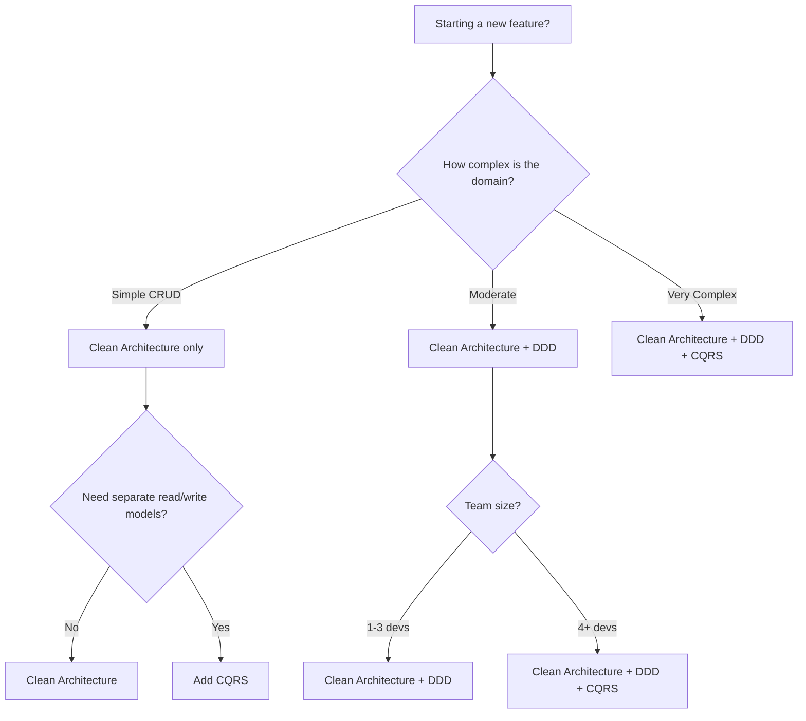

---
slug: a036-clean-architecture
sources:
  - https://blog.cleancoder.com/uncle-bob/2012/08/13/the-clean-architecture.html
  - https://blog.cleancoder.com/
date: 2026-11-02
tags:
  - clean-architecture
  - hexagonal-architecture
  - ports-adapters
  - onion-architecture
  - dependency-inversion
  - architecture
# Clean Architecture

## Overview

## concept_id
a036-clean-architecture

## title
Clean Architecture

## aliases
- A036-clean-architecture

## category
architecture

## concept_type
design-pattern

## research_status
verified

## project_adoption
recommended
Clean Architecture (also known as Hexagonal Architecture, Ports and Adapters, Onion Architecture) is an architectural style that keeps business rules independent of frameworks, databases, UIs, and external services. The overriding rule is **The Dependency Rule**: source code dependencies can only point inwards.

---

## 1. The Dependency Rule

## concept_id
a036-clean-architecture

## title
Clean Architecture

## aliases
- A036-clean-architecture

## category
architecture

## concept_type
design-pattern

## research_status
verified

## project_adoption
recommended
> Source code dependencies can only point inwards. Nothing in an inner circle can know anything at all about something in an outer circle.

```
┌─────────────────────────────────────────────────────────┐
│  Frameworks & Drivers (Outermost)                       │
│  • Databases, Web frameworks, UI, 3rd-party libs        │
│  • Details, not policies                                │
├─────────────────────────────────────────────────────────┤
│  Interface Adapters                                     │
│  • Controllers, Presenters, Gateways, Use Case Port     │
│  • Data conversion: outer ↔ inner                       │
├─────────────────────────────────────────────────────────┤
│  Use Cases (Application Business Rules)                 │
│  • Orchestrate flow of data to/from entities            │
│  • Application-specific business rules                  │
├─────────────────────────────────────────────────────────┤
│  Entities (Enterprise Business Rules) (Innermost)       │
│  • Most general, least likely to change                 │
│  • Encapsulate enterprise-wide business rules           │
└─────────────────────────────────────────────────────────┘
         â–²         â–²         â–²         â–²
         │         │         │         │
         └─────────┴─────────┴─────────┘
         Dependencies point INWARDS only
```

---

## 2. The Four Circles

## concept_id
a036-clean-architecture

## title
Clean Architecture

## aliases
- A036-clean-architecture

## category
architecture

## concept_type
design-pattern

## research_status
verified

## project_adoption
recommended
### Circle 1: Entities (Innermost)

**Encapsulate enterprise-wide business rules.**

```typescript
// entities/user.entity.ts
export class User {
  private constructor(
    readonly id: UserId,
    private _name: Name,
    private _email: Email,
    private _status: UserStatus
  ) {}

  static create(params: CreateUserParams): User {
    // Validation at creation
    if (params.name.length < 2) {
      throw new Error('Name must be at least 2 characters')
    }
    return new User(
      generateId(),
      new Name(params.name),
      new Email(params.email),
      UserStatus.ACTIVE
    )
  }

  // Business behavior
  deactivate(): void {
    this._status = UserStatus.INACTIVE
  }

  rename(newName: string): void {
    this._name = new Name(newName)
  }

  // Getters only (no direct mutation)
  get id() { return this.id }
  get name() { return this._name.value }
  get email() { return this._email.value }
  get status() { return this._status }
}

// entities/order.entity.ts
export class Order {
  private constructor(
    readonly id: OrderId,
    private _items: OrderItem[],
    private _status: OrderStatus,
    private _total: Money
  ) {}

  static create(params: CreateOrderParams): Order {
    if (params.items.length === 0) {
      throw new Error('Order must have at least one item')
    }
    const total = params.items.reduce(
      (sum, item) => sum.add(item.price.multiply(item.quantity)),
      Money.zero(params.currency)
    )
    return new Order(generateId(), params.items, OrderStatus.PENDING, total)
  }

  addItem(item: OrderItem): void {
    this._items.push(item)
    this._total = this._total.add(item.price.multiply(item.quantity))
  }

  cancel(): void {
    if (this._status !== OrderStatus.PENDING) {
      throw new Error('Only pending orders can be cancelled')
    }
    this._status = OrderStatus.CANCELLED
  }

  get items() { return [...this._items] }
  get status() { return this._status }
  get total() { return this._total }
}
```

### Circle 2: Use Cases (Application Business Rules)

**Encapsulate application-specific business rules. Orchestrate flow of data to/from entities.**

```typescript
// usecases/create-user.usecase.ts
import { User } from '../entities/user.entity'
import { UserRepository } from '../ports/user-repository.port'
import { EmailService } from '../ports/email-service.port'

export class CreateUserUseCase {
  constructor(
    private userRepository: UserRepository,
    private emailService: EmailService
  ) {}

  async execute(params: CreateUserParams): Promise<User> {
    // 1. Validate input
    if (!params.name || !params.email) {
      throw new ValidationError('Name and email are required')
    }

    // 2. Check business rules
    const existing = await this.userRepository.findByEmail(params.email)
    if (existing) {
      throw new ConflictError('Email already registered')
    }

    // 3. Create entity
    const user = User.create(params)

    // 4. Persist
    await this.userRepository.save(user)

    // 5. Side effects (email notification)
    await this.emailService.sendWelcome(user.email)

    return user
  }
}

// usecases/place-order.usecase.ts
export class PlaceOrderUseCase {
  constructor(
    private orderRepository: OrderRepository,
    private inventoryService: InventoryPort,
    private paymentService: PaymentPort
  ) {}

  async execute(params: PlaceOrderParams): Promise<Order> {
    // 1. Validate items exist
    const items = await this.inventoryService.checkAvailability(params.items)

    // 2. Create order
    const order = Order.create({ items, currency: params.currency })

    // 3. Process payment
    const paymentResult = await this.paymentService.charge(order.total)

    // 4. Confirm order
    order.confirm()
    await this.orderRepository.save(order)

    return order
  }
}
```

### Circle 3: Interface Adapters

**Convert data from outer format to inner format. Controllers, Presenters, Gateways.**

```typescript
// adapters/controller/user-controller.ts
import { CreateUserUseCase } from '../../usecases/create-user.usecase'
import { HttpRequest, HttpResponse } from '../../ports/http.port'

export class UserController {
  constructor(private createUserUseCase: CreateUserUseCase) {}

  async handle(request: HttpRequest): Promise<HttpResponse> {
    try {
      const params = {
        name: request.body.name,
        email: request.body.email,
      }

      const user = await this.createUserUseCase.execute(params)

      return {
        status: 201,
        body: {
          id: user.id,
          name: user.name,
          email: user.email,
        },
      }
    } catch (error) {
      if (error instanceof ConflictError) {
        return { status: 409, body: { error: error.message } }
      }
      return { status: 400, body: { error: error.message } }
    }
  }
}

// adapters/gateway/database/user-repository.adapter.ts
import { UserRepository } from '../../../ports/user-repository.port'
import { User } from '../../../entities/user.entity'
import { DbClient } from './db-client.adapter'

export class UserRepositoryAdapter implements UserRepository {
  constructor(private db: DbClient) {}

  async save(user: User): Promise<void> {
    await this.db.collection('users').insertOne({
      id: user.id,
      name: user.name,
      email: user.email,
      status: user.status,
      createdAt: new Date(),
    })
  }

  async findById(id: string): Promise<User | null> {
    const doc = await this.db.collection('users').findOne({ id })
    if (!doc) return null
    return User.create({ name: doc.name, email: doc.email })
  }

  async findByEmail(email: string): Promise<User | null> {
    const doc = await this.db.collection('users').findOne({ email })
    if (!doc) return null
    return User.create({ name: doc.name, email: doc.email })
  }
}

// adapters/presenter/dashboard-presenter.ts
import { User } from '../../entities/user.entity'

export class DashboardPresenter {
  present(user: User): DashboardViewModel {
    return {
      greeting: `Welcome, ${user.name}!`,
      status: user.status,
      email: user.email,
    }
  }
}
```

### Circle 4: Frameworks & Drivers (Outermost)

**Details: databases, web frameworks, UI, external services.**

```typescript
// frameworks/web/express-server.ts
import express from 'express'
import { UserController } from '../../adapters/controller/user-controller'
import { CreateUserUseCase } from '../../usecases/create-user.usecase'
import { UserRepositoryAdapter } from '../../adapters/gateway/database/user-repository.adapter'
import { DbClient } from '../../adapters/gateway/database/db-client.adapter'
import { EmailServiceAdapter } from '../../adapters/gateway/email/email.adapter'

const app = express()
app.use(express.json())

// Wire dependencies (Dependency Injection)
const db = new DbClient()
const userRepository = new UserRepositoryAdapter(db)
const emailService = new EmailServiceAdapter()
const createUserUseCase = new CreateUserUseCase(userRepository, emailService)
const userController = new UserController(createUserUseCase)

app.post('/api/users', (req, res) => {
  userController.handle({ body: req.body })
    .then(response => res.status(response.status).json(response.body))
})

app.listen(3000)
```

---

## 3. Crossing Boundaries

## concept_id
a036-clean-architecture

## title
Clean Architecture

## aliases
- A036-clean-architecture

## category
architecture

## concept_type
design-pattern

## research_status
verified

## project_adoption
recommended
### How Control Flow vs Dependency Direction Work

```
┌──────────────────────────────────────────────────────┐
│  Flow of Control:                                    │
│  Controller → Use Case → Presenter                   │
│                                                      │
│  Source Code Dependencies (point INWARDS):           │
│  Controller depends on Use Case interface            │
│  Use Case depends on Entity interface                │
│  Use Case depends on Port interface                  │
│                                                      │
│  Result: Inner circles NEVER know about outer circles│
└──────────────────────────────────────────────────────┘
```

### Using Dependency Inversion

```typescript
// Use case defines the port (inner circle)
export interface EmailPort {
  send(to: string, subject: string, body: string): Promise<void>
}

// Use case depends on the port
class CreateUserUseCase {
  constructor(private emailPort: EmailPort) {}
  async execute(params: CreateUserParams) {
    await this.emailPort.send(params.email, 'Welcome', '...')
  }
}

// Outer circle implements the port
class EmailServiceAdapter implements EmailPort {
  async send(to: string, subject: string, body: string) {
    // Uses SendGrid, AWS SES, etc. (outer circle detail)
  }
}
```

---

## 4. What Data Crosses Boundaries

## concept_id
a036-clean-architecture

## title
Clean Architecture

## aliases
- A036-clean-architecture

## category
architecture

## concept_type
design-pattern

## research_status
verified

## project_adoption
recommended
**Always use simple data structures. Never pass Entities or Database rows inward.**

```typescript
// ✅ GOOD: Simple DTO
interface CreateUserDto {
  name: string
  email: string
}

// ✅ GOOD: Simple result
interface UserResponse {
  id: string
  name: string
  email: string
}

// ❌ BAD: Passing Entity inward
async function updateUser(user: User) { /* ... */ }

// ❌ BAD: Passing DB row inward
async function processRow(doc: DbDocument) { /* ... */ }
```

---

## 5. Benefits

## concept_id
a036-clean-architecture

## title
Clean Architecture

## aliases
- A036-clean-architecture

## category
architecture

## concept_type
design-pattern

## research_status
verified

## project_adoption
recommended
| Benefit | Description |
|---------|-------------|
| **Independent of Frameworks** | Frameworks are tools, not constraints |
| **Testable** | Business rules testable without UI, DB, web |
| **Independent of UI** | Replace web UI with console UI easily |
| **Independent of Database** | Swap SQL for NoSQL without changing rules |
| **Independent of External Agencies** | Business rules don't know about the outside world |

---

## 6. Architecture Comparison

## concept_id
a036-clean-architecture

## title
Clean Architecture

## aliases
- A036-clean-architecture

## category
architecture

## concept_type
design-pattern

## research_status
verified

## project_adoption
recommended
| Architecture | Core Idea | Best For |
|-------------|-----------|----------|
| **Clean Architecture** | Dependency rule, 4 circles | General purpose, testability |
| **Hexagonal (Ports/Adapters)** | Ports define interfaces, adapters implement | API-driven apps |
| **Onion Architecture** | Concentric layers, dependencies inward | Similar to Clean |
| **DDD** | Domain model centered | Complex business logic |
| **Vertical Slice** | Organize by feature/use case | Small teams, fast delivery |

> Clean, Hexagonal, Onion, DDD, and vertical slices can coexist. Microservices and CQRS introduce costs and should follow concrete requirements.

---

## Cross-References

## concept_id
a036-clean-architecture

## title
Clean Architecture

## aliases
- A036-clean-architecture

## category
architecture

## concept_type
design-pattern

## research_status
verified

## project_adoption
recommended
- [SOLID Principles](./solid-principles.md)
- [DDD Patterns](./Application Architecture/domain-driven-design.md)
- [Architecture Patterns](./architecture-patterns.md)
- [Atomic Design](./atomic-design.md)
- [Coding Practices](./Architecture/clean-architecture.md)

---

## Decision Tree: Clean Architecture vs DDD vs CQRS

## concept_id
a036-clean-architecture

## title
Clean Architecture

## aliases
- A036-clean-architecture

## category
architecture

## concept_type
design-pattern

## research_status
verified

## project_adoption
recommended


### When to Use Clean Architecture Only
- Simple CRUD operations
- Small team (1-3 developers)
- Domain has few business rules
- Fast delivery needed

### When to Add DDD
- Complex domain logic
- Multiple teams working on same codebase
- Need clear bounded contexts
- Domain experts available for modeling

### When to Add CQRS
- High read/write ratio imbalance
- Need separate scaling for reads vs writes
- Event sourcing required
- Complex query requirements

---

## Procedural Guidance: Implementing a Feature in Clean Architecture

## concept_id
a036-clean-architecture

## title
Clean Architecture

## aliases
- A036-clean-architecture

## category
architecture

## concept_type
design-pattern

## research_status
verified

## project_adoption
recommended
### Step 1: Define the Entity (Innermost Circle)

```typescript
// entities/order.entity.ts
export class Order {
  private constructor(
    private _id: OrderId,
    private _items: OrderItem[],
    private _status: OrderStatus
  ) {}

  static create(params: CreateOrderParams): Order {
    if (params.items.length === 0) {
      throw new Error('Order must have at least one item')
    }
    return new Order(generateId(), params.items, OrderStatus.PENDING)
  }

  addItem(item: OrderItem): void {
    this._items.push(item)
  }

  cancel(): void {
    this._status = OrderStatus.CANCELLED
  }
}
```

### Step 2: Define the Port (Use Case Layer)

```typescript
// ports/order-repository.port.ts
export interface OrderRepository {
  save(order: Order): Promise<void>
  findById(id: OrderId): Promise<Order | null>
  findAll(): Promise<Order[]>
}
```

### Step 3: Implement the Use Case

```typescript
// usecases/create-order.usecase.ts
export class CreateOrderUseCase {
  constructor(
    private orderRepository: OrderRepository,
    private inventoryPort: InventoryPort
  ) {}

  async execute(params: CreateOrderParams): Promise<Order> {
    // Validate inventory
    await this.inventoryPort.checkAvailability(params.items)

    // Create order
    const order = Order.create(params)

    // Save
    await this.orderRepository.save(order)

    return order
  }
}
```

### Step 4: Implement the Adapter (Outermost Circle)

```typescript
// adapters/controller/order-controller.ts
export class OrderController {
  constructor(private createOrderUseCase: CreateOrderUseCase) {}

  async handle(request: HttpRequest): Promise<HttpResponse> {
    const order = await this.createOrderUseCase.execute(request.body)
    return { status: 201, body: order }
  }
}
```

### Step 5: Wire Dependencies

```typescript
// main.ts
const db = new DbClient()
const orderRepository = new OrderRepositoryAdapter(db)
const orderController = new OrderController(
  new CreateOrderUseCase(orderRepository, new InventoryGateway())
)
```

---

## Copilot Instructions

## concept_id
a036-clean-architecture

## title
Clean Architecture

## aliases
- A036-clean-architecture

## category
architecture

## concept_type
design-pattern

## research_status
verified

## project_adoption
recommended
### When to Read This Note
- Creating a new feature or module
- Refactoring existing code to improve separation of concerns
- Code review: checking for architecture violations
- Setting up new project structure
- Adding a new database, API endpoint, or UI component

### What to Do With This Information
1. **When creating new code**: Place business logic in `entities/` and `usecases/`, keep frameworks in `adapters/` and `frameworks/`
2. **When reviewing code**: Check that dependencies point inward — inner circles should never import from outer circles
3. **When adding a new feature**: Create a port interface in the use case layer, implement the adapter in the outer layer
4. **When refactoring**: Move business logic inward, push framework dependencies outward

### Tools to Use
- **VS Code Extension**: Error Lens — for inline error display while refactoring
- **VS Code Extension**: GitLens — for understanding dependency history
- **npm Package**: `typescript` — for type-safe dependency injection
- **VS Code Setting**: `"editor.codeActionsOnSave": { "source.organizeImports": "explicit" }`
- **Terminal Command**: `pnpm tsc --noEmit` — verify no type errors after refactoring

### Agents to Invoke
- **Architecture Validation Agent**: Run when creating new modules to verify Clean Architecture compliance
- **Code Review Agent**: Run when reviewing PRs that touch architecture layers

### Integration with Other Notes
- Read [solid-principles](https://en.wikipedia.org/wiki/SOLID) for single responsibility within each layer
- Read [[Application Architecture/domain-driven-design]] for domain model patterns within entities
- Read [cqrs-pattern](https://learn.microsoft.com/azure/architecture/patterns/cqrs) for separating read/write models
- Read [dependency-injection](https://en.wikipedia.org/wiki/Dependency_injection) for wiring dependencies at the boundary

### Common Pitfalls
- Don't let entities know about databases (entities should be plain classes)
- Don't let use cases import from adapters (use port interfaces instead)
- Don't pass database rows into business logic (use DTOs)
- Don't put business logic in controllers (use use cases)
- Don't let outer layers depend on inner layers (violation of dependency rule)

### Quick Validation Checklist
- [ ] Can I test the entities without a database?
- [ ] Can I test the use cases without a web framework?
- [ ] Do inner layers import only from other inner layers?
- [ ] Are ports (interfaces) defined in inner layers?
- [ ] Are adapters (implementations) in outer layers?
- [ ] Is business logic in entities/use cases, not in controllers?


## See Also

## concept_id
a036-clean-architecture

## title
Clean Architecture

## aliases
- A036-clean-architecture

## category
architecture

## concept_type
design-pattern

## research_status
verified

## project_adoption
recommended- [[A001-abstract-factory-pattern]]
- [[Architecture/abstract-factory-pattern]]
- [[A003-accessibility-a11y]]
- [[A004-accessibility-by-design]]
- [[A005-active-record-pattern]]


