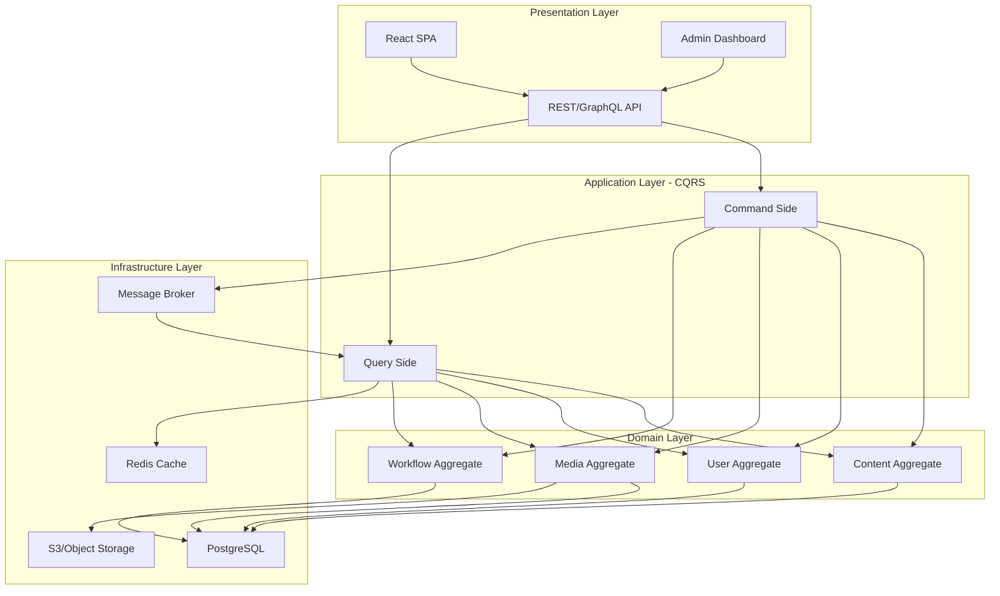
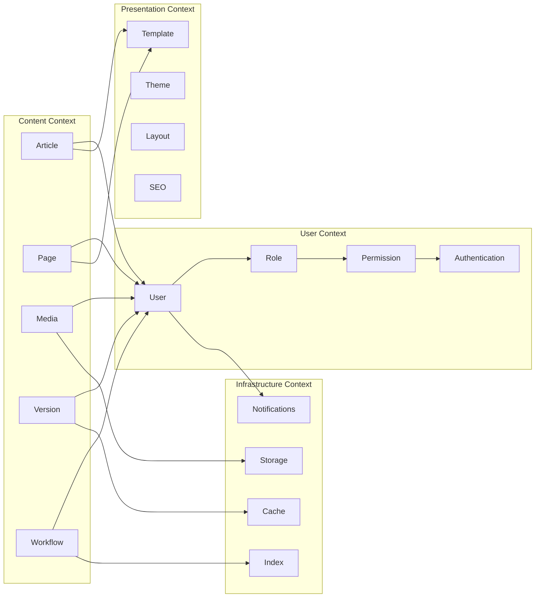
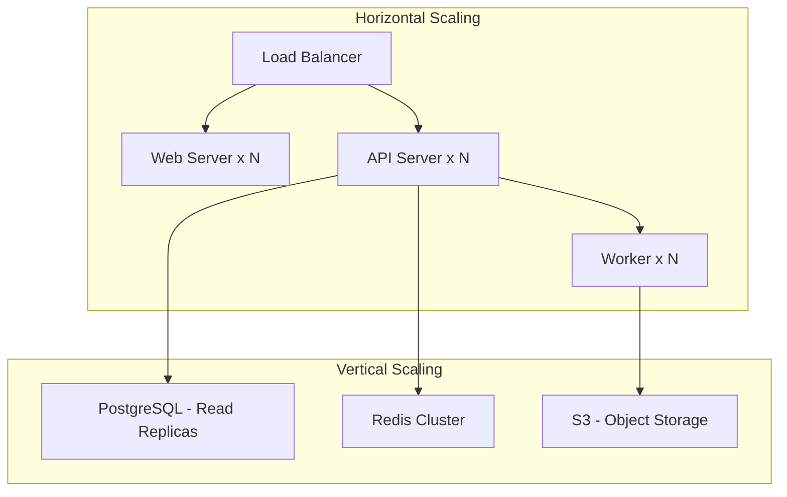
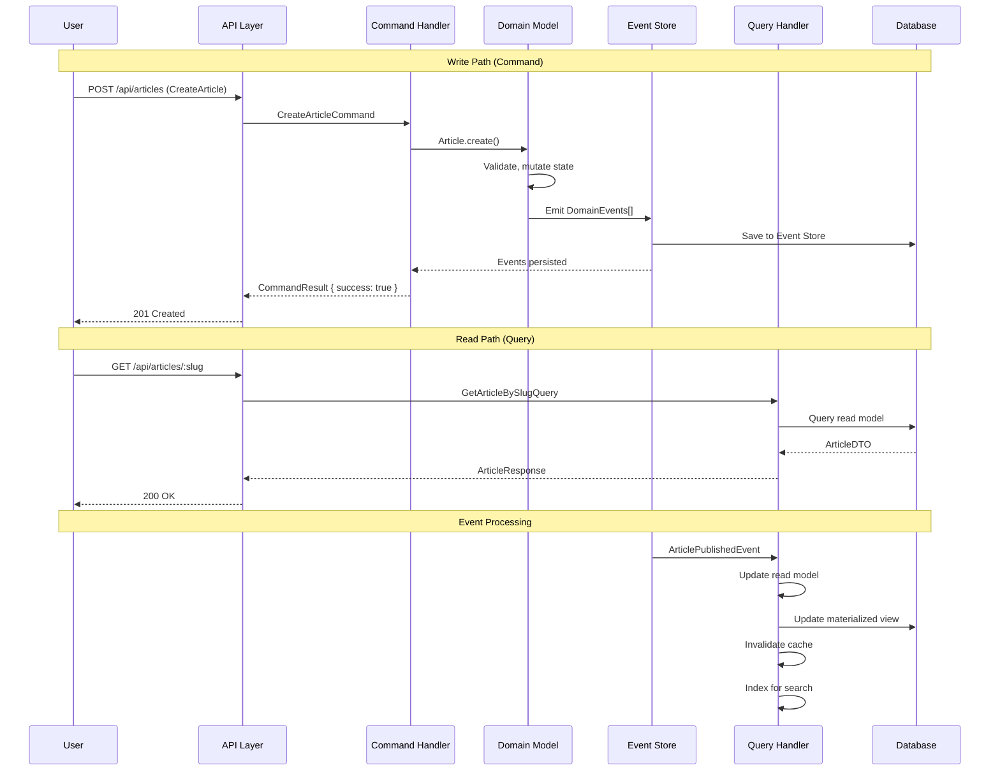
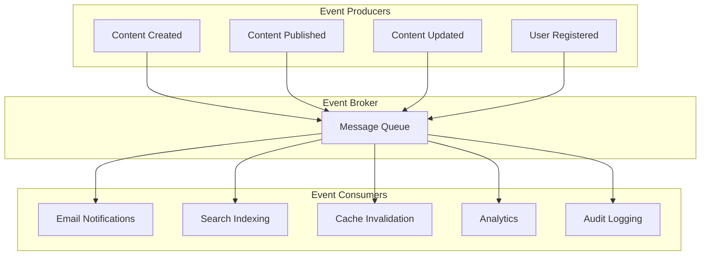
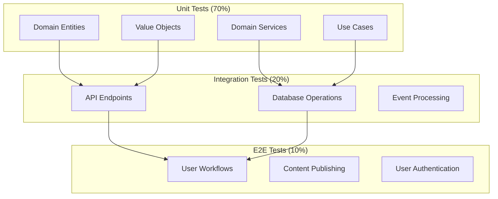
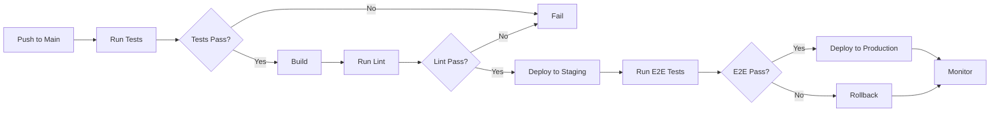
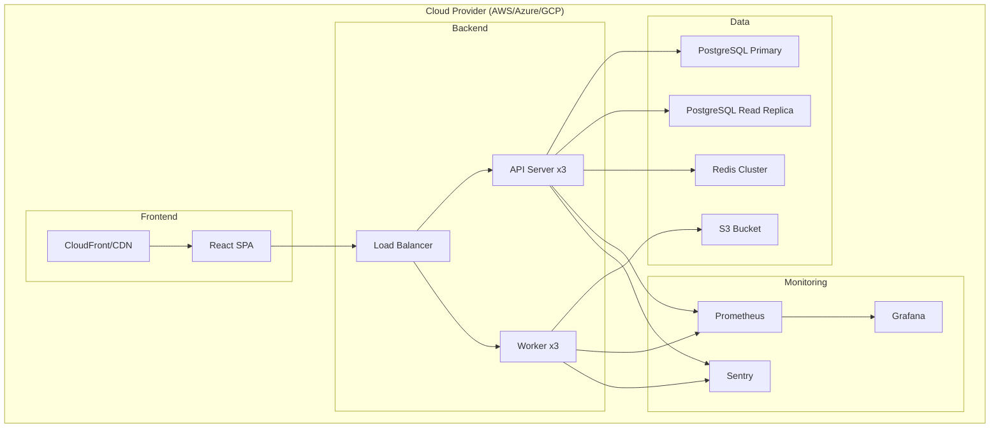

---
slug: A061-custom-cms-requirements
---

# Custom CMS — Requirements Specification

> **Date:** 2026-11-02
> **Scope:** Build a content management system from scratch — no off-the-shelf packages
> **Tech Stack:** React 19 + Vite + TypeScript + Tailwind CSS + pnpm
> **Architecture:** Clean Architecture + DDD + CQRS + Event-Driven

---

tags:
  - maturity/experimental
  - --
## 1. Executive Summary

This document defines the requirements for building a **custom content management system (CMS)** from the ground up. No WordPress, Drupal, Joomla, or similar off-the-shelf solutions. This is a greenfield project that will be architected using **Clean Architecture**, **Domain-Driven Design**, **CQRS**, and **Event-Driven Architecture** patterns.

### Why Build from Scratch?

| Reason | Explanation |
|--------|-------------|
| **Full control** | No legacy code, no forced abstractions, no upgrade paths |
| **Performance** | No bloat, only what you need |
| **Security** | No known vulnerabilities, no third-party dependencies to audit |
| **Custom workflows** | Model exactly your content processes, not generic ones |
| **Learning** | Deep understanding of every layer |

### Trade-off Analysis

| Factor | Custom CMS | Off-the-Shelf (WordPress, etc.) |
|--------|-----------|-------------------------------|
| **Time to MVP** | 6-12 months | 1-2 weeks |
| **Initial cost** | High ($100k-$500k+) | Low ($0-$5k) |
| **Long-term cost** | Lower (no licensing, no plugins) | Higher (plugins, hosting, security) |
| **Flexibility** | Unlimited | Constrained by platform |
| **Security** | You control the attack surface | You inherit all platform vulnerabilities |
| **Maintenance** | You own it | Community/vendor owned |
| **Scalability** | Architect to your needs | Platform limitations |

**Recommendation:** Build custom only if you have >100k monthly visitors, complex content workflows, or need deep customization. Otherwise, headless CMS (Strapi, Sanity) may be better.

---

tags:
  - maturity/experimental
  - --
## 2. Architectural Style

### Recommended: Modular Monolith with CQRS



### Why This Architecture?

| Pattern | Why for CMS | Trade-off |
|---------|-------------|-----------|
| **Clean Architecture** | Keeps business rules independent of React, DB, API | More files, more abstractions |
| **DDD** | Content is a complex domain with workflows, permissions, versions | Requires domain expertise, more modeling |
| **CQRS** | Reads (content display) vastly outnumber writes (content creation) | Two models to maintain, eventual consistency |
| **Event-Driven** | Content changes trigger notifications, indexing, caching | Complex debugging, eventual consistency |
| **Modular Monolith** | Start simple, scale modules independently later | Module boundaries must be well-defined |

### Consistency Model

| Operation | Consistency | Reason |
|-----------|-------------|--------|
| Content creation | **Strong** | Author needs immediate feedback |
| Content publishing | **Eventual** (50-500ms) | Eventual consistency acceptable for published content |
| User authentication | **Strong** | Security-critical |
| Search/indexing | **Eventual** (1-5s) | Search can lag behind content changes |
| Caching | **Eventual** (TTL-based) | Cache invalidation is asynchronous |

---

tags:
  - maturity/experimental
  - --
## 3. Core Domain Model (DDD)

### Bounded Contexts



### Key Aggregates

#### 1. Content Aggregate (Root: `ContentItem`)

```typescript
// entities/content-item.entity.ts
export class ContentItem {
  private constructor(
    readonly id: ContentId,
    private _title: Title,
    private _slug: Slug,
    private _status: ContentStatus,
    private _version: VersionNumber,
    private _author: UserId,
    private _publishedAt: DateTime | null,
    private _scheduledAt: DateTime | null,
    private _metadata: ContentMetadata
  ) {}

  static create(params: CreateContentParams): ContentItem {
    // Validation
    if (params.title.value.length < 3) {
      throw new Error('Title must be at least 3 characters')
    }
    
    return new ContentItem(
      generateId(),
      new Title(params.title.value),
      new Slug(params.title.value),
      ContentStatus.DRAFT,
      VersionNumber.first(),
      params.author,
      null,
      params.scheduledAt,
      new ContentMetadata()
    )
  }

  // Business behavior
  publish(): void {
    if (this._status !== ContentStatus.DRAFT && this._status !== ContentStatus.REVISION) {
      throw new Error('Only drafts can be published')
    }
    this._status = ContentStatus.PUBLISHED
    this._publishedAt = DateTime.now()
    this._version = this._version.next()
  }

  schedule(scheduledAt: DateTime): void {
    this._scheduledAt = scheduledAt
    this._status = ContentStatus.SCHEDULED
  }

  unpublish(): void {
    this._status = ContentStatus.DRAFT
    this._publishedAt = null
  }

  updateTitle(newTitle: string): void {
    this._title = new Title(newTitle)
    this._slug = new Slug(newTitle)
    this._version = this._version.next()
  }

  // Domain events
  toDomainEvents(): DomainEvent[] {
    const events: DomainEvent[] = []
    
    if (this._status === ContentStatus.PUBLISHED && 
        this._version.isFirst()) {
      events.push(new ContentPublishedEvent(
        this.id, this._title, this._slug, this._publishedAt!
      ))
    }
    
    if (this._version.isFirst() === false) {
      events.push(new ContentVersionCreatedEvent(
        this.id, this._version, this._title
      ))
    }
    
    return events
  }
}
```

#### 2. User Aggregate (Root: `User`)

```typescript
// entities/user.entity.ts
export class User {
  private constructor(
    readonly id: UserId,
    private _email: Email,
    private _passwordHash: PasswordHash,
    private _role: Role,
    private _isActive: boolean,
    private _lastLoginAt: DateTime | null
  ) {}

  static create(params: CreateUserParams): User {
    return new User(
      generateId(),
      new Email(params.email),
      new PasswordHash(params.passwordHash),
      Role.USER,
      true,
      null
    )
  }

  // Business behavior
  assignRole(role: Role): void {
    this._role = role
  }

  deactivate(): void {
    this._isActive = false
  }

  activate(): void {
    this._isActive = true
    this._lastLoginAt = DateTime.now()
  }

  hasPermission(permission: Permission): boolean {
    return this._role.permissions.includes(permission)
  }
}
```

#### 3. Workflow Aggregate (Root: `Workflow`)

```typescript
// entities/workflow.entity.ts
export class Workflow {
  private constructor(
    readonly id: WorkflowId,
    private _name: WorkflowName,
    private _stages: WorkflowStage[],
    private _currentStage: StageNumber,
    private _assignees: UserId[]
  ) {}

  static create(params: CreateWorkflowParams): Workflow {
    return new Workflow(
      generateId(),
      new WorkflowName(params.name),
      params.stages.map(s => new WorkflowStage(s)),
      0,
      params.assignees
    )
  }

  // Business behavior
  advanceStage(): void {
    if (this._currentStage >= this._stages.length - 1) {
      throw new Error('Already at final stage')
    }
    this._currentStage++
  }

  revertStage(): void {
    if (this._currentStage <= 0) {
      throw new Error('Already at first stage')
    }
    this._currentStage--
  }

  isApproved(): boolean {
    return this._currentStage === this._stages.length - 1
  }
}
```

---

tags:
  - maturity/experimental
  - --
## 4. Functional Requirements

### 4.1 Content Management

| ID | Requirement | Priority | CQRS Side |
|----|-------------|----------|-----------|
| FR-01 | Create content (draft) | P0 | Command |
| FR-02 | Edit content | P0 | Command |
| FR-03 | Delete content (soft delete) | P0 | Command |
| FR-04 | Publish content | P0 | Command |
| FR-05 | Unpublish content | P0 | Command |
| FR-06 | Schedule content for future publishing | P1 | Command |
| FR-07 | Version history (track all changes) | P1 | Command |
| FR-08 | Restore previous version | P1 | Command |
| FR-09 | Preview content before publishing | P1 | Query |
| FR-10 | Search content by title, slug, tags | P1 | Query |
| FR-11 | Filter content by status, author, date | P1 | Query |
| FR-12 | Bulk operations (publish, delete, tag) | P2 | Command |
| FR-13 | Content templates | P2 | Command |
| FR-14 | Custom fields (extensible schema) | P2 | Command |
| FR-15 | Content categories/tags | P2 | Command |
| FR-16 | Content relationships (related posts) | P2 | Command |
| FR-17 | Content comments | P3 | Command |
| FR-18 | Content ratings/reviews | P3 | Command |

### 4.2 User Management

| ID | Requirement | Priority | CQRS Side |
|----|-------------|----------|-----------|
| FR-20 | User registration | P0 | Command |
| FR-21 | User login (email/password) | P0 | Command |
| FR-22 | User logout | P0 | Command |
| FR-23 | Password reset | P0 | Command |
| FR-24 | Role-based access control (RBAC) | P0 | Command |
| FR-25 | Permission management | P1 | Command |
| FR-26 | User profile management | P1 | Command |
| FR-27 | Two-factor authentication (2FA) | P2 | Command |
| FR-28 | OAuth/Social login | P2 | Command |
| FR-29 | User activity audit log | P2 | Query |
| FR-30 | User search/filter | P2 | Query |

### 4.3 Media Management

| ID | Requirement | Priority | CQRS Side |
|----|-------------|----------|-----------|
| FR-40 | Upload images/videos/documents | P0 | Command |
| FR-41 | Image optimization (resize, compress) | P1 | Command |
| FR-42 | Media library (browse, search, filter) | P1 | Query |
| FR-43 | Media metadata (EXIF, dimensions) | P1 | Query |
| FR-44 | CDN integration | P2 | Query |
| FR-45 | Media versioning | P2 | Command |
| FR-46 | Alt text and SEO metadata | P2 | Command |
| FR-47 | Bulk media operations | P3 | Command |

### 4.4 Presentation Layer

| ID | Requirement | Priority | CQRS Side |
|----|-------------|----------|-----------|
| FR-60 | Template system (layouts, blocks) | P0 | Query |
| FR-61 | Theme customization | P1 | Command |
| FR-62 | SEO metadata (title, description, Open Graph) | P1 | Command |
| FR-63 | Sitemap generation | P1 | Query |
| FR-64 | RSS/Atom feeds | P2 | Query |
| FR-65 | Multi-language (i18n) | P2 | Query |
| FR-66 | URL routing (custom slugs) | P2 | Query |
| FR-67 | Page builder (drag-and-drop) | P3 | Command |
| FR-68 | A/B testing | P3 | Query |

### 4.5 Workflow & Approval

| ID | Requirement | Priority | CQRS Side |
|----|-------------|----------|-----------|
| FR-70 | Content approval workflow | P1 | Command |
| FR-71 | Multi-stage approval | P2 | Command |
| FR-72 | Assignment notifications | P2 | Command |
| FR-73 | Comment/feedback on content | P2 | Command |
| FR-74 | Workflow history | P2 | Query |
| FR-75 | Custom workflows per content type | P3 | Command |

### 4.6 API & Integrations

| ID | Requirement | Priority | CQRS Side |
|----|-------------|----------|-----------|
| FR-80 | REST API for content | P0 | Query/Command |
| FR-81 | GraphQL API (optional) | P2 | Query |
| FR-82 | Webhook notifications | P2 | Command |
| FR-83 | Third-party integrations (Slack, email) | P2 | Command |
| FR-84 | API rate limiting | P1 | Command |
| FR-85 | API versioning | P1 | Command |
| FR-86 | API documentation (OpenAPI/Swagger) | P1 | Query |
| FR-87 | OAuth 2.0 for API clients | P2 | Command |

### 4.7 Administration

| ID | Requirement | Priority | CQRS Side |
|----|-------------|----------|-----------|
| FR-90 | Admin dashboard | P0 | Query |
| FR-91 | Content analytics (views, engagement) | P1 | Query |
| FR-92 | System settings | P1 | Command |
| FR-93 | Backup/restore | P1 | Command |
| FR-94 | User management UI | P1 | Query/Command |
| FR-95 | Media library UI | P1 | Query/Command |
| FR-96 | Workflow management UI | P2 | Query/Command |
| FR-97 | Audit log | P2 | Query |
| FR-98 | System health monitoring | P2 | Query |
| FR-99 | Error logging and reporting | P2 | Query |

---

tags:
  - maturity/experimental
  - --
## 5. Non-Functional Requirements

### 5.1 Performance

| Metric | Target | Measurement |
|--------|--------|-------------|
| Page load time (cached) | < 100ms | Time to First Byte (TTFB) |
| Page load time (uncached) | < 500ms | Full page render |
| API response time (p95) | < 200ms | 95th percentile |
| API response time (p99) | < 500ms | 99th percentile |
| Search query time | < 100ms | Full-text search |
| Image upload time | < 2s (1MB) | Upload + optimize |
| Concurrent users | 10,000+ | Load testing |
| Content items | 1M+ | Database capacity |

### 5.2 Scalability



| Component | Scaling Strategy | Reason |
|-----------|-----------------|--------|
| **Web Server** | Horizontal (auto-scale) | Stateless, handle traffic spikes |
| **API Server** | Horizontal (auto-scale) | CQRS allows independent scaling |
| **Worker** | Horizontal (queue-based) | Async processing (indexing, notifications) |
| **PostgreSQL** | Vertical + Read Replicas | Write-heavy, strong consistency needed |
| **Redis** | Cluster mode | Cache invalidation, session storage |
| **S3** | Horizontal (managed) | Object storage scales automatically |

### 5.3 Security

| Requirement | Implementation | Standard |
|-------------|----------------|----------|
| **Authentication** | JWT + Refresh Tokens | OAuth 2.0 / OpenID Connect |
| **Authorization** | RBAC + ABAC | NIST Cybersecurity Framework |
| **Password Storage** | bcrypt (cost factor 12) | OWASP Password Storage |
| **HTTPS** | TLS 1.3 everywhere | OWASP Transport Layer Protection |
| **CORS** | Strict origin allowlist | OWASP CORS |
| **CSP** | Content Security Policy | OWASP CSP |
| **SQL Injection** | Parameterized queries (TypeORM) | OWASP SQL Injection |
| **XSS** | React auto-escaping + CSP | OWASP XSS |
| **CSRF** | SameSite cookies + tokens | OWASP CSRF |
| **Rate Limiting** | Token bucket algorithm | OWASP Rate Limiting |
| **Input Validation** | Zod schema validation | OWASP Input Validation |
| **Output Encoding** | Context-aware encoding | OWASP Output Encoding |
| **Secrets Management** | Environment variables + Vault | OWASP Secrets Management |
| **Audit Logging** | Immutable audit trail | OWASP Audit Logging |
| **Data Encryption** | AES-256 at rest, TLS in transit | NIST Encryption Guidelines |
| **2FA** | TOTP (Time-based One-Time Password) | NIST 2FA Guidelines |
| **Session Management** | Secure, HttpOnly, SameSite cookies | OWASP Session Management |
| **API Security** | OAuth 2.0 + JWT | OWASP API Security |
| **File Upload** | MIME validation + size limits + virus scan | OWASP File Upload |
| **Backup** | Daily encrypted backups + 30-day retention | NIST Backup Guidelines |

### 5.4 Availability & Reliability

| Metric | Target |
|--------|--------|
| **Uptime** | 99.9% (8.76 hours downtime/year) |
| **Recovery Time Objective (RTO)** | < 1 hour |
| **Recovery Point Objective (RPO)** | < 15 minutes |
| **Backup Frequency** | Daily (full) + hourly (incremental) |
| **Disaster Recovery** | Multi-region failover |
| **Monitoring** | 24/7 automated alerts |
| **Incident Response** | < 15 minutes acknowledgment |

### 5.5 Maintainability

| Metric | Target |
|--------|--------|
| **Code Coverage** | > 80% (unit), > 60% (integration) |
| **Technical Debt Ratio** | < 5% |
| **Cycle Time** | < 2 weeks (feature to production) |
| **Deployment Frequency** | Daily (canary) |
| **Change Failure Rate** | < 5% |
| **Mean Time to Recovery** | < 30 minutes |

---

tags:
  - maturity/experimental
  - --
## 6. Technical Architecture

### 6.1 Clean Architecture Layers

```mermaid
graph TB
    subgraph "Presentation Layer"
        A[React SPA]
        B[Admin Dashboard]
        C[REST/GraphQL API]
    end
    
    subgraph "Application Layer"
        D[Use Cases]
        E[DTOs]
        F[Ports/Interfaces]
    end
    
    subgraph "Domain Layer"
        G[Entities]
        H[Value Objects]
        I[Domain Events]
        J[Domain Services]
        K[Repositories (interfaces)]
    end
    
    subgraph "Infrastructure Layer"
        L[PostgreSQL]
        M[Redis]
        N[S3]
        O[Message Broker]
        P[Email Service]
        Q[Search Engine]
    end
    
    A --> C
    B --> C
    C --> D
    D --> E
    D --> F
    F --> G
    F --> H
    F --> I
    F --> J
    F --> K
    K --> L
    K --> M
    K --> N
    D --> O
    O --> P
    O --> Q
```

### 6.2 CQRS Implementation



### 6.3 Event-Driven Architecture



### 6.4 Database Schema (PostgreSQL)

```sql
-- Core tables (write model)
CREATE TABLE content_items (
    id UUID PRIMARY KEY,
    title VARCHAR(500) NOT NULL,
    slug VARCHAR(500) NOT NULL UNIQUE,
    status VARCHAR(50) NOT NULL DEFAULT 'draft',
    version INTEGER NOT NULL DEFAULT 1,
    author_id UUID NOT NULL,
    published_at TIMESTAMP,
    scheduled_at TIMESTAMP,
    metadata JSONB DEFAULT '{}',
    created_at TIMESTAMP DEFAULT NOW(),
    updated_at TIMESTAMP DEFAULT NOW()
);

CREATE TABLE content_versions (
    id UUID PRIMARY KEY,
    content_id UUID REFERENCES content_items(id) ON DELETE CASCADE,
    version INTEGER NOT NULL,
    title VARCHAR(500) NOT NULL,
    content TEXT,
    metadata JSONB DEFAULT '{}',
    created_at TIMESTAMP DEFAULT NOW()
);

CREATE TABLE users (
    id UUID PRIMARY KEY,
    email VARCHAR(255) NOT NULL UNIQUE,
    password_hash VARCHAR(255) NOT NULL,
    role VARCHAR(50) NOT NULL DEFAULT 'user',
    is_active BOOLEAN DEFAULT true,
    last_login_at TIMESTAMP,
    created_at TIMESTAMP DEFAULT NOW()
);

CREATE TABLE roles (
    id UUID PRIMARY KEY,
    name VARCHAR(50) NOT NULL UNIQUE,
    permissions JSONB NOT NULL DEFAULT '[]'
);

CREATE TABLE media (
    id UUID PRIMARY KEY,
    filename VARCHAR(500) NOT NULL,
    mime_type VARCHAR(100) NOT NULL,
    size INTEGER NOT NULL,
    url VARCHAR(1000) NOT NULL,
    alt_text VARCHAR(500),
    metadata JSONB DEFAULT '{}',
    uploaded_by UUID REFERENCES users(id),
    created_at TIMESTAMP DEFAULT NOW()
);

-- Read model tables (materialized views)
CREATE TABLE articles_index (
    id UUID PRIMARY KEY,
    title VARCHAR(500) NOT NULL,
    slug VARCHAR(500) NOT NULL,
    status VARCHAR(50) NOT NULL,
    author_name VARCHAR(255),
    tags TEXT[],
    search_vector tsvector,
    updated_at TIMESTAMP DEFAULT NOW()
);

CREATE TABLE content_cache (
    key VARCHAR(500) PRIMARY KEY,
    value JSONB NOT NULL,
    ttl INTEGER NOT NULL,
    created_at TIMESTAMP DEFAULT NOW()
);
```

---

tags:
  - maturity/experimental
  - --
## 7. API Design

### 7.1 REST API Endpoints

```
Content
  POST   /api/v1/articles              Create article
  GET    /api/v1/articles              List articles (paginated)
  GET    /api/v1/articles/:slug        Get article by slug
  PUT    /api/v1/articles/:slug        Update article
  DELETE /api/v1/articles/:slug        Delete article (soft)
  POST   /api/v1/articles/:slug/publish Publish article
  POST   /api/v1/articles/:slug/unpublish Unpublish article
  GET    /api/v1/articles/:slug/versions List versions
  GET    /api/v1/articles/:slug/versions/:version Get version
  POST   /api/v1/articles/:slug/versions/:version/restore Restore version

Users
  POST   /api/v1/auth/register         Register user
  POST   /api/v1/auth/login            Login user
  POST   /api/v1/auth/logout           Logout user
  POST   /api/v1/auth/password/reset   Request password reset
  POST   /api/v1/auth/password/confirm Confirm password reset
  GET    /api/v1/users/:id             Get user
  PUT    /api/v1/users/:id             Update user
  GET    /api/v1/users                 List users (admin)

Media
  POST   /api/v1/media                 Upload media
  GET    /api/v1/media                 List media
  GET    /api/v1/media/:id             Get media
  DELETE /api/v1/media/:id             Delete media
  PUT    /api/v1/media/:id             Update media metadata

Search
  GET    /api/v1/search                Full-text search
  GET    /api/v1/search/suggestions    Autocomplete suggestions

Admin
  GET    /api/v1/admin/analytics       Site analytics
  GET    /api/v1/admin/settings        System settings
  PUT    /api/v1/admin/settings        Update settings
  GET    /api/v1/admin/audit-log       Audit log
  GET    /api/v1/admin/health          Health check
```

### 7.2 Request/Response Examples

```typescript
// Request: Create Article
interface CreateArticleRequest {
  title: string
  content: string
  tags?: string[]
  category?: string
  scheduledAt?: string  // ISO 8601
  metadata?: Record<string, unknown>
}

// Response: Article Created
interface ArticleResponse {
  id: string
  title: string
  slug: string
  status: 'draft' | 'scheduled' | 'published' | 'unpublished'
  version: number
  author: {
    id: string
    name: string
  }
  publishedAt: string | null
  scheduledAt: string | null
  tags: string[]
  metadata: Record<string, unknown>
  createdAt: string
  updatedAt: string
}

// Request: Search
interface SearchRequest {
  query: string
  type?: 'article' | 'page' | 'media'
  status?: 'published' | 'draft'
  tags?: string[]
  page?: number
  pageSize?: number
  sortBy?: 'created_at' | 'updated_at' | 'title'
  sortOrder?: 'asc' | 'desc'
}

// Response: Search Results
interface SearchResponse {
  results: SearchResult[]
  total: number
  page: number
  pageSize: number
  totalPages: number
}
```

---

tags:
  - maturity/experimental
  - --
## 8. Frontend Architecture (React 19)

### 8.1 Admin Dashboard Structure

```
src/
├── components/
│   ├── ui/                    # shadcn/ui components
│   ├── layout/                # Layout components
│   │   ├── Sidebar.tsx
│   │   ├── Header.tsx
│   │   └── MainLayout.tsx
│   ├── content/               # Content management
│   │   ├── ArticleEditor.tsx
│   │   ├── MediaLibrary.tsx
│   │   ├── VersionHistory.tsx
│   │   └── WorkflowSteps.tsx
│   ├── users/                 # User management
│   │   ├── UserList.tsx
│   │   ├── UserForm.tsx
│   │   └── RoleManager.tsx
│   └── common/                # Shared components
│       ├── DataTable.tsx
│       ├── SearchInput.tsx
│       └── FileUpload.tsx
├── hooks/
│   ├── useAuth.ts             # Authentication
│   ├── useContent.ts          # Content operations
│   ├── useMedia.ts            # Media operations
│   ├── useSearch.ts           # Search
│   └── useWorkflow.ts         # Workflow
├── services/
│   ├── api.ts                 # API client
│   ├── auth.ts                # Auth service
│   ├── content.ts             # Content service
│   └── media.ts               # Media service
├── types/
│   ├── content.ts             # Content types
│   ├── user.ts                # User types
│   └── api.ts                 # API types
├── utils/
│   ├── validators.ts          # Zod schemas
│   ├── formatters.ts          # Date, currency, etc.
│   └── constants.ts           # App constants
└── pages/
    ├── Dashboard.tsx
    ├── Articles.tsx
    ├── ArticleEdit.tsx
    ├── Media.tsx
    ├── Users.tsx
    ├── Settings.tsx
    └── Login.tsx
```

### 8.2 State Management

```typescript
// Use React 19 Server Components + React Query for data fetching
// Local state for UI (forms, modals, tabs)
// Server state for API data (React Query)

import { useQuery, useMutation, useQueryClient } from '@tanstack/react-query'
import { api } from '@/services/api'

// Query: Get articles
function useArticles(params: ArticleQueryParams) {
  return useQuery({
    queryKey: ['articles', params],
    queryFn: () => api.get('/articles', { params }),
    staleTime: 1000 * 60 * 5,  // 5 minutes
  })
}

// Mutation: Create article
function useCreateArticle() {
  const queryClient = useQueryClient()
  
  return useMutation({
    mutationFn: (data: CreateArticleInput) => 
      api.post('/articles', data),
    onSuccess: () => {
      queryClient.invalidateQueries({ queryKey: ['articles'] })
    },
  })
}
```

---

tags:
  - maturity/experimental
  - --
## 9. Testing Strategy

### 9.1 Test Pyramid



### 9.2 Testing Tools

| Layer | Tool | Purpose |
|-------|------|---------|
| **Unit** | Vitest | Fast unit testing |
| **Integration** | Vitest + Supertest | API testing |
| **E2E** | Playwright | Browser automation |
| **Mocking** | Vitest mocks | API, database mocks |
| **Coverage** | Vitest coverage | Code coverage reporting |
| **Visual** | Playwright screenshots | Visual regression |

### 9.3 Test Examples

```typescript
// Unit Test: ContentItem.publish()
import { describe, it, expect } from 'vitest'
import { ContentItem } from '@/entities/content-item'

describe('ContentItem', () => {
  it('should publish a draft article', () => {
    const article = ContentItem.create({
      title: 'Test Article',
      content: 'Test content',
      author: 'user-123',
    })
    
    expect(article.status).toBe('draft')
    expect(article.publishedAt).toBeNull()
    
    article.publish()
    
    expect(article.status).toBe('published')
    expect(article.publishedAt).not.toBeNull()
    expect(article.version).toBe(2)
  })
  
  it('should not publish an already published article', () => {
    const article = ContentItem.create({
      title: 'Test Article',
      content: 'Test content',
      author: 'user-123',
    })
    
    article.publish()
    
    expect(() => article.publish()).toThrow(
      'Only drafts can be published'
    )
  })
})

// Integration Test: Create Article API
import { describe, it, expect, beforeAll, afterAll } from 'vitest'
import { request } from 'supertest'
import { app } from '@/app'
import { db } from '@/infrastructure/database'

describe('POST /api/v1/articles', () => {
  beforeAll(async () => {
    await db.migrate()
  })
  
  afterAll(async () => {
    await db.destroy()
  })
  
  it('should create a new article', async () => {
    const response = await request(app)
      .post('/api/v1/articles')
      .set('Authorization', 'Bearer test-token')
      .send({
        title: 'Test Article',
        content: 'Test content',
      })
    
    expect(response.status).toBe(201)
    expect(response.body).toMatchObject({
      title: 'Test Article',
      slug: 'test-article',
      status: 'draft',
    })
  })
})
```

---

tags:
  - maturity/experimental
  - --
## 10. Deployment & DevOps

### 10.1 CI/CD Pipeline



### 10.2 Infrastructure



### 10.3 Environment Strategy

| Environment | Purpose | Auto-Deploy? | Data |
|-------------|---------|--------------|------|
| **Development** | Local development | Manual | Local DB |
| **Staging** | Pre-production testing | On merge to `main` | Anonymized prod data |
| **Production** | Live site | Manual approval | Real data |

---

tags:
  - maturity/experimental
  - --
## 11. Project Structure

```
cms/
├── apps/
│   ├── web/                    # React SPA (Vite)
│   │   ├── src/
│   │   ├── public/
│   │   ├── vite.config.ts
│   │   └── tsconfig.json
│   └── admin/                  # Admin Dashboard (Vite)
│       ├── src/
│       ├── public/
│       ├── vite.config.ts
│       └── tsconfig.json
├── packages/
│   ├── domain/                 # Domain layer (shared)
│   │   ├── src/
│   │   │   ├── entities/
│   │   │   ├── value-objects/
│   │   │   ├── domain-events/
│   │   │   ├── domain-services/
│   │   │   └── index.ts
│   │   └── package.json
│   ├── application/            # Application layer (shared)
│   │   ├── src/
│   │   │   ├── use-cases/
│   │   │   ├── dtos/
│   │   │   ├── ports/
│   │   │   └── index.ts
│   │   └── package.json
│   ├── infrastructure/         # Infrastructure layer (shared)
│   │   ├── src/
│   │   │   ├── database/
│   │   │   ├── cache/
│   │   │   ├── storage/
│   │   │   ├── messaging/
│   │   │   └── index.ts
│   │   └── package.json
│   └── shared/                 # Shared utilities
│       ├── src/
│       │   ├── types/
│       │   ├── utils/
│       │   ├── validators/
│       │   └── index.ts
│       └── package.json
├── docker-compose.yml
├── pnpm-workspace.yaml
├── tsconfig.json
└── package.json
```

---

tags:
  - maturity/experimental
  - --
## 12. Development Phases

### Phase 1: Foundation (Weeks 1-4)
- [ ] Project setup (monorepo, TypeScript, pnpm)
- [ ] Domain model (Content, User, Media aggregates)
- [ ] Database schema (PostgreSQL)
- [ ] API skeleton (REST endpoints)
- [ ] Authentication (JWT, RBAC)
- [ ] Basic admin UI (login, dashboard)

### Phase 2: Core Content (Weeks 5-8)
- [ ] Content CRUD operations
- [ ] Version history
- [ ] Media upload and management
- [ ] Basic publishing workflow
- [ ] Search functionality
- [ ] Admin dashboard (content management)

### Phase 3: Advanced Features (Weeks 9-12)
- [ ] CQRS implementation (separate read/write models)
- [ ] Event-driven architecture (notifications, indexing)
- [ ] Workflow/approval system
- [ ] SEO metadata and sitemap
- [ ] API documentation (OpenAPI)
- [ ] Performance optimization (caching, CDN)

### Phase 4: Polish & Production (Weeks 13-16)
- [ ] E2E tests (Playwright)
- [ ] Load testing
- [ ] Security audit
- [ ] Monitoring and alerting
- [ ] Deployment pipeline (CI/CD)
- [ ] Documentation
- [ ] Beta testing

### Phase 5: Launch & Iterate (Weeks 17+)
- [ ] Production deployment
- [ ] Monitoring and observability
- [ ] User feedback collection
- [ ] Performance tuning
- [ ] Feature enhancements

---

tags:
  - maturity/experimental
  - --
## 13. Risk Assessment

| Risk | Impact | Likelihood | Mitigation |
|------|--------|------------|------------|
| **Scope creep** | High | High | Strict MVP definition, change control |
| **Underestimating complexity** | High | High | Start simple, iterate, avoid over-engineering |
| **Security vulnerabilities** | Critical | Medium | Security audit, OWASP checklist, penetration testing |
| **Performance issues** | High | Medium | Load testing, caching strategy, CDN |
| **Team skill gaps** | Medium | Medium | Training, pair programming, documentation |
| **Data loss** | Critical | Low | Backups, disaster recovery plan, testing |
| **Timeline overrun** | High | High | Agile sprints, regular reviews, buffer time |
| **Technology debt** | Medium | High | Code reviews, refactoring sprints, linting |

---

tags:
  - maturity/experimental
  - --
## 14. Success Criteria

### MVP (Minimum Viable Product)
- [ ] Create, edit, publish, delete content
- [ ] User authentication and authorization
- [ ] Media upload and management
- [ ] Basic admin dashboard
- [ ] REST API
- [ ] Responsive admin UI

### V1 (Production Ready)
- [ ] Version history and restore
- [ ] Search and filtering
- [ ] Workflow/approval system
- [ ] SEO metadata
- [ ] API documentation
- [ ] Monitoring and logging
- [ ] E2E tests
- [ ] CI/CD pipeline

### V2 (Advanced)
- [ ] CQRS for performance
- [ ] Event-driven architecture
- [ ] GraphQL API
- [ ] Multi-language support
- [ ] Advanced analytics
- [ ] Webhooks and integrations
- [ ] Custom fields/schema

---

tags:
  - maturity/experimental
  - --
## 15. References & Sources

### Architectural Patterns
- [[Sources/martin-clean-architecture-2017|Clean Architecture]] — Robert C. Martin
- [[Sources/martin-fowler-patterns|Enterprise Integration Patterns]] — Martin Fowler
- [[Sources/evans-ddd-2003|Domain-Driven Design]] — Eric Evans
- [[Sources/goF-1994|Design Patterns]] — GoF

### Technical Documentation
- [[Sources/react-docs-2026|React 19 Documentation]] — React Team
- [[Sources/microsoft-typescript-handbook|TypeScript Handbook]] — Microsoft
- [[Sources/tailwind-docs-2024|Tailwind CSS Documentation]] — Tailwind Labs
- [[Sources/pnpm-docs-2024|pnpm Documentation]] — pnpm
- [[Sources/vitest-docs-2024|Vitest Documentation]] — Vitest
- [[Sources/playwright-docs-2024|Playwright Documentation]] — Microsoft

### Security
- [[Sources/owasp-top-ten-2021|OWASP Top 10]] — OWASP
- [[Sources/nist-cyberframework-2014|NIST Cybersecurity Framework]] — NIST

### Architecture Patterns
- [[Sources/martin-fowler-patterns|CQRS]] — Martin Fowler
- [[Sources/microsoft-distributed-systems|Event-Driven Architecture]] — Microsoft Azure
- [[Sources/martin-fowler-patterns|Repository Pattern]] — Martin Fowler
- [[Sources/martin-fowler-patterns|Service Layer Pattern]] — Martin Fowler


## See Also
- [[A001-abstract-factory-pattern]]
- [[Architecture/abstract-factory-pattern]]
- [[A003-accessibility-a11y]]
- [[A004-accessibility-by-design]]
- [[A005-active-record-pattern]]


