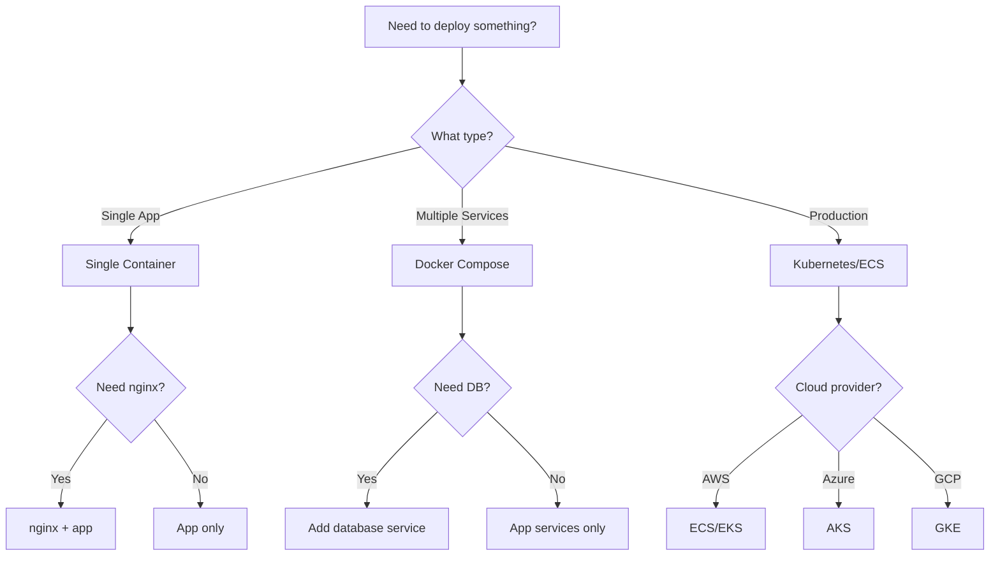

# Docker Deployment

## Definition

Docker Deployment is a **practice of packaging software into containers for consistent deployment across environments**.

> "Docker is a set of platform as a service products that use OS-level virtualization to deliver software in packages called containers." — Wikipedia

## Problem Addressed

Without Docker:
- **Inconsistency**: Software works differently in different environments
- **Deployment difficulty**: Hard to deploy consistently
- **Resource usage**: Hard to manage resources
- **Scalability**: Hard to scale

## Scope and Boundaries

- Docker ≠ Kubernetes (Docker is for containers, Kubernetes is for orchestration)
- Docker ≠ Virtual Machines (Docker is for containers, VMs are for virtualization)
- Docker is a **containerization practice**, not an orchestration practice

## When to Apply

- When building software
- When deployment matters
- When consistency is important
- When scalability is important

## Tradeoffs and When to Avoid

| Cost | Description |
|------|-------------|
| **Complexity** — Docker is complex |
| **Time** — Docker takes time |
| **Over-containerization** — Don't containerize everything |

## Common Misuses

- **Everything containerized**: Not everything needs Docker
- **Confusing with Kubernetes**: Docker ≠ Kubernetes
- **Over-containerization**: Too much containerization creates complexity

## Related Concepts

- [CI/CD](Architecture/cicd-github-actions.md) — Docker with CI/CD
- [Nginx](Architecture/nginx.md) — Docker with Nginx
- [Deployment](Architecture/deployment.md) — Docker with deployment

## Project Observations

- The project uses Docker:
  - The project's Docker deployment note covers Docker (from existing notes)
  - No evidence of Docker in existing code (src/ is empty)
- File naming conventions support Docker:
  - `*.test.ts` — Test files
  - `*.spec.ts` — Spec files

## Sources

- [[Sources/martin-fowler-patterns|martin-fowler-patterns]]

---

## Decision Tree: Docker Deployment



### When to Use Each Deployment Strategy

| Strategy | When to Use | Example |
|----------|-------------|---------|
| **Single Container** | Simple apps | Node.js, Python |
| **Docker Compose** | Local development | App + DB + Redis |
| **Kubernetes** | Production microservices | Multi-service app |
| **ECS/EKS** | Cloud production | AWS/Azure/GCP |
| **Serverless** | Event-driven apps | Lambda, Cloud Functions |

---

## Procedural Guidance: Docker Setup

### Step 1: Create Dockerfile

```dockerfile
# Dockerfile
FROM node:20-alpine AS builder

WORKDIR /app

# Install dependencies
COPY package*.json ./
RUN npm ci --only=production

# Copy source
COPY . .

# Build
RUN npm run build

# Production stage
FROM node:20-alpine

WORKDIR /app

# Copy dependencies and built files
COPY --from=builder /app/package*.json ./
COPY --from=builder /app/dist ./dist
COPY --from=builder /app/node_modules ./node_modules

# Run as non-root user
RUN addgroup -S appgroup && adduser -S appuser -G appgroup
USER appuser

EXPOSE 3000

CMD ["node", "dist/main.js"]
```

### Step 2: Create docker-compose.yml

```yaml
# docker-compose.yml
version: '3.8'

services:
  app:
    build: .
    ports:
      - "3000:3000"
    environment:
      - NODE_ENV=development
      - DATABASE_URL=postgresql://user:password@db:5432/mydb
    depends_on:
      - db
      - redis

  db:
    image: postgres:15-alpine
    environment:
      - POSTGRES_USER=user
      - POSTGRES_PASSWORD=password
      - POSTGRES_DB=mydb
    volumes:
      - postgres_data:/var/lib/postgresql/data

  redis:
    image: redis:7-alpine

volumes:
  postgres_data:
```

### Step 3: Create .dockerignore

```gitignore
# .dockerignore
node_modules
npm-debug.log
.git
.gitignore
README.md
.dockerignore
Dockerfile
docker-compose.yml
.env
.env.*
dist
```

### Step 4: Build and Run

```bash
# Build Docker image
docker build -t myapp .

# Run with docker-compose
docker-compose up

# Run in detached mode
docker-compose up -d

# View logs
docker-compose logs -f

# Stop services
docker-compose down

# Remove volumes
docker-compose down -v
```

### Step 5: Production Deployment

```dockerfile
# Dockerfile.production
FROM node:20-alpine

WORKDIR /app

# Install only production dependencies
COPY package*.json ./
RUN npm ci --only=production

# Copy built files
COPY --from=builder /app/dist ./dist

# Run as non-root user
RUN addgroup -S appgroup && adduser -S appuser -G appgroup
USER appuser

EXPOSE 3000

# Health check
HEALTHCHECK --interval=30s --timeout=3s --start-period=5s --retries=3 \
  CMD curl -f http://localhost:3000/health || exit 1

CMD ["node", "dist/main.js"]
```

```yaml
# docker-compose.production.yml
version: '3.8'

services:
  app:
    build: .
    ports:
      - "3000:3000"
    environment:
      - NODE_ENV=production
      - DATABASE_URL=${DATABASE_URL}
    restart: unless-stopped
    healthcheck:
      test: ["CMD", "curl", "-f", "http://localhost:3000/health"]
      interval: 30s
      timeout: 10s
      retries: 3

  nginx:
    image: nginx:alpine
    ports:
      - "80:80"
      - "443:443"
    volumes:
      - ./nginx.conf:/etc/nginx/nginx.conf
    depends_on:
      - app
```

---

## Copilot Instructions

### When to Read This Note
- Setting up Docker for local development
- Creating Dockerfiles for production
- Using Docker Compose for multi-service apps
- Deploying to cloud providers
- Optimizing Docker images

### What to Do With This Information
1. **Use multi-stage builds**: Reduce image size with multi-stage Dockerfiles
2. **Run as non-root**: Always run containers as non-root users
3. **Use .dockerignore**: Exclude unnecessary files from build context
4. **Add health checks**: Implement health checks for production
5. **Use environment variables**: Never hardcode secrets in Dockerfiles

### Tools to Use
- **VS Code Extension**: Docker — for Docker management
- **VS Code Extension**: Error Lens — for inline Docker error display
- **npm Package**: `docker-compose` — for multi-container apps
- **Terminal Command**: `docker build -t myapp .` — build Docker image
- **Terminal Command**: `docker-compose up` — start services
- **Terminal Command**: `docker-compose down` — stop services

### Agents to Invoke
- **Security Review Agent**: Run when creating production Dockerfiles
- **Performance Review Agent**: Run when optimizing Docker images

### Integration with Other Notes
- Read [ci-cd-patterns](D/ci-cd-patterns.md) for CI/CD deployment patterns
- read [nginx-patterns](D/nginx-patterns.md) for nginx configuration
- Read [deployment-patterns](D/deployment-patterns.md) for deployment strategies
- Read [monitoring-patterns](D/monitoring-patterns.md) for monitoring Docker containers

### Common Pitfalls
- Don't hardcode secrets in Dockerfiles (use environment variables)
- Don't run as root (always create non-root user)
- Don't ignore .dockerignore (exclude node_modules, .git)
- Don't forget health checks in production
- Don't use latest tag (use specific versions)

### Quick Validation Checklist
- [ ] Is multi-stage build used?
- [ ] Does container run as non-root user?
- [ ] Is .dockerignore configured?
- [ ] Are health checks implemented?
- [ ] Are secrets in environment variables?
- [ ] Is the image size optimized?


