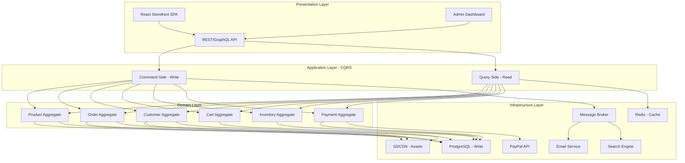
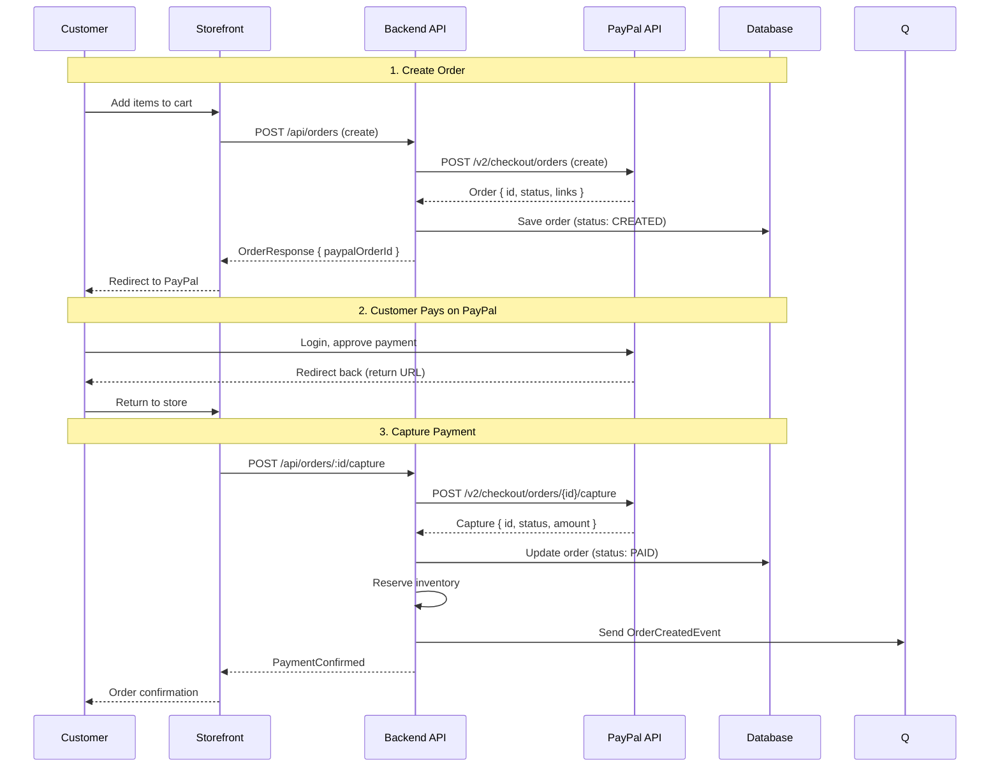
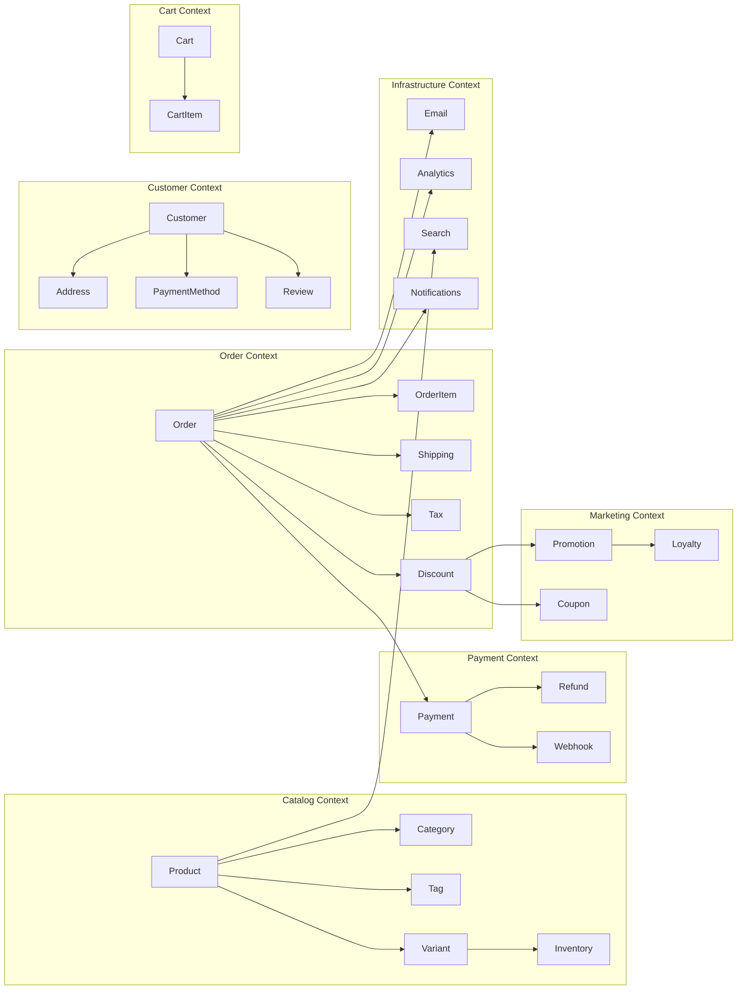
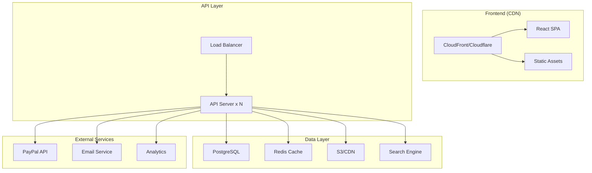
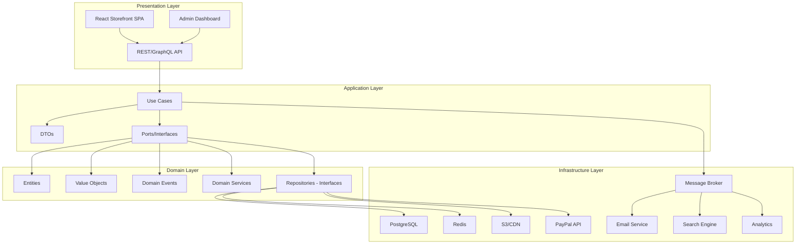
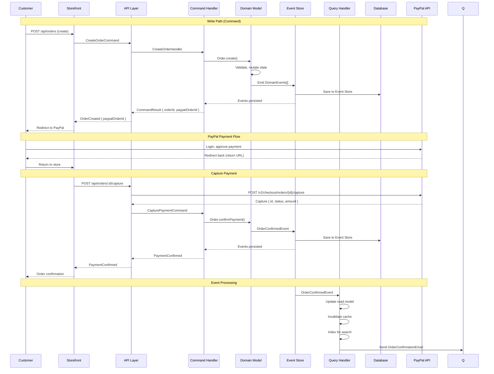
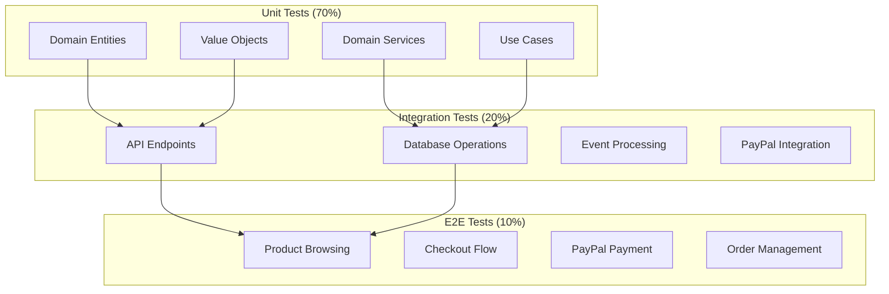
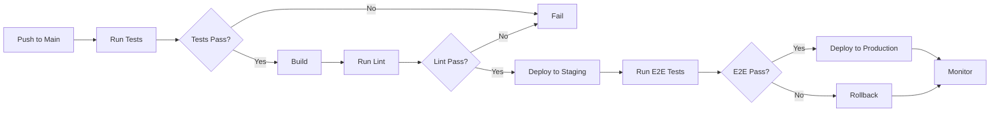
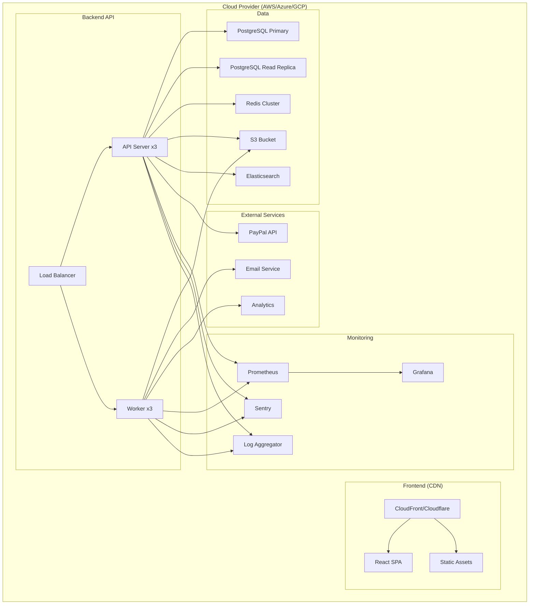

---
slug: A089-ecommerce-platform-requirements
---

# eCommerce Platform — Requirements Specification

> **Date:** 2026-11-02
> **Scope:** Build an eCommerce platform / online store from scratch with PayPal integration
> **Tech Stack:** React 19 + Vite + TypeScript + Tailwind CSS + pnpm
> **Architecture:** Clean Architecture + DDD + CQRS + Event-Driven
> **Payment Gateway:** PayPal REST API (OAuth 2.0, Orders v2, Payments v2)
> **Constraint:** No off-the-shelf eCommerce solutions (no Shopify, WooCommerce, Magento)

---

tags:
  - maturity/experimental
## 1. Executive Summary

## concept_id
a089-ecommerce-platform-requirements

## title
eCommerce Platform — Requirements Specification

## aliases
- A089-ecommerce-platform-requirements

## category
architecture

## concept_type
design-pattern

## research_status
verified

## project_adoption
recommended
This document defines the requirements for building a **custom eCommerce platform** from the ground up. No Shopify, WooCommerce, Magento, or similar off-the-shelf solutions. This is a greenfield project that will be architected using **Clean Architecture**, **Domain-Driven Design**, **CQRS**, and **Event-Driven Architecture** patterns, with **PayPal REST API** as the primary payment gateway.

### Why Build from Scratch?

| Reason | Explanation |
|--------|-------------|
| **Full control** | No legacy code, no forced abstractions, no platform limitations |
| **Performance** | No bloat, only what you need — sub-second page loads |
| **Custom workflows** | Model exactly your product/catalog processes |
| **Payment flexibility** | Integrate any payment gateway, not just platform-supported ones |
| **Ownership** | No vendor lock-in, no platform fee changes, no deprecations |
| **Learning** | Deep understanding of every layer |

### Trade-off Analysis

| Factor | Custom eCommerce | Shopify | WooCommerce | Magento |
|--------|-----------------|---------|-------------|---------|
| **Time to MVP** | 8-16 weeks | 1-2 days | 2-4 days | 2-4 weeks |
| **Initial cost** | High ($50k-$250k+) | Low ($29-$299/mo) | Low ($5-$50/mo) | Medium ($15k-$100k+) |
| **Long-term cost** | Lower (no transaction fees) | 2-5% transaction fees | Plugins + hosting | High (development + hosting) |
| **Performance** | Unlimited (architect to needs) | Good | Poor-Medium | Medium |
| **Customization** | Unlimited | App-limited | Plugin-limited | High (complex) |
| **Payment** | Any gateway | Limited gateways | Many gateways | Many gateways |
| **Maintenance** | You own it | Platform managed | Community/vendor | Vendor/Community |
| **Scalability** | Architect to needs | Platform-limited | Database-limited | Good (complex) |
| **Transaction fees** | None (PayPal fees only) | 0.5-2% | None | None |

**Recommendation:** Build custom if you need full control, custom workflows, specific payment integrations, or plan to scale beyond platform limits.

---

tags:
  - maturity/experimental
## 2. Architectural Style

## concept_id
a089-ecommerce-platform-requirements

## title
eCommerce Platform — Requirements Specification

## aliases
- A089-ecommerce-platform-requirements

## category
architecture

## concept_type
design-pattern

## research_status
verified

## project_adoption
recommended
### Recommended: Modular Monolith with CQRS



### Why This Architecture?

| Pattern | Why for eCommerce | Trade-off |
|---------|------------------|-----------|
| **Clean Architecture** | Business rules independent of React, DB, PayPal API | More files, more abstractions |
| **DDD** | eCommerce has complex domain (products, orders, inventory, payments) | Requires domain expertise, more modeling |
| **CQRS** | Reads (product browsing) >> Writes (orders) — scale independently | Two models to maintain, eventual consistency |
| **Event-Driven** | Order created → inventory reserved, email sent, analytics updated | Complex debugging, eventual consistency |
| **Modular Monolith** | Start simple, scale modules independently later | Module boundaries must be well-defined |

### Consistency Model

| Operation | Consistency | Reason |
|-----------|-------------|--------|
| Product browsing | **Eventual** (TTL cache) | Cache is acceptable for product info |
| Cart operations | **Strong** | User needs immediate feedback |
| Order creation | **Strong** | Financial transaction, inventory reservation |
| Payment capture | **Strong** | PayPal API synchronous capture |
| Inventory update | **Eventual** (1-5s) | Eventual consistency acceptable |
| Email notifications | **Eventual** (async) | Email delivery is async |
| Analytics | **Eventual** (async) | Analytics can lag |
| Search indexing | **Eventual** (5-30s) | Search can lag behind product changes |

---

tags:
  - maturity/experimental
## 3. PayPal Integration Architecture

## concept_id
a089-ecommerce-platform-requirements

## title
eCommerce Platform — Requirements Specification

## aliases
- A089-ecommerce-platform-requirements

## category
architecture

## concept_type
design-pattern

## research_status
verified

## project_adoption
recommended
### 3.1 PayPal API Flow



### 3.2 PayPal API Endpoints Used

| PayPal Endpoint | Purpose | Our Endpoint |
|-----------------|---------|--------------|
| `POST /v1/oauth2/token` | Get access token | Internal token cache |
| `POST /v2/checkout/orders` | Create order | `POST /api/orders` |
| `GET /v2/checkout/orders/{id}` | Get order details | `GET /api/orders/:id` |
| `PATCH /v2/checkout/orders/{id}` | Update order | `PUT /api/orders/:id` |
| `POST /v2/checkout/orders/{id}/capture` | Capture payment | `POST /api/orders/:id/capture` |
| `POST /v2/checkout/orders/{id}/authorize` | Authorize payment | `POST /api/orders/:id/authorize` |
| `POST /v2/payments/authorizations/{id}/capture` | Capture authorization | Handled by capture |
| `POST /v2/payments/captures/{id}/refund` | Refund capture | `POST /api/orders/:id/refund` |
| `POST /webhooks` | Webhook listener | `POST /api/webhooks/paypal` |

### 3.3 PayPal Authentication

```typescript
// infrastructure/paypal/paypal-auth.service.ts
interface PayPalCredentials {
  clientId: string
  clientSecret: string
}

interface PayPalAccessToken {
  accessToken: string
  tokenType: 'Bearer'
  expiresIn: number  // 31668 seconds (~9 hours)
  nonce: string
}

class PayPalAuthService {
  private accessToken: PayPalAccessToken | null = null
  private tokenExpiry: number = 0

  constructor(private credentials: PayPalCredentials) {}

  async getAccessToken(): Promise<string> {
    // Return cached token if still valid
    if (this.accessToken && Date.now() < this.tokenExpiry) {
      return this.accessToken.accessToken
    }

    // Fetch new token from PayPal
    const auth = Buffer.from(
      `${this.credentials.clientId}:${this.credentials.clientSecret}`
    ).toString('base64')

    const response = await fetch(
      `${this.getBaseUrl()}/v1/oauth2/token`,
      {
        method: 'POST',
        headers: {
          'Authorization': `Basic ${auth}`,
          'Content-Type': 'application/x-www-form-urlencoded',
        },
        body: 'grant_type=client_credentials',
      }
    )

    const data = await response.json() as PayPalAccessToken
    this.accessToken = data
    this.tokenExpiry = Date.now() + (data.expiresIn * 1000) - 60000 // 1 min buffer

    return data.accessToken
  }

  private getBaseUrl(): string {
    return process.env.PAYPAL_MODE === 'sandbox'
      ? 'https://api-m.sandbox.paypal.com'
      : 'https://api-m.paypal.com'
  }
}
```

### 3.4 PayPal Webhook Handling

```typescript
// infrastructure/paypal/paypal-webhook.service.ts
class PayPalWebhookService {
  async handleWebhook(payload: string, headers: Headers): Promise<void> {
    // 1. Verify webhook signature
    const isValid = await this.verifySignature(payload, headers)
    if (!isValid) {
      throw new Error('Invalid webhook signature')
    }

    // 2. Parse event
    const event = JSON.parse(payload) as PayPalWebhookEvent

    // 3. Route to appropriate handler
    switch (event.event_type) {
      case 'PAYMENT.CAPTURE.COMPLETED':
        await this.handlePaymentCaptureCompleted(event)
        break
      case 'PAYMENT.CAPTURE.REFUNDED':
        await this.handlePaymentCaptureRefunded(event)
        break
      case 'PAYMENT.CAPTURE.DENIED':
        await this.handlePaymentCaptureDenied(event)
        break
      case 'CHECKOUT.ORDER.APPROVED':
        await this.handleOrderApproved(event)
        break
      case 'BILLING.SUBSCRIPTION.CREATED':
        await this.handleSubscriptionCreated(event)
        break
      case 'CUSTOMER.DISPUTE.CREATED':
        await this.handleDisputeCreated(event)
        break
      default:
        console.log(`Unhandled event type: ${event.event_type}`)
    }

    // 4. Return 200 to acknowledge receipt
  }

  private async verifySignature(
    payload: string,
    headers: Headers
  ): Promise<boolean> {
    const transmissionId = headers.get('paypal-transmission-id')
    const transmissionSig = headers.get('paypal-transmission-sig')
    const transmissionTime = headers.get('paypal-transmission-time')
    const webhookId = headers.get('paypal-auth-algo')

    if (!transmissionId || !transmissionSig || !transmissionTime || !webhookId) {
      return false
    }

    // Verify using PayPal's certificate
    const certificate = await this.getPayPalCertificate(webhookId)
    const signature = Buffer.from(transmissionSig!, 'base64')
    const message = `${transmissionTime}|${transmissionId}|${webhookId}|${payload}`

    // Verify signature using crypto library
    return crypto.verify(
      'sha256',
      Buffer.from(message),
      certificate,
      signature
    )
  }

  private async handlePaymentCaptureCompleted(event: PayPalWebhookEvent): Promise<void> {
    const { id: captureId } = event.resource as PayPalCaptureResource
    const { amount } = event.resource.purchase_unit[0].payments as PayPalPaymentsResource

    // Update order status in our system
    await this.orderService.markAsPaid(captureId, amount)

    // Emit domain event
    this.eventBus.publish(new OrderPaidEvent(captureId, amount))
  }
}
```

---

tags:
  - maturity/experimental
## 4. Core Domain Model (DDD)

## concept_id
a089-ecommerce-platform-requirements

## title
eCommerce Platform — Requirements Specification

## aliases
- A089-ecommerce-platform-requirements

## category
architecture

## concept_type
design-pattern

## research_status
verified

## project_adoption
recommended
### 4.1 Bounded Contexts



### 4.2 Key Aggregates

#### 1. Product Aggregate (Root: `Product`)

```typescript
// entities/product.entity.ts
export class Product {
  private constructor(
    readonly id: ProductId,
    private _title: Title,
    private _slug: Slug,
    private _description: Description,
    private _shortDescription: ShortDescription | null,
    private _status: ProductStatus,
    private _category: CategoryId,
    private _tags: TagId[],
    private _variants: ProductVariant[],
    private _images: ProductImage[],
    private _seo: SeoMetadata,
    private _metadata: ProductMetadata
  ) {}

  static create(params: CreateProductParams): Product {
    return new Product(
      generateId(),
      new Title(params.title),
      new Slug(params.title),
      new Description(params.description),
      params.shortDescription ? new ShortDescription(params.shortDescription) : null,
      ProductStatus.DRAFT,
      params.categoryId,
      params.tags || [],
      [],
      SeoMetadata.empty(),
      new ProductMetadata()
    )
  }

  // Business behavior
  publish(): void {
    if (this._status !== ProductStatus.DRAFT) {
      throw new Error('Only drafts can be published')
    }
    this._status = ProductStatus.PUBLISHED
  }

  unpublish(): void {
    this._status = ProductStatus.DRAFT
  }

  updatePrice(price: Money): void {
    if (price.value <= 0) {
      throw new Error('Price must be greater than zero')
    }
    this._variants.forEach(v => v.updatePrice(price))
  }

  updateInventory(quantity: number): void {
    if (quantity < 0) {
      throw new Error('Inventory cannot be negative')
    }
    this._variants.forEach(v => v.updateInventory(quantity))
  }

  addImage(image: ProductImage): void {
    this._images.push(image)
  }

  removeImage(imageId: ImageId): void {
    this._images = this._images.filter(img => img.id !== imageId)
  }

  updateSeo(seo: Partial<SeoMetadata>): void {
    this._seo = this._seo.update(seo)
  }

  get price(): Money {
    return this._variants[0]?.price || new Money(0, this._metadata.currency)
  }

  get isInStock(): boolean {
    return this._variants.some(v => v.quantity > 0)
  }

  get rating(): number {
    // Calculated from reviews
    return 0
  }
}

// Value Objects
class Money {
  constructor(
    readonly value: number,
    readonly currency: Currency = new Currency('USD')
  ) {}

  static fromCents(cents: number, currency: string = 'USD'): Money {
    return new Money(cents / 100, new Currency(currency))
  }

  add(other: Money): Money {
    if (this.currency.value !== other.currency.value) {
      throw new Error('Cannot add different currencies')
    }
    return new Money(this.value + other.value, this.currency)
  }

  multiply(multiplier: number): Money {
    return new Money(this.value * multiplier, this.currency)
  }

  format(): string {
    return new Intl.NumberFormat('en-US', {
      style: 'currency',
      currency: this.currency.value,
    }).format(this.value)
  }
}

class Currency {
  constructor(private _value: string) {
    if (!/^[A-Z]{3}$/.test(_value)) {
      throw new Error('Invalid currency code')
    }
  }
  get value() { return this._value }
}

class Title {
  constructor(private _value: string) {
    if (_value.length < 3 || _value.length > 200) {
      throw new Error('Title must be 3-200 characters')
    }
  }
  get value() { return this._value }
}

class Slug {
  constructor(title: string) {
    this._value = title
      .toLowerCase()
      .replace(/[^\w\s-]/g, '')
      .replace(/\s+/g, '-')
      .replace(/-+/g, '-')
      .substring(0, 200)
  }
  private _value: string
  get value() { return this._value }
}
```

#### 2. Order Aggregate (Root: `Order`)

```typescript
// entities/order.entity.ts
export class Order {
  private constructor(
    readonly id: OrderId,
    private _customerId: CustomerId,
    private _items: OrderItem[],
    private _status: OrderStatus,
    private _shipping: ShippingDetails,
    private _tax: TaxDetails,
    private _discount: Discount | null,
    private _total: Money,
    private _payment: PaymentDetails | null,
    private _paypalOrderId: string | null,
    private _createdAt: DateTime,
    private _updatedAt: DateTime
  ) {}

  static create(params: CreateOrderParams): Order {
    const total = params.items.reduce(
      (sum, item) => sum.add(item.subtotal),
      new Money(0, params.items[0].product.currency)
    )

    return new Order(
      generateId(),
      params.customerId,
      params.items,
      OrderStatus.PENDING,
      params.shipping,
      new TaxDetails(0, new Money(0)),
      null,
      total,
      null,
      DateTime.now(),
      DateTime.now()
    )
  }

  // Business behavior
  applyDiscount(discount: Discount): void {
    this._discount = discount
    this._total = this._total.multiply(1 - discount.percentage)
    this._updatedAt = DateTime.now()
  }

  removeDiscount(): void {
    this._discount = null
    // Recalculate total
    this._updatedAt = DateTime.now()
  }

  setPaypalOrderId(paypalOrderId: string): void {
    this._paypalOrderId = paypalOrderId
    this._updatedAt = DateTime.now()
  }

  confirmPayment(captureId: string, amount: Money): void {
    this._payment = {
      method: 'paypal',
      status: PaymentStatus.PAID,
      captureId,
      amount,
      paidAt: DateTime.now(),
    }
    this._status = OrderStatus.CONFIRMED
    this._updatedAt = DateTime.now()
  }

  ship(trackingNumber: string): void {
    if (this._status !== OrderStatus.CONFIRMED) {
      throw new Error('Order must be confirmed before shipping')
    }
    this._status = OrderStatus.SHIPPED
    this._shipping.trackingNumber = trackingNumber
    this._updatedAt = DateTime.now()
  }

  deliver(): void {
    if (this._status !== OrderStatus.SHIPPED) {
      throw new Error('Order must be shipped before delivery')
    }
    this._status = OrderStatus.DELIVERED
    this._updatedAt = DateTime.now()
  }

  cancel(): void {
    if (this._status === OrderStatus.DELIVERED) {
      throw new Error('Cannot deliver an order that has been delivered')
    }
    this._status = OrderStatus.CANCELLED
    this._updatedAt = DateTime.now()
  }

  refund(amount: Money): void {
    if (!this._payment || this._payment.status !== PaymentStatus.PAID) {
      throw new Error('Order must be paid to refund')
    }
    this._payment.status = PaymentStatus.REFUNDED
    this._payment.refundAmount = amount
    this._payment.refundedAt = DateTime.now()
    this._updatedAt = DateTime.now()
  }

  // Domain events
  toDomainEvents(): DomainEvent[] {
    const events: DomainEvent[] = []
    
    if (this._status === OrderStatus.CONFIRMED) {
      events.push(new OrderConfirmedEvent(
        this.id, this._customerId, this._total, this._items
      ))
    }
    
    if (this._status === OrderStatus.SHIPPED) {
      events.push(new OrderShippedEvent(
        this.id, this._shipping.trackingNumber
      ))
    }
    
    if (this._status === OrderStatus.DELIVERED) {
      events.push(new OrderDeliveredEvent(this.id))
    }
    
    return events
  }
}

// Value Objects
class OrderItem {
  constructor(
    readonly productId: ProductId,
    readonly productName: string,
    readonly variantName: string | null,
    readonly quantity: number,
    readonly unitPrice: Money,
    private _discount: Money | null = null
  ) {}

  get subtotal(): Money {
    const total = this.unitPrice.multiply(this.quantity)
    return this._discount ? total.subtract(this._discount) : total
  }

  applyDiscount(discount: Money): void {
    this._discount = discount
  }
}

class ShippingDetails {
  constructor(
    public firstName: string,
    public lastName: string,
    public addressLine1: string,
    public addressLine2: string | null,
    public city: string,
    public state: string,
    public postalCode: string,
    public country: string,
    public phone: string,
    public trackingNumber: string | null = null,
    public method: ShippingMethod = ShippingMethod.STANDARD,
    public cost: Money = new Money(0),
    public estimatedDelivery: DateTime | null = null
  ) {}
}

class TaxDetails {
  constructor(
    readonly rate: number,
    readonly amount: Money
  ) {}
}

class Discount {
  constructor(
    readonly code: string,
    readonly type: DiscountType,
    readonly value: number,
    readonly percentage: number
  ) {}
}

enum DiscountType {
  PERCENTAGE = 'percentage',
  FIXED = 'fixed',
  FREE_SHIPPING = 'free_shipping',
}
```

#### 3. Cart Aggregate (Root: `Cart`)

```typescript
// entities/cart.entity.ts
export class Cart {
  private constructor(
    readonly id: CartId,
    private _customerId: CustomerId | null,
    private _items: CartItem[],
    private _discount: Discount | null,
    private _shippingMethod: ShippingMethod,
    private _createdAt: DateTime,
    private _updatedAt: DateTime
  ) {}

  static create(customerId: CustomerId | null): Cart {
    return new Cart(
      generateId(),
      customerId,
      [],
      null,
      ShippingMethod.STANDARD,
      DateTime.now(),
      DateTime.now()
    )
  }

  // Business behavior
  addItem(productId: ProductId, quantity: number, variantId?: VariantId): void {
    const existingItem = this._items.find(
      item => item.productId === productId && item.variantId === variantId
    )

    if (existingItem) {
      existingItem.incrementQuantity(quantity)
    } else {
      this._items.push(new CartItem(productId, variantId, quantity))
    }

    this._updatedAt = DateTime.now()
  }

  removeItem(productId: ProductId, variantId?: VariantId): void {
    this._items = this._items.filter(
      item => !(item.productId === productId && item.variantId === variantId)
    )
    this._updatedAt = DateTime.now()
  }

  updateQuantity(productId: ProductId, quantity: number, variantId?: VariantId): void {
    const item = this._items.find(
      item => item.productId === productId && item.variantId === variantId
    )
    if (item) {
      item.updateQuantity(quantity)
    }
    this._updatedAt = DateTime.now()
  }

  applyDiscount(discount: Discount): void {
    this._discount = discount
    this._updatedAt = DateTime.now()
  }

  removeDiscount(): void {
    this._discount = null
    this._updatedAt = DateTime.now()
  }

  get subtotal(): Money {
    return this._items.reduce(
      (sum, item) => sum.add(item.subtotal),
      new Money(0)
    )
  }

  get total(): Money {
    let total = this.subtotal
    if (this._discount) {
      total = total.multiply(1 - this._discount.percentage)
    }
    total = total.add(this._shippingMethod.cost)
    return total
  }

  get itemCount(): number {
    return this._items.reduce((sum, item) => sum + item.quantity, 0)
  }

  isEmpty(): boolean {
    return this._items.length === 0
  }
}

class CartItem {
  constructor(
    readonly productId: ProductId,
    readonly variantId: VariantId | null,
    private _quantity: number
  ) {}

  get quantity() { return this._quantity }
  
  incrementQuantity(amount: number): void {
    this._quantity += amount
  }

  updateQuantity(quantity: number): void {
    if (quantity <= 0) {
      throw new Error('Quantity must be positive')
    }
    this._quantity = quantity
  }

  get subtotal(): Money {
    // Would fetch product price from repository
    return new Money(0)
  }
}
```

#### 4. Inventory Aggregate (Root: `Inventory`)

```typescript
// entities/inventory.entity.ts
export class Inventory {
  private constructor(
    readonly productId: ProductId,
    private _quantity: number,
    private _reserved: number,
    private _lowStockThreshold: number,
    private _reorderPoint: number
  ) {}

  static create(productId: ProductId, initialQuantity: number): Inventory {
    return new Inventory(
      productId,
      initialQuantity,
      0,
      10,  // Default low stock threshold
      20   // Default reorder point
    )
  }

  // Business behavior
  reserve(quantity: number): void {
    if (this._quantity - this._reserved < quantity) {
      throw new Error('Insufficient inventory')
    }
    this._reserved += quantity
  }

  release(quantity: number): void {
    this._reserved = Math.max(0, this._reserved - quantity)
  }

  confirmReservation(quantity: number): void {
    if (this._reserved < quantity) {
      throw new Error('Cannot confirm more than reserved')
    }
    this._quantity -= quantity
    this._reserved -= quantity
  }

  cancelReservation(quantity: number): void {
    this.release(quantity)
  }

  updateQuantity(quantity: number): void {
    this._quantity = quantity
  }

  get available(): number {
    return this._quantity - this._reserved
  }

  get isLowStock(): boolean {
    return this.available <= this._lowStockThreshold
  }

  get needsReorder(): boolean {
    return this.available <= this._reorderPoint
  }
}
```

---

tags:
  - maturity/experimental
## 5. Functional Requirements

## concept_id
a089-ecommerce-platform-requirements

## title
eCommerce Platform — Requirements Specification

## aliases
- A089-ecommerce-platform-requirements

## category
architecture

## concept_type
design-pattern

## research_status
verified

## project_adoption
recommended
### 5.1 Product Catalog

| ID | Requirement | Priority | CQRS Side |
|----|-------------|----------|-----------|
| FR-01 | Create product (draft) | P0 | Command |
| FR-02 | Edit product | P0 | Command |
| FR-03 | Delete product (soft delete) | P0 | Command |
| FR-04 | Publish/unpublish product | P0 | Command |
| FR-05 | Product variants (size, color, etc.) | P1 | Command |
| FR-06 | Product images (multiple, upload) | P1 | Command |
| FR-07 | Product categories | P1 | Command |
| FR-08 | Product tags | P1 | Command |
| FR-09 | Product search (full-text) | P1 | Query |
| FR-10 | Filter by category, price, rating | P1 | Query |
| FR-11 | Sort by price, name, rating, date | P1 | Query |
| FR-12 | Product reviews and ratings | P2 | Command |
| FR-13 | Related products | P2 | Query |
| FR-14 | Product SEO (title, description, OG) | P2 | Command |
| FR-15 | Bulk import/export (CSV, JSON) | P2 | Command |
| FR-16 | Product attributes (custom fields) | P3 | Command |
| FR-17 | Digital products (downloads) | P3 | Command |
| FR-18 | Subscription products | P3 | Command |

### 5.2 Shopping Cart

| ID | Requirement | Priority | CQRS Side |
|----|-------------|----------|-----------|
| FR-20 | Add item to cart | P0 | Command |
| FR-21 | Update item quantity | P0 | Command |
| FR-22 | Remove item from cart | P0 | Command |
| FR-23 | Apply discount code | P1 | Command |
| FR-24 | Remove discount code | P1 | Command |
| FR-25 | Cart total calculation | P0 | Query |
| FR-26 | Cart persistence (guest + logged-in) | P0 | Query |
| FR-27 | Cart merge (guest to logged-in) | P1 | Command |
| FR-28 | Save cart for later | P2 | Command |
| FR-29 | Wishlist | P2 | Command |
| FR-30 | Cart expiration (30 days) | P2 | Command |

### 5.3 Checkout & Payment (PayPal)

| ID | Requirement | Priority | CQRS Side |
|----|-------------|----------|-----------|
| FR-40 | Guest checkout | P0 | Command |
| FR-41 | Registered user checkout | P0 | Command |
| FR-42 | PayPal payment (checkout) | P0 | Command |
| FR-43 | PayPal credit card payment | P0 | Command |
| FR-44 | PayPal subscription payment | P2 | Command |
| FR-45 | Payment capture (automatic/manual) | P0 | Command |
| FR-46 | Payment authorization (hold) | P1 | Command |
| FR-47 | Payment refund (full/partial) | P1 | Command |
| FR-48 | Payment status tracking | P0 | Query |
| FR-49 | PayPal webhook handling | P0 | Command |
| FR-50 | Order confirmation email | P0 | Command |
| FR-51 | Shipping address collection | P0 | Command |
| FR-52 | Billing address collection | P1 | Command |
| FR-53 | Tax calculation | P1 | Command |
| FR-54 | Shipping cost calculation | P1 | Command |
| FR-55 | Order summary review | P0 | Query |
| FR-56 | Order number generation | P0 | Command |
| FR-57 | Order status tracking | P1 | Query |
| FR-58 | Order history (customer) | P1 | Query |
| FR-59 | Order cancellation | P1 | Command |
| FR-60 | Multiple shipping addresses | P2 | Command |
| FR-61 | Gift wrapping | P3 | Command |
| FR-62 | Gift message | P3 | Command |
| FR-63 | Invoice generation | P2 | Query |
| FR-64 | Receipt generation | P1 | Query |

### 5.4 Customer Management

| ID | Requirement | Priority | CQRS Side |
|----|-------------|----------|-----------|
| FR-70 | Customer registration | P0 | Command |
| FR-71 | Customer login | P0 | Command |
| FR-72 | Customer logout | P0 | Command |
| FR-73 | Password reset | P0 | Command |
| FR-74 | Customer profile management | P1 | Command |
| FR-75 | Address book (multiple addresses) | P1 | Command |
| FR-76 | Payment methods (saved) | P2 | Command |
| FR-77 | Order history | P1 | Query |
| FR-78 | Wishlist | P2 | Query |
| FR-79 | Product reviews | P2 | Query |
| FR-80 | Email notifications preferences | P2 | Command |
| FR-81 | Two-factor authentication (2FA) | P2 | Command |
| FR-82 | OAuth/Social login (Google, Facebook) | P2 | Command |
| FR-83 | GDPR data export | P2 | Command |
| FR-84 | GDPR account deletion | P2 | Command |
| FR-85 | Customer loyalty program | P3 | Command |
| FR-86 | Customer tiers/levels | P3 | Command |

### 5.5 Inventory Management

| ID | Requirement | Priority | CQRS Side |
|----|-------------|----------|-----------|
| FR-90 | Stock quantity tracking | P0 | Command |
| FR-91 | Low stock alerts | P1 | Query |
| FR-92 | Inventory reservation (on order) | P0 | Command |
| FR-93 | Inventory release (on cancel) | P1 | Command |
| FR-94 | Inventory adjustment | P1 | Command |
| FR-95 | Backorder support | P2 | Command |
| FR-96 | Out of stock handling | P1 | Command |
| FR-97 | Inventory history/audit | P2 | Query |
| FR-98 | Multi-warehouse support | P3 | Command |
| FR-99 | Reorder point automation | P2 | Command |

### 5.6 Shipping & Fulfillment

| ID | Requirement | Priority | CQRS Side |
|----|-------------|----------|-----------|
| FR-100 | Shipping rate calculation | P1 | Command |
| FR-101 | Shipping zones | P1 | Command |
| FR-102 | Shipping methods (standard, express) | P1 | Command |
| FR-103 | Tracking number integration | P2 | Command |
| FR-104 | Shipping label generation | P2 | Command |
| FR-105 | Order status updates (shipped, delivered) | P1 | Command |
| FR-106 | Delivery estimation | P2 | Query |
| FR-107 | International shipping | P2 | Command |
| FR-108 | Free shipping threshold | P1 | Command |
| FR-109 | Pick list generation | P3 | Query |
| FR-110 | Packing slip generation | P3 | Query |

### 5.7 Tax & Pricing

| ID | Requirement | Priority | CQRS Side |
|----|-------------|----------|-----------|
| FR-120 | Tax rate configuration | P1 | Command |
| FR-121 | Tax calculation by location | P1 | Command |
| FR-122 | Tax-exempt customers | P2 | Command |
| FR-123 | Price rules (bulk discounts) | P2 | Command |
| FR-124 | Customer-specific pricing | P3 | Command |
| FR-125 | Currency conversion | P2 | Query |
| FR-126 | Multi-currency support | P2 | Command |
| FR-127 | Price history | P3 | Query |
| FR-128 | Sale price / regular price | P1 | Command |
| FR-129 | Price rounding rules | P2 | Command |

### 5.8 Marketing & Promotions

| ID | Requirement | Priority | CQRS Side |
|----|-------------|----------|-----------|
| FR-130 | Coupon/discount codes | P1 | Command |
| FR-131 | Percentage discount | P1 | Command |
| FR-132 | Fixed amount discount | P1 | Command |
| FR-133 | Free shipping discount | P1 | Command |
| FR-134 | Buy X get Y discount | P2 | Command |
| FR-135 | BOGO (Buy One Get One) | P2 | Command |
| FR-136 | Cart-level discounts | P1 | Command |
| FR-137 | Product-level discounts | P1 | Command |
| FR-138 | Coupon expiration | P1 | Command |
| FR-139 | Coupon usage limits | P1 | Command |
| FR-140 | Email marketing integration | P2 | Command |
| FR-141 | Abandoned cart emails | P2 | Command |
| FR-142 | Product recommendations | P2 | Query |
| FR-143 | SEO optimization | P1 | Query |
| FR-144 | Social media integration | P2 | Command |
| FR-145 | Referral program | P3 | Command |
| FR-146 | Gift cards | P3 | Command |
| FR-147 | Loyalty points | P3 | Command |

### 5.9 Search & Discovery

| ID | Requirement | Priority | CQRS Side |
|----|-------------|----------|-----------|
| FR-150 | Full-text search (product name, description) | P1 | Query |
| FR-151 | Search by category | P1 | Query |
| FR-152 | Search by tag | P1 | Query |
| FR-153 | Search by brand | P2 | Query |
| FR-154 | Search suggestions/autocomplete | P2 | Query |
| FR-155 | Search highlighting | P2 | Query |
| FR-156 | Recent searches | P2 | Query |
| FR-157 | Popular products | P1 | Query |
| FR-158 | New arrivals | P1 | Query |
| FR-159 | Best sellers | P1 | Query |
| FR-160 | Featured products | P1 | Query |
| FR-161 | Recently viewed | P2 | Query |
| FR-162 | Compare products | P2 | Query |
| FR-163 | Filter by price range | P1 | Query |
| FR-164 | Filter by rating | P1 | Query |
| FR-165 | Filter by availability | P1 | Query |
| FR-166 | Sort by price, name, rating, date | P1 | Query |
| FR-167 | Pagination (infinite scroll, page-based) | P1 | Query |

### 5.10 Reviews & Ratings

| ID | Requirement | Priority | CQRS Side |
|----|-------------|----------|-----------|
| FR-170 | Write product review | P1 | Command |
| FR-171 | Rate product (1-5 stars) | P1 | Command |
| FR-172 | Review moderation (approve/reject) | P1 | Command |
| FR-173 | Review helpfulness voting | P2 | Command |
| FR-174 | Review images | P2 | Command |
| FR-175 | Review listing (paginated) | P1 | Query |
| FR-176 | Average rating calculation | P1 | Query |
| FR-177 | Review sorting (helpful, recent) | P1 | Query |
| FR-178 | Review replies (from merchant) | P2 | Command |
| FR-179 | Verified purchase badge | P1 | Query |

### 5.11 Administration

| ID | Requirement | Priority | CQRS Side |
|----|-------------|----------|-----------|
| FR-180 | Admin dashboard | P0 | Query |
| FR-181 | Product management UI | P0 | Query/Command |
| FR-182 | Order management UI | P0 | Query/Command |
| FR-183 | Customer management UI | P1 | Query/Command |
| FR-184 | Inventory management UI | P1 | Query/Command |
| FR-185 | Discount/coupon management UI | P1 | Query/Command |
| FR-186 | Shipping configuration UI | P1 | Query/Command |
| FR-187 | Tax configuration UI | P1 | Query/Command |
| FR-188 | PayPal settings UI | P1 | Command |
| FR-189 | Analytics dashboard | P2 | Query |
| FR-190 | Sales reports | P2 | Query |
| FR-191 | Revenue reports | P2 | Query |
| FR-192 | Product performance reports | P2 | Query |
| FR-193 | Customer reports | P2 | Query |
| FR-194 | System settings | P1 | Command |
| FR-195 | User/role management | P1 | Command |
| FR-196 | Backup/restore | P1 | Command |
| FR-197 | Audit log | P2 | Query |
| FR-198 | System health monitoring | P2 | Query |
| FR-199 | Error logging and reporting | P2 | Query |
| FR-200 | Environment configuration | P1 | Command |

### 5.12 API & Integrations

| ID | Requirement | Priority | CQRS Side |
|----|-------------|----------|-----------|
| FR-210 | REST API for products | P1 | Query/Command |
| FR-211 | REST API for orders | P1 | Query/Command |
| FR-212 | REST API for customers | P1 | Query/Command |
| FR-213 | GraphQL API (optional) | P2 | Query |
| FR-214 | API authentication (JWT) | P1 | Command |
| FR-215 | API rate limiting | P1 | Command |
| FR-216 | API versioning | P1 | Command |
| FR-217 | API documentation (OpenAPI/Swagger) | P1 | Query |
| FR-218 | Webhook on order created | P2 | Command |
| FR-219 | Third-party integrations (Slack, email) | P2 | Command |
| FR-220 | OAuth 2.0 for API clients | P3 | Command |
| FR-221 | RSS/Atom feeds (products) | P2 | Query |
| FR-222 | Google Shopping integration | P3 | Command |
| FR-223 | Facebook Pixel integration | P3 | Command |
| FR-224 | Analytics integration (Google Analytics) | P2 | Query |

---

tags:
  - maturity/experimental
## 6. Non-Functional Requirements

## concept_id
a089-ecommerce-platform-requirements

## title
eCommerce Platform — Requirements Specification

## aliases
- A089-ecommerce-platform-requirements

## category
architecture

## concept_type
design-pattern

## research_status
verified

## project_adoption
recommended
### 6.1 Performance

| Metric | Target | Measurement |
|--------|--------|-------------|
| **First Contentful Paint (FCP)** | < 1s | Lighthouse |
| **Largest Contentful Paint (LCP)** | < 2.5s | Lighthouse |
| **Time to First Byte (TTFB)** | < 200ms | CDN edge |
| **First Input Delay (FID)** | < 100ms | Lighthouse |
| **Cumulative Layout Shift (CLS)** | < 0.1 | Lighthouse |
| **Total Blocking Time (TBT)** | < 200ms | Lighthouse |
| **Product page load (cached)** | < 100ms | CDN |
| **Product page load (uncached)** | < 500ms | Full page render |
| **API response time (p95)** | < 200ms | 95th percentile |
| **Search query time** | < 100ms | Full-text search |
| **Checkout flow time** | < 3s | End-to-end |
| **PayPal redirect time** | < 2s | PayPal API |
| **Concurrent users** | 10,000+ | Load testing |
| **Products capacity** | 100k+ | Database capacity |
| **Orders capacity** | 1M+ | Database capacity |

### 6.2 Security

| Requirement | Implementation | Standard |
|-------------|----------------|----------|
| **Authentication** | JWT + Refresh Tokens | OAuth 2.0 / OpenID Connect |
| **Authorization** | RBAC (Admin, Merchant, Customer) | NIST Cybersecurity Framework |
| **Password Storage** | bcrypt (cost factor 12) | OWASP Password Storage |
| **HTTPS** | TLS 1.3 everywhere | OWASP Transport Layer Protection |
| **CORS** | Strict origin allowlist | OWASP CORS |
| **CSP** | Content Security Policy | OWASP CSP |
| **SQL Injection** | Parameterized queries (Prisma/TypeORM) | OWASP SQL Injection |
| **XSS** | React auto-escaping + CSP | OWASP XSS |
| **CSRF** | SameSite cookies + tokens | OWASP CSRF |
| **Rate Limiting** | Token bucket algorithm | OWASP Rate Limiting |
| **Input Validation** | Zod schema validation | OWASP Input Validation |
| **Output Encoding** | Context-aware encoding | OWASP Output Encoding |
| **Secrets Management** | Environment variables + Vault | OWASP Secrets Management |
| **Audit Logging** | Immutable audit trail | OWASP Audit Logging |
| **Data Encryption** | AES-256 at rest, TLS in transit | NIST Encryption Guidelines |
| **2FA** | TOTP (Time-based One-Time Password) | NIST 2FA Guidelines |
| **Session Management** | Secure, HttpOnly, SameSite cookies | OWASP Session Management |
| **API Security** | OAuth 2.0 + JWT | OWASP API Security |
| **File Upload** | MIME validation + size limits + virus scan | OWASP File Upload |
| **PCI Compliance** | No card data stored (PayPal handles) | PCI DSS |
| **PayPal Security** | Webhook signature verification | PayPal Security Guidelines |
| **Backup** | Daily encrypted backups + 30-day retention | NIST Backup Guidelines |

### 6.3 Availability & Reliability

| Metric | Target |
|--------|--------|
| **Uptime** | 99.9% (8.76 hours downtime/year) |
| **Recovery Time Objective (RTO)** | < 1 hour |
| **Recovery Point Objective (RPO)** | < 15 minutes |
| **Backup Frequency** | Daily (full) + hourly (incremental) |
| **Disaster Recovery** | Multi-region failover |
| **Monitoring** | 24/7 automated alerts |
| **Incident Response** | < 15 minutes acknowledgment |

### 6.4 Scalability



| Component | Scaling Strategy | Reason |
|-----------|-----------------|--------|
| **Frontend** | CDN (global edge) | Static assets cached at edge |
| **API Server** | Horizontal (auto-scale) | Handle traffic spikes |
| **PostgreSQL** | Vertical + Read Replicas | Write-heavy, strong consistency |
| **Redis** | Cluster mode | Cache, session storage |
| **S3/CDN** | Horizontal (managed) | Product images scale automatically |
| **Search** | Horizontal (Elasticsearch) | Full-text search scales independently |
| **PayPal API** | Token caching | Reduce API calls, handle rate limits |

### 6.5 Maintainability

| Metric | Target |
|--------|--------|
| **Code Coverage** | > 80% (unit), > 60% (integration) |
| **Technical Debt Ratio** | < 5% |
| **Cycle Time** | < 2 weeks (feature to production) |
| **Deployment Frequency** | Daily (canary) |
| **Change Failure Rate** | < 5% |
| **Mean Time to Recovery** | < 30 minutes |

---

tags:
  - maturity/experimental
## 7. Technical Architecture

## concept_id
a089-ecommerce-platform-requirements

## title
eCommerce Platform — Requirements Specification

## aliases
- A089-ecommerce-platform-requirements

## category
architecture

## concept_type
design-pattern

## research_status
verified

## project_adoption
recommended
### 7.1 Clean Architecture Layers



### 7.2 CQRS Implementation for eCommerce



### 7.3 Database Schema (PostgreSQL)

```sql
-- Core tables (write model)
CREATE TABLE products (
    id UUID PRIMARY KEY,
    title VARCHAR(500) NOT NULL,
    slug VARCHAR(500) NOT NULL UNIQUE,
    description TEXT NOT NULL,
    short_description VARCHAR(500),
    status VARCHAR(50) NOT NULL DEFAULT 'draft',
    category_id UUID NOT NULL,
    seo_title VARCHAR(500),
    seo_description VARCHAR(500),
    seo_keywords TEXT[],
    seo_og_image VARCHAR(1000),
    created_at TIMESTAMP DEFAULT NOW(),
    updated_at TIMESTAMP DEFAULT NOW()
);

CREATE TABLE product_variants (
    id UUID PRIMARY KEY,
    product_id UUID REFERENCES products(id) ON DELETE CASCADE,
    name VARCHAR(200) NOT NULL,
    sku VARCHAR(100) NOT NULL,
    price NUMERIC(10, 2) NOT NULL,
    currency VARCHAR(3) NOT NULL DEFAULT 'USD',
    quantity INTEGER NOT NULL DEFAULT 0,
    attributes JSONB DEFAULT '{}',
    images TEXT[] DEFAULT '{}',
    is_active BOOLEAN DEFAULT true,
    created_at TIMESTAMP DEFAULT NOW()
);

CREATE TABLE product_tags (
    product_id UUID REFERENCES products(id) ON DELETE CASCADE,
    tag_id UUID REFERENCES tags(id) ON DELETE CASCADE,
    PRIMARY KEY (product_id, tag_id)
);

CREATE TABLE tags (
    id UUID PRIMARY KEY,
    name VARCHAR(100) NOT NULL UNIQUE,
    slug VARCHAR(100) NOT NULL UNIQUE
);

CREATE TABLE categories (
    id UUID PRIMARY KEY,
    name VARCHAR(100) NOT NULL UNIQUE,
    slug VARCHAR(100) NOT NULL UNIQUE,
    description TEXT,
    parent_id UUID REFERENCES categories(id)
);

CREATE TABLE customers (
    id UUID PRIMARY KEY,
    email VARCHAR(255) NOT NULL UNIQUE,
    password_hash VARCHAR(255) NOT NULL,
    first_name VARCHAR(100) NOT NULL,
    last_name VARCHAR(100) NOT NULL,
    role VARCHAR(50) NOT NULL DEFAULT 'customer',
    is_active BOOLEAN DEFAULT true,
    last_login_at TIMESTAMP,
    created_at TIMESTAMP DEFAULT NOW()
);

CREATE TABLE customer_addresses (
    id UUID PRIMARY KEY,
    customer_id UUID REFERENCES customers(id) ON DELETE CASCADE,
    first_name VARCHAR(100) NOT NULL,
    last_name VARCHAR(100) NOT NULL,
    address_line1 VARCHAR(255) NOT NULL,
    address_line2 VARCHAR(255),
    city VARCHAR(100) NOT NULL,
    state VARCHAR(100) NOT NULL,
    postal_code VARCHAR(20) NOT NULL,
    country VARCHAR(100) NOT NULL,
    phone VARCHAR(20),
    is_default BOOLEAN DEFAULT false
);

CREATE TABLE carts (
    id UUID PRIMARY KEY,
    customer_id UUID REFERENCES customers(id),
    expires_at TIMESTAMP NOT NULL,
    created_at TIMESTAMP DEFAULT NOW(),
    updated_at TIMESTAMP DEFAULT NOW()
);

CREATE TABLE cart_items (
    cart_id UUID REFERENCES carts(id) ON DELETE CASCADE,
    product_id UUID REFERENCES products(id),
    variant_id UUID REFERENCES product_variants(id),
    quantity INTEGER NOT NULL DEFAULT 1,
    PRIMARY KEY (cart_id, product_id, variant_id)
);

CREATE TABLE orders (
    id UUID PRIMARY KEY,
    order_number VARCHAR(50) NOT NULL UNIQUE,
    customer_id UUID NOT NULL REFERENCES customers(id),
    status VARCHAR(50) NOT NULL DEFAULT 'pending',
    paypal_order_id VARCHAR(100),
    paypal_capture_id VARCHAR(100),
    subtotal NUMERIC(10, 2) NOT NULL,
    tax_amount NUMERIC(10, 2) NOT NULL DEFAULT 0,
    shipping_amount NUMERIC(10, 2) NOT NULL DEFAULT 0,
    discount_amount NUMERIC(10, 2) NOT NULL DEFAULT 0,
    total_amount NUMERIC(10, 2) NOT NULL,
    currency VARCHAR(3) NOT NULL DEFAULT 'USD',
    shipping_address JSONB NOT NULL,
    billing_address JSONB NOT NULL,
    created_at TIMESTAMP DEFAULT NOW(),
    updated_at TIMESTAMP DEFAULT NOW()
);

CREATE TABLE order_items (
    id UUID PRIMARY KEY,
    order_id UUID REFERENCES orders(id) ON DELETE CASCADE,
    product_id UUID REFERENCES products(id),
    product_name VARCHAR(500) NOT NULL,
    variant_name VARCHAR(200),
    quantity INTEGER NOT NULL,
    unit_price NUMERIC(10, 2) NOT NULL,
    subtotal NUMERIC(10, 2) NOT NULL,
    discount_amount NUMERIC(10, 2) NOT NULL DEFAULT 0
);

CREATE TABLE payments (
    id UUID PRIMARY KEY,
    order_id UUID REFERENCES orders(id) ON DELETE CASCADE,
    method VARCHAR(50) NOT NULL DEFAULT 'paypal',
    status VARCHAR(50) NOT NULL DEFAULT 'pending',
    amount NUMERIC(10, 2) NOT NULL,
    currency VARCHAR(3) NOT NULL DEFAULT 'USD',
    paypal_transaction_id VARCHAR(100),
    paid_at TIMESTAMP,
    refunded_at TIMESTAMP,
    created_at TIMESTAMP DEFAULT NOW()
);

CREATE TABLE discounts (
    id UUID PRIMARY KEY,
    code VARCHAR(50) NOT NULL UNIQUE,
    type VARCHAR(50) NOT NULL,
    value NUMERIC(10, 2) NOT NULL,
    percentage NUMERIC(5, 2) NOT NULL,
    usage_limit INTEGER,
    used_count INTEGER NOT NULL DEFAULT 0,
    expires_at TIMESTAMP,
    is_active BOOLEAN DEFAULT true,
    created_at TIMESTAMP DEFAULT NOW()
);

CREATE TABLE reviews (
    id UUID PRIMARY KEY,
    product_id UUID REFERENCES products(id) ON DELETE CASCADE,
    customer_id UUID REFERENCES customers(id),
    rating INTEGER NOT NULL CHECK (rating >= 1 AND rating <= 5),
    title VARCHAR(200),
    content TEXT,
    status VARCHAR(50) NOT NULL DEFAULT 'pending',
    is_verified BOOLEAN DEFAULT false,
    created_at TIMESTAMP DEFAULT NOW(),
    updated_at TIMESTAMP DEFAULT NOW()
);

CREATE TABLE inventory (
    product_id UUID PRIMARY KEY REFERENCES products(id),
    quantity INTEGER NOT NULL DEFAULT 0,
    reserved INTEGER NOT NULL DEFAULT 0,
    low_stock_threshold INTEGER NOT NULL DEFAULT 10,
    reorder_point INTEGER NOT NULL DEFAULT 20
);

-- Read model tables (materialized views)
CREATE TABLE products_index (
    id UUID PRIMARY KEY,
    title VARCHAR(500) NOT NULL,
    slug VARCHAR(500) NOT NULL,
    status VARCHAR(50) NOT NULL,
    category_name VARCHAR(100),
    tags TEXT[],
    price NUMERIC(10, 2),
    rating NUMERIC(3, 2),
    review_count INTEGER DEFAULT 0,
    search_vector tsvector,
    view_count INTEGER DEFAULT 0,
    updated_at TIMESTAMP DEFAULT NOW()
);

CREATE TABLE product_cache (
    key VARCHAR(500) PRIMARY KEY,
    value JSONB NOT NULL,
    ttl INTEGER NOT NULL,
    created_at TIMESTAMP DEFAULT NOW()
);

CREATE TABLE cart_cache (
    key VARCHAR(500) PRIMARY KEY,
    value JSONB NOT NULL,
    ttl INTEGER NOT NULL,
    created_at TIMESTAMP DEFAULT NOW()
);
```

---

tags:
  - maturity/experimental
## 8. API Design

## concept_id
a089-ecommerce-platform-requirements

## title
eCommerce Platform — Requirements Specification

## aliases
- A089-ecommerce-platform-requirements

## category
architecture

## concept_type
design-pattern

## research_status
verified

## project_adoption
recommended
### 8.1 REST API Endpoints

```
Products (Public)
  GET    /api/v1/products                   List products (paginated)
  GET    /api/v1/products/:slug             Get product by slug
  GET    /api/v1/products/:slug/reviews     Get product reviews
  GET    /api/v1/products/:slug/related     Get related products
  GET    /api/v1/categories                 List categories
  GET    /api/v1/categories/:slug           Get category with products
  GET    /api/v1/tags                       List all tags
  GET    /api/v1/tags/:slug                 Get tag with products
  GET    /api/v1/search                     Full-text search
  GET    /api/v1/search/suggestions         Autocomplete
  GET    /api/v1/products/popular           Popular products
  GET    /api/v1/products/new               New arrivals
  GET    /api/v1/products/featured          Featured products

Cart
  GET    /api/v1/cart                       Get cart
  POST   /api/v1/cart/items                 Add item to cart
  PUT    /api/v1/cart/items/:productId      Update cart item
  DELETE /api/v1/cart/items/:productId      Remove item from cart
  POST   /api/v1/cart/discounts             Apply discount
  DELETE /api/v1/cart/discounts             Remove discount
  GET    /api/v1/wishlist                   Get wishlist
  POST   /api/v1/wishlist/items             Add to wishlist
  DELETE /api/v1/wishlist/items/:productId  Remove from wishlist

Orders
  POST   /api/v1/orders                     Create order
  GET    /api/v1/orders                     List customer orders
  GET    /api/v1/orders/:id                 Get order details
  POST   /api/v1/orders/:id/capture         Capture PayPal payment
  POST   /api/v1/orders/:id/authorize       Authorize PayPal payment
  POST   /api/v1/orders/:id/refund          Refund order
  POST   /api/v1/orders/:id/cancel          Cancel order
  GET    /api/v1/orders/:id/invoice         Get invoice
  GET    /api/v1/orders/:id/receipt         Get receipt

Auth
  POST   /api/v1/auth/register              Register customer
  POST   /api/v1/auth/login                 Login customer
  POST   /api/v1/auth/logout                Logout customer
  POST   /api/v1/auth/password/reset        Request password reset
  POST   /api/v1/auth/password/confirm      Confirm password reset
  GET    /api/v1/auth/me                    Get current user
  PUT    /api/v1/auth/me                    Update profile
  GET    /api/v1/auth/me/addresses          Get addresses
  POST   /api/v1/auth/me/addresses          Add address
  PUT    /api/v1/auth/me/addresses/:id      Update address
  DELETE /api/v1/auth/me/addresses/:id      Delete address

Reviews
  POST   /api/v1/products/:slug/reviews     Create review
  PUT    /api/v1/reviews/:id                Update review
  DELETE /api/v1/reviews/:id                Delete review
  POST   /api/v1/reviews/:id/helpful        Mark review helpful

Webhooks
  POST   /api/v1/webhooks/paypal            PayPal webhook

Admin
  GET    /api/v1/admin/dashboard            Dashboard stats
  GET    /api/v1/admin/products             List all products
  POST   /api/v1/admin/products             Create product
  PUT    /api/v1/admin/products/:id         Update product
  DELETE /api/v1/admin/products/:id         Delete product
  GET    /api/v1/admin/orders               List all orders
  GET    /api/v1/admin/orders/:id           Get order details
  PUT    /api/v1/admin/orders/:id/status    Update order status
  GET    /api/v1/admin/customers            List all customers
  GET    /api/v1/admin/reviews              List all reviews
  PUT    /api/v1/admin/reviews/:id/status   Moderate review
  GET    /api/v1/admin/discounts            List all discounts
  POST   /api/v1/admin/discounts            Create discount
  PUT    /api/v1/admin/discounts/:id        Update discount
  GET    /api/v1/admin/inventory            List inventory
  PUT    /api/v1/admin/inventory/:id        Update inventory
  GET    /api/v1/admin/analytics            Analytics data
  GET    /api/v1/admin/settings             System settings
  PUT    /api/v1/admin/settings             Update settings
  GET    /api/v1/admin/audit-log            Audit log
  GET    /api/v1/admin/health               Health check
```

### 8.2 Request/Response Examples

```typescript
// Request: Create Product
interface CreateProductRequest {
  title: string
  description: string
  shortDescription?: string
  categoryId: string
  tags?: string[]
  variants: {
    name: string
    sku: string
    price: number
    currency?: string
    quantity: number
    attributes?: Record<string, unknown>
  }[]
  images?: string[]
  seo?: {
    title?: string
    description?: string
    keywords?: string[]
    ogImage?: string
  }
}

// Response: Product
interface ProductResponse {
  id: string
  title: string
  slug: string
  description: string
  shortDescription: string | null
  status: 'draft' | 'published' | 'archived'
  category: { id: string; name: string; slug: string }
  tags: { id: string; name: string; slug: string }[]
  variants: {
    id: string
    name: string
    sku: string
    price: number
    currency: string
    quantity: number
    attributes: Record<string, unknown>
    images: string[]
    isActive: boolean
  }[]
  images: string[]
  seo: {
    title: string | null
    description: string | null
    keywords: string[]
    ogImage: string | null
  }
  price: number
  currency: string
  rating: number
  reviewCount: number
  isInStock: boolean
  createdAt: string
  updatedAt: string
}

// Request: Create Order
interface CreateOrderRequest {
  items: {
    productId: string
    variantId?: string
    quantity: number
  }[]
  shippingAddress: {
    firstName: string
    lastName: string
    addressLine1: string
    addressLine2?: string
    city: string
    state: string
    postalCode: string
    country: string
    phone: string
  }
  billingAddress?: {
    firstName: string
    lastName: string
    addressLine1: string
    addressLine2?: string
    city: string
    state: string
    postalCode: string
    country: string
    phone: string
  }
  shippingMethod: 'standard' | 'express' | 'overnight'
  discountCode?: string
}

// Response: Order Created
interface OrderCreatedResponse {
  id: string
  orderNumber: string
  status: 'pending' | 'confirmed' | 'shipped' | 'delivered' | 'cancelled'
  paypalOrderId: string
  total: number
  currency: string
  items: {
    productId: string
    productName: string
    variantName: string | null
    quantity: number
    unitPrice: number
    subtotal: number
  }[]
  paypalRedirectUrl: string  // URL to redirect customer to PayPal
  createdAt: string
}

// Request: Capture Payment
interface CapturePaymentRequest {
  // Empty - PayPal order ID is in URL
}

// Response: Payment Captured
interface PaymentCapturedResponse {
  orderId: string
  orderNumber: string
  captureId: string
  status: 'paid' | 'refunded' | 'partially_refunded'
  amount: number
  currency: string
  paidAt: string
}
```

---

tags:
  - maturity/experimental
## 9. Frontend Architecture (React 19)

## concept_id
a089-ecommerce-platform-requirements

## title
eCommerce Platform — Requirements Specification

## aliases
- A089-ecommerce-platform-requirements

## category
architecture

## concept_type
design-pattern

## research_status
verified

## project_adoption
recommended
### 9.1 Storefront Structure

```
src/
├── components/
│   ├── products/
│   │   ├── ProductCard.tsx
│   │   ├── ProductList.tsx
│   │   ├── ProductDetail.tsx
│   │   ├── ProductGallery.tsx
│   │   ├── ProductVariants.tsx
│   │   ├── ProductReviews.tsx
│   │   └── ProductRelated.tsx
│   ├── cart/
│   │   ├── CartDrawer.tsx
│   │   ├── CartItem.tsx
│   │   ├── CartSummary.tsx
│   │   └── CartEmpty.tsx
│   ├── checkout/
│   │   ├── CheckoutForm.tsx
│   │   ├── ShippingForm.tsx
│   │   ├── PaymentForm.tsx
│   │   ├── OrderSummary.tsx
│   │   └── PayPalButton.tsx
│   ├── layout/
│   │   ├── Header.tsx
│   │   ├── Footer.tsx
│   │   ├── Navigation.tsx
│   │   ├── Sidebar.tsx
│   │   └── MainLayout.tsx
│   ├── search/
│   │   ├── SearchBar.tsx
│   │   ├── SearchResults.tsx
│   │   └── SearchSuggestions.tsx
│   ├── filters/
│   │   ├── PriceFilter.tsx
│   │   ├── CategoryFilter.tsx
│   │   ├── RatingFilter.tsx
│   │   └── AvailabilityFilter.tsx
│   └── common/
│       ├── Loading.tsx
│       ├── ErrorBoundary.tsx
│       ├── Image.tsx
│       ├── Pagination.tsx
│       └── StarRating.tsx
├── hooks/
│   ├── useProducts.ts
│   ├── useProduct.ts
│   ├── useCart.ts
│   ├── useCheckout.ts
│   ├── useOrders.ts
│   ├── useAuth.ts
│   ├── useSearch.ts
│   └── useWishlist.ts
├── pages/
│   ├── Index.tsx              // Homepage
│   ├── Shop.tsx               // Product listing
│   ├── Product.tsx            // Single product
│   ├── Cart.tsx               // Shopping cart
│   ├── Checkout.tsx           // Checkout flow
│   ├── OrderConfirmation.tsx  // Order confirmation
│   ├── Order.tsx              // Order details
│   ├── Account.tsx            // Customer account
│   ├── Login.tsx              // Login
│   ├── Register.tsx           // Register
│   ├── Search.tsx             // Search results
│   ├── Category.tsx           // Category page
│   ├── Tag.tsx                // Tag page
│   ├── About.tsx              // About page
│   ├── Contact.tsx            // Contact page
│   └── NotFound.tsx           // 404 page
└── utils/
    ├── seo.ts                 // SEO helpers
    ├── metadata.ts            // Page metadata
    └── analytics.ts           // Analytics tracking
```

### 9.2 Admin Dashboard Structure

```
src/admin/
├── components/
│   ├── layout/
│   │   ├── Sidebar.tsx
│   │   ├── Header.tsx
│   │   └── AdminLayout.tsx
│   ├── products/
│   │   ├── ProductList.tsx
│   │   ├── ProductForm.tsx
│   │   ├── ProductEditor.tsx
│   │   ├── ProductPreview.tsx
│   │   └── MediaUploader.tsx
│   ├── orders/
│   │   ├── OrderList.tsx
│   │   ├── OrderDetail.tsx
│   │   ├── OrderStatusUpdate.tsx
│   │   └── OrderPrint.tsx
│   ├── customers/
│   │   ├── CustomerList.tsx
│   │   ├── CustomerDetail.tsx
│   │   └── CustomerOrders.tsx
│   ├── inventory/
│   │   ├── InventoryList.tsx
│   │   ├── InventoryAdjustment.tsx
│   │   └── LowStockAlerts.tsx
│   ├── discounts/
│   │   ├── DiscountList.tsx
│   │   └── DiscountForm.tsx
│   ├── analytics/
│   │   ├── Dashboard.tsx
│   │   ├── SalesReport.tsx
│   │   ├── ProductPerformance.tsx
│   │   └── CustomerReport.tsx
│   └── settings/
│       ├── GeneralSettings.tsx
│       ├── PayPalSettings.tsx
│       ├── ShippingSettings.tsx
│       ├── TaxSettings.tsx
│       └── ApiSettings.tsx
├── hooks/
│   ├── useAuth.ts
│   ├── useProducts.ts
│   ├── useOrders.ts
│   ├── useCustomers.ts
│   ├── useInventory.ts
│   ├── useDiscounts.ts
│   ├── useAnalytics.ts
│   └── useSettings.ts
├── pages/
│   ├── Login.tsx
│   ├── Dashboard.tsx
│   ├── Products.tsx
│   ├── ProductEdit.tsx
│   ├── Orders.tsx
│   ├── OrderDetail.tsx
│   ├── Customers.tsx
│   ├── CustomerDetail.tsx
│   ├── Inventory.tsx
│   ├── Discounts.tsx
│   ├── Analytics.tsx
│   └── Settings.tsx
└── utils/
    ├── validators.ts
    └── formatters.ts
```

### 9.3 PayPal Checkout Integration

```typescript
// components/checkout/PayPalButton.tsx
import { loadScript } from '@paypal/paypal-js'

interface PayPalButtonProps {
  orderId: string
  onSuccess: (captureId: string) => void
  onError: (error: Error) => void
}

function PayPalButton({ orderId, onSuccess, onError }: PayPalButtonProps) {
  useEffect(() => {
    const initPayPal = async () => {
      try {
        const paypal = await loadScript({
          'client-id': process.env.PAYPAL_CLIENT_ID!,
          'currency': 'USD',
          'intent': 'capture',
        })

        // Render PayPal buttons
        paypal.Buttons({
          createOrder: async () => {
            return orderId
          },
          onApprove: async (data) => {
            // Capture payment on our backend
            const response = await fetch(
              `/api/v1/orders/${orderId}/capture`,
              { method: 'POST' }
            )
            const result = await response.json()
            onSuccess(result.captureId)
          },
          onError: (err) => {
            onError(err)
          },
          onClick: () => {
            // Track PayPal button click
            analytics.track('PayPal Button Clicked', { orderId })
          },
        }).render('#paypal-button-container')
      } catch (error) {
        onError(error as Error)
      }
    }

    initPayPal()
  }, [orderId, onSuccess, onError])

  return <div id="paypal-button-container" />
}
```

---

tags:
  - maturity/experimental
## 10. Testing Strategy

## concept_id
a089-ecommerce-platform-requirements

## title
eCommerce Platform — Requirements Specification

## aliases
- A089-ecommerce-platform-requirements

## category
architecture

## concept_type
design-pattern

## research_status
verified

## project_adoption
recommended
### 10.1 Test Pyramid



### 10.2 Testing Tools

| Layer | Tool | Purpose |
|-------|------|---------|
| **Unit** | Vitest | Fast unit testing |
| **Integration** | Vitest + Supertest | API testing |
| **E2E** | Playwright | Browser automation |
| **Mocking** | Vitest mocks | PayPal API mocks |
| **Coverage** | Vitest coverage | Code coverage reporting |
| **Visual** | Playwright screenshots | Visual regression |
| **Performance** | Lighthouse CI | Page speed testing |

### 10.3 Test Examples

```typescript
// Unit Test: Order.confirmPayment()
import { describe, it, expect } from 'vitest'
import { Order } from '@/entities/order.entity'

describe('Order', () => {
  it('should confirm payment and update status', () => {
    const order = Order.create({
      customerId: 'customer-123',
      items: [
        {
          productId: 'product-1',
          productName: 'Test Product',
          quantity: 2,
          unitPrice: new Money(50),
        },
      ],
      shipping: new ShippingDetails('John', 'Doe', '123 Main St', null, 'City', 'State', '12345', 'US', '555-1234'),
    })
    
    expect(order.status).toBe('pending')
    expect(order.payment).toBeNull()
    
    order.confirmPayment('paypal-capture-123', new Money(100))
    
    expect(order.status).toBe('confirmed')
    expect(order.payment?.status).toBe('paid')
    expect(order.payment?.captureId).toBe('paypal-capture-123')
  })
  
  it('should not confirm payment on already confirmed order', () => {
    const order = Order.create({
      customerId: 'customer-123',
      items: [],
      shipping: new ShippingDetails('John', 'Doe', '123 Main St', null, 'City', 'State', '12345', 'US', '555-1234'),
    })
    
    order.confirmPayment('capture-1', new Money(0))
    
    expect(() => order.confirmPayment('capture-2', new Money(0)))
      .toThrow('Order must be pending to confirm payment')
  })
})

// Integration Test: PayPal Webhook Handler
import { describe, it, expect } from 'vitest'
import { PayPalWebhookService } from '@/infrastructure/paypal'
import { OrderService } from '@/application/orders'

describe('PayPalWebhookService', () => {
  it('should handle PAYMENT.CAPTURE.COMPLETED event', async () => {
    const webhookService = new PayPalWebhookService({
      orderService: { markAsPaid: vi.fn() } as OrderService,
      eventBus: { publish: vi.fn() } as any,
    })

    const payload = JSON.stringify({
      event_type: 'PAYMENT.CAPTURE.COMPLETED',
      resource: {
        id: 'capture-123',
        amount: { value: '100.00', currency: 'USD' },
      },
    })

    await webhookService.handleWebhook(payload, new Headers())

    expect(vi.mocked(webhookService.orderService.markAsPaid))
      .toHaveBeenCalledWith('capture-123', new Money(100))
  })
})
```

---

tags:
  - maturity/experimental
## 11. Deployment & DevOps

## concept_id
a089-ecommerce-platform-requirements

## title
eCommerce Platform — Requirements Specification

## aliases
- A089-ecommerce-platform-requirements

## category
architecture

## concept_type
design-pattern

## research_status
verified

## project_adoption
recommended
### 11.1 CI/CD Pipeline



### 11.2 Infrastructure



### 11.3 Environment Strategy

| Environment | Purpose | Auto-Deploy? | Data |
|-------------|---------|--------------|------|
| **Development** | Local development | Manual | Local DB |
| **Staging** | Pre-production testing | On merge to `main` | Anonymized prod data |
| **Production** | Live store | Manual approval | Real data |

### 11.4 Deployment Targets

| Component | Target | Reason |
|-----------|--------|--------|
| **Frontend** | S3 + CloudFront/Cloudflare | Global CDN, edge caching |
| **API Server** | AWS Elastic Beanstalk / Azure App Service / Railway / Render | Managed hosting |
| **PostgreSQL** | AWS RDS / Azure Database / Supabase | Managed database |
| **Redis** | AWS ElastiCache / Upstash | Managed cache |
| **Elasticsearch** | AWS OpenSearch / Meilisearch | Managed search |
| **S3** | AWS S3 / Cloudflare R2 | Product images |
| **PayPal** | Sandbox (dev/staging), Live (production) | Payment processing |

---

tags:
  - maturity/experimental
## 12. Project Structure

## concept_id
a089-ecommerce-platform-requirements

## title
eCommerce Platform — Requirements Specification

## aliases
- A089-ecommerce-platform-requirements

## category
architecture

## concept_type
design-pattern

## research_status
verified

## project_adoption
recommended
```
ecommerce-platform/
├── apps/
│   ├── storefront/             # Public Storefront (Vite + React)
│   │   ├── src/
│   │   ├── public/
│   │   ├── vite.config.ts
│   │   └── tsconfig.json
│   ├── admin/                  # Admin Dashboard (Vite + React)
│   │   ├── src/
│   │   ├── public/
│   │   ├── vite.config.ts
│   │   └── tsconfig.json
│   └── api/                    # API Server (Node.js/Express)
│       ├── src/
│       ├── package.json
│       └── tsconfig.json
├── packages/
│   ├── domain/                 # Domain layer (shared)
│   │   ├── src/
│   │   │   ├── entities/
│   │   │   │   ├── product.entity.ts
│   │   │   │   ├── order.entity.ts
│   │   │   │   ├── cart.entity.ts
│   │   │   │   ├── customer.entity.ts
│   │   │   │   ├── inventory.entity.ts
│   │   │   │   └── payment.entity.ts
│   │   │   ├── value-objects/
│   │   │   │   ├── money.ts
│   │   │   │   ├── currency.ts
│   │   │   │   ├── title.ts
│   │   │   │   └── slug.ts
│   │   │   ├── domain-events/
│   │   │   │   ├── order-events.ts
│   │   │   │   ├── product-events.ts
│   │   │   │   └── payment-events.ts
│   │   │   ├── domain-services/
│   │   │   └── index.ts
│   │   └── package.json
│   ├── application/            # Application layer (shared)
│   │   ├── src/
│   │   │   ├── use-cases/
│   │   │   │   ├── product-use-cases.ts
│   │   │   │   ├── order-use-cases.ts
│   │   │   │   ├── cart-use-cases.ts
│   │   │   │   ├── customer-use-cases.ts
│   │   │   │   └── payment-use-cases.ts
│   │   │   ├── dtos/
│   │   │   ├── ports/
│   │   │   └── index.ts
│   │   └── package.json
│   ├── infrastructure/         # Infrastructure layer (shared)
│   │   ├── src/
│   │   │   ├── database/
│   │   │   ├── cache/
│   │   │   ├── storage/
│   │   │   ├── messaging/
│   │   │   ├── search/
│   │   │   ├── paypal/
│   │   │   │   ├── paypal-auth.service.ts
│   │   │   │   ├── paypal-orders.service.ts
│   │   │   │   ├── paypal-payments.service.ts
│   │   │   │   └── paypal-webhook.service.ts
│   │   │   ├── email/
│   │   │   └── index.ts
│   │   └── package.json
│   └── shared/                 # Shared utilities
│       ├── src/
│       │   ├── types/
│       │   ├── utils/
│       │   ├── validators/
│       │   └── index.ts
│       └── package.json
├── docker-compose.yml
├── pnpm-workspace.yaml
├── tsconfig.json
└── package.json
```

---

tags:
  - maturity/experimental
## 13. Development Phases

## concept_id
a089-ecommerce-platform-requirements

## title
eCommerce Platform — Requirements Specification

## aliases
- A089-ecommerce-platform-requirements

## category
architecture

## concept_type
design-pattern

## research_status
verified

## project_adoption
recommended
### Phase 1: Foundation (Weeks 1-3)
- [ ] Project setup (monorepo, TypeScript, pnpm)
- [ ] Domain model (Product, Order, Cart, Customer aggregates)
- [ ] Database schema (PostgreSQL)
- [ ] API skeleton (REST endpoints)
- [ ] Authentication (JWT, RBAC)
- [ ] Basic admin UI (login, dashboard)
- [ ] PayPal integration (OAuth, token management)

### Phase 2: Core Storefront (Weeks 4-6)
- [ ] Product catalog (list, detail, search)
- [ ] Shopping cart (add, update, remove)
- [ ] PayPal checkout flow (create order, capture)
- [ ] Order creation and confirmation
- [ ] Public storefront pages (list, detail, cart, checkout)
- [ ] Basic SEO (meta tags, sitemap, robots.txt)

### Phase 3: Order Management (Weeks 7-9)
- [ ] Order management UI (list, detail, status update)
- [ ] Customer account (profile, addresses, order history)
- [ ] Inventory management (stock tracking, reservations)
- [ ] Shipping configuration (zones, methods, rates)
- [ ] Tax configuration (rates, rules)
- [ ] Email notifications (order confirmation, shipping)

### Phase 4: Advanced Features (Weeks 10-12)
- [ ] Discounts and coupons
- [ ] Product reviews and ratings
- [ ] Search and filtering
- [ ] Theme system (layouts, templates)
- [ ] Performance optimization (CDN, caching, lazy loading)
- [ ] E2E tests (Playwright)
- [ ] Load testing

### Phase 5: Polish & Production (Weeks 13-16)
- [ ] Security audit
- [ ] Monitoring and alerting
- [ ] Deployment pipeline (CI/CD)
- [ ] Documentation
- [ ] Beta testing
- [ ] Production deployment

### Phase 6: Launch & Iterate (Weeks 17+)
- [ ] Production deployment
- [ ] Monitoring and observability
- [ ] User feedback collection
- [ ] Performance tuning
- [ ] Feature enhancements

---

tags:
  - maturity/experimental
## 14. Risk Assessment

## concept_id
a089-ecommerce-platform-requirements

## title
eCommerce Platform — Requirements Specification

## aliases
- A089-ecommerce-platform-requirements

## category
architecture

## concept_type
design-pattern

## research_status
verified

## project_adoption
recommended
| Risk | Impact | Likelihood | Mitigation |
|------|--------|------------|------------|
| **Scope creep** | High | High | Strict MVP definition, change control |
| **Underestimating complexity** | High | High | Start simple, iterate, avoid over-engineering |
| **Security vulnerabilities** | Critical | Medium | Security audit, OWASP checklist, penetration testing |
| **Payment failures** | Critical | Medium | PayPal sandbox testing, webhook retry logic |
| **Performance issues** | High | Medium | Load testing, caching strategy, CDN |
| **Team skill gaps** | Medium | Medium | Training, pair programming, documentation |
| **Data loss** | Critical | Low | Backups, disaster recovery plan, testing |
| **Timeline overrun** | High | High | Agile sprints, regular reviews, buffer time |
| **PayPal API changes** | Medium | Low | Abstract PayPal API, version management |
| **PCI compliance** | High | Medium | No card data stored, PayPal handles payments |

---

tags:
  - maturity/experimental
## 15. Success Criteria

## concept_id
a089-ecommerce-platform-requirements

## title
eCommerce Platform — Requirements Specification

## aliases
- A089-ecommerce-platform-requirements

## category
architecture

## concept_type
design-pattern

## research_status
verified

## project_adoption
recommended
### MVP (Minimum Viable Product)
- [ ] Product catalog (list, detail, search)
- [ ] Shopping cart (add, update, remove)
- [ ] PayPal checkout (create order, capture)
- [ ] Order creation and confirmation
- [ ] Admin dashboard (product management, order management)
- [ ] Customer authentication
- [ ] Basic SEO (meta tags, sitemap, robots.txt)
- [ ] REST API

### V1 (Production Ready)
- [ ] Inventory management (stock tracking, reservations)
- [ ] Shipping configuration (zones, methods, rates)
- [ ] Tax configuration (rates, rules)
- [ ] Email notifications (order confirmation, shipping)
- [ ] Customer account (profile, addresses, order history)
- [ ] Discounts and coupons
- [ ] Product reviews and ratings
- [ ] Search and filtering
- [ ] Performance optimization (CDN, caching)
- [ ] E2E tests
- [ ] CI/CD pipeline
- [ ] Monitoring and logging

### V2 (Advanced)
- [ ] CQRS for performance
- [ ] Event-driven architecture
- [ ] GraphQL API
- [ ] Advanced analytics
- [ ] Webhooks and integrations
- [ ] Multi-currency support
- [ ] Subscription products
- [ ] Digital products (downloads)
- [ ] Multi-warehouse support
- [ ] Loyalty program

---

tags:
  - maturity/experimental
## 16. Key Differentiators vs. Shopify/WooCommerce

## concept_id
a089-ecommerce-platform-requirements

## title
eCommerce Platform — Requirements Specification

## aliases
- A089-ecommerce-platform-requirements

## category
architecture

## concept_type
design-pattern

## research_status
verified

## project_adoption
recommended
| Feature | Custom eCommerce | Shopify | WooCommerce |
|---------|-----------------|---------|-------------|
| **Page load time** | < 100ms (CDN) | 1-2s | 2-4s |
| **Security** | Minimal attack surface | Good | Vulnerable (targeted) |
| **Customization** | Unlimited | App-limited | Plugin-limited |
| **Performance** | CDN-global | Good | Poor-Medium |
| **Payment** | PayPal + any gateway | Multiple gateways | Multiple gateways |
| **Transaction fees** | None (PayPal fees only) | 0.5-2% | None |
| **Maintenance** | Minimal | Platform managed | High (updates, plugins) |
| **Cost** | Hosting only | $29-$299/mo + fees | Hosting + plugins |
| **Scalability** | CDN-global | Platform-limited | Database-limited |
| **Data ownership** | Full | Full | Full |
| **Vendor lock-in** | None | None | None |

---

tags:
  - maturity/experimental
## 17. References & Sources

## concept_id
a089-ecommerce-platform-requirements

## title
eCommerce Platform — Requirements Specification

## aliases
- A089-ecommerce-platform-requirements

## category
architecture

## concept_type
design-pattern

## research_status
verified

## project_adoption
recommended
### Architectural Patterns
- [[Sources/martin-clean-architecture-2017|Clean Architecture]] — Robert C. Martin
- [[Sources/martin-fowler-patterns|Enterprise Integration Patterns]] — Martin Fowler
- [[Sources/evans-ddd-2003|Domain-Driven Design]] — Eric Evans
- [[Sources/goF-1994|Design Patterns]] — GoF

### Technical Documentation
- [[Sources/react-docs-2026|React 19 Documentation]] — React Team
- [[Sources/microsoft-typescript-handbook|TypeScript Handbook]] — Microsoft
- [[Sources/tailwind-docs-2024|Tailwind CSS Documentation]] — Tailwind Labs
- [[Sources/pnpm-docs-2024|pnpm Documentation]] — pnpm
- [[Sources/vitest-docs-2024|Vitest Documentation]] — Vitest
- [[Sources/playwright-docs-2024|Playwright Documentation]] — Microsoft

### Security
- [[Sources/owasp-top-ten-2021|OWASP Top 10]] — OWASP
- [[Sources/nist-cyberframework-2014|NIST Cybersecurity Framework]] — NIST

### Architecture Patterns
- [[Sources/martin-fowler-patterns|CQRS]] — Martin Fowler
- [[Sources/microsoft-distributed-systems|Event-Driven Architecture]] — Microsoft Azure
- [[Sources/martin-fowler-patterns|Repository Pattern]] — Martin Fowler
- [[Sources/martin-fowler-patterns|Service Layer Pattern]] — Martin Fowler
- [[Sources/martin-fowler-patterns|Cache-Aside Pattern]] — Microsoft Azure

### Payment & API
- [[Sources/swagger-openapi|REST API Design]] — OpenAPI Specification
- [[Sources/microsoft-distributed-systems|OAuth 2.0]] — Microsoft Identity Platform
- [[Sources/martin-fowler-patterns|Webhooks]] — Martin Fowler
- PayPal Developer Documentation — PayPal REST API (Orders v2, Payments v2)


## See Also

## concept_id
a089-ecommerce-platform-requirements

## title
eCommerce Platform — Requirements Specification

## aliases
- A089-ecommerce-platform-requirements

## category
architecture

## concept_type
design-pattern

## research_status
verified

## project_adoption
recommended- [[A001-abstract-factory-pattern]]
- [[Architecture/abstract-factory-pattern]]
- [[A003-accessibility-a11y]]
- [[A004-accessibility-by-design]]
- [[A005-active-record-pattern]]


