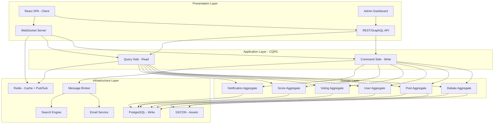
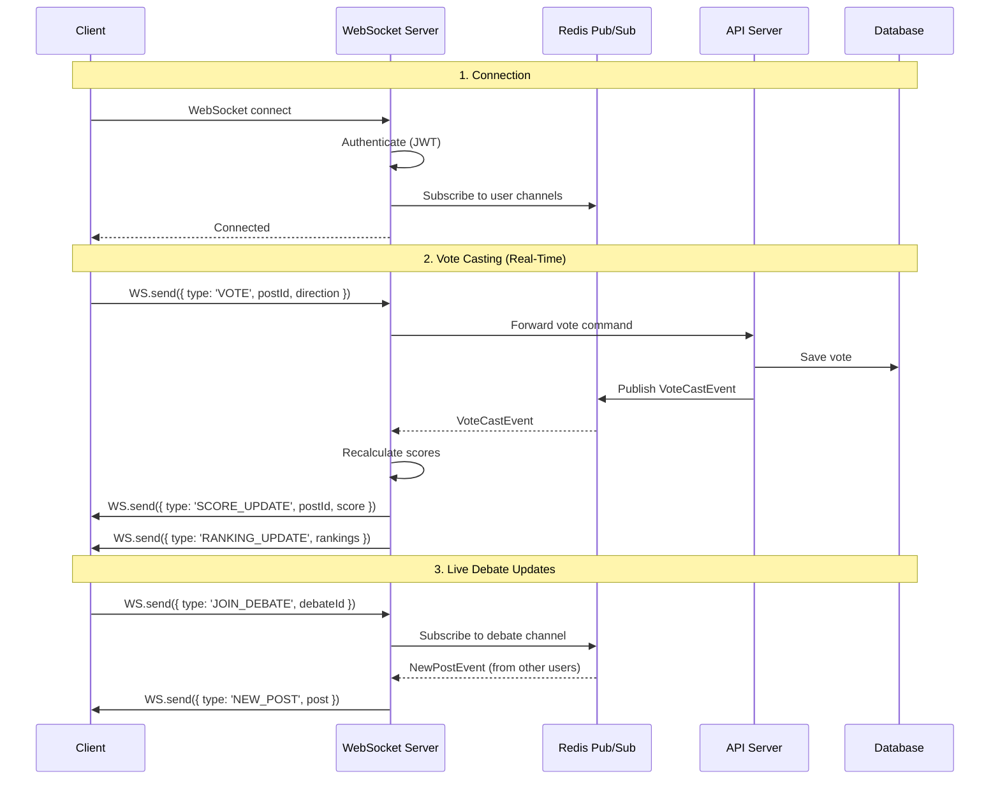
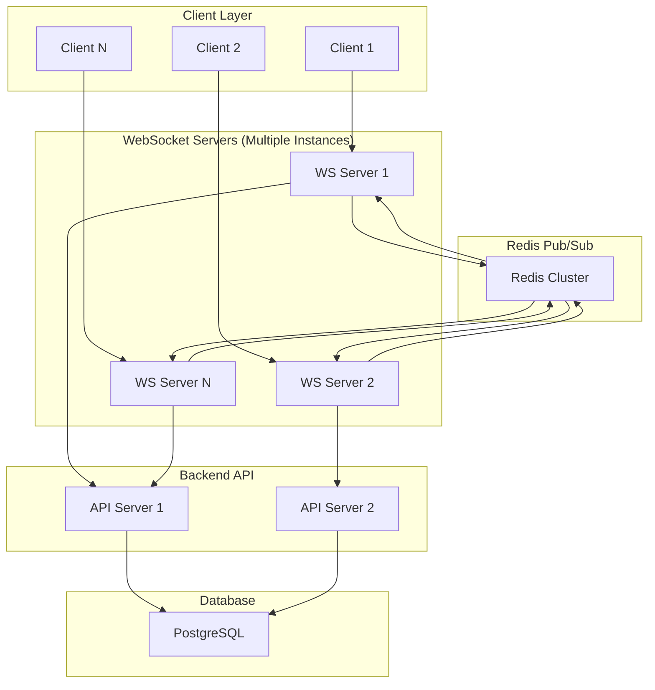
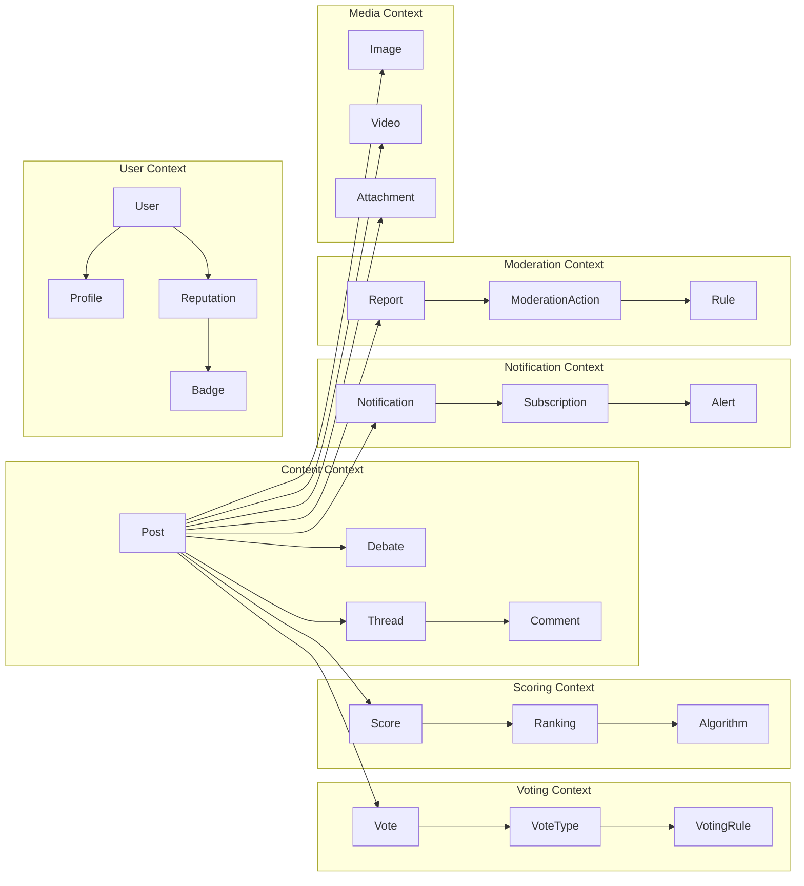
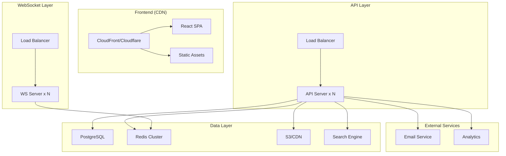
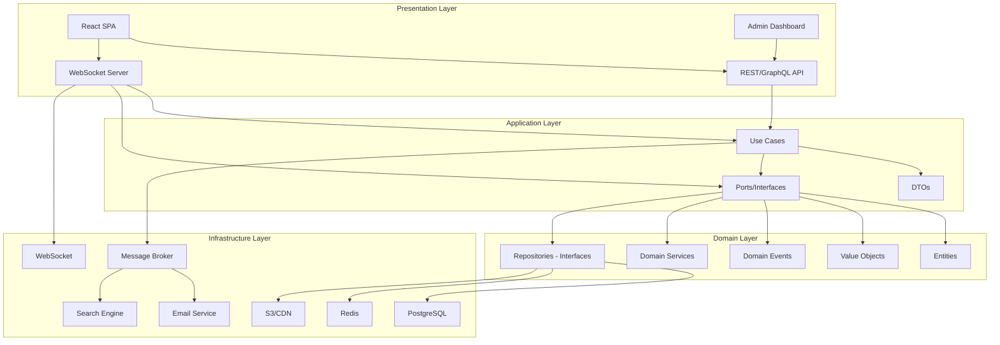
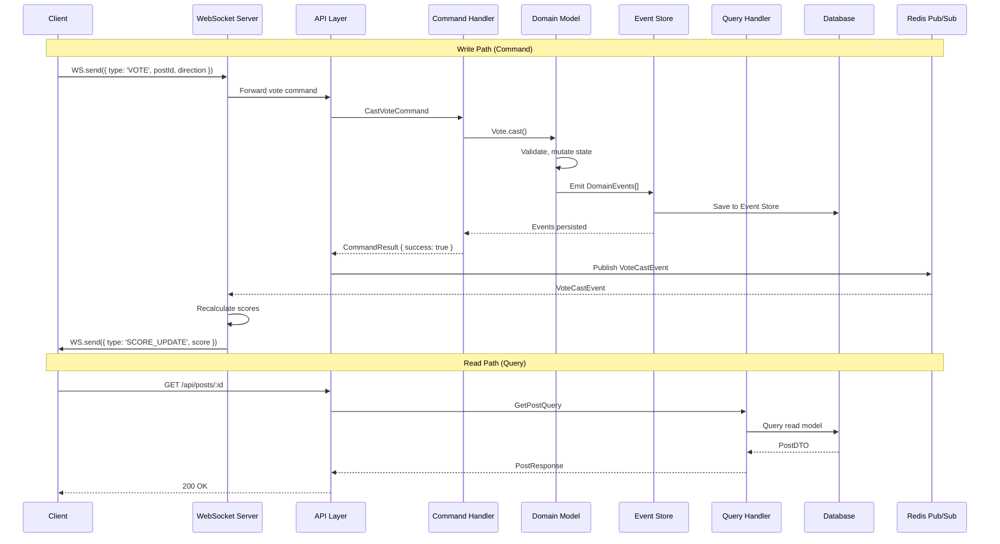
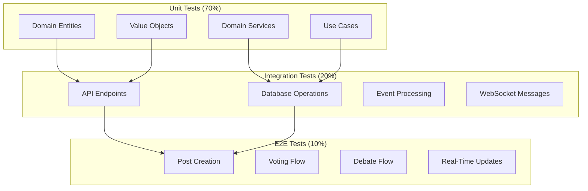
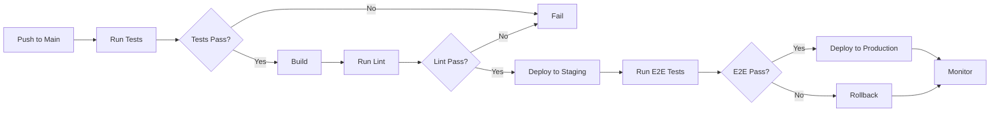
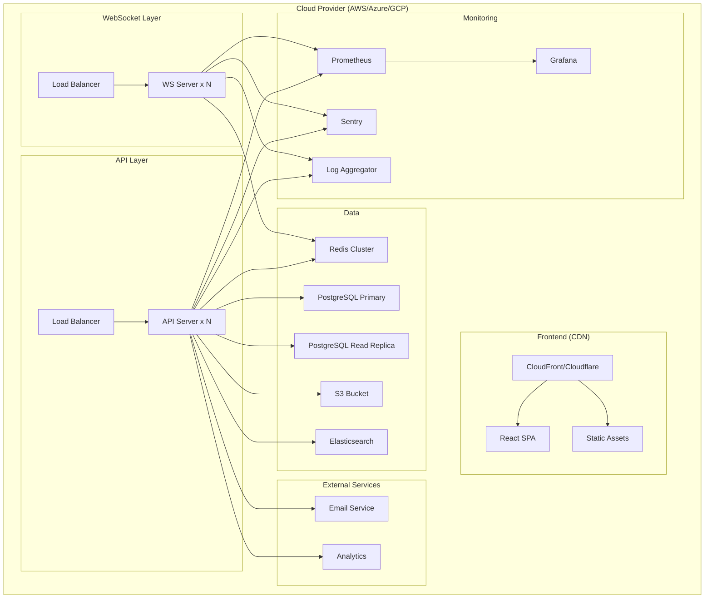

---
slug: A108-forum-debate-platform-requirements
---

# Message Forum / Debate Platform — Requirements Specification

> **Date:** 2026-11-02
> **Scope:** Build a message forum / debate platform with voting/scoring similar to BattleCam or TikTok Battles
> **Tech Stack:** React 19 + Vite + TypeScript + Tailwind CSS + pnpm
> **Architecture:** Clean Architecture + DDD + CQRS + Event-Driven + WebSockets
> **Key Differentiator:** Real-time voting, live debates, scoring/ranking system

---

tags:
  - maturity/deprecated
  - --
## 1. Executive Summary

This document defines the requirements for building a **custom message forum / debate platform** from the ground up. No Reddit, Discord, TikTok Battles, BattleCam, or similar off-the-shelf solutions. This is a greenfield project that will be architected using **Clean Architecture**, **Domain-Driven Design**, **CQRS**, **Event-Driven Architecture**, and **WebSockets** for real-time interactions.

### Why Build from Scratch?

| Reason | Explanation |
|--------|-------------|
| **Full control** | No legacy code, no forced abstractions, no platform limitations |
| **Real-time** | Built for real-time voting, live debates, instant updates |
| **Custom scoring** | Model exactly your voting/scoring algorithms |
| **Ownership** | No vendor lock-in, no platform fee changes, no deprecations |
| **Learning** | Deep understanding of every layer |

### Trade-off Analysis

| Factor | Custom Forum | Reddit | Discord | TikTok Battles |
|--------|-------------|--------|---------|----------------|
| **Time to MVP** | 8-12 weeks | N/A | N/A | N/A |
| **Initial cost** | High ($40k-$200k+) | $0 | $0 | $0 |
| **Long-term cost** | Lower (no platform fees) | Ads, data monetization | Meta ownership | TikTok ownership |
| **Real-time** | Built-in, full control | Limited | Good | Good |
| **Customization** | Unlimited | Plugin-limited | Bot-limited | None |
| **Scoring** | Custom algorithms | Upvote/downvote only | None | Simple voting |
| **Maintenance** | You own it | Reddit owned | Meta owned | TikTok owned |
| **Data ownership** | Full | Reddit/Meta | Meta | TikTok |

**Recommendation:** Build custom if you need real-time interactions, custom scoring algorithms, live debates, or full data ownership.

---

tags:
  - maturity/deprecated
  - --
## 2. Architectural Style

### Recommended: Real-Time CQRS with WebSockets



### Why This Architecture?

| Pattern | Why for Forum/Debate | Trade-off |
|---------|---------------------|-----------|
| **Clean Architecture** | Business rules independent of React, DB, WebSocket | More files, more abstractions |
| **DDD** | Forum has complex domain (debates, votes, scores, rankings) | Requires domain expertise, more modeling |
| **CQRS** | Reads (browsing posts) >> Writes (votes) — scale independently | Two models to maintain, eventual consistency |
| **Event-Driven** | Vote cast → recalculate scores, notify users, update rankings | Complex debugging, eventual consistency |
| **WebSockets** | Real-time voting, live debates, instant updates | Connection management, scaling challenges |
| **Modular Monolith** | Start simple, scale modules independently later | Module boundaries must be well-defined |

### Consistency Model

| Operation | Consistency | Reason |
|-----------|-------------|--------|
| Post creation | **Strong** | Author needs immediate feedback |
| Vote casting | **Eventual** (100-500ms) | WebSocket broadcast, score recalculation |
| Score recalculation | **Eventual** (500ms-2s) | Aggregation across many votes |
| Ranking updates | **Eventual** (1-5s) | Rankings can lag behind votes |
| Notifications | **Eventual** (async) | Email/push notifications are async |
| Search indexing | **Eventual** (5-30s) | Search can lag behind content |
| User authentication | **Strong** | Security-critical |

---

tags:
  - maturity/deprecated
  - --
## 3. Real-Time Communication Architecture

### 3.1 WebSocket Architecture



### 3.2 WebSocket Message Types

```typescript
// WebSocket message types
interface WSMessage {
  type: string
  payload: unknown
  timestamp: number
}

// Client → Server messages
interface VoteMessage extends WSMessage {
  type: 'VOTE'
  payload: {
    postId: string
    direction: 'up' | 'down' | 'hot' | 'cool'
  }
}

interface PostMessage extends WSMessage {
  type: 'CREATE_POST' | 'UPDATE_POST' | 'DELETE_POST'
  payload: {
    debateId?: string
    content: string
    title?: string
    media?: string[]
  }
}

interface JoinDebateMessage extends WSMessage {
  type: 'JOIN_DEBATE'
  payload: {
    debateId: string
  }
}

interface TypingMessage extends WSMessage {
  type: 'TYPING'
  payload: {
    debateId: string
    isTyping: boolean
  }
}

// Server → Client messages
interface ScoreUpdateMessage extends WSMessage {
  type: 'SCORE_UPDATE'
  payload: {
    postId: string
    score: number
    voteCount: number
  }
}

interface RankingUpdateMessage extends WSMessage {
  type: 'RANKING_UPDATE'
  payload: {
    rankings: RankingItem[]
  }
}

interface NewPostMessage extends WSMessage {
  type: 'NEW_POST'
  payload: {
    post: PostDTO
    debateId: string
  }
}

interface VoteCastMessage extends WSMessage {
  type: 'VOTE_CAST'
  payload: {
    postId: string
    direction: 'up' | 'down' | 'hot' | 'cool'
    userId: string
  }
}

interface NotificationMessage extends WSMessage {
  type: 'NOTIFICATION'
  payload: {
    id: string
    type: 'vote' | 'reply' | 'mention' | 'debate_update'
    message: string
    timestamp: number
  }
}

interface TypingIndicatorMessage extends WSMessage {
  type: 'TYPING_INDICATOR'
  payload: {
    userId: string
    userName: string
    debateId: string
    isTyping: boolean
  }
}
```

### 3.3 WebSocket Server Implementation

```typescript
// infrastructure/websocket/websocket-server.ts
import { WebSocket, WebSocketServer } from 'ws'
import { Redis } from 'ioredis'

interface WSClient {
  ws: WebSocket
  userId: string
  username: string
  subscriptions: Set<string>  // Channels to subscribe to
  lastActivity: number
}

class WebSocketServerService {
  private wss: WebSocketServer
  private redis: Redis
  private clients: Map<string, WSClient> = new Map()

  constructor(port: number) {
    this.wss = new WebSocketServer({ port })
    this.redis = new Redis(process.env.REDIS_URL!)
    
    this.setupHandlers()
    this.setupRedisSubscriber()
  }

  private setupHandlers(): void {
    this.wss.on('connection', (ws: WebSocket, req: Request) => {
      // Authenticate client
      const token = this.extractToken(req)
      const userId = this.verifyToken(token)
      
      const client: WSClient = {
        ws,
        userId,
        username: this.getUsername(userId),
        subscriptions: new Set([`user:${userId}`]),
        lastActivity: Date.now(),
      }
      
      this.clients.set(userId, client)
      
      // Subscribe to user-specific channel
      this.redis.subscribe(`user:${userId}`)
      
      // Handle incoming messages
      ws.on('message', (data: string) => {
        const message = JSON.parse(data) as WSMessage
        this.handleMessage(client, message)
        client.lastActivity = Date.now()
      })
      
      // Handle disconnect
      ws.on('close', () => {
        this.clients.delete(userId)
        this.redis.unsubscribe(`user:${userId}`)
      })
    })
  }

  private handleMessage(client: WSClient, message: WSMessage): void {
    switch (message.type) {
      case 'VOTE':
        this.handleVote(client, message as VoteMessage)
        break
      case 'CREATE_POST':
        this.handleCreatePost(client, message as PostMessage)
        break
      case 'JOIN_DEBATE':
        this.handleJoinDebate(client, message as JoinDebateMessage)
        break
      case 'TYPING':
        this.handleTyping(client, message as TypingMessage)
        break
      default:
        this.sendError(client, 'Unknown message type')
    }
  }

  private async handleVote(client: WSClient, message: VoteMessage): Promise<void> {
    const { postId, direction } = message.payload
    
    // Validate vote
    const canVote = await this.voteService.canVote(client.userId, postId)
    if (!canVote) {
      this.sendError(client, 'Cannot vote on this post')
      return
    }
    
    // Cast vote
    const vote = await this.voteService.castVote(client.userId, postId, direction)
    
    // Recalculate scores
    const score = await this.scoreService.recalculateScore(postId)
    
    // Broadcast to all subscribers of this post
    await this.redis.publish(`post:${postId}`, JSON.stringify({
      type: 'SCORE_UPDATE',
      payload: {
        postId,
        score: score.value,
        voteCount: score.voteCount,
      },
      timestamp: Date.now(),
    }))
    
    // Update rankings
    const rankings = await this.scoreService.getTopRankings(100)
    await this.redis.publish('rankings:global', JSON.stringify({
      type: 'RANKING_UPDATE',
      payload: { rankings },
      timestamp: Date.now(),
    }))
  }

  private setupRedisSubscriber(): void {
    this.redis.on('message', (channel: string, data: string) => {
      // Broadcast to all subscribed clients
      const message = JSON.parse(data) as WSMessage
      
      if (channel.startsWith('user:')) {
        const userId = channel.replace('user:', '')
        const client = this.clients.get(userId)
        if (client && client.ws.readyState === WebSocket.OPEN) {
          client.ws.send(JSON.stringify(message))
        }
      } else if (channel.startsWith('post:')) {
        // Broadcast to all clients subscribed to this post
        this.broadcastToChannel(channel, data)
      } else if (channel === 'rankings:global') {
        // Broadcast to all connected clients
        this.broadcastToAll(data)
      }
    })
  }

  private broadcastToChannel(channel: string, data: string): void {
    // Find all clients subscribed to this channel
    for (const [, client] of this.clients) {
      if (client.subscriptions.has(channel) && client.ws.readyState === WebSocket.OPEN) {
        client.ws.send(data)
      }
    }
  }

  private broadcastToAll(data: string): void {
    for (const [, client] of this.clients) {
      if (client.ws.readyState === WebSocket.OPEN) {
        client.ws.send(data)
      }
    }
  }
}
```

### 3.4 Redis Pub/Sub for Scaling



| Component | Purpose |
|-----------|---------|
| **WebSocket Servers** | Handle client connections, authenticate, route messages |
| **Redis Pub/Sub** | Cross-server message broadcasting, channel subscriptions |
| **Backend API** | Business logic, database operations, vote validation |
| **PostgreSQL** | Persistent storage for posts, votes, users, scores |

---

tags:
  - maturity/deprecated
  - --
## 4. Core Domain Model (DDD)

### 4.1 Bounded Contexts



### 4.2 Key Aggregates

#### 1. Debate Aggregate (Root: `Debate`)

```typescript
// entities/debate.entity.ts
export class Debate {
  private constructor(
    readonly id: DebateId,
    private _title: Title,
    private _description: Description,
    private _status: DebateStatus,
    private _category: CategoryId,
    private _tags: TagId[],
    private _proPosition: Position | null,
    private _conPosition: Position | null,
    private _proScore: Score,
    private _conScore: Score,
    private _proVotes: VoteCount,
    private _conVotes: VoteCount,
    private _proUser: UserId,
    private _conUser: UserId,
    private _posts: PostId[],
    private _createdAt: DateTime,
    private _updatedAt: DateTime,
    private _endsAt: DateTime | null
  ) {}

  static create(params: CreateDebateParams): Debate {
    return new Debate(
      generateId(),
      new Title(params.title),
      new Description(params.description),
      DebateStatus.ACTIVE,
      params.categoryId,
      params.tags || [],
      null,
      null,
      Score.zero(),
      Score.zero(),
      VoteCount.zero(),
      VoteCount.zero(),
      params.proUserId,
      params.conUserId,
      [],
      DateTime.now(),
      DateTime.now(),
      params.endsAt || DateTime.now().addDays(7)
    )
  }

  // Business behavior
  addPost(postId: PostId): void {
    this._posts.push(postId)
    this._updatedAt = DateTime.now()
  }

  updateProPosition(position: Position): void {
    this._proPosition = position
    this._updatedAt = DateTime.now()
  }

  updateConPosition(position: Position): void {
    this._conPosition = position
    this._updatedAt = DateTime.now()
  }

  recordProVote(): void {
    this._proVotes.increment()
    this._proScore = this._proScore.calculate(this._proVotes.value, this._conVotes.value)
    this._updatedAt = DateTime.now()
  }

  recordConVote(): void {
    this._conVotes.increment()
    this._conScore = this._conScore.calculate(this._conVotes.value, this._proVotes.value)
    this._updatedAt = DateTime.now()
  }

  get winner(): 'pro' | 'con' | 'tie' | null {
    if (this._proScore.value > this._conScore.value) return 'pro'
    if (this._conScore.value > this._proScore.value) return 'con'
    return 'tie'
  }

  get isActive(): boolean {
    return this._status === DebateStatus.ACTIVE && 
           (this._endsAt === null || DateTime.now().isBefore(this._endsAt))
  }

  get totalVotes(): number {
    return this._proVotes.value + this._conVotes.value
  }

  get engagement(): number {
    // Engagement = votes + posts + comments
    return this.totalVotes + this._posts.length
  }

  // Domain events
  toDomainEvents(): DomainEvent[] {
    const events: DomainEvent[] = []
    
    if (this.isActive === false && this._status === DebateStatus.ACTIVE) {
      events.push(new DebateEndedEvent(
        this.id, this.winner, this._proScore, this._conScore
      ))
    }
    
    if (this.totalVotes > 0 && this.totalVotes % 100 === 0) {
      events.push(new DebateMilestoneEvent(
        this.id, this.totalVotes, 'votes_reached'
      ))
    }
    
    return events
  }
}

// Value Objects
class Score {
  constructor(
    readonly value: number,
    readonly voteCount: number,
    readonly upvotes: number,
    readonly downvotes: number,
    readonly hotVotes: number,
    readonly coolVotes: number
  ) {}

  static zero(): Score {
    return new Score(0, 0, 0, 0, 0, 0)
  }

  static calculate(upvotes: number, downvotes: number): Score {
    // Wilson score confidence interval for binomial proportion
    const total = upvotes + downvotes
    if (total === 0) return Score.zero()
    
    const observed = upvotes / total
    const z = 1.96  // 95% confidence
    const denominator = 1 + z * z / total
    const center = (observed + z * z / (2 * total)) / denominator
    const spread = z * Math.sqrt((observed * (1 - observed) + z * z / (4 * total * total)) / total)
    
    return new Score(
      center - spread,  // Lower bound of confidence interval
      total,
      upvotes,
      downvotes,
      0,  // hotVotes
      0   // coolVotes
    )
  }

  addUpvote(): Score {
    return new Score(
      this.value + 0.01,  // Simplified score update
      this.voteCount + 1,
      this.upvotes + 1,
      this.downvotes,
      this.hotVotes,
      this.coolVotes
    )
  }

  addDownvote(): Score {
    return new Score(
      this.value - 0.01,  // Simplified score update
      this.voteCount + 1,
      this.upvotes,
      this.downvotes + 1,
      this.hotVotes,
      this.coolVotes
    )
  }
}

class VoteCount {
  constructor(private _value: number) {}
  
  static zero(): VoteCount {
    return new VoteCount(0)
  }
  
  get value(): number { return this._value }
  
  increment(): void {
    this._value++
  }
}
```

#### 2. Post Aggregate (Root: `Post`)

```typescript
// entities/post.entity.ts
export class Post {
  private constructor(
    readonly id: PostId,
    private _content: Content,
    private _status: PostStatus,
    private _author: UserId,
    private _parentPostId: PostId | null,
    private _debateId: DebateId | null,
    private _media: MediaAttachment[],
    private _score: Score,
    private _createdAt: DateTime,
    private _updatedAt: DateTime
  ) {}

  static create(params: CreatePostParams): Post {
    return new Post(
      generateId(),
      new Content(params.content),
      PostStatus.PUBLISHED,
      params.authorId,
      params.parentPostId || null,
      params.debateId || null,
      [],
      Score.zero(),
      DateTime.now(),
      DateTime.now()
    )
  }

  // Business behavior
  addUpvote(): void {
    this._score = this._score.addUpvote()
    this._updatedAt = DateTime.now()
  }

  addDownvote(): void {
    this._score = this._score.addDownvote()
    this._updatedAt = DateTime.now()
  }

  addMedia(media: MediaAttachment): void {
    this._media.push(media)
  }

  removeMedia(mediaId: MediaId): void {
    this._media = this._media.filter(m => m.id !== mediaId)
  }

  get isHot(): boolean {
    // Hot = high score + recent + many votes
    return this._score.value > 0.5 && 
           DateTime.now().diff(this._createdAt).hours < 24 &&
           this._score.voteCount > 10
  }

  get isControversial(): boolean {
    // Controversial = similar upvotes and downvotes
    const total = this._score.upvotes + this._score.downvotes
    if (total === 0) return false
    const ratio = this._score.upvotes / total
    return ratio > 0.4 && ratio < 0.6
  }

  get depth(): number {
    // Depth in comment thread
    return 0
  }
}

class Content {
  constructor(private _value: string) {
    if (_value.length < 1 || _value.length > 10000) {
      throw new Error('Content must be 1-10000 characters')
    }
  }
  get value() { return this._value }
  get wordCount() { return this._value.split(/\s+/).length }
}
```

#### 3. Vote Aggregate (Root: `Vote`)

```typescript
// entities/vote.entity.ts
export class Vote {
  private constructor(
    readonly id: VoteId,
    private _userId: UserId,
    private _postId: PostId,
    private _debateId: DebateId | null,
    private _direction: VoteDirection,
    private _createdAt: DateTime
  ) {}

  static create(params: CreateVoteParams): Vote {
    return new Vote(
      generateId(),
      params.userId,
      params.postId,
      params.debateId || null,
      params.direction,
      DateTime.now()
    )
  }

  // Business behavior
  toggleDirection(): VoteDirection {
    const directions: VoteDirection[] = ['up', 'down', 'hot', 'cool']
    const currentIndex = directions.indexOf(this._direction)
    this._direction = directions[(currentIndex + 1) % directions.length]
    return this._direction
  }

  get isUpvote(): boolean {
    return this._direction === 'up' || this._direction === 'hot'
  }

  get isDownvote(): boolean {
    return this._direction === 'down' || this._direction === 'cool'
  }
}

type VoteDirection = 'up' | 'down' | 'hot' | 'cool'
```

#### 4. User Aggregate (Root: `User`)

```typescript
// entities/user.entity.ts
export class User {
  private constructor(
    readonly id: UserId,
    private _username: Username,
    private _email: Email,
    private _passwordHash: PasswordHash,
    private _role: UserRole,
    private _reputation: Reputation,
    private _badges: Badge[],
    private _isActive: boolean,
    private _lastLoginAt: DateTime | null
  ) {}

  static create(params: CreateUserParams): User {
    return new User(
      generateId(),
      new Username(params.username),
      new Email(params.email),
      new PasswordHash(params.passwordHash),
      UserRole.USER,
      Reputation.zero(),
      [],
      true,
      null
    )
  }

  // Business behavior
  addReputation(points: number): void {
    this._reputation = this._reputation.add(points)
  }

  removeReputation(points: number): void {
    this._reputation = this._reputation.subtract(points)
  }

  addBadge(badge: Badge): void {
    if (!this._badges.find(b => b.id === badge.id)) {
      this._badges.push(badge)
    }
  }

  assignRole(role: UserRole): void {
    this._role = role
  }

  deactivate(): void {
    this._isActive = false
  }

  activate(): void {
    this._isActive = true
    this._lastLoginAt = DateTime.now()
  }

  get level(): UserLevel {
    return this._reputation.calculateLevel()
  }

  get canModerate(): boolean {
    return this._role === UserRole.MODERATOR || this._role === UserRole.ADMIN
  }

  get canCreateDebate(): boolean {
    return this._reputation.value >= 100
  }
}

class Reputation {
  constructor(private _value: number) {}
  
  static zero(): Reputation {
    return new Reputation(0)
  }
  
  get value(): number { return this._value }
  
  add(points: number): Reputation {
    return new Reputation(this._value + points)
  }
  
  subtract(points: number): Reputation {
    return new Reputation(Math.max(0, this._value - points))
  }
  
  calculateLevel(): UserLevel {
    if (this._value >= 10000) return UserLevel.GOD
    if (this._value >= 5000) return UserLevel.MASTER
    if (this._value >= 1000) return UserLevel.EXPERT
    if (this._value >= 500) return UserLevel.ADEPT
    if (this._value >= 100) return UserLevel.INTERMEDIATE
    if (this._value >= 50) return UserLevel.BEGINNER
    return UserLevel.NEWCOMER
  }
}

enum UserLevel {
  NEWCOMER = 'newcomer',
  BEGINNER = 'beginner',
  INTERMEDIATE = 'intermediate',
  ADEPT = 'adept',
  EXPERT = 'expert',
  MASTER = 'master',
  GOD = 'god',
}

enum UserRole {
  USER = 'user',
  MODERATOR = 'moderator',
  ADMIN = 'admin',
}
```

---

tags:
  - maturity/deprecated
  - --
## 5. Functional Requirements

### 5.1 Posts & Content

| ID | Requirement | Priority | CQRS Side |
|----|-------------|----------|-----------|
| FR-01 | Create post (text) | P0 | Command |
| FR-02 | Edit post | P1 | Command |
| FR-03 | Delete post | P0 | Command |
| FR-04 | Reply to post (threaded comments) | P0 | Command |
| FR-05 | Pin post | P1 | Command |
| FR-06 | Hide post | P2 | Command |
| FR-07 | Post with media (images, videos) | P1 | Command |
| FR-08 | Markdown/HTML formatting | P1 | Command |
| FR-09 | Post scheduling | P2 | Command |
| FR-10 | Post templates | P3 | Command |
| FR-11 | Post search (full-text) | P1 | Query |
| FR-12 | Filter by category, tag, user | P1 | Query |
| FR-13 | Sort by hot, new, top, controversial | P1 | Query |
| FR-14 | Post preview | P1 | Query |
| FR-15 | Post sharing (social media) | P2 | Query |
| FR-16 | Post bookmarks/saves | P2 | Query |
| FR-17 | Post history/versioning | P2 | Query |
| FR-18 | Post analytics (views, engagement) | P2 | Query |

### 5.2 Debates

| ID | Requirement | Priority | CQRS Side |
|----|-------------|----------|-----------|
| FR-20 | Create debate (pro vs con) | P0 | Command |
| FR-21 | Join debate (as pro or con) | P0 | Command |
| FR-22 | Post in debate | P0 | Command |
| FR-23 | Vote in debate (pro/con) | P0 | Command |
| FR-24 | Debate status (active, ended, archived) | P0 | Command |
| FR-25 | Debate categories | P1 | Command |
| FR-26 | Debate tags | P1 | Command |
| FR-27 | Debate scheduling (start/end dates) | P1 | Command |
| FR-28 | Debate templates | P2 | Command |
| FR-29 | Debate search | P1 | Query |
| FR-30 | Filter by status, category, popularity | P1 | Query |
| FR-31 | Sort by hot, new, top, trending | P1 | Query |
| FR-32 | Debate leaderboard | P1 | Query |
| FR-33 | Debate analytics (votes, views, engagement) | P2 | Query |
| FR-34 | Debate sharing | P2 | Query |
| FR-35 | Debate embedding | P3 | Query |
| FR-36 | Live debate (real-time) | P2 | Command |
| FR-37 | Debate timer | P2 | Command |
| FR-38 | Debate moderation | P2 | Command |

### 5.3 Voting & Scoring

| ID | Requirement | Priority | CQRS Side |
|----|-------------|----------|-----------|
| FR-40 | Upvote post | P0 | Command |
| FR-41 | Downvote post | P0 | Command |
| FR-42 | Hot vote (boost) | P1 | Command |
| FR-43 | Cool vote (demote) | P1 | Command |
| FR-44 | Vote on debate (pro/con) | P0 | Command |
| FR-45 | Vote recalculation (Wilson score) | P0 | Command |
| FR-46 | Real-time score updates (WebSocket) | P0 | Query |
| FR-47 | Vote history | P1 | Query |
| FR-48 | Vote limits (rate limiting) | P1 | Command |
| FR-49 | Anti-spam voting | P1 | Command |
| FR-50 | Vote weighting (reputation-based) | P2 | Command |
| FR-51 | Hot posts algorithm | P1 | Query |
| FR-52 | Controversial posts algorithm | P1 | Query |
| FR-53 | Top posts (daily, weekly, monthly) | P1 | Query |
| FR-54 | Trending posts algorithm | P2 | Query |
| FR-55 | Ranking system (global, category, user) | P1 | Query |
| FR-56 | Leaderboard (users, posts, debates) | P1 | Query |
| FR-57 | Score visualization | P1 | Query |
| FR-58 | Vote distribution analytics | P2 | Query |

### 5.4 User Management

| ID | Requirement | Priority | CQRS Side |
|----|-------------|----------|-----------|
| FR-60 | User registration | P0 | Command |
| FR-61 | User login | P0 | Command |
| FR-62 | User logout | P0 | Command |
| FR-63 | Password reset | P0 | Command |
| FR-64 | User profile management | P1 | Command |
| FR-65 | Avatar upload | P1 | Command |
| FR-66 | Bio, links, social media | P1 | Command |
| FR-67 | Reputation system | P1 | Command |
| FR-68 | Badge/achievement system | P2 | Command |
| FR-69 | User levels (newcomer to god) | P1 | Command |
| FR-70 | User search | P1 | Query |
| FR-71 | User leaderboard | P1 | Query |
| FR-72 | User activity feed | P1 | Query |
| FR-73 | User post history | P1 | Query |
| FR-74 | User debate history | P1 | Query |
| FR-75 | User voting history | P2 | Query |
| FR-76 | Two-factor authentication (2FA) | P2 | Command |
| FR-77 | OAuth/Social login (Google, GitHub) | P2 | Command |
| FR-78 | GDPR data export | P2 | Command |
| FR-79 | GDPR account deletion | P2 | Command |
| FR-80 | Account deactivation | P2 | Command |

### 5.5 Real-Time Features

| ID | Requirement | Priority | CQRS Side |
|----|-------------|----------|-----------|
| FR-81 | Real-time vote updates | P0 | Query |
| FR-82 | Real-time score updates | P0 | Query |
| FR-83 | Real-time ranking updates | P0 | Query |
| FR-84 | Live debate chat | P1 | Query |
| FR-85 | Typing indicators | P2 | Query |
| FR-86 | Online user presence | P2 | Query |
| FR-87 | Real-time notifications | P1 | Query |
| FR-88 | WebSocket reconnection | P1 | Query |
| FR-89 | Message queuing (offline) | P2 | Query |
| FR-90 | Heartbeat/ping | P1 | Query |
| FR-91 | Connection status | P1 | Query |
| FR-92 | Broadcast to channels | P1 | Query |
| FR-93 | Rate limiting (WebSocket) | P1 | Command |
| FR-94 | Message validation | P1 | Command |
| FR-95 | Message encryption | P3 | Command |

### 5.6 Notifications

| ID | Requirement | Priority | CQRS Side |
|----|-------------|----------|-----------|
| FR-100 | Vote received notification | P1 | Command |
| FR-101 | Reply notification | P1 | Command |
| FR-102 | Mention notification | P1 | Command |
| FR-103 | Debate update notification | P1 | Command |
| FR-104 | Badge earned notification | P2 | Command |
| FR-105 | Reputation change notification | P2 | Command |
| FR-106 | Email notifications | P2 | Command |
| FR-107 | Push notifications | P2 | Command |
| FR-108 | In-app notifications | P1 | Query |
| FR-109 | Notification preferences | P2 | Command |
| FR-110 | Notification history | P1 | Query |
| FR-111 | Mark as read | P1 | Command |
| FR-112 | Mark all as read | P1 | Command |
| FR-113 | Notification sound | P2 | Query |
| FR-114 | Notification badge count | P1 | Query |

### 5.7 Moderation

| ID | Requirement | Priority | CQRS Side |
|----|-------------|----------|-----------|
| FR-120 | Report post | P1 | Command |
| FR-121 | Report user | P1 | Command |
| FR-122 | Hide post | P1 | Command |
| FR-123 | Delete post | P1 | Command |
| FR-124 | Ban user (temporary) | P1 | Command |
| FR-125 | Ban user (permanent) | P1 | Command |
| FR-126 | Warn user | P1 | Command |
| FR-127 | Edit post (moderator) | P1 | Command |
| FR-128 | Pin post (moderator) | P1 | Command |
| FR-129 | Approve post (moderator) | P2 | Command |
| FR-130 | Moderation log | P2 | Query |
| FR-131 | Moderation dashboard | P2 | Query |
| FR-132 | Auto-moderation rules | P2 | Command |
| FR-133 | Spam detection | P2 | Command |
| FR-134 | Content filtering | P2 | Command |
| FR-135 | Word blacklist | P2 | Command |
| FR-136 | Rate limiting (per user) | P1 | Command |
| FR-137 | IP-based rate limiting | P2 | Command |
| FR-138 | CAPTCHA for suspicious activity | P2 | Command |

### 5.8 Search & Discovery

| ID | Requirement | Priority | CQRS Side |
|----|-------------|----------|-----------|
| FR-140 | Full-text search (posts, debates) | P1 | Query |
| FR-141 | Search by user | P1 | Query |
| FR-142 | Search by tag | P1 | Query |
| FR-143 | Search by category | P1 | Query |
| FR-144 | Search suggestions/autocomplete | P2 | Query |
| FR-145 | Search highlighting | P2 | Query |
| FR-146 | Recent searches | P2 | Query |
| FR-147 | Hot posts | P1 | Query |
| FR-148 | New posts | P1 | Query |
| FR-149 | Top posts (daily, weekly, monthly) | P1 | Query |
| FR-150 | Trending posts | P2 | Query |
| FR-151 | Controversial posts | P1 | Query |
| FR-152 | Featured posts | P1 | Query |
| FR-153 | Related posts | P2 | Query |
| FR-154 | Filter by date range | P1 | Query |
| FR-155 | Filter by score range | P1 | Query |
| FR-156 | Sort by relevance, date, score | P1 | Query |
| FR-157 | Pagination (infinite scroll, page-based) | P1 | Query |
| FR-158 | Search analytics | P2 | Query |

### 5.9 Media & Attachments

| ID | Requirement | Priority | CQRS Side |
|----|-------------|----------|-----------|
| FR-160 | Image upload | P1 | Command |
| FR-161 | Video upload | P2 | Command |
| FR-162 | Image optimization (resize, compress) | P1 | Command |
| FR-163 | Image CDN delivery | P1 | Query |
| FR-164 | Image gallery | P1 | Query |
| FR-165 | Video player | P2 | Query |
| FR-166 | Media metadata (EXIF, dimensions) | P2 | Query |
| FR-167 | Media alt text | P2 | Command |
| FR-168 | Media moderation | P2 | Command |
| FR-169 | Media size limits | P1 | Command |
| FR-170 | Media type restrictions | P1 | Command |
| FR-171 | Media deletion | P1 | Command |
| FR-172 | Media library | P2 | Query |
| FR-173 | Media search | P2 | Query |

### 5.10 Administration

| ID | Requirement | Priority | CQRS Side |
|----|-------------|----------|-----------|
| FR-180 | Admin dashboard | P0 | Query |
| FR-181 | User management UI | P1 | Query/Command |
| FR-182 | Post management UI | P1 | Query/Command |
| FR-183 | Debate management UI | P1 | Query/Command |
| FR-184 | Moderation queue UI | P1 | Query/Command |
| FR-185 | Report management UI | P1 | Query/Command |
| FR-186 | Category management UI | P1 | Query/Command |
| FR-187 | Tag management UI | P1 | Query/Command |
| FR-188 | Badge management UI | P2 | Query/Command |
| FR-189 | Scoring algorithm configuration | P2 | Command |
| FR-190 | Rate limiting configuration | P2 | Command |
| FR-191 | System settings | P1 | Command |
| FR-192 | Analytics dashboard | P2 | Query |
| FR-193 | User analytics | P2 | Query |
| FR-194 | Post analytics | P2 | Query |
| FR-195 | Debate analytics | P2 | Query |
| FR-196 | Voting analytics | P2 | Query |
| FR-197 | Backup/restore | P1 | Command |
| FR-198 | Audit log | P2 | Query |
| FR-199 | System health monitoring | P2 | Query |
| FR-200 | Error logging and reporting | P2 | Query |

### 5.11 API & Integrations

| ID | Requirement | Priority | CQRS Side |
|----|-------------|----------|-----------|
| FR-210 | REST API for posts | P1 | Query/Command |
| FR-211 | REST API for debates | P1 | Query/Command |
| FR-212 | REST API for users | P1 | Query/Command |
| FR-213 | REST API for votes | P2 | Query/Command |
| FR-214 | GraphQL API (optional) | P2 | Query |
| FR-215 | API authentication (JWT) | P1 | Command |
| FR-216 | API rate limiting | P1 | Command |
| FR-217 | API versioning | P1 | Command |
| FR-218 | API documentation (OpenAPI/Swagger) | P1 | Query |
| FR-219 | Webhook on post created | P2 | Command |
| FR-220 | Webhook on vote cast | P2 | Command |
| FR-221 | Third-party integrations (Slack, Discord) | P2 | Command |
| FR-222 | OAuth 2.0 for API clients | P3 | Command |
| FR-223 | RSS/Atom feeds | P2 | Query |
| FR-224 | Social media sharing | P2 | Query |
| FR-225 | Embed codes | P2 | Query |
| FR-226 | Google Analytics integration | P2 | Query |
| FR-227 | SEO optimization | P1 | Query |

---

tags:
  - maturity/deprecated
  - --
## 6. Non-Functional Requirements

### 6.1 Performance

| Metric | Target | Measurement |
|--------|--------|-------------|
| **First Contentful Paint (FCP)** | < 1s | Lighthouse |
| **Largest Contentful Paint (LCP)** | < 2.5s | Lighthouse |
| **Time to First Byte (TTFB)** | < 200ms | CDN edge |
| **First Input Delay (FID)** | < 100ms | Lighthouse |
| **Cumulative Layout Shift (CLS)** | < 0.1 | Lighthouse |
| **Total Blocking Time (TBT)** | < 200ms | Lighthouse |
| **WebSocket latency** | < 50ms | Round-trip time |
| **Vote update latency** | < 500ms | End-to-end |
| **Score recalculation** | < 2s | Server-side |
| **API response time (p95)** | < 200ms | 95th percentile |
| **Search query time** | < 100ms | Full-text search |
| **Concurrent WebSocket connections** | 50,000+ | Load testing |
| **Posts capacity** | 10M+ | Database capacity |
| **Votes capacity** | 1B+ | Database capacity |

### 6.2 Security

| Requirement | Implementation | Standard |
|-------------|----------------|----------|
| **Authentication** | JWT + Refresh Tokens | OAuth 2.0 / OpenID Connect |
| **Authorization** | RBAC (Admin, Moderator, User) | NIST Cybersecurity Framework |
| **Password Storage** | bcrypt (cost factor 12) | OWASP Password Storage |
| **HTTPS** | TLS 1.3 everywhere | OWASP Transport Layer Protection |
| **CORS** | Strict origin allowlist | OWASP CORS |
| **CSP** | Content Security Policy | OWASP CSP |
| **SQL Injection** | Parameterized queries (Prisma/TypeORM) | OWASP SQL Injection |
| **XSS** | React auto-escaping + CSP | OWASP XSS |
| **CSRF** | SameSite cookies + tokens | OWASP CSRF |
| **Rate Limiting** | Token bucket algorithm | OWASP Rate Limiting |
| **Input Validation** | Zod schema validation | OWASP Input Validation |
| **Output Encoding** | Context-aware encoding | OWASP Output Encoding |
| **Secrets Management** | Environment variables + Vault | OWASP Secrets Management |
| **Audit Logging** | Immutable audit trail | OWASP Audit Logging |
| **Data Encryption** | AES-256 at rest, TLS in transit | NIST Encryption Guidelines |
| **2FA** | TOTP (Time-based One-Time Password) | NIST 2FA Guidelines |
| **Session Management** | Secure, HttpOnly, SameSite cookies | OWASP Session Management |
| **API Security** | OAuth 2.0 + JWT | OWASP API Security |
| **File Upload** | MIME validation + size limits + virus scan | OWASP File Upload |
| **WebSocket Security** | TLS, authentication, rate limiting | OWASP WebSocket |
| **Backup** | Daily encrypted backups + 30-day retention | NIST Backup Guidelines |

### 6.3 Availability & Reliability

| Metric | Target |
|--------|--------|
| **Uptime** | 99.9% (8.76 hours downtime/year) |
| **Recovery Time Objective (RTO)** | < 1 hour |
| **Recovery Point Objective (RPO)** | < 15 minutes |
| **Backup Frequency** | Daily (full) + hourly (incremental) |
| **Disaster Recovery** | Multi-region failover |
| **Monitoring** | 24/7 automated alerts |
| **Incident Response** | < 15 minutes acknowledgment |

### 6.4 Scalability



| Component | Scaling Strategy | Reason |
|-----------|-----------------|--------|
| **Frontend** | CDN (global edge) | Static assets cached at edge |
| **WebSocket Servers** | Horizontal (auto-scale) | Handle concurrent connections |
| **API Server** | Horizontal (auto-scale) | Handle traffic spikes |
| **PostgreSQL** | Vertical + Read Replicas | Write-heavy, strong consistency |
| **Redis** | Cluster mode | Cache, session storage, Pub/Sub |
| **S3/CDN** | Horizontal (managed) | Media assets scale automatically |
| **Search** | Horizontal (Elasticsearch) | Full-text search scales independently |

### 6.5 Maintainability

| Metric | Target |
|--------|--------|
| **Code Coverage** | > 80% (unit), > 60% (integration) |
| **Technical Debt Ratio** | < 5% |
| **Cycle Time** | < 2 weeks (feature to production) |
| **Deployment Frequency** | Daily (canary) |
| **Change Failure Rate** | < 5% |
| **Mean Time to Recovery** | < 30 minutes |

---

tags:
  - maturity/deprecated
  - --
## 7. Technical Architecture

### 7.1 Clean Architecture Layers



### 7.2 CQRS Implementation with WebSockets



### 7.3 Database Schema (PostgreSQL)

```sql
-- Core tables (write model)
CREATE TABLE users (
    id UUID PRIMARY KEY,
    username VARCHAR(50) NOT NULL UNIQUE,
    email VARCHAR(255) NOT NULL UNIQUE,
    password_hash VARCHAR(255) NOT NULL,
    role VARCHAR(50) NOT NULL DEFAULT 'user',
    reputation INTEGER NOT NULL DEFAULT 0,
    avatar_url VARCHAR(1000),
    bio TEXT,
    is_active BOOLEAN DEFAULT true,
    last_login_at TIMESTAMP,
    created_at TIMESTAMP DEFAULT NOW()
);

CREATE TABLE debates (
    id UUID PRIMARY KEY,
    title VARCHAR(500) NOT NULL,
    description TEXT NOT NULL,
    status VARCHAR(50) NOT NULL DEFAULT 'active',
    category_id UUID,
    pro_user_id UUID NOT NULL,
    con_user_id UUID NOT NULL,
    pro_score NUMERIC(10, 6) NOT NULL DEFAULT 0,
    con_score NUMERIC(10, 6) NOT NULL DEFAULT 0,
    pro_votes INTEGER NOT NULL DEFAULT 0,
    con_votes INTEGER NOT NULL DEFAULT 0,
    ends_at TIMESTAMP,
    created_at TIMESTAMP DEFAULT NOW(),
    updated_at TIMESTAMP DEFAULT NOW()
);

CREATE TABLE posts (
    id UUID PRIMARY KEY,
    content TEXT NOT NULL,
    status VARCHAR(50) NOT NULL DEFAULT 'published',
    author_id UUID NOT NULL REFERENCES users(id),
    parent_post_id UUID REFERENCES posts(id),
    debate_id UUID REFERENCES debates(id),
    score NUMERIC(10, 6) NOT NULL DEFAULT 0,
    upvotes INTEGER NOT NULL DEFAULT 0,
    downvotes INTEGER NOT NULL DEFAULT 0,
    hot_votes INTEGER NOT NULL DEFAULT 0,
    cool_votes INTEGER NOT NULL DEFAULT 0,
    view_count INTEGER NOT NULL DEFAULT 0,
    created_at TIMESTAMP DEFAULT NOW(),
    updated_at TIMESTAMP DEFAULT NOW()
);

CREATE TABLE votes (
    id UUID PRIMARY KEY,
    user_id UUID NOT NULL REFERENCES users(id),
    post_id UUID NOT NULL REFERENCES posts(id),
    debate_id UUID REFERENCES debates(id),
    direction VARCHAR(50) NOT NULL,
    created_at TIMESTAMP DEFAULT NOW(),
    UNIQUE(user_id, post_id),
    UNIQUE(user_id, debate_id)
);

CREATE TABLE comments (
    id UUID PRIMARY KEY,
    content TEXT NOT NULL,
    author_id UUID NOT NULL REFERENCES users(id),
    post_id UUID NOT NULL REFERENCES posts(id),
    parent_comment_id UUID REFERENCES comments(id),
    score NUMERIC(10, 6) NOT NULL DEFAULT 0,
    created_at TIMESTAMP DEFAULT NOW(),
    updated_at TIMESTAMP DEFAULT NOW()
);

CREATE TABLE media (
    id UUID PRIMARY KEY,
    post_id UUID REFERENCES posts(id) ON DELETE CASCADE,
    url VARCHAR(1000) NOT NULL,
    type VARCHAR(50) NOT NULL,
    mime_type VARCHAR(100) NOT NULL,
    size INTEGER NOT NULL,
    alt_text VARCHAR(500),
    created_at TIMESTAMP DEFAULT NOW()
);

CREATE TABLE notifications (
    id UUID PRIMARY KEY,
    user_id UUID NOT NULL REFERENCES users(id),
    type VARCHAR(50) NOT NULL,
    message TEXT NOT NULL,
    is_read BOOLEAN DEFAULT false,
    created_at TIMESTAMP DEFAULT NOW()
);

CREATE TABLE reports (
    id UUID PRIMARY KEY,
    reporter_id UUID NOT NULL REFERENCES users(id),
    target_type VARCHAR(50) NOT NULL,
    target_id UUID NOT NULL,
    reason TEXT NOT NULL,
    status VARCHAR(50) NOT NULL DEFAULT 'pending',
    created_at TIMESTAMP DEFAULT NOW()
);

CREATE TABLE badges (
    id UUID PRIMARY KEY,
    name VARCHAR(100) NOT NULL UNIQUE,
    description TEXT,
    icon_url VARCHAR(1000),
    requirement TEXT NOT NULL
);

CREATE TABLE user_badges (
    user_id UUID REFERENCES users(id) ON DELETE CASCADE,
    badge_id UUID REFERENCES badges(id) ON DELETE CASCADE,
    earned_at TIMESTAMP DEFAULT NOW(),
    PRIMARY KEY (user_id, badge_id)
);

CREATE TABLE categories (
    id UUID PRIMARY KEY,
    name VARCHAR(100) NOT NULL UNIQUE,
    slug VARCHAR(100) NOT NULL UNIQUE,
    description TEXT,
    parent_id UUID REFERENCES categories(id)
);

CREATE TABLE tags (
    id UUID PRIMARY KEY,
    name VARCHAR(100) NOT NULL UNIQUE,
    slug VARCHAR(100) NOT NULL UNIQUE
);

CREATE TABLE post_tags (
    post_id UUID REFERENCES posts(id) ON DELETE CASCADE,
    tag_id UUID REFERENCES tags(id) ON DELETE CASCADE,
    PRIMARY KEY (post_id, tag_id)
);

-- Read model tables (materialized views)
CREATE TABLE posts_index (
    id UUID PRIMARY KEY,
    content TEXT NOT NULL,
    status VARCHAR(50) NOT NULL,
    author_username VARCHAR(50),
    tags TEXT[],
    score NUMERIC(10, 6),
    upvotes INTEGER,
    downvotes INTEGER,
    hot_votes INTEGER,
    cool_votes INTEGER,
    view_count INTEGER,
    search_vector tsvector,
    updated_at TIMESTAMP DEFAULT NOW()
);

CREATE TABLE rankings (
    entity_type VARCHAR(50) NOT NULL,  -- 'user', 'post', 'debate'
    entity_id UUID NOT NULL,
    rank INTEGER NOT NULL,
    score NUMERIC(10, 6) NOT NULL,
    period VARCHAR(50) NOT NULL,  -- 'daily', 'weekly', 'monthly', 'all_time'
    updated_at TIMESTAMP DEFAULT NOW(),
    PRIMARY KEY (entity_type, entity_id, period)
);

CREATE TABLE user_cache (
    key VARCHAR(500) PRIMARY KEY,
    value JSONB NOT NULL,
    ttl INTEGER NOT NULL,
    created_at TIMESTAMP DEFAULT NOW()
);

CREATE TABLE post_cache (
    key VARCHAR(500) PRIMARY KEY,
    value JSONB NOT NULL,
    ttl INTEGER NOT NULL,
    created_at TIMESTAMP DEFAULT NOW()
);
```

---

tags:
  - maturity/deprecated
  - --
## 8. API Design

### 8.1 REST API Endpoints

```
Posts (Public)
  GET    /api/v1/posts                    List posts (paginated)
  GET    /api/v1/posts/:id                Get post by ID
  POST   /api/v1/posts                    Create post
  PUT    /api/v1/posts/:id                Update post
  DELETE /api/v1/posts/:id                Delete post
  GET    /api/v1/posts/:id/replies        Get post replies
  POST   /api/v1/posts/:id/replies        Reply to post
  GET    /api/v1/posts/:id/media          Get post media
  GET    /api/v1/posts/hot                Hot posts
  GET    /api/v1/posts/new                New posts
  GET    /api/v1/posts/top                Top posts
  GET    /api/v1/posts/controversial      Controversial posts
  GET    /api/v1/posts/trending           Trending posts
  GET    /api/v1/posts/:id/related        Related posts

Debates (Public)
  GET    /api/v1/debates                  List debates
  GET    /api/v1/debates/:id              Get debate
  POST   /api/v1/debates                  Create debate
  POST   /api/v1/debates/:id/join         Join debate
  GET    /api/v1/debates/:id/posts        Get debate posts
  POST   /api/v1/debates/:id/posts        Post in debate
  GET    /api/v1/debates/leaderboard      Debate leaderboard
  GET    /api/v1/debates/hot              Hot debates
  GET    /api/v1/debates/new              New debates
  GET    /api/v1/debates/top              Top debates

Votes
  POST   /api/v1/posts/:id/vote           Vote on post
  POST   /api/v1/debates/:id/vote         Vote on debate
  GET    /api/v1/users/:id/votes          User's vote history

Users
  GET    /api/v1/users                    List users
  GET    /api/v1/users/:id                Get user
  GET    /api/v1/users/:id/posts          User's posts
  GET    /api/v1/users/:id/debates        User's debates
  GET    /api/v1/users/:id/reputation     User's reputation
  GET    /api/v1/users/leaderboard        User leaderboard

Auth
  POST   /api/v1/auth/register            Register user
  POST   /api/v1/auth/login               Login user
  POST   /api/v1/auth/logout              Logout user
  POST   /api/v1/auth/password/reset      Request password reset
  POST   /api/v1/auth/password/confirm    Confirm password reset
  GET    /api/v1/auth/me                  Get current user
  PUT    /api/v1/auth/me                  Update profile
  GET    /api/v1/auth/me/notifications    Get notifications
  PUT    /api/v1/auth/me/notifications/:id Mark notification read
  PUT    /api/v1/auth/me/notifications    Mark all read

Search
  GET    /api/v1/search                   Full-text search
  GET    /api/v1/search/suggestions       Autocomplete

Notifications
  GET    /api/v1/notifications            List notifications
  PUT    /api/v1/notifications/:id        Mark as read
  PUT    /api/v1/notifications            Mark all read

Reports
  POST   /api/v1/reports                  Report post/user
  GET    /api/v1/reports                  List reports (moderator)

Admin
  GET    /api/v1/admin/dashboard          Dashboard stats
  GET    /api/v1/admin/users              List all users
  PUT    /api/v1/admin/users/:id          Update user
  GET    /api/v1/admin/posts              List all posts
  DELETE /api/v1/admin/posts/:id          Delete post
  GET    /api/v1/admin/debates            List all debates
  PUT    /api/v1/admin/debates/:id        Update debate
  GET    /api/v1/admin/reports            List all reports
  PUT    /api/v1/admin/reports/:id        Handle report
  GET    /api/v1/admin/analytics          Analytics data
  GET    /api/v1/admin/settings           System settings
  PUT    /api/v1/admin/settings           Update settings
  GET    /api/v1/admin/audit-log          Audit log
  GET    /api/v1/admin/health             Health check
```

### 8.2 Request/Response Examples

```typescript
// Request: Create Post
interface CreatePostRequest {
  content: string
  debateId?: string
  parentPostId?: string
  media?: string[]
  tags?: string[]
}

// Response: Post
interface PostResponse {
  id: string
  content: string
  status: 'published' | 'hidden' | 'deleted'
  author: {
    id: string
    username: string
    avatar?: string
    reputation: number
    level: string
  }
  parentPostId: string | null
  debateId: string | null
  score: number
  upvotes: number
  downvotes: number
  hotVotes: number
  coolVotes: number
  viewCount: number
  isHot: boolean
  isControversial: boolean
  media: MediaItem[]
  tags: { id: string; name: string; slug: string }[]
  createdAt: string
  updatedAt: string
  replyCount: number
}

// Request: Vote
interface VoteRequest {
  direction: 'up' | 'down' | 'hot' | 'cool'
}

// Response: Vote Cast
interface VoteResponse {
  postId: string
  direction: 'up' | 'down' | 'hot' | 'cool'
  score: number
  voteCount: number
  timestamp: string
}

// Request: Create Debate
interface CreateDebateRequest {
  title: string
  description: string
  categoryId: string
  tags?: string[]
  endsAt?: string  // ISO 8601
}

// Response: Debate
interface DebateResponse {
  id: string
  title: string
  description: string
  status: 'active' | 'ended' | 'archived'
  category: { id: string; name: string }
  tags: { id: string; name: string }[]
  pro: {
    userId: string
    username: string
    score: number
    votes: number
  }
  con: {
    userId: string
    username: string
    score: number
    votes: number
  }
  totalVotes: number
  winner: 'pro' | 'con' | 'tie' | null
  posts: number
  isActive: boolean
  endsAt: string | null
  createdAt: string
  updatedAt: string
}
```

---

tags:
  - maturity/deprecated
  - --
## 9. Frontend Architecture (React 19)

### 9.1 Main App Structure

```
src/
├── components/
│   ├── posts/
│   │   ├── PostCard.tsx
│   │   ├── PostList.tsx
│   │   ├── PostDetail.tsx
│   │   ├── PostForm.tsx
│   │   ├── PostActions.tsx
│   │   ├── PostVotes.tsx
│   │   ├── PostComments.tsx
│   │   └── PostMedia.tsx
│   ├── debates/
│   │   ├── DebateCard.tsx
│   │   ├── DebateList.tsx
│   │   ├── DebateDetail.tsx
│   │   ├── DebateForm.tsx
│   │   ├── DebateVotes.tsx
│   │   ├── DebatePosts.tsx
│   │   └── DebateLeaderboard.tsx
│   ├── voting/
│   │   ├── VoteButton.tsx
│   │   ├── VoteGroup.tsx
│   │   ├── ScoreDisplay.tsx
│   │   └── RankingList.tsx
│   ├── layout/
│   │   ├── Header.tsx
│   │   ├── Footer.tsx
│   │   ├── Sidebar.tsx
│   │   ├── Navigation.tsx
│   │   └── MainLayout.tsx
│   ├── notifications/
│   │   ├── NotificationBell.tsx
│   │   ├── NotificationList.tsx
│   │   └── NotificationItem.tsx
│   ├── search/
│   │   ├── SearchBar.tsx
│   │   ├── SearchResults.tsx
│   │   └── SearchSuggestions.tsx
│   ├── users/
│   │   ├── UserCard.tsx
│   │   ├── UserProfile.tsx
│   │   ├── UserLeaderboard.tsx
│   │   └── UserReputation.tsx
│   └── common/
│       ├── Loading.tsx
│       ├── ErrorBoundary.tsx
│       ├── Image.tsx
│       ├── Pagination.tsx
│       └── MarkdownRenderer.tsx
├── hooks/
│   ├── usePosts.ts
│   ├── usePost.ts
│   ├── useDebates.ts
│   ├── useDebate.ts
│   ├── useVotes.ts
│   ├── useWebSocket.ts
│   ├── useNotifications.ts
│   ├── useAuth.ts
│   ├── useSearch.ts
│   └── useRankings.ts
├── pages/
│   ├── Index.tsx              // Homepage
│   ├── Posts.tsx              // Post listing
│   ├── Post.tsx               // Single post
│   ├── CreatePost.tsx         // Create post
│   ├── Debates.tsx            // Debate listing
│   ├── Debate.tsx             // Single debate
│   ├── CreateDebate.tsx       // Create debate
│   ├── Search.tsx             // Search results
│   ├── User.tsx               // User profile
│   ├── Leaderboard.tsx        // User leaderboard
│   ├── Login.tsx              // Login
│   ├── Register.tsx           // Register
│   ├── Notifications.tsx      // Notifications
│   └── NotFound.tsx           // 404 page
└── utils/
    ├── seo.ts                 // SEO helpers
    ├── metadata.ts            // Page metadata
    └── analytics.ts           // Analytics tracking
```

### 9.2 WebSocket Integration

```typescript
// hooks/useWebSocket.ts
import { useEffect, useRef, useState } from 'react'

interface UseWebSocketOptions {
  url: string
  onMessage?: (message: WSMessage) => void
  onConnect?: () => void
  onDisconnect?: () => void
}

function useWebSocket({ url, onMessage, onConnect, onDisconnect }: UseWebSocketOptions) {
  const wsRef = useRef<WebSocket | null>(null)
  const [isConnected, setIsConnected] = useState(false)
  const [lastMessage, setLastMessage] = useState<WSMessage | null>(null)

  useEffect(() => {
    const ws = new WebSocket(url)
    wsRef.current = ws

    ws.onopen = () => {
      setIsConnected(true)
      onConnect?.()
    }

    ws.onmessage = (event) => {
      const message = JSON.parse(event.data) as WSMessage
      setLastMessage(message)
      onMessage?.(message)
    }

    ws.onclose = () => {
      setIsConnected(false)
      onDisconnect?.()
    }

    ws.onerror = (error) => {
      console.error('WebSocket error:', error)
    }

    return () => {
      ws.close()
    }
  }, [url, onMessage, onConnect, onDisconnect])

  const send = (message: WSMessage) => {
    if (wsRef.current?.readyState === WebSocket.OPEN) {
      wsRef.current.send(JSON.stringify(message))
    }
  }

  return { isConnected, lastMessage, send }
}
```

### 9.3 Admin Dashboard Structure

```
src/admin/
├── components/
│   ├── layout/
│   │   ├── Sidebar.tsx
│   │   ├── Header.tsx
│   │   └── AdminLayout.tsx
│   ├── users/
│   │   ├── UserList.tsx
│   │   ├── UserDetail.tsx
│   │   └── UserForm.tsx
│   ├── posts/
│   │   ├── PostList.tsx
│   │   ├── PostDetail.tsx
│   │   └── PostActions.tsx
│   ├── debates/
│   │   ├── DebateList.tsx
│   │   ├── DebateDetail.tsx
│   │   └── DebateActions.tsx
│   ├── moderation/
│   │   ├── ReportList.tsx
│   │   ├── ReportDetail.tsx
│   │   └── ModerationActions.tsx
│   ├── analytics/
│   │   ├── Dashboard.tsx
│   │   ├── UserAnalytics.tsx
│   │   ├── PostAnalytics.tsx
│   │   ├── DebateAnalytics.tsx
│   │   └── VotingAnalytics.tsx
│   └── settings/
│       ├── GeneralSettings.tsx
│       ├── ScoringSettings.tsx
│       ├── RateLimitSettings.tsx
│       └── ApiSettings.tsx
├── hooks/
│   ├── useAuth.ts
│   ├── useUsers.ts
│   ├── usePosts.ts
│   ├── useDebates.ts
│   ├── useReports.ts
│   ├── useAnalytics.ts
│   └── useSettings.ts
├── pages/
│   ├── Login.tsx
│   ├── Dashboard.tsx
│   ├── Users.tsx
│   ├── UserDetail.tsx
│   ├── Posts.tsx
│   ├── PostDetail.tsx
│   ├── Debates.tsx
│   ├── DebateDetail.tsx
│   ├── Reports.tsx
│   ├── ReportDetail.tsx
│   ├── Analytics.tsx
│   └── Settings.tsx
└── utils/
    ├── validators.ts
    └── formatters.ts
```

---

tags:
  - maturity/deprecated
  - --
## 10. Testing Strategy

### 10.1 Test Pyramid



### 10.2 Testing Tools

| Layer | Tool | Purpose |
|-------|------|---------|
| **Unit** | Vitest | Fast unit testing |
| **Integration** | Vitest + Supertest | API testing |
| **E2E** | Playwright | Browser automation |
| **Mocking** | Vitest mocks | WebSocket mocks |
| **Coverage** | Vitest coverage | Code coverage reporting |
| **Visual** | Playwright screenshots | Visual regression |
| **Performance** | Lighthouse CI | Page speed testing |

### 10.3 Test Examples

```typescript
// Unit Test: Score calculation
import { describe, it, expect } from 'vitest'
import { Score } from '@/entities/score.entity'

describe('Score', () => {
  it('should calculate score from upvotes and downvotes', () => {
    const score = Score.calculate(100, 50)
    
    expect(score.upvotes).toBe(100)
    expect(score.downvotes).toBe(50)
    expect(score.voteCount).toBe(150)
    expect(score.value).toBeGreaterThan(0)
  })
  
  it('should return zero score when no votes', () => {
    const score = Score.calculate(0, 0)
    
    expect(score.value).toBe(0)
    expect(score.voteCount).toBe(0)
  })
  
  it('should add upvote', () => {
    const score = Score.zero()
    const updated = score.addUpvote()
    
    expect(updated.upvotes).toBe(1)
    expect(updated.voteCount).toBe(1)
  })
  
  it('should add downvote', () => {
    const score = Score.zero()
    const updated = score.addDownvote()
    
    expect(updated.downvotes).toBe(1)
    expect(updated.voteCount).toBe(1)
  })
})

// Integration Test: WebSocket Vote
import { describe, it, expect } from 'vitest'
import { WebSocketServerService } from '@/infrastructure/websocket'
import { VoteService } from '@/application/votes'

describe('WebSocketServerService', () => {
  it('should broadcast score update after vote', async () => {
    const wsService = new WebSocketServerService(8080)
    
    // Simulate vote message
    const voteMessage: VoteMessage = {
      type: 'VOTE',
      payload: {
        postId: 'post-123',
        direction: 'up',
      },
      timestamp: Date.now(),
    }
    
    // Handle vote
    await wsService.handleVote(
      { ws: {} as any, userId: 'user-1', username: 'test', subscriptions: new Set(), lastActivity: Date.now() } as any,
      voteMessage
    )
    
    // Verify score update was broadcast
    expect(vi.mocked(wsService.redis.publish)).toHaveBeenCalledWith(
      'post:post-123',
      expect.stringContaining('SCORE_UPDATE')
    )
  })
})
```

---

tags:
  - maturity/deprecated
  - --
## 11. Deployment & DevOps

### 11.1 CI/CD Pipeline



### 11.2 Infrastructure



### 11.3 Environment Strategy

| Environment | Purpose | Auto-Deploy? | Data |
|-------------|---------|--------------|------|
| **Development** | Local development | Manual | Local DB |
| **Staging** | Pre-production testing | On merge to `main` | Anonymized prod data |
| **Production** | Live platform | Manual approval | Real data |

### 11.4 Deployment Targets

| Component | Target | Reason |
|-----------|--------|--------|
| **Frontend** | S3 + CloudFront/Cloudflare | Global CDN, edge caching |
| **WebSocket Server** | AWS Elastic Beanstalk / Azure App Service / Railway / Render | Managed hosting |
| **API Server** | AWS Elastic Beanstalk / Azure App Service / Railway / Render | Managed hosting |
| **PostgreSQL** | AWS RDS / Azure Database / Supabase | Managed database |
| **Redis** | AWS ElastiCache / Upstash | Managed cache + Pub/Sub |
| **Elasticsearch** | AWS OpenSearch / Meilisearch | Managed search |
| **S3** | AWS S3 / Cloudflare R2 | Media assets |

---

tags:
  - maturity/deprecated
  - --
## 12. Project Structure

```
forum-platform/
├── apps/
│   ├── web/                    # Main App (Vite + React)
│   │   ├── src/
│   │   ├── public/
│   │   ├── vite.config.ts
│   │   └── tsconfig.json
│   ├── admin/                  # Admin Dashboard (Vite + React)
│   │   ├── src/
│   │   ├── public/
│   │   ├── vite.config.ts
│   │   └── tsconfig.json
│   └── api/                    # API Server (Node.js/Express)
│       ├── src/
│       ├── package.json
│       └── tsconfig.json
├── packages/
│   ├── domain/                 # Domain layer (shared)
│   │   ├── src/
│   │   │   ├── entities/
│   │   │   │   ├── debate.entity.ts
│   │   │   │   ├── post.entity.ts
│   │   │   │   ├── vote.entity.ts
│   │   │   │   ├── user.entity.ts
│   │   │   │   ├── score.entity.ts
│   │   │   │   └── ranking.entity.ts
│   │   │   ├── value-objects/
│   │   │   │   ├── score.ts
│   │   │   │   ├── username.ts
│   │   │   │   └── content.ts
│   │   │   ├── domain-events/
│   │   │   │   ├── vote-events.ts
│   │   │   │   ├── post-events.ts
│   │   │   │   └── debate-events.ts
│   │   │   ├── domain-services/
│   │   │   └── index.ts
│   │   └── package.json
│   ├── application/            # Application layer (shared)
│   │   ├── src/
│   │   │   ├── use-cases/
│   │   │   │   ├── post-use-cases.ts
│   │   │   │   ├── debate-use-cases.ts
│   │   │   │   ├── vote-use-cases.ts
│   │   │   │   ├── user-use-cases.ts
│   │   │   │   └── score-use-cases.ts
│   │   │   ├── dtos/
│   │   │   ├── ports/
│   │   │   └── index.ts
│   │   └── package.json
│   ├── infrastructure/         # Infrastructure layer (shared)
│   │   ├── src/
│   │   │   ├── database/
│   │   │   ├── cache/
│   │   │   ├── storage/
│   │   │   ├── messaging/
│   │   │   ├── search/
│   │   │   ├── websocket/
│   │   │   │   ├── websocket-server.ts
│   │   │   │   └── websocket-handler.ts
│   │   │   ├── email/
│   │   │   └── index.ts
│   │   └── package.json
│   └── shared/                 # Shared utilities
│       ├── src/
│       │   ├── types/
│       │   ├── utils/
│       │   ├── validators/
│       │   └── index.ts
│       └── package.json
├── docker-compose.yml
├── pnpm-workspace.yaml
├── tsconfig.json
└── package.json
```

---

tags:
  - maturity/deprecated
  - --
## 13. Development Phases

### Phase 1: Foundation (Weeks 1-2)
- [ ] Project setup (monorepo, TypeScript, pnpm)
- [ ] Domain model (Post, Vote, User aggregates)
- [ ] Database schema (PostgreSQL)
- [ ] API skeleton (REST endpoints)
- [ ] Authentication (JWT, RBAC)
- [ ] Basic admin UI (login, dashboard)
- [ ] WebSocket server setup

### Phase 2: Core Forum (Weeks 3-5)
- [ ] Post CRUD operations
- [ ] Voting system (upvote, downvote)
- [ ] Score calculation (Wilson score)
- [ ] Real-time updates (WebSocket)
- [ ] Public forum pages (list, detail)
- [ ] Basic SEO (meta tags, sitemap, robots.txt)

### Phase 3: Debates (Weeks 6-7)
- [ ] Debate creation and joining
- [ ] Debate voting (pro/con)
- [ ] Debate scoring and ranking
- [ ] Debate pages (list, detail, leaderboard)
- [ ] Real-time debate updates

### Phase 4: Advanced Features (Weeks 8-9)
- [ ] User profiles and reputation
- [ ] Badges and achievements
- [ ] Notifications (in-app, email)
- [ ] Search and filtering
- [ ] Media uploads (images, videos)
- [ ] Moderation tools

### Phase 5: Polish & Production (Weeks 10-12)
- [ ] Performance optimization (CDN, caching)
- [ ] E2E tests (Playwright)
- [ ] Load testing
- [ ] Security audit
- [ ] Monitoring and alerting
- [ ] Deployment pipeline (CI/CD)
- [ ] Documentation
- [ ] Beta testing

### Phase 6: Launch & Iterate (Weeks 13+)
- [ ] Production deployment
- [ ] Monitoring and observability
- [ ] User feedback collection
- [ ] Performance tuning
- [ ] Feature enhancements

---

tags:
  - maturity/deprecated
  - --
## 14. Risk Assessment

| Risk | Impact | Likelihood | Mitigation |
|------|--------|------------|------------|
| **Scope creep** | High | High | Strict MVP definition, change control |
| **Underestimating complexity** | High | High | Start simple, iterate, avoid over-engineering |
| **Security vulnerabilities** | Critical | Medium | Security audit, OWASP checklist, penetration testing |
| **WebSocket scaling issues** | High | Medium | Redis Pub/Sub, horizontal scaling, connection limits |
| **Performance issues** | High | Medium | Load testing, caching strategy, CDN |
| **Team skill gaps** | Medium | Medium | Training, pair programming, documentation |
| **Data loss** | Critical | Low | Backups, disaster recovery plan, testing |
| **Timeline overrun** | High | High | Agile sprints, regular reviews, buffer time |
| **Toxic community** | High | High | Moderation tools, reporting, auto-moderation |

---

tags:
  - maturity/deprecated
  - --
## 15. Success Criteria

### MVP (Minimum Viable Product)
- [ ] Post creation, editing, deletion
- [ ] Upvote/downvote system
- [ ] Score calculation (Wilson score)
- [ ] Real-time updates (WebSocket)
- [ ] User authentication
- [ ] Basic admin dashboard
- [ ] Public forum pages

### V1 (Production Ready)
- [ ] Debate creation and voting
- [ ] User profiles and reputation
- [ ] Notifications (in-app, email)
- [ ] Search and filtering
- [ ] Media uploads
- [ ] Moderation tools
- [ ] Performance optimization (CDN, caching)
- [ ] E2E tests
- [ ] CI/CD pipeline
- [ ] Monitoring and logging

### V2 (Advanced)
- [ ] Badges and achievements
- [ ] Advanced scoring algorithms
- [ ] GraphQL API
- [ ] Advanced analytics
- [ ] Webhooks and integrations
- [ ] Multi-language support
- [ ] Live debates (real-time chat)
- [ ] Mobile app (React Native)

---

tags:
  - maturity/deprecated
  - --
## 16. Key Differentiators vs. Reddit/TikTok Battles

| Feature | Custom Forum | Reddit | Discord | TikTok Battles |
|---------|-------------|--------|---------|----------------|
| **Real-time** | Full control, WebSocket-native | Limited | Good | Good |
| **Scoring** | Custom algorithms (Wilson score) | Upvote/downvote only | None | Simple voting |
| **Debates** | Built-in, structured | Thread-based | None | Video-based |
| **Customization** | Unlimited | Limited | Bot-limited | None |
| **Performance** | CDN-global | Good | Good | Good |
| **Data ownership** | Full | Reddit | Meta | TikTok |
| **Maintenance** | Minimal | Platform managed | Meta managed | TikTok managed |
| **Cost** | Hosting only | Ads | Free | Free |
| **Scalability** | Architect to needs | Platform-limited | Platform-limited | Platform-limited |

---

tags:
  - maturity/deprecated
  - --
## 17. References & Sources

### Architectural Patterns
- [[Sources/martin-clean-architecture-2017|Clean Architecture]] — Robert C. Martin
- [[Sources/martin-fowler-patterns|Enterprise Integration Patterns]] — Martin Fowler
- [[Sources/evans-ddd-2003|Domain-Driven Design]] — Eric Evans
- [[Sources/goF-1994|Design Patterns]] — GoF

### Technical Documentation
- [[Sources/react-docs-2026|React 19 Documentation]] — React Team
- [[Sources/microsoft-typescript-handbook|TypeScript Handbook]] — Microsoft
- [[Sources/tailwind-docs-2024|Tailwind CSS Documentation]] — Tailwind Labs
- [[Sources/pnpm-docs-2024|pnpm Documentation]] — pnpm
- [[Sources/vitest-docs-2024|Vitest Documentation]] — Vitest
- [[Sources/playwright-docs-2024|Playwright Documentation]] — Microsoft
- [[Sources/mdn-html-2024|WebSocket API]] — MDN

### Security
- [[Sources/owasp-top-ten-2021|OWASP Top 10]] — OWASP
- [[Sources/nist-cyberframework-2014|NIST Cybersecurity Framework]] — NIST

### Architecture Patterns
- [[Sources/martin-fowler-patterns|CQRS]] — Martin Fowler
- [[Sources/microsoft-distributed-systems|Event-Driven Architecture]] — Microsoft Azure
- [[Sources/martin-fowler-patterns|Repository Pattern]] — Martin Fowler
- [[Sources/martin-fowler-patterns|Service Layer Pattern]] — Martin Fowler
- [[Sources/martin-fowler-patterns|Cache-Aside Pattern]] — Microsoft Azure

### Real-Time Communication
- [[Sources/mdn-html-2024|WebSocket API]] — MDN
- [[Sources/microsoft-distributed-systems|Redis Pub/Sub]] — Microsoft Azure
- [[Sources/martin-fowler-patterns|WebSockets]] — Martin Fowler


## See Also
- [[A001-abstract-factory-pattern]]
- [[A002-abstract-factory-patterns]]
- [[A003-accessibility-a11y]]
- [[A004-accessibility-by-design]]
- [[A005-active-record-pattern]]


