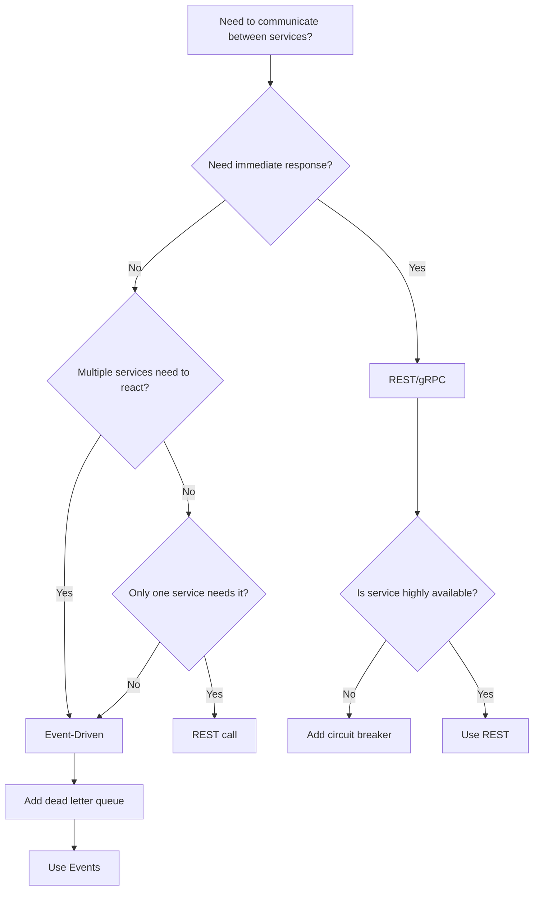

---
slug: microservices
sources:
  - https://martinfowler.com/articles/microservices.html
  - https://docs.microsoft.com/en-us/azure/architecture/guide/microservices/
date: 2026-11-02
tags:
  - maturity/deprecated
  - microservices
  - distributed-systems
  - architecture
  - patterns
  - --
# Microservices

## Definition

Microservices is an **architecture style that structures an application as a collection of loosely coupled services**.

> "Microservices is an architectural style that structures an application as a collection of loosely coupled services." — Martin Fowler

## Problem Addressed

Monolithic architectures lead to:
- **Scaling difficulty**: Hard to scale individual components
- **Deployment difficulty**: Hard to deploy individual components
- **Technology lock-in**: Hard to use different technologies
- **Team coordination**: Hard for multiple teams to work together

## Scope and Boundaries

- Microservices ≠ Distributed Systems (microservices is an architecture style, distributed systems is a category)
- Microservices ≠ SOA (microservices is a specific type of SOA)
- Microservices is an **architecture style**, not a specific pattern

## When to Apply

- When building large applications
- When scaling is important
- When multiple teams are involved
- When technology diversity matters

## Tradeoffs and When to Avoid

| Cost | Description |
|------|-------------|
| **Complexity** — Microservices are complex |
| **Time** — Microservices take time |
| **Over-microservices** — Don't microservice everything |

## Common Misuses

- **Everything microservices**: Not everything needs microservices
- **Confusing with distributed systems**: Microservices ≠ distributed systems
- **Over-microservices**: Too many microservices create complexity

## Related Concepts

- [Modular Monolith](Application Architecture/modular-monolith-architecture.md) — Microservices vs. modular monolith
- [Event-Driven Architecture](event-driven-architecture.md) — Microservices with EDA
- [API Versioning](api-versioning.md) — Microservices with API versioning
- [API Gateway](api-gateway-pattern.md) — Service gateway patterns

---

## Decision Tree: Service Communication Patterns



### When to Use Synchronous (REST/gRPC)

- Client needs immediate response
- Simple request/response pattern
- Service is highly available
- Strong consistency required

### When to Use Asynchronous (Events)

- Multiple services need to react
- Response can be delayed
- Service might be temporarily unavailable
- Eventual consistency is acceptable

---

## Procedural Guidance: Adding a New Service

### Step 1: Define Service Scope

```bash
# Create service folder
mkdir -p src/services/{service-name}
```

### Step 2: Define Service API

```typescript
// src/services/user/user.controller.ts
import { Controller, Get, Post, Body, Param } from '@nestjs/common'

@Controller('users')
export class UserController {
  @Get() findAll() { /* ... */ }
  @Get(':id') findOne() { /* ... */ }
  @Post() create() { /* ... */ }
}
```

### Step 3: Define Service Database

```sql
-- Each service owns its own database/schema
CREATE SCHEMA users;
CREATE TABLE users.users (
  id UUID PRIMARY KEY,
  email VARCHAR(255) UNIQUE NOT NULL,
  created_at TIMESTAMP DEFAULT NOW()
);
```

### Step 4: Set Up Service Communication

```typescript
// For REST communication
import { HttpService } from '@nestjs/axios'

@Injectable()
export class OrderService {
  async getUser(userId: string) {
    return this.httpService.get(`/api/v1/users/${userId}`).toPromise()
  }
}

// For event communication
import { EventsPattern, ClientProxy } from '@nestjs/microservices'

@Injectable()
export class OrderService {
  constructor(private readonly client: ClientProxy) {}

  async placeOrder(order: Order) {
    await this.client.send({ cmd: 'order.placed' }, order)
  }
}
```

### Step 5: Add Health Checks

```typescript
// src/services/user/health.controller.ts
import { Controller, Get } from '@nestjs/common'
import { HealthCheck, HealthCheckService } from '@nestjs/terminus'

@Controller('health')
export class HealthController {
  constructor(private readonly health: HealthCheckService) {}

  @Get()
  @HealthCheck()
  check() {
    return this.health.check([])
  }
}
```

### Step 6: Test the Service

```bash
# Run service tests
pnpm test services/user/

# Run E2E tests
pnpm test:e2e services/user/
```

---

## Copilot Instructions

### When to Read This Note
- Designing service boundaries
- Deciding between monolith and microservices
- Code review: checking for cross-service dependencies
- Adding a new service

### What to Do With This Information
1. **Define boundaries**: Each service owns its data, API, and team
2. **Choose communication**: REST for sync, events for async
3. **Avoid shared databases**: Each service has its own database
4. **Implement circuit breakers**: Handle service failures gracefully
5. **Version APIs**: Each service versioned independently

### Tools to Use
- **VS Code Extension**: Docker — for local service development
- **VS Code Extension**: REST Client — for testing service APIs
- **npm Package**: `opentelemetry` — for distributed tracing
- **npm Package**: `@nestjs/microservices` — for NestJS microservices
- **Terminal Command**: `pnpm add @nestjs/microservices @types/opentelemetry` — install microservices packages
- **Terminal Command**: `docker-compose up` — start local services

### Agents to Invoke
- **Architecture Validation Agent**: Run when designing new service boundaries
- **Security Review Agent**: Run when adding inter-service communication

### Integration with Other Notes
- Read [[Application Architecture/modular-monolith-architecture]] for when to choose monolith over microservices
- Read [event-driven-architecture](https://en.wikipedia.org/wiki/Event-driven_architecture) for async communication patterns
- Read [api-gateway-pattern](https://martinfowler.com/articles/microservices.html#APIGateway) for service gateway patterns
- read [circuit-breaker-pattern](https://martinfowler.com/bliki/CircuitBreaker.html) for failure handling
- read [[Project File Conventions]] for folder structure

### Common Pitfalls
- Don't create microservices for a small team (start with modular monolith)
- Don't share databases between services (each service owns its data)
- Don't use synchronous calls for everything (use events for decoupling)
- Don't forget to handle service failures (implement circuit breakers)
- Don't create too many services (start with 3-5, add as needed)
- Don't couple services through direct database access (use APIs only)

### Quick Validation Checklist
- [ ] Does each service own its data?
- [ ] Can each service be deployed independently?
- [ ] Is there a clear team ownership for each service?
- [ ] Are service boundaries documented?
- [ ] Is there a health check endpoint?
- [ ] Are inter-service calls handled with circuit breakers?

## Project Observations

- The project uses microservices:
  - The project's architecture patterns note covers microservices (from existing notes)
  - No evidence of microservices in existing code (src/ is empty)
- File naming conventions support microservices:
  - `*.test.ts` — Test files
  - `*.spec.ts` — Spec files

---

## Service Boundaries

### How to Define Service Boundaries

```
┌─────────────────────────────────────────────────────────┐
│  Service: User Service                                  │
│  ┌─────────────────────────────────────────────────┐    │
│  │  Owns: user table, auth tokens, profiles        │    │
│  │  API: /api/v1/users/*                           │    │
│  │  Team: 2-4 developers                           │    │
│  │  DB: PostgreSQL (own schema)                    │    │
│  └─────────────────────────────────────────────────┘    │
├─────────────────────────────────────────────────────────┤
│  Service: Order Service                                 │
│  ┌─────────────────────────────────────────────────┐    │
│  │  Owns: order table, order items, status         │    │
│  │  API: /api/v1/orders/*                          │    │
│  │  Team: 2-4 developers                           │    │
│  │  DB: PostgreSQL (own schema)                    │    │
│  └─────────────────────────────────────────────────┘    │
├─────────────────────────────────────────────────────────┤
│  Service: Payment Service                               │
│  ┌─────────────────────────────────────────────────┐    │
│  │  Owns: payment table, transactions              │    │
│  │  API: /api/v1/payments/*                        │    │
│  │  Team: 1-2 developers                           │    │
│  │  DB: PostgreSQL (own schema)                    │    │
│  └─────────────────────────────────────────────────┘    │
└─────────────────────────────────────────────────────────┘
```

### Bounded Context → Service Mapping

| Bounded Context | Service | API Prefix | Database |
|----------------|---------|-----------|----------|
| User | User Service | `/api/v1/users/` | `users` schema |
| Order | Order Service | `/api/v1/orders/` | `orders` schema |
| Payment | Payment Service | `/api/v1/payments/` | `payments` schema |
| Notification | Notification Service | `/api/v1/notifications/` | `notifications` schema |

---

## Service Communication

### Synchronous (REST/gRPC)

```
Client → User Service → Order Service (REST call)
```

**Use when:**
- Real-time response needed
- Simple request/response
- Service is highly available

**Don't use when:**
- Service might be unavailable
- Response can be delayed
- Multiple services need to react

### Asynchronous (Events)

```
Order Service → [OrderPlaced] → Notification Service
                          → Inventory Service
                          → Analytics Service
```

**Use when:**
- Multiple services need to react
- Response can be delayed
- Service might be temporarily unavailable

**Don't use when:**
- Immediate response needed
- Simple request/response
- Only one service needs to react

---

## Copilot Instructions

### When to Read This Note
- Designing service boundaries
- Deciding between monolith and microservices
- Code review: checking for cross-service dependencies
- Adding a new service

### What to Do With This Information
1. **Define boundaries**: Each service owns its data, API, and team
2. **Choose communication**: REST for sync, events for async
3. **Avoid shared databases**: Each service has its own database
4. **Implement circuit breakers**: Handle service failures gracefully
5. **Version APIs**: Each service versioned independently

### Tools to Use
- **VS Code Extension**: Docker — for local service development
- **VS Code Extension**: REST Client — for testing service APIs
- **npm Package**: `opentelemetry` — for distributed tracing
- **npm Package**: `@nestjs/microservices` — for NestJS microservices
- **Terminal Command**: `pnpm add @nestjs/microservices @types/opentelemetry` — install microservices packages
- **Terminal Command**: `docker-compose up` — start local services

### Agents to Invoke
- **Architecture Validation Agent**: Run when designing new service boundaries
- **Security Review Agent**: Run when adding inter-service communication

### Integration with Other Notes
- Read [[Application Architecture/modular-monolith-architecture]] for when to choose monolith over microservices
- Read [event-driven-architecture](https://en.wikipedia.org/wiki/Event-driven_architecture) for async communication patterns
- Read [api-gateway-pattern](https://martinfowler.com/articles/microservices.html#APIGateway) for service gateway patterns
- read [circuit-breaker-pattern](https://martinfowler.com/bliki/CircuitBreaker.html) for failure handling
- read [[Project File Conventions]] for folder structure

### Common Pitfalls
- Don't create microservices for a small team (start with modular monolith)
- Don't share databases between services (each service owns its data)
- Don't use synchronous calls for everything (use events for decoupling)
- Don't forget to handle service failures (implement circuit breakers)
- Don't create too many services (start with 3-5, add as needed)
- Don't couple services through direct database access (use APIs only)

### Quick Validation Checklist
- [ ] Does each service own its data?
- [ ] Can each service be deployed independently?
- [ ] Is there a clear team ownership for each service?
- [ ] Are service boundaries defined by business domain?
- [ ] Is inter-service communication documented?
- [ ] Are failure handling strategies in place?

## Sources

- [[Sources/martin-fowler-patterns|martin-fowler-patterns]]


