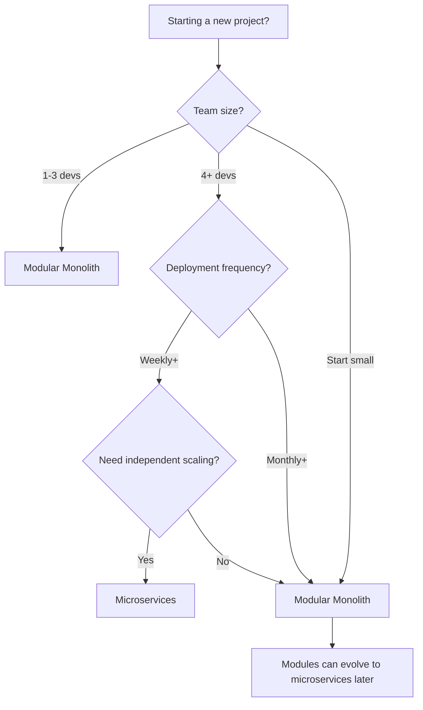

---
slug: Application Architecture/modular-monolith-architecture
sources:
  - https://martinfowler.com/bliki/ModularMonolith.html
  - https://www.infoq.com/articles/Application Architecture/modular-monolith-architecture/
date: 2026-11-02
tags:
  - maturity/deprecated
  - Application Architecture/modular-monolith-architecture
  - architecture
  - monolith
  - microservices
  - --
# Modular Monolith

## Definition

A Modular Monolith is a **single deployed application that maintains explicit internal module boundaries**. It combines the simplicity of a monolith with the organizational benefits of modular design.

> "A modular monolith is a single deployment unit with well-defined module boundaries." — Martin Fowler

## Problem Addressed

Monoliths without modules lead to:
- **Spaghetti code**: No clear boundaries between concerns
- **Team coordination**: Developers interfere with each other's work
- **Testing difficulty**: Hard to test isolated components

## Scope and Boundaries

- Modular Monolith ≠ Microservices (single deployment unit)
- Modules are **logical boundaries**, not physical deployments
- Modules can evolve into microservices later if needed

## When to Apply

- When starting a new project
- When a monolith is too disorganized
- When teams need clear boundaries without deployment complexity
- As a starting point before considering microservices

## Tradeoffs and When to Avoid

| Cost | Description |
|------|-------------|
| **Single deployment** — Can't scale modules independently |
| **Shared database** — Modules share the same data layer |
| **Single point of failure** — All modules go down together |

## Common Misuses

- **Fake modules**: Physical separation without logical boundaries
- **Over-engineering**: Creating modules before they're needed
- **Confusing with microservices**: Modular monolith is a single deployment

## Related Concepts

- [Microservices](Architecture/architecture-patterns.md) — Alternative for scaling
- [Clean Architecture](Architecture/clean-architecture.md) — Module boundaries
- [DDD Patterns](Architecture/Application Architecture/domain-driven-design.md) — Module design

## Project Observations

- The project is currently a single application (no evidence of microservices)
- File naming conventions support modular design
- pnpm workspace supports modular structure if needed

## Sources

- [[Sources/martin-fowler-patterns|martin-fowler-patterns]]

---

## Decision Tree: Modular Monolith vs Microservices



### When to Choose Modular Monolith

- Team has 1-5 developers
- Deployment frequency is < weekly
- No need to scale individual components independently
- Starting a new project (start simple, scale later)
- Budget is limited (no DevOps overhead)

### When to Choose Microservices

- Team has 5+ developers working independently
- Need to scale individual components independently
- Different components have different tech requirements
- Need independent deployment cycles
- Have DevOps infrastructure in place

---

## Procedural Guidance: Setting Up a Modular Monolith

### Step 1: Define Module Boundaries

```bash
# Create module folders
mkdir -p src/modules/{users,orders,payments,notifications}
```

### Step 2: Set Up Module Structure

```bash
# Each module has its own structure
src/modules/users/
├── users.controller.ts
├── users.service.ts
├── users.repository.ts
├── users.types.ts
└── users.test.ts
```

### Step 3: Configure Module Imports

```typescript
// src/app.module.ts
import { UsersModule } from './modules/users/users.module'
import { OrdersModule } from './modules/orders/orders.module'

@Module({
  imports: [UsersModule, OrdersModule],
})
export class AppModule {}
```

### Step 4: Enforce Module Boundaries

```bash
# Add ESLint rule to prevent cross-module imports
# .eslintrc.js
{
  rules: {
    'no-restricted-imports': [
      'error',
      {
        patterns: [
          'modules/users/**',  // users can't import from other modules
        ],
      },
    ],
  },
}
```

### Step 5: Test Module Isolation

```bash
# Run tests per module
pnpm test modules/users/
pnpm test modules/orders/
```

---

## Copilot Instructions

### When to Read This Note
- Deciding between modular monolith and microservices
- Setting up a new project's module structure
- Code review: checking for module boundary violations
- Refactoring a monolith into modules

### What to Do With This Information
1. **Start with modular monolith** unless you have 5+ developers
2. **Define clear module boundaries** before writing code
3. **Enforce boundaries** with ESLint rules
4. **Test modules independently**
5. **Don't create microservices prematurely** — modules can evolve later

### Tools to Use
- **VS Code Extension**: ESLint — for enforcing module boundaries
- **npm Package**: `eslint-plugin-no-restricted-imports` — for cross-module import prevention
- **Terminal Command**: `pnpm add -D eslint-plugin-no-restricted-imports` — install boundary enforcement

### Integration with Other Notes
- Read [microservices](https://martinfowler.com/microservices.html) for when to consider microservices
- Read [clean-architecture](https://martinfowler.com/bliki/CleanArchitecture.html) for module-level architecture
- read [[Project File Conventions]] for folder structure

### Common Pitfalls
- Don't create physical folders without logical boundaries
- Don't over-engineer modules before they're needed
- Don't confuse modular monolith with microservices
- Don't share database tables between modules (use separate schemas)

### Quick Validation Checklist
- [ ] Does each module have its own controller, service, repository?
- [ ] Can modules be tested independently?
- [ ] Are cross-module imports restricted?
- [ ] Does each module have a clear responsibility?
- [ ] Can modules be extracted to microservices later?


