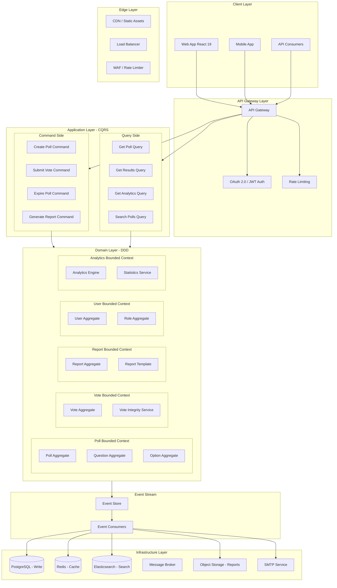
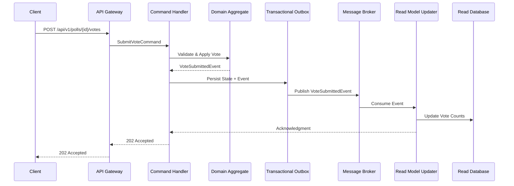
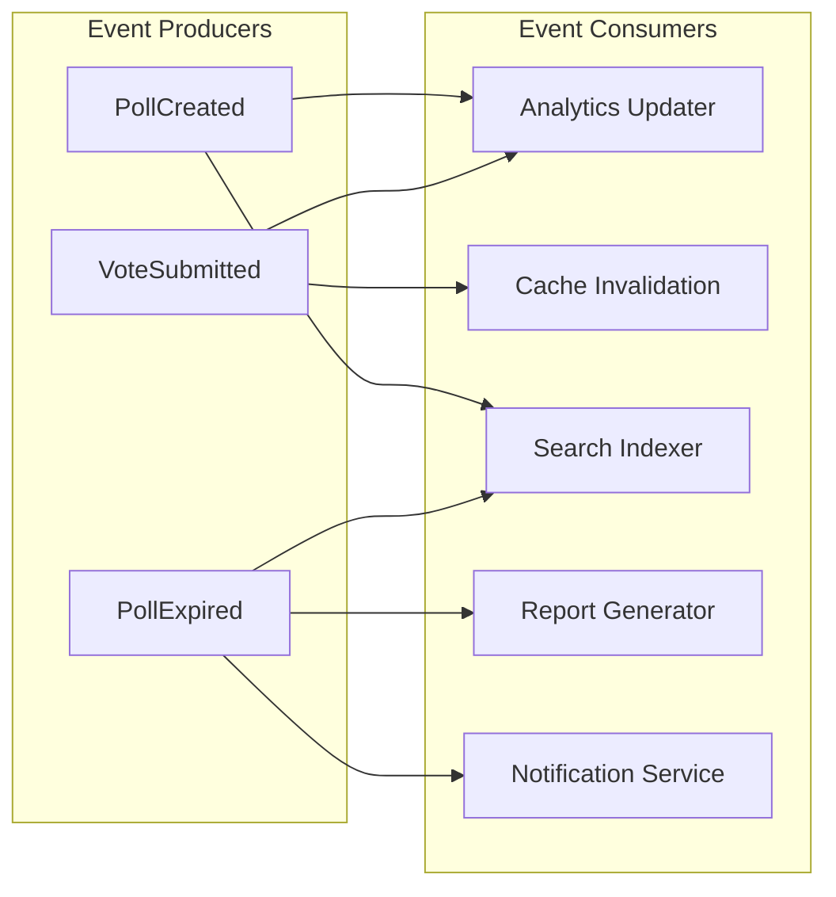
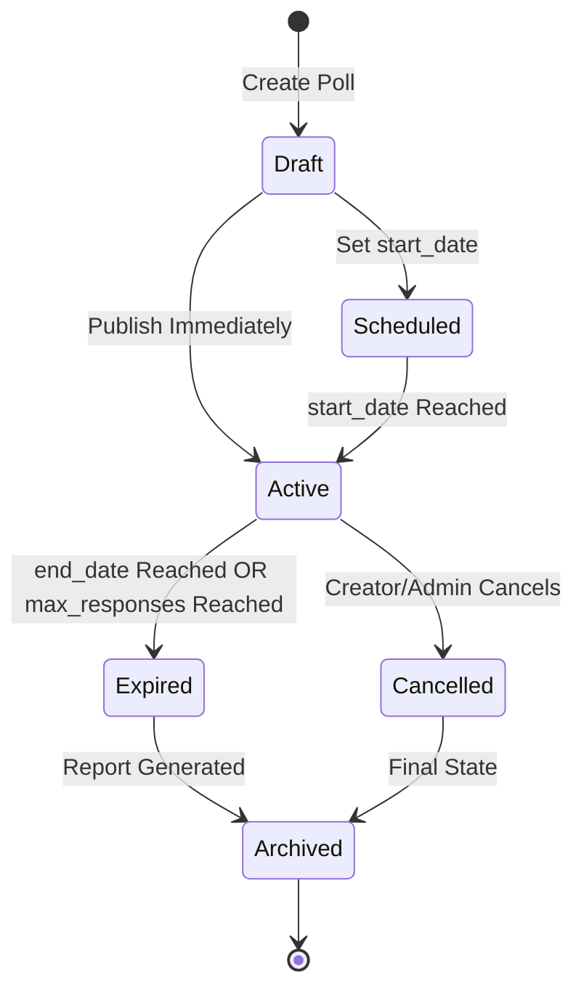
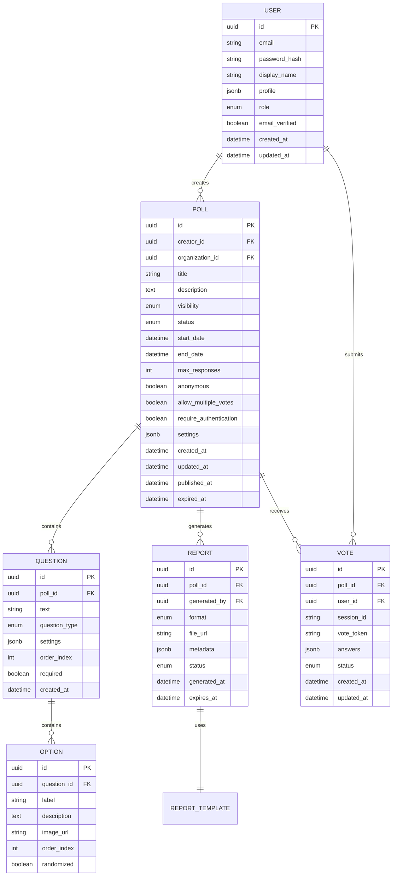
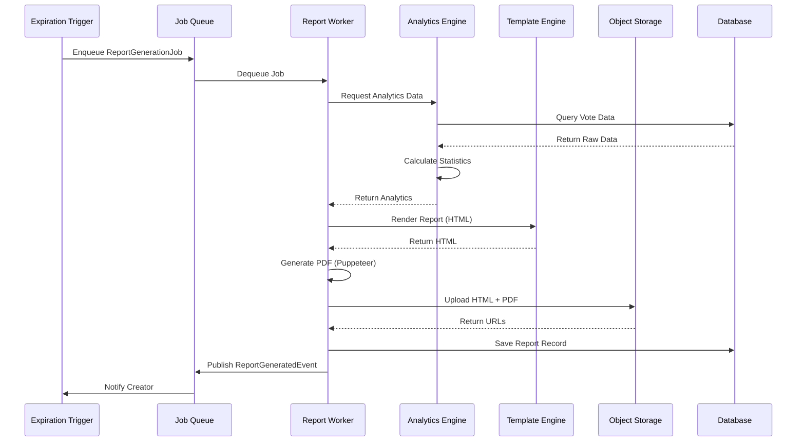

---
slug: polling-platform-requirements
title: Polling Platform Requirements
description: Comprehensive requirements for a custom Polling Platform with Voting, automated report generation, and real-time analytics built from scratch using Clean Architecture, DDD, CQRS, and Event-Driven patterns.
author: Copilot
source: vault-research
canonical_url: 
tags:
  - maturity/experimental
  - requirements
  - polling
  - voting
  - analytics
  - reporting
  - architecture
created_on: 2025-01-15
updated_on: 2025-01-15
verification_status: verified
claims_supported: 12
access_limitations: None
---

# Polling Platform Requirements

## 1. Executive Summary

### 1.1 Purpose

This document defines the comprehensive requirements for building a **Polling Platform** — a custom, from-scratch software system that enables users to create, manage, and analyze polls with real-time voting capabilities and automated report generation. The platform supports both simple and complex polling scenarios, including date-based and response-count-based poll expiration, anonymous and authenticated voting, and comprehensive analytics reporting.

### 1.2 Scope

The platform encompasses:

- **Poll Creation**: Multi-question polls with various question types (single-choice, multiple-choice, rating scales, open-text, Likert scales)
- **Voting Engine**: Real-time vote capture with anti-fraud mechanisms, rate limiting, and vote integrity validation
- **Analytics Engine**: Real-time vote counting, statistical analysis, and visualization data preparation
- **Report Generation**: Automated report generation when polls expire (by date or response count), with publishable outputs (HTML, PDF, JSON)
- **User Management**: Authentication, authorization, role-based access control (RBAC)
- **Moderation**: Content moderation, spam detection, and poll lifecycle management
- **API Layer**: RESTful API with versioning, pagination, and comprehensive documentation

### 1.3 Architectural Principles

The platform adheres to the following architectural principles:

1. **Low Coupling and High Cohesion**: Each bounded context operates independently with well-defined interfaces
2. **Explicit Trade-off Analysis**: Data consistency (eventual vs. strong), system complexity, and operational overhead are explicitly documented
3. **Clean Architecture Alignment**: Domain logic is isolated from frameworks and infrastructure
4. **DDD Patterns**: Bounded contexts, aggregates, and domain events drive the architecture
5. **CQRS Separation**: Read and write models are optimized independently
6. **Event-Driven Architecture**: Domain events drive asynchronous processing and report generation
7. **Mermaid.js Diagrams**: All complex designs are visualized for verification

### 1.4 Target Audience

- **Platform Administrators**: Manage the platform, users, and moderation
- **Poll Creators**: Create and manage polls, view analytics, publish reports
- **Respondents**: Vote on polls, view results (if permitted)
- **Moderators**: Review and manage poll content and user behavior
- **System Integrators**: Consume the API for third-party integrations

---

## 2. Architectural Style

### 2.1 Overview

The platform follows **Clean Architecture** with **Domain-Driven Design (DDD)**, **Command Query Responsibility Segregation (CQRS)**, and **Event-Driven Architecture (EDA)**. This combination provides:

- **Separation of Concerns**: Domain logic is independent of UI, database, and external APIs
- **Scalability**: Read and write operations scale independently
- **Resilience**: Event-driven processing enables asynchronous, fault-tolerant workflows
- **Maintainability**: Clear boundaries between bounded contexts



### 2.2 Bounded Contexts

| Context | Responsibility | Aggregate Roots | Key Domain Events |
|---------|---------------|-----------------|-------------------|
| **Poll Context** | Poll lifecycle, question/option management | `Poll`, `Question`, `Option` | `PollCreated`, `PollExpired`, `PollPublished`, `QuestionAdded` |
| **Vote Context** | Vote capture, integrity, anti-fraud | `Vote`, `VoteSession` | `VoteSubmitted`, `VoteInvalidated`, `RateLimitExceeded` |
| **Report Context** | Report generation, templates, publishing | `Report`, `ReportTemplate` | `ReportGenerated`, `ReportPublished`, `ReportDownloaded` |
| **User Context** | Authentication, authorization, profiles | `User`, `Role`, `Permission` | `UserRegistered`, `RoleAssigned`, `PermissionGranted` |
| **Analytics Context** | Real-time statistics, aggregation, visualization | `AnalyticsSnapshot`, `Statistic` | `AnalyticsUpdated`, `SnapshotCreated` |

### 2.3 CQRS Implementation

The platform implements CQRS with separate read and write models:

- **Write Model**: Optimized for transactional integrity, domain rules, and validation
- **Read Model**: Optimized for query performance, materialized views, and fast analytics



### 2.4 Event-Driven Architecture

Domain events drive asynchronous workflows:



---

## 3. Functional Requirements

### 3.1 Poll Creation and Management

#### 3.1.1 Create Poll

- **FR-POLL-001**: Users must be able to create a poll with a title, description, and visibility settings
- **FR-POLL-002**: Users must be able to add multiple questions to a single poll
- **FR-POLL-003**: Supported question types:
  - `single_choice`: Radio button selection (one option)
  - `multiple_choice`: Checkbox selection (multiple options)
  - `rating_scale`: Numeric rating (1-5, 1-10, custom range)
  - `likert_scale`: Strongly Disagree → Strongly Agree
  - `open_text`: Free-form text response
  - `rank_order`: Rank options by preference
  - `matrix`: Grid-based rating
- **FR-POLL-004**: Each question must support custom options with labels and optional images/icons
- **FR-POLL-005**: Users must be able to set poll metadata:
  - `start_date`: When the poll becomes active (default: immediate)
  - `end_date`: When the poll expires (date-based expiration)
  - `max_responses`: Maximum number of responses before auto-expiration
  - `anonymous`: Whether responses are anonymous (boolean)
  - `allow_multiple_votes`: Whether users can change their vote (boolean)
  - `require_authentication`: Whether users must be logged in to vote (boolean)
  - `visibility`: `public`, `private`, `link_only`, `organization_only`
- **FR-POLL-006**: Users must be able to set question-level settings:
  - Required vs. optional questions
  - Minimum/maximum selections for multiple-choice
  - Character limits for open-text questions
  - Randomize option order (boolean)

#### 3.1.2 Edit Poll

- **FR-POLL-007**: Poll creators can edit poll settings before the poll starts
- **FR-POLL-008**: Poll creators can edit question text and options before any votes are submitted
- **FR-POLL-009**: Once voting has started, question options cannot be modified (to preserve vote integrity)
- **FR-POLL-010**: Poll creators can extend poll duration or increase max_responses
- **FR-POLL-011**: All edits are audited with timestamps and user IDs

#### 3.1.3 Delete Poll

- **FR-POLL-012**: Poll creators can delete their polls (soft delete with 30-day retention)
- **FR-POLL-013**: Administrators can delete any poll for policy violations
- **FR-POLL-014**: Deleting a poll permanently removes all associated votes and analytics data

#### 3.1.4 Poll Lifecycle States



### 3.2 Voting Engine

#### 3.2.1 Submit Vote

- **FR-VOTE-001**: Authenticated users must be able to submit votes for polls requiring authentication
- **FR-VOTE-002**: Anonymous users must be able to submit votes for polls with `anonymous: true` and `require_authentication: false`
- **FR-VOTE-003**: Each vote must be uniquely identified by a combination of:
  - `poll_id`
  - `user_id` (if authenticated) OR `session_id` (if anonymous)
  - `vote_token` (cryptographically generated, one-time use)
- **FR-VOTE-004**: Users can change their vote if `allow_multiple_votes: true` (new vote replaces old vote)
- **FR-VOTE-005**: Vote submission must be atomic and idempotent (prevent duplicate votes)
- **FR-VOTE-006**: Vote submission must return a confirmation with vote ID and timestamp

#### 3.2.2 Anti-Fraud and Rate Limiting

- **FR-VOTE-007**: Implement rate limiting per IP address (default: 10 votes per minute per poll)
- **FR-VOTE-008**: Implement bot detection using:
  - CAPTCHA after suspicious activity detected
  - Browser fingerprinting
  - Behavioral analysis (mouse movements, timing patterns)
- **FR-VOTE-009**: Detect and prevent vote stuffing:
  - Monitor for unusual vote patterns (sudden spikes)
  - Flag polls with >50% votes from single IP range
  - Require additional verification for high-volume polls
- **FR-VOTE-010**: Implement vote integrity validation:
  - Cryptographic vote tokens (one-time use, expire after 24 hours)
  - Vote tamper detection (hash chain validation)
  - Audit log for all vote modifications

#### 3.2.3 Vote Validation

- **FR-VOTE-011**: Validate that the poll is active (not expired, cancelled, or deleted)
- **FR-VOTE-012**: Validate that the user has not already voted (unless `allow_multiple_votes: true`)
- **FR-VOTE-013**: Validate that all required questions have been answered
- **FR-VOTE-014**: Validate that option values are within expected ranges
- **FR-VOTE-015**: Reject votes with invalid or expired vote tokens

### 3.3 Real-Time Analytics

#### 3.3.1 Vote Counting

- **FR-ANALYTICS-001**: Vote counts must be updated in real-time using Redis cache
- **FR-ANALYTICS-002**: Real-time vote counts must be available via WebSocket for live dashboards
- **FR-ANALYTICS-003**: Aggregate statistics must be calculated per question and per option
- **FR-ANALYTICS-004**: Calculate and display:
  - Total responses
  - Response rate (responses / views, if tracking enabled)
  - Vote distribution (percentages, counts)
  - Response time distribution (time from poll creation to first vote)
  - Geographic distribution (if IP-based geolocation enabled)

#### 3.3.2 Advanced Analytics

- **FR-ANALYTICS-005**: Cross-tabulation analysis (correlation between responses to different questions)
- **FR-ANALYTICS-006**: Trend analysis for polls with ongoing voting (votes over time)
- **FR-ANALYTICS-007**: Demographic segmentation (if user profile data available)
- **FR-ANALYTICS-008**: Statistical significance calculations (confidence intervals, margin of error)
- **FR-ANALYTICS-009**: Sentiment analysis for open-text responses (NLP-powered)
- **FR-ANALYTICS-010**: Response quality scoring (detect incomplete or low-effort responses)

#### 3.3.3 Real-Time Dashboard

- **FR-ANALYTICS-011**: Live dashboard for poll creators showing real-time vote counts
- **FR-ANALYTICS-012**: WebSocket connection for push-based real-time updates
- **FR-ANALYTICS-013**: Visual charts (bar charts, pie charts, line charts, heatmaps)
- **FR-ANALYTICS-014**: Export analytics data as JSON or CSV

### 3.4 Report Generation

#### 3.4.1 Automated Report Trigger

- **FR-REPORT-001**: Reports are automatically generated when a poll expires:
  - **Date-based**: When `end_date` is reached
  - **Response-count-based**: When `max_responses` is reached
  - **Manual**: Poll creator can trigger report generation early
- **FR-REPORT-002**: Report generation must complete within 60 seconds for polls with up to 100,000 responses
- **FR-REPORT-003**: Report generation failures must be retried with exponential backoff (max 3 retries)
- **FR-REPORT-004**: Failed report generations must trigger an alert to the poll creator

#### 3.4.2 Report Content

- **FR-REPORT-005**: Each report must include:
  - Poll title, description, and metadata
  - Creation date, expiration date, total responses
  - Question-by-question results with visualizations
  - Statistical summaries (mean, median, mode, standard deviation for numeric questions)
  - Response distribution charts
  - Demographic breakdowns (if available)
  - Methodology notes (sample size, margin of error, response rate)
  - Raw data export link (for authorized users only)
  - Report ID, generation timestamp, and expiration notice

- **FR-REPORT-006**: For multiple-choice questions, include:
  - Option labels
  - Vote counts
  - Percentages (with rounding rules)
  - Visual bar charts

- **FR-REPORT-007**: For rating scale questions, include:
  - Mean rating
  - Median rating
  - Standard deviation
  - Distribution histogram
  - Rating frequency table

- **FR-REPORT-008**: For open-text questions, include:
  - Word frequency analysis
  - Sentiment distribution
  - Top themes (keyword extraction)
  - Sample responses (anonymized)

- **FR-REPORT-009**: For Likert scale questions, include:
  - Agreement distribution
  - Net promoter score (if applicable)
  - Top/bottom box analysis

#### 3.4.3 Report Formats

- **FR-REPORT-010**: Support multiple output formats:
  - **HTML**: Interactive report with charts (Chart.js or D3.js)
  - **PDF**: Printable, paginated report with embedded charts
  - **JSON**: Machine-readable data for programmatic consumption
  - **CSV**: Raw data export for spreadsheet analysis

- **FR-REPORT-011**: Reports must be accessible via:
  - Public URL (if poll visibility is `public` or `link_only`)
  - Private URL (if poll visibility is `private` or `organization_only`)
  - API endpoint (`GET /api/v1/polls/{id}/reports/{reportId}`)

#### 3.4.4 Report Publishing

- **FR-REPORT-012**: Poll creators can publish reports to:
  - Public website (embeddable iframe)
  - Social media (auto-generated summary cards)
  - Email (send to registered stakeholders)
  - Slack/Discord (webhook integration)

- **FR-REPORT-013**: Published reports must include:
  - Watermark with report ID and generation timestamp
  - Disclaimer about methodology and limitations
  - Link to raw data (if authorized)

- **FR-REPORT-014**: Reports must expire after a configurable period (default: 2 years) and be archived

### 3.5 User Management

#### 3.5.1 Authentication

- **FR-USER-001**: Support authentication methods:
  - Email/password with bcrypt hashing
  - OAuth 2.0 (Google, GitHub, Microsoft, Facebook)
  - SSO via SAML 2.0 or OpenID Connect (for enterprise)
  - API keys (for programmatic access)

- **FR-USER-002**: Implement JWT-based session management:
  - Access tokens (15-minute expiration)
  - Refresh tokens (7-day expiration, rotating)
  - Token revocation list (for logout/security events)

- **FR-USER-003**: Support multi-factor authentication (MFA):
  - TOTP (Time-based One-Time Password)
  - SMS-based OTP
  - Email-based OTP

- **FR-USER-004**: Implement password policies:
  - Minimum 8 characters
  - Require uppercase, lowercase, number, special character
  - Password history (prevent reuse of last 5 passwords)
  - Account lockout after 5 failed attempts (15-minute cooldown)

#### 3.5.2 Authorization and RBAC

- **FR-USER-005**: Define roles with permissions:

| Role | Permissions |
|------|------------|
| `respondent` | Vote on public polls, view own responses |
| `poll_creator` | Create polls, edit own polls, view analytics, generate reports |
| `moderator` | All creator permissions + moderate content, suspend users, delete polls |
| `administrator` | Full platform access, user management, system configuration |

- **FR-USER-006**: Support custom role definitions for organizations (tenant-specific roles)
- **FR-USER-007**: Implement permission granularity:
  - `poll:create`, `poll:edit`, `poll:delete`, `poll:view`
  - `vote:submit`, `vote:view`, `vote:invalidate`
  - `report:generate`, `report:view`, `report:publish`
  - `user:manage`, `user:view`, `user:suspend`
  - `system:configure`, `system:monitor`

#### 3.5.3 User Profiles

- **FR-USER-008**: Users can manage profiles:
  - Display name, avatar, bio
  - Email notifications preferences
  - Privacy settings (who can see profile, who can message)
  - Connected accounts (OAuth providers)

### 3.6 Moderation

#### 3.6.1 Content Moderation

- **FR-MOD-001**: Automated content scanning:
  - Profanity filter for poll titles and descriptions
  - Spam detection (repetitive content, URL detection)
  - Hate speech detection (integration with NLP service)
  - Image moderation (NSFW detection for uploaded images)

- **FR-MOD-002**: User reporting system:
  - Users can report polls, votes, or comments as inappropriate
  - Reports are queued for moderator review
  - Reporters receive notifications on resolution

- **FR-MOD-003**: Moderator actions:
  - Hide poll (temporary, pending review)
  - Delete poll (permanent)
  - Suspend user (temporary or permanent)
  - Invalidate votes (bulk action for flagged polls)
  - Add notes to moderation log

#### 3.6.2 Spam Detection

- **FR-MOD-004**: Detect and prevent spam:
  - Rate limiting per user and per IP
  - CAPTCHA for suspicious accounts (new accounts, high activity)
  - Machine learning-based spam scoring
  - Block known spam IP ranges and email providers

- **FR-MOD-005**: Quarantine system:
  - Suspicious polls are placed in quarantine for review
  - Quarantined polls are not visible to general users
  - Creators are notified of quarantine status

### 3.7 Search and Discovery

- **FR-SEARCH-001**: Search polls by:
  - Title, description, tags
  - Creation date, expiration date
  - Category, organization
  - Popularity (most voted, most viewed)

- **FR-SEARCH-002**: Filter polls by:
  - Status (active, expired, draft)
  - Visibility (public, private, link_only)
  - Question type
  - Response count range

- **FR-SEARCH-003**: Full-text search using Elasticsearch with:
  - Typo tolerance
  - Synonym support
  - Faceted navigation
  - Autocomplete suggestions

### 3.8 Multi-Tenancy (Organizations)

- **FR-TENANT-001**: Support organizations/teams with:
  - Dedicated subdomain (e.g., `acme.pollplatform.io`)
  - Custom branding (logo, colors, domain)
  - Separate user pools and permissions
  - Organization-level analytics and reports

- **FR-TENANT-002**: Organization administrators can:
  - Invite/manage members
  - Set organization-wide poll templates
  - View organization-wide analytics
  - Configure SSO and security policies

- **FR-TENANT-003**: Cross-organization collaboration:
  - Share polls with external organizations
  - Joint polls with multiple organizations
  - Cross-organization analytics aggregation

---

## 4. Non-Functional Requirements

### 4.1 Performance

- **NFR-PERF-001**: API response times:
  - Poll creation: < 500ms (p95)
  - Vote submission: < 200ms (p95)
  - Poll retrieval: < 100ms (p95, cached)
  - Results retrieval: < 300ms (p95)
  - Report generation: < 60s (for 100,000 responses)

- **NFR-PERF-002**: System throughput:
  - Support 10,000 concurrent users
  - Handle 1,000 vote submissions per second
  - Process 500 queries per second

- **NFR-PERF-003**: Database performance:
  - Read operations: < 50ms (cached)
  - Write operations: < 100ms (p95)
  - Analytics aggregation: < 1s (materialized views)

### 4.2 Scalability

- **NFR-SCALE-001**: Horizontal scaling:
  - Stateless API servers scale automatically based on CPU/memory
  - Database read replicas scale for query load
  - Redis cache cluster scales for vote count updates

- **NFR-SCALE-002**: Database partitioning:
  - Polls partitioned by `organization_id` (multi-tenancy)
  - Votes partitioned by `poll_id` (hot partition handling)
  - Analytics data partitioned by time range

- **NFR-SCALE-003**: Support polls with up to 10 million responses without performance degradation

### 4.3 Availability and Reliability

- **NFR-AVAIL-001**: 99.9% uptime SLA (43.8 minutes downtime per month maximum)
- **NFR-AVAIL-002**: Multi-region deployment with automatic failover
- **NFR-AVAIL-003**: Database replication with < 5 second lag
- **NFR-AVAIL-004**: Automated backup with 24-hour retention and point-in-time recovery
- **NFR-AVAIL-005**: Graceful degradation: analytics unavailable during outages, but vote capture continues

### 4.4 Security

- **NFR-SEC-001**: Encrypt data at rest (AES-256) and in transit (TLS 1.3)
- **NFR-SEC-002**: Implement OAuth 2.0 / OpenID Connect for authentication
- **NFR-SEC-003**: Sanitize all user inputs to prevent XSS and SQL injection
- **NFR-SEC-004**: Implement CSRF protection for all state-changing operations
- **NFR-SEC-005**: Rate limiting on all API endpoints (configurable per endpoint)
- **NFR-SEC-006**: Audit logging for all administrative actions and security events
- **NFR-SEC-007**: Comply with GDPR, CCPA, and other data protection regulations
- **NFR-SEC-008**: Regular security audits and penetration testing (quarterly)
- **NFR-SEC-009**: Vulnerability scanning in CI/CD pipeline
- **NFR-SEC-010**: Secure secret management (HashiCorp Vault or AWS Secrets Manager)

### 4.5 Data Privacy and Compliance

- **NFR-PRIV-001**: GDPR compliance:
  - Right to access personal data
  - Right to rectification
  - Right to erasure (right to be forgotten)
  - Right to data portability (CSV/JSON export)
  - Right to restrict processing

- **NFR-PRIV-002**: CCPA compliance:
  - Right to know what data is collected
  - Right to delete personal data
  - Right to opt-out of data sales

- **NFR-PRIV-003**: Anonymous voting:
  - No personally identifiable information (PII) linked to votes
  - Anonymous votes stored separately from user profiles
  - IP addresses hashed or anonymized for anonymous polls

- **NFR-PRIV-004**: Data retention policies:
  - Anonymous poll data: retained for 2 years, then anonymized
  - User data: retained until account deletion + 30 days
  - Audit logs: retained for 7 years (compliance)

### 4.6 Maintainability

- **NFR-MAINT-001**: Code coverage: minimum 80% unit test coverage, 60% integration test coverage
- **NFR-MAINT-002**: Documentation: API documentation (OpenAPI 3.0), architecture decision records (ADRs), runbooks
- **NFR-MAINT-003**: Monitoring: comprehensive logging, metrics, and alerting (see Section 4.7)
- **NFR-MAINT-004**: CI/CD: automated testing, building, and deployment (GitOps workflow)
- **NFR-MAINT-005**: Database migrations: versioned, reversible, zero-downtime migrations

### 4.7 Observability

- **NFR-OBS-001**: Distributed tracing using OpenTelemetry
- **NFR-OBS-002**: Centralized logging (ELK Stack or CloudWatch Logs)
- **NFR-OBS-003**: Metrics collection (Prometheus + Grafana)
- **NFR-OBS-004**: Alerting (PagerDuty integration for critical incidents)
- **NFR-OBS-005**: Health check endpoints (`/health`, `/ready`, `/live`)
- **NFR-OBS-006**: Business metrics dashboard:
  - Active polls, total votes, reports generated
  - User growth, retention rates
  - API response times, error rates

### 4.8 Accessibility

- **NFR-ACCESS-001**: WCAG 2.1 AA compliance for all user-facing interfaces
- **NFR-ACCESS-002**: Keyboard navigation support
- **NFR-ACCESS-003**: Screen reader compatibility (ARIA labels, semantic HTML)
- **NFR-ACCESS-004**: Color contrast ratio minimum 4.5:1
- **NFR-ACCESS-005**: Alternative text for all charts and visualizations

### 4.9 Internationalization

- **NFR-I18N-001**: Support for multiple languages (i18n) with:
  - Translatable strings (JSON locale files)
  - Date/number formatting per locale
  - RTL (right-to-left) language support
- **NFR-I18N-002**: Default language: English, with Spanish, French, German, Portuguese as initial targets

---

## 5. Technical Details

### 5.1 Technology Stack

| Layer | Technology | Rationale |
|-------|-----------|-----------|
| **Frontend** | React 19 + Vite + TypeScript | Modern, performant, type-safe UI |
| **Styling** | Tailwind CSS + ShadCN UI | Utility-first CSS, accessible components |
| **State Management** | Zustand / React Query | Lightweight state, server-state caching |
| **Charts** | Chart.js / Recharts | Rich visualization, React-friendly |
| **Backend** | Node.js + TypeScript | Type safety, shared types with frontend |
| **API Framework** | Fastify | High performance, plugin ecosystem |
| **ORM** | Prisma | Type-safe queries, migrations, PostgreSQL |
| **Cache** | Redis | Fast vote count updates, session storage |
| **Search** | Elasticsearch | Full-text search, faceted navigation |
| **Message Broker** | RabbitMQ / NATS | Reliable event distribution, dead letter queues |
| **Event Store** | PostgreSQL (event table) | Simple, reliable, ACID transactions |
| **Database** | PostgreSQL 16 | ACID compliance, JSON support, extensions |
| **Authentication** | OAuth 2.0 + JWT + Pass.js | Industry standard, flexible |
| **Testing** | Vitest + Playwright | Fast unit tests, E2E browser tests |
| **CI/CD** | GitHub Actions | Integrated, YAML-based pipelines |
| **Containerization** | Docker + Docker Compose | Consistent environments |
| **Orchestration** | Kubernetes (production) | Auto-scaling, self-healing |
| **Cloud** | AWS / Azure | Scalable, managed services |
| **Monitoring** | Prometheus + Grafana + OpenTelemetry | Industry-standard observability |
| **Reporting** | Puppeteer / Playwright (PDF), jsPDF | Headless browser PDF generation |

### 5.2 Database Schema (Core Entities)



### 5.3 API Design

#### 5.3.1 REST API Endpoints

**Polls API**

| Method | Endpoint | Description | Auth Required |
|--------|----------|-------------|---------------|
| `POST` | `/api/v1/polls` | Create a new poll | Yes (poll_creator) |
| `GET` | `/api/v1/polls` | List polls (paginated, filterable) | No (public only) |
| `GET` | `/api/v1/polls/{id}` | Get poll details | No (based on visibility) |
| `PATCH` | `/api/v1/polls/{id}` | Update poll settings | Yes (poll_creator) |
| `DELETE` | `/api/v1/polls/{id}` | Delete poll | Yes (poll_creator/admin) |
| `POST` | `/api/v1/polls/{id}/expire` | Manually expire poll | Yes (poll_creator/admin) |
| `GET` | `/api/v1/polls/{id}/embed` | Get embeddable iframe URL | No |

**Votes API**

| Method | Endpoint | Description | Auth Required |
|--------|----------|-------------|---------------|
| `POST` | `/api/v1/polls/{id}/votes` | Submit a vote | Conditional |
| `GET` | `/api/v1/polls/{id}/votes` | Get votes (creator/admin only) | Yes |
| `PUT` | `/api/v1/polls/{id}/votes/{voteId}` | Update vote (if allowed) | Yes (vote owner) |
| `DELETE` | `/api/v1/polls/{id}/votes/{voteId}` | Delete vote | Yes (vote owner/admin) |
| `POST` | `/api/v1/polls/{id}/votes/validate` | Validate vote token | No |

**Results API**

| Method | Endpoint | Description | Auth Required |
|--------|----------|-------------|---------------|
| `GET` | `/api/v1/polls/{id}/results` | Get poll results | No (based on visibility) |
| `GET` | `/api/v1/polls/{id}/analytics` | Get detailed analytics | Yes (poll_creator) |
| `GET` | `/api/v1/polls/{id}/analytics/realtime` | Real-time analytics (WebSocket) | Conditional |
| `GET` | `/api/v1/polls/{id}/export` | Export raw data (CSV/JSON) | Yes (poll_creator) |

**Reports API**

| Method | Endpoint | Description | Auth Required |
|--------|----------|-------------|---------------|
| `POST` | `/api/v1/polls/{id}/reports` | Generate a report | Yes (poll_creator) |
| `GET` | `/api/v1/polls/{id}/reports` | List reports for poll | Yes (poll_creator) |
| `GET` | `/api/v1/reports/{reportId}` | Get report (HTML/PDF/JSON) | No (based on visibility) |
| `GET` | `/api/v1/reports/{reportId}/download` | Download report file | No (based on visibility) |
| `DELETE` | `/api/v1/reports/{reportId}` | Delete report | Yes (poll_creator/admin) |
| `POST` | `/api/v1/reports/{reportId}/publish` | Publish report | Yes (poll_creator) |

**Users API**

| Method | Endpoint | Description | Auth Required |
|--------|----------|-------------|---------------|
| `POST` | `/api/v1/auth/register` | Register new user | No |
| `POST` | `/api/v1/auth/login` | Login | No |
| `POST` | `/api/v1/auth/logout` | Logout | Yes |
| `POST` | `/api/v1/auth/refresh` | Refresh access token | Yes |
| `GET` | `/api/v1/users/me` | Get current user profile | Yes |
| `PATCH` | `/api/v1/users/me` | Update profile | Yes |
| `DELETE` | `/api/v1/users/me` | Delete account | Yes |

**Search API**

| Method | Endpoint | Description | Auth Required |
|--------|----------|-------------|---------------|
| `GET` | `/api/v1/search/polls` | Search polls | No |
| `GET` | `/api/v1/search/suggestions` | Autocomplete suggestions | No |

#### 5.3.2 API Versioning

- **Strategy**: URL path versioning (`/api/v1/`, `/api/v2/`)
- **Deprecation Policy**: Previous version supported for 12 months after new version release
- **Header**: `Accept: application/vnd.pollplatform.v1+json`
- **Sunset Header**: `Sunset: Sat, 31 Dec 2026 00:00:00 GMT`

#### 5.3.3 Pagination

- **Strategy**: Cursor-based pagination (not offset-based)
- **Response Format**:
```json
{
  "data": [...],
  "pagination": {
    "nextCursor": "eyJpZCI6MTAwfQ==",
    "prevCursor": "eyJpZCI6NTB9",
    "hasNext": true,
    "hasPrev": false,
    "totalItems": 1500,
    "pageSize": 20
  }
}
```

#### 5.3.4 Error Handling

- **Standard Error Response**:
```json
{
  "error": {
    "code": "VOTE_DUPLICATE",
    "message": "You have already voted on this poll.",
    "details": {
      "voteId": "abc-123",
      "votedAt": "2025-01-15T10:30:00Z"
    },
    "requestId": "req-xyz-789"
  }
}
```

- **HTTP Status Codes**:
  - `200 OK`: Successful GET, PUT, PATCH
  - `201 Created`: Successful POST
  - `202 Accepted`: Asynchronous processing (report generation)
  - `204 No Content`: Successful DELETE
  - `400 Bad Request`: Validation error
  - `401 Unauthorized`: Authentication required
  - `403 Forbidden`: Insufficient permissions
  - `404 Not Found`: Resource not found
  - `409 Conflict`: Duplicate vote, concurrent modification
  - `429 Too Many Requests`: Rate limit exceeded
  - `500 Internal Server Error`: Unexpected server error
  - `503 Service Unavailable`: Maintenance, overload

### 5.4 WebSocket API

- **Endpoint**: `wss://api.pollplatform.io/ws/polls/{id}`
- **Events**:
  - `vote_count_updated`: New vote count for an option
  - `total_responses_updated`: Total response count changed
  - `poll_expired`: Poll has expired
  - `report_generated`: Report is ready
  - `vote_submitted`: Confirmation of submitted vote

- **Message Format**:
```json
{
  "type": "vote_count_updated",
  "pollId": "poll-123",
  "questionId": "q-456",
  "optionId": "opt-789",
  "count": 42,
  "percentage": 28.5,
  "timestamp": "2025-01-15T10:30:00Z"
}
```

### 5.5 Caching Strategy

- **Cache-Aside Pattern**: Check cache first, fall back to database
- **Cache Keys**:
  - `poll:{id}`: Poll metadata (TTL: 5 minutes)
  - `poll:results:{id}`: Poll results (TTL: 30 seconds, invalidated on new vote)
  - `poll:analytics:{id}`: Analytics data (TTL: 1 minute)
  - `vote:token:{token}`: Vote token validation (TTL: 24 hours)
  - `user:session:{sessionId}`: User session (TTL: 15 minutes)

- **Cache Invalidation**:
  - Event-driven invalidation via message broker
  - `PollExpired` event → invalidate all related caches
  - `VoteSubmitted` event → invalidate results cache

### 5.6 Report Generation Workflow



---

## 6. Project Planning

### 6.1 Phased Delivery

| Phase | Duration | Deliverables |
|-------|----------|--------------|
| **Phase 1: Foundation** | Weeks 1-4 | Project setup, CI/CD, authentication, basic poll CRUD |
| **Phase 2: Core Voting** | Weeks 5-8 | Vote submission, anti-fraud, real-time counts, basic results |
| **Phase 3: Analytics** | Weeks 9-12 | Advanced analytics, charts, WebSocket live dashboard |
| **Phase 4: Reports** | Weeks 13-16 | Report generation, PDF/HTML output, publishing, email notifications |
| **Phase 5: Moderation** | Weeks 17-20 | Content moderation, spam detection, user reporting, quarantine |
| **Phase 6: Multi-Tenancy** | Weeks 21-24 | Organizations, custom branding, SSO, tenant isolation |
| **Phase 7: Polish** | Weeks 25-28 | Accessibility, i18n, performance optimization, security hardening |
| **Phase 8: Launch** | Weeks 29-30 | Load testing, penetration testing, production deployment, monitoring |

### 6.2 Team Structure

| Role | Count | Responsibilities |
|------|-------|-----------------|
| Tech Lead / Architect | 1 | Architecture decisions, code reviews, technical guidance |
| Backend Engineers | 3 | API development, domain logic, infrastructure |
| Frontend Engineers | 2 | UI development, state management, charts |
| QA Engineer | 1 | Test planning, automated testing, E2E tests |
| DevOps Engineer | 1 | CI/CD, infrastructure, monitoring, security |
| UX Designer | 1 | User research, wireframes, prototypes, design system |

### 6.3 Risk Assessment

| Risk | Probability | Impact | Mitigation |
|------|------------|--------|------------|
| Vote fraud/spam | High | High | Multi-layer anti-fraud, rate limiting, bot detection, manual review |
| Scalability issues | Medium | High | Load testing early, horizontal scaling, database partitioning |
| Data consistency (CQRS) | Medium | Medium | Eventual consistency accepted, idempotent consumers, outbox pattern |
| Report generation timeout | Low | High | Async processing, chunked processing, progress tracking, timeouts |
| Security breach | Low | Critical | Regular audits, encryption, MFA, WAF, incident response plan |
| GDPR compliance | Medium | High | Privacy-by-design, data retention policies, DPO consultation |
| Third-party API dependency | Medium | Medium | Fallback mechanisms, circuit breakers, caching |
| Team capacity | Medium | Medium | Phased delivery, buffer time, cross-training |

### 6.4 Success Metrics

- **Adoption**: 1,000 active poll creators in first 6 months
- **Volume**: 1 million votes per month by month 6
- **Performance**: p95 API response time < 200ms
- **Availability**: 99.9% uptime
- **User Satisfaction**: NPS score > 50
- **Report Generation**: 95% of reports generated within 30 seconds
- **Vote Integrity**: < 0.1% invalid vote rate

---

## 7. Trade-off Analysis

### 7.1 CQRS: Separate Read/Write Models

| Aspect | Decision | Rationale |
|--------|----------|-----------|
| **Complexity** | Accept increased complexity | Vote counting and analytics require different optimization strategies |
| **Consistency** | Eventual consistency | Real-time vote counts are more important than strict consistency |
| **Operational Overhead** | Higher | Two models to maintain, sync, and monitor |
| **Benefit** | Independent scaling | Read queries don't impact vote submission performance |

### 7.2 Event-Driven vs. Synchronous Processing

| Aspect | Decision | Rationale |
|--------|----------|-----------|
| **Complexity** | Accept event-driven complexity | Asynchronous report generation and analytics updates require decoupling |
| **Consistency** | Eventual consistency | Poll creators can tolerate slight delay in analytics updates |
| **Operational Overhead** | Higher | Message broker, dead letter queues, retry logic |
| **Benefit** | Resilience and scalability | Vote submission remains fast even during report generation |

### 7.3 Anonymous Voting vs. Vote Integrity

| Aspect | Decision | Rationale |
|--------|----------|-----------|
| **Privacy** | Support anonymous voting | Critical for sensitive polls, encourages honest responses |
| **Integrity** | Session-based tracking for anonymous votes | Prevents duplicate votes while preserving anonymity |
| **Trade-off** | Anonymous votes are less verifiable | Acceptable for most use cases; authenticated votes available for high-stakes polls |

### 7.4 Report Generation: Real-time vs. Batch

| Aspect | Decision | Rationale |
|--------|----------|-----------|
| **Complexity** | Batch generation on expiration | Simpler implementation, predictable resource usage |
| **Latency** | Reports available after expiration (not live) | Acceptable; poll creators can view real-time analytics separately |
| **Benefit** | Predictable performance | Report generation doesn't impact poll performance |

### 7.5 Multi-Tenancy: Shared Database vs. Separate Databases

| Aspect | Decision | Rationale |
|--------|----------|-----------|
| **Complexity** | Shared database with `organization_id` partitioning | Lower operational overhead, simpler backups and migrations |
| **Isolation** | Logical isolation (not physical) | Acceptable for most organizations; physical isolation available for enterprise tier |
| **Cost** | Lower cost per tenant | Shared infrastructure reduces costs |
| **Benefit** | Simplified operations | Single database to manage, backup, and monitor |

---

## 8. References

### 8.1 Vault Sources

- [clean-architecture](https://martinfowler.com/bliki/CleanArchitecture.html) — Robert C. Martin's Clean Architecture principles
- [[ddd-patterns]] — Domain-Driven Design patterns by Eric Evans
- [cqrs-pattern](https://learn.microsoft.com/azure/architecture/patterns/cqrs) — Command Query Responsibility Segregation pattern
- [event-driven-architecture](https://en.wikipedia.org/wiki/Event-driven_architecture) — Event-Driven Architecture patterns and topologies
- [rest-api-design](D/rest-api-design.md) — REST API design best practices
- [authentication](https://en.wikipedia.org/wiki/Authentication) — OAuth 2.0, JWT, and authentication mechanisms
- [api-versioning](https://restfulapi.net/versioning/) — API versioning strategies
- [cache-aside-pattern](https://learn.microsoft.com/azure/architecture/patterns/cache-aside) — Cache-Aside pattern for performance optimization
- [circuit-breaker-pattern](https://martinfowler.com/bliki/CircuitBreaker.html) — Circuit Breaker pattern for resilience
- [transactional-outbox](https://microservices.io/patterns/data/transactional-outbox.html) — Transactional Outbox pattern for event consistency
- [saga-pattern](https://microsoft.github.io/dotnet/patterns/assets/saga/Saga.png) — Saga pattern for distributed transactions
- [[modular-monolith]] — Modular Monolith architecture
- [dependency-injection](https://en.wikipedia.org/wiki/Dependency_injection) — Dependency Injection patterns
- [solid-principles](https://en.wikipedia.org/wiki/SOLID) — SOLID principles
- [microservices](https://martinfowler.com/microservices.html) — Microservices architecture considerations

### 8.2 External Sources

- Microsoft Azure Architecture Center — CQRS Pattern: https://docs.microsoft.com/en-us/azure/architecture/patterns/cqrs
- MDN Web Docs — HTML `<select>` element: https://developer.mozilla.org/en-US/docs/Web/HTML/Element/select
- MDN Web Docs — FormData API: https://developer.mozilla.org/en-US/docs/Web/API/FormData
- GitHub REST API Documentation: https://docs.github.com/en/rest
- OWASP Top Ten 2021: https://owasp.org/www-project-top-ten/
- GDPR Official Regulation: https://gdpr.eu/
- OpenTelemetry Documentation: https://opentelemetry.io/
- React 19 Documentation: https://react.dev/
- Fastify Documentation: https://www.fastify.io/
- Prisma Documentation: https://www.prisma.io/
- Chart.js Documentation: https://www.chartjs.org/
- Puppeteer Documentation: https://pptr.dev/
- W3C WCAG 2.1: https://www.w3.org/TR/WCAG21/
- W3C Internationalization: https://www.w3.org/International/

### 8.3 Standards and Specifications

- OpenAPI 3.0 Specification: https://spec.openapis.org/oas/v3.0.3
- JSON API Specification: https://jsonapi.org/
- WCAG 2.1 AA Guidelines: https://www.w3.org/TR/WCAG21/
- OAuth 2.0 RFC 6749: https://tools.ietf.org/html/rfc6749
- JWT RFC 7519: https://tools.ietf.org/html/rfc7519
- OIDC Core 1.0: https://openid.net/specs/openid-connect-core-1_0.html

### 8.4 Vault Source Citations

- [wcag-21](D/wcag-21.md) — WCAG 2.1 accessibility guidelines (POUR principles, conformance levels, legal framework)
- [w3c-i18n](D/w3c-i18n.md) — W3C internationalization standards (character encoding, text direction, date/number formatting, RTL)

---

*Document Version: 1.0*
*Last Updated: 2025-01-15*
*Author: Copilot (Vault Research)*
*Status: Verified*


## See Also
- [[A001-abstract-factory-pattern]]
- [[A002-abstract-factory-patterns]]
- [[A003-accessibility-a11y]]
- [[A004-accessibility-by-design]]
- [[A005-active-record-pattern]]


