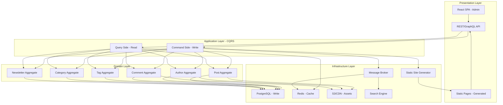
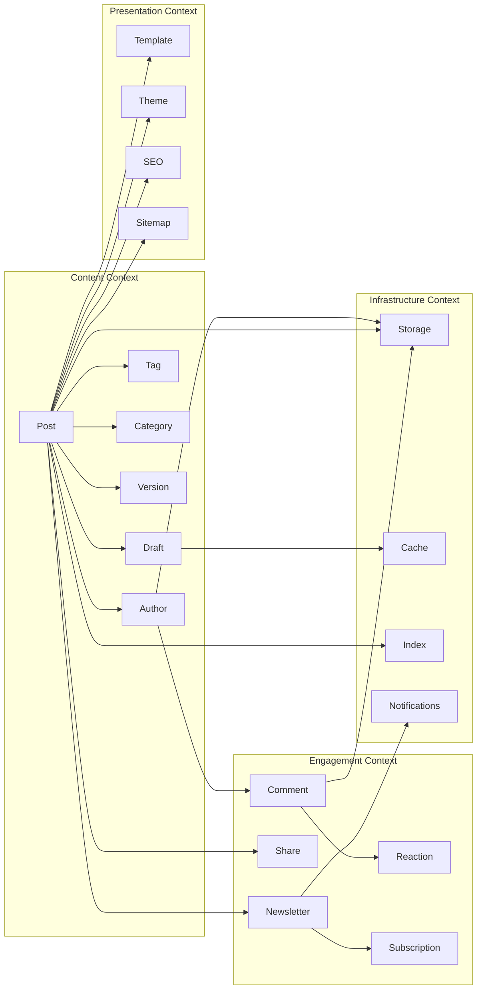
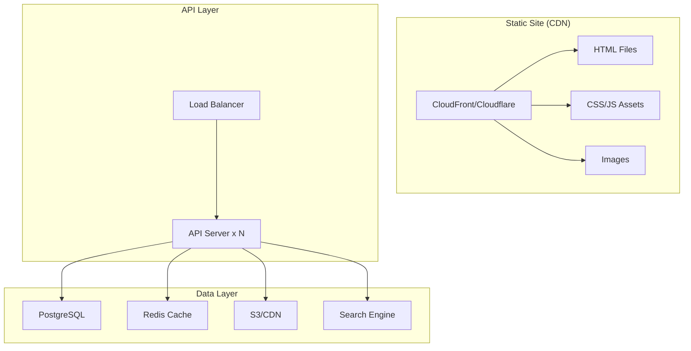
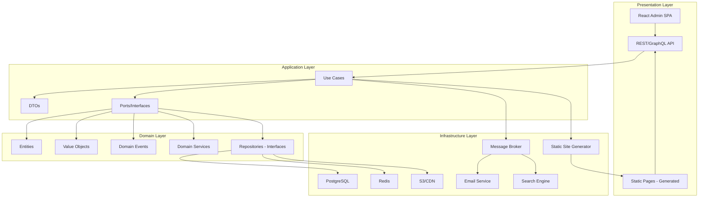
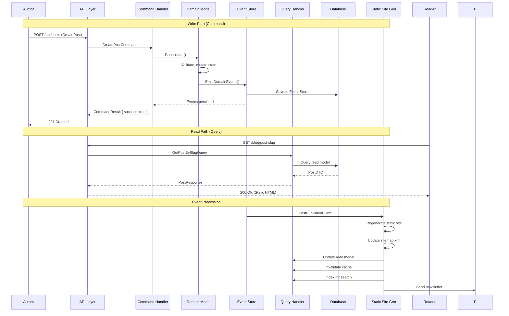
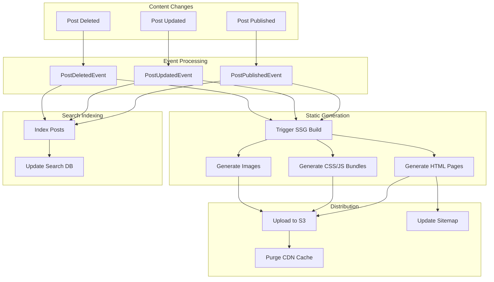
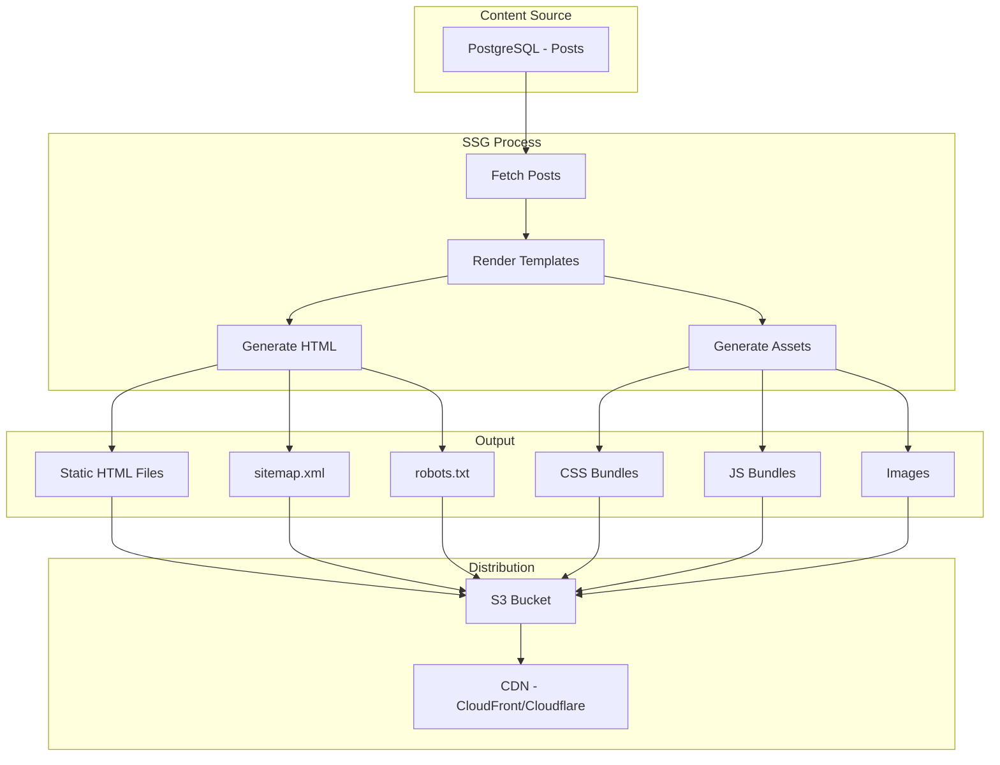
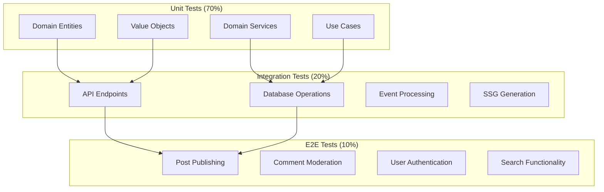
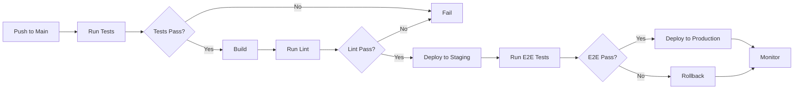
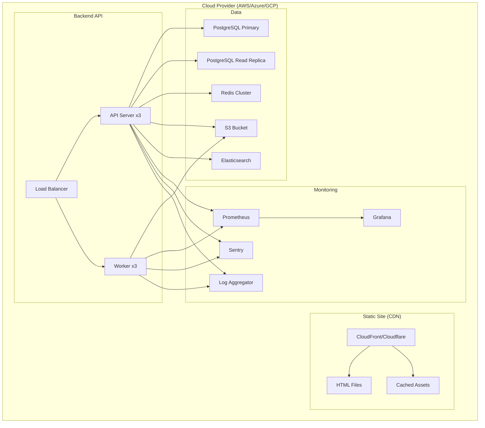

# Blogging Platform — Requirements Specification

> **Date:** 2026-11-02
> **Scope:** Build a blogging platform from scratch — no off-the-shelf packages
> **Tech Stack:** React 19 + Vite + TypeScript + Tailwind CSS + pnpm
> **Architecture:** Clean Architecture + DDD + CQRS + Event-Driven
> **Key Differentiator:** Performance-first, SEO-optimized, content-centric

---

## 1. Executive Summary

This document defines the requirements for building a **custom blogging platform** from the ground up. No WordPress, Ghost, Medium, or similar off-the-shelf solutions. This is a greenfield project architected using **Clean Architecture**, **Domain-Driven Design**, **CQRS**, and **Event-Driven Architecture** patterns.

### Why Build from Scratch?

| Reason | Explanation |
|--------|-------------|
| **Full control** | No legacy code, no forced abstractions, no upgrade paths |
| **Performance** | No bloat, only what you need — sub-second page loads |
| **SEO** | Built for search engines from day one, not bolted on |
| **Custom workflows** | Model exactly your content processes |
| **Ownership** | No vendor lock-in, no platform changes, no deprecations |
| **Learning** | Deep understanding of every layer |

### Trade-off Analysis

| Factor | Custom Blog | WordPress | Ghost | Medium | Substack |
|--------|-------------|-----------|-------|--------|----------|
| **Time to MVP** | 4-8 weeks | 1-2 days | 2-4 weeks | N/A | N/A |
| **Initial cost** | High ($30k-$150k+) | Low ($0-$5k) | Medium ($10k-$50k) | $0 | $0 |
| **Long-term cost** | Lower (no licensing) | Medium (plugins, hosting) | Medium ($9-$219/mo) | $0 (platform takes cut) | $0 (platform takes cut) |
| **Performance** | Unlimited (architect to needs) | Poor-Medium (plugin bloat) | Good | Good | Good |
| **SEO** | Built-in, full control | Plugin-dependent | Good | Good | Limited |
| **Customization** | Unlimited | Plugin-limited | Theme-limited | None | None |
| **Monetization** | Full control | Plugin-dependent | Plugin-dependent | Platform-controlled | Platform-controlled |
| **Maintenance** | You own it | Community/vendor | Vendor | Platform | Platform |
| **Scalability** | Architect to needs | Limited | Limited | Platform | Platform |

**Recommendation:** Build custom if you need full control, high performance, custom workflows, or plan to scale beyond platform limits.

---

## 2. Architectural Style

### Recommended: Static-First with CQRS



### Why Static-First + CQRS?

| Pattern | Why for Blog | Trade-off |
|---------|-------------|-----------|
| **Static Site Generation** | Blazing fast, SEO-friendly, secure, CDN-ready | Regeneration needed on content changes |
| **CQRS** | Reads (page views) >> Writes (post creation) — scale independently | Two models to maintain |
| **Clean Architecture** | Business rules independent of React, DB, CDN | More files, more abstractions |
| **DDD** | Blogging has complex domain (posts, authors, comments, tags) | Requires domain expertise |
| **Event-Driven** | Post published → regenerate site, index search, notify subscribers | Complex debugging, eventual consistency |
| **Modular Monolith** | Start simple, scale modules independently | Module boundaries must be well-defined |

### Consistency Model

| Operation | Consistency | Reason |
|-----------|-------------|--------|
| Post creation/edit | **Strong** | Author needs immediate feedback |
| Post publishing | **Eventual** (1-5s) | Static regeneration takes time |
| Comment posting | **Eventual** (5-30s) | Moderation queue, spam filtering |
| Author authentication | **Strong** | Security-critical |
| Search indexing | **Eventual** (5-30s) | Search can lag behind content |
| Cache invalidation | **Eventual** (TTL-based) | CDN cache propagation |
| Newsletter notifications | **Eventual** (minutes) | Email delivery is async |

---

## 3. Core Domain Model (DDD)

### Bounded Contexts



### Key Aggregates

#### 1. Post Aggregate (Root: `Post`)

```typescript
// entities/post.entity.ts
export class Post {
  private constructor(
    readonly id: PostId,
    private _title: Title,
    private _slug: Slug,
    private _content: Content,
    private _excerpt: Excerpt | null,
    private _status: PostStatus,
    private _version: VersionNumber,
    private _author: AuthorId,
    private _publishedAt: DateTime | null,
    private _scheduledAt: DateTime | null,
    private _tags: TagId[],
    private _categories: CategoryId[],
    private _seo: SeoMetadata,
    private _metadata: PostMetadata
  ) {}

  static create(params: CreatePostParams): Post {
    return new Post(
      generateId(),
      new Title(params.title),
      new Slug(params.title),
      new Content(params.content),
      params.excerpt ? new Excerpt(params.excerpt) : null,
      PostStatus.DRAFT,
      VersionNumber.first(),
      params.authorId,
      null,
      params.scheduledAt,
      [],
      [],
      SeoMetadata.empty(),
      new PostMetadata()
    )
  }

  // Business behavior
  publish(): void {
    if (this._status !== PostStatus.DRAFT && this._status !== PostStatus.REVISION) {
      throw new Error('Only drafts can be published')
    }
    this._status = PostStatus.PUBLISHED
    this._publishedAt = DateTime.now()
    this._version = this._version.next()
  }

  schedule(scheduledAt: DateTime): void {
    this._scheduledAt = scheduledAt
    this._status = PostStatus.SCHEDULED
  }

  unpublish(): void {
    this._status = PostStatus.DRAFT
    this._publishedAt = null
  }

  updateContent(newContent: string): void {
    this._content = new Content(newContent)
    this._version = this._version.next()
  }

  addTag(tagId: TagId): void {
    if (!this._tags.includes(tagId)) {
      this._tags.push(tagId)
    }
  }

  removeTag(tagId: TagId): void {
    this._tags = this._tags.filter(id => id !== tagId)
  }

  updateSeo(seo: Partial<SeoMetadata>): void {
    this._seo = this._seo.update(seo)
  }

  // Domain events
  toDomainEvents(): DomainEvent[] {
    const events: DomainEvent[] = []
    
    if (this._status === PostStatus.PUBLISHED && this._version.isFirst()) {
      events.push(new PostPublishedEvent(
        this.id, this._title, this._slug, this._author, this._publishedAt!
      ))
    }
    
    if (this._version.isFirst() === false) {
      events.push(new PostVersionCreatedEvent(
        this.id, this._version, this._title
      ))
    }
    
    if (this._status === PostStatus.UNPUBLISHED) {
      events.push(new PostUnpublishedEvent(
        this.id, this._title, this._slug
      ))
    }
    
    return events
  }
}

// Value Objects
class Title {
  constructor(private _value: string) {
    if (_value.length < 3 || _value.length > 200) {
      throw new Error('Title must be 3-200 characters')
    }
  }
  get value() { return this._value }
}

class Slug {
  constructor(title: string) {
    this._value = title
      .toLowerCase()
      .replace(/[^\w\s-]/g, '')
      .replace(/\s+/g, '-')
      .replace(/-+/g, '-')
      .substring(0, 200)
  }
  private _value: string
  get value() { return this._value }
}

class Content {
  constructor(private _value: string) {
    if (_value.length < 10) {
      throw new Error('Content must be at least 10 characters')
    }
  }
  get value() { return this._value }
  get wordCount() { return this._value.split(/\s+/).length }
  get readingTime() { return Math.ceil(this.wordCount / 200) } // 200 wpm
}

class SeoMetadata {
  constructor(
    private _title: string | null,
    private _description: string | null,
    private _keywords: string[],
    private _ogImage: string | null,
    private _canonicalUrl: string | null
  ) {}

  static empty(): SeoMetadata {
    return new SeoMetadata(null, null, [], null, null)
  }

  update(partial: Partial<SeoMetadata>): SeoMetadata {
    return new SeoMetadata(
      partial.title ?? this._title,
      partial.description ?? this._description,
      partial.keywords ?? this._keywords,
      partial.ogImage ?? this._ogImage,
      partial.canonicalUrl ?? this._canonicalUrl
    )
  }

  get title() { return this._title }
  get description() { return this._description }
  get keywords() { return this._keywords }
  get ogImage() { return this._ogImage }
  get canonicalUrl() { return this._canonicalUrl }
}
```

#### 2. Comment Aggregate (Root: `Comment`)

```typescript
// entities/comment.entity.ts
export class Comment {
  private constructor(
    readonly id: CommentId,
    private _postId: PostId,
    private _authorName: AuthorName,
    private _authorEmail: Email,
    private _content: CommentContent,
    private _status: CommentStatus,
    private _parentId: CommentId | null,
    private _createdAt: DateTime
  ) {}

  static create(params: CreateCommentParams): Comment {
    return new Comment(
      generateId(),
      params.postId,
      new AuthorName(params.authorName),
      new Email(params.authorEmail),
      new CommentContent(params.content),
      CommentStatus.PENDING, // Requires moderation
      null,
      DateTime.now()
    )
  }

  approve(): void {
    this._status = CommentStatus.APPROVED
  }

  reject(): void {
    this._status = CommentStatus.REJECTED
  }

  spam(): void {
    this._status = CommentStatus.SPAM
  }
}
```

#### 3. Newsletter Aggregate (Root: `Newsletter`)

```typescript
// entities/newsletter.entity.ts
export class Newsletter {
  private constructor(
    readonly id: NewsletterId,
    private _name: NewsletterName,
    private _subscribers: Subscriber[],
    private _isActive: boolean
  ) {}

  static create(params: CreateNewsletterParams): Newsletter {
    return new Newsletter(
      generateId(),
      new NewsletterName(params.name),
      [],
      true
    )
  }

  subscribe(email: Email): void {
    if (!this._subscribers.find(s => s.email.value === email.value)) {
      this._subscribers.push({
        id: generateId(),
        email,
        subscribedAt: DateTime.now(),
        confirmed: false
      })
    }
  }

  confirmSubscription(subscriberId: SubscriberId): void {
    const subscriber = this._subscribers.find(s => s.id === subscriberId)
    if (subscriber) {
      subscriber.confirmed = true
    }
  }

  unsubscribe(subscriberId: SubscriberId): void {
    this._subscribers = this._subscribers.filter(s => s.id !== subscriberId)
  }
}
```

---

## 4. Functional Requirements

### 4.1 Content Management (Blog Posts)

| ID | Requirement | Priority | CQRS Side |
|----|-------------|----------|-----------|
| FR-01 | Create post (draft) | P0 | Command |
| FR-02 | Edit post (draft) | P0 | Command |
| FR-03 | Delete post (soft delete) | P0 | Command |
| FR-04 | Publish post | P0 | Command |
| FR-05 | Unpublish post | P0 | Command |
| FR-06 | Schedule post for future publishing | P1 | Command |
| FR-07 | Version history (track all changes) | P1 | Command |
| FR-08 | Restore previous version | P1 | Command |
| FR-09 | Preview post before publishing | P1 | Query |
| FR-10 | Rich text editor (Markdown/WYSIWYG) | P0 | Command |
| FR-11 | Media embedding (images, videos, code) | P1 | Command |
| FR-12 | Post categories | P1 | Command |
| FR-13 | Post tags | P1 | Command |
| FR-14 | Featured image | P1 | Command |
| FR-15 | SEO metadata (title, description, keywords, OG) | P1 | Command |
| FR-16 | Custom URL slug | P1 | Command |
| FR-17 | Post excerpts | P2 | Command |
| FR-18 | Reading time estimation | P2 | Query |
| FR-19 | Word count | P2 | Query |
| FR-20 | Post templates | P2 | Command |
| FR-21 | Bulk operations (publish, delete, tag) | P2 | Command |
| FR-22 | Post drafts auto-save | P2 | Command |
| FR-23 | Post revisions comparison | P2 | Query |
| FR-24 | Post import/export (JSON, Markdown) | P3 | Command |
| FR-25 | Post scheduling queue | P2 | Command |

### 4.2 Author Management

| ID | Requirement | Priority | CQRS Side |
|----|-------------|----------|-----------|
| FR-30 | Author registration | P0 | Command |
| FR-31 | Author login (email/password) | P0 | Command |
| FR-32 | Author profile management | P1 | Command |
| FR-33 | Author bio, avatar, social links | P1 | Command |
| FR-34 | Multi-author support | P1 | Command |
| FR-35 | Role-based access (Admin, Editor, Author, Contributor) | P1 | Command |
| FR-36 | Author page (list all posts) | P1 | Query |
| FR-37 | Author statistics (post count, views) | P2 | Query |
| FR-38 | Password reset | P0 | Command |
| FR-39 | Two-factor authentication (2FA) | P2 | Command |
| FR-40 | OAuth/Social login (Google, GitHub) | P2 | Command |

### 4.3 Comment Management

| ID | Requirement | Priority | CQRS Side |
|----|-------------|----------|-----------|
| FR-50 | Post comments (guest + authenticated) | P1 | Command |
| FR-51 | Comment moderation (approve/reject/spam) | P1 | Command |
| FR-52 | Nested comments (replies) | P2 | Command |
| FR-53 | Comment voting (upvote/downvote) | P2 | Command |
| FR-54 | Comment notifications (email) | P2 | Command |
| FR-55 | Comment spam filtering (Akismet-like) | P2 | Command |
| FR-56 | Comment RSS feed | P2 | Query |
| FR-57 | Comment search | P2 | Query |
| FR-58 | Comment pagination | P1 | Query |
| FR-59 | Comment avatars (Gravatar) | P2 | Query |

### 4.4 Search & Discovery

| ID | Requirement | Priority | CQRS Side |
|----|-------------|----------|-----------|
| FR-70 | Full-text search (post titles, content, tags) | P1 | Query |
| FR-71 | Search by tag/category | P1 | Query |
| FR-72 | Search by author | P1 | Query |
| FR-73 | Search by date range | P1 | Query |
| FR-74 | Search suggestions/autocomplete | P2 | Query |
| FR-75 | Search highlighting | P2 | Query |
| FR-76 | Related posts (tag-based, content-based) | P1 | Query |
| FR-77 | Popular posts (by views, comments) | P1 | Query |
| FR-78 | Recent posts | P1 | Query |
| FR-79 | Archive by date (month/year) | P1 | Query |
| FR-80 | Filter by category/tag | P1 | Query |
| FR-81 | Sort by date, title, views, comments | P1 | Query |
| FR-82 | Pagination (infinite scroll, page-based) | P1 | Query |

### 4.5 Newsletter & Subscriptions

| ID | Requirement | Priority | CQRS Side |
|----|-------------|----------|-----------|
| FR-90 | Newsletter signup (email) | P1 | Command |
| FR-91 | Email confirmation (double opt-in) | P1 | Command |
| FR-92 | Unsubscribe link | P1 | Command |
| FR-93 | Newsletter email on post publish | P1 | Command |
| FR-94 | Newsletter archive (web view) | P2 | Query |
| FR-95 | Subscriber management | P2 | Command |
| FR-96 | Subscriber statistics | P2 | Query |
| FR-97 | Email templates | P2 | Command |
| FR-98 | Email delivery tracking | P3 | Query |
| FR-99 | GDPR compliance (data export, deletion) | P2 | Command |

### 4.6 SEO & Performance

| ID | Requirement | Priority | CQRS Side |
|----|-------------|----------|-----------|
| FR-110 | Automatic sitemap.xml generation | P0 | Query |
| FR-111 | robots.txt generation | P0 | Query |
| FR-112 | Open Graph metadata | P0 | Query |
| FR-113 | Twitter Card metadata | P0 | Query |
| FR-114 | Canonical URLs | P0 | Query |
| FR-115 | Structured data (JSON-LD) | P1 | Query |
| FR-116 | RSS/Atom feeds | P1 | Query |
| FR-117 | URL redirects (custom, old URLs) | P2 | Query |
| FR-118 | 404 page with search | P1 | Query |
| FR-119 | Page speed optimization | P0 | Query |
| FR-120 | Image optimization (WebP, lazy loading) | P1 | Query |
| FR-121 | CDN integration | P1 | Query |
| FR-122 | HTTP/2 support | P1 | Query |
| FR-123 | Brotli/Gzip compression | P1 | Query |
| FR-124 | Core Web Vitals optimization | P2 | Query |
| FR-125 | Lighthouse score > 90 | P2 | Query |

### 4.7 Theme & Presentation

| ID | Requirement | Priority | CQRS Side |
|----|-------------|----------|-----------|
| FR-130 | Theme system (layouts, templates) | P0 | Query |
| FR-131 | Theme customization (colors, fonts) | P1 | Command |
| FR-132 | Dark mode support | P2 | Query |
| FR-133 | Responsive design | P0 | Query |
| FR-134 | Custom CSS support | P2 | Command |
| FR-135 | Custom JavaScript support | P3 | Command |
| FR-136 | Header, footer, sidebar customization | P1 | Command |
| FR-137 | Navigation menu builder | P2 | Command |
| FR-138 | Widget system | P2 | Command |
| FR-139 | Multi-language (i18n) | P3 | Query |
| FR-140 | RTL language support | P3 | Query |
| FR-141 | Typography system (font sizes, line heights) | P1 | Query |
| FR-142 | Code syntax highlighting | P2 | Query |
| FR-143 | Math rendering (KaTeX/MathJax) | P3 | Query |
| FR-144 | Mermaid.js diagrams | P3 | Query |

### 4.8 Analytics & Monitoring

| ID | Requirement | Priority | CQRS Side |
|----|-------------|----------|-----------|
| FR-150 | Page view tracking | P1 | Command |
| FR-151 | Post view counts | P1 | Query |
| FR-152 | Author statistics | P2 | Query |
| FR-153 | Referrer tracking | P2 | Query |
| FR-154 | Geographic analytics | P2 | Query |
| FR-155 | Device/browser analytics | P2 | Query |
| FR-156 | Search term tracking | P2 | Query |
| FR-157 | Conversion tracking | P3 | Query |
| FR-158 | Custom events | P3 | Command |
| FR-159 | Export analytics data | P3 | Query |
| FR-160 | Real-time analytics | P3 | Query |

### 4.9 API & Integrations

| ID | Requirement | Priority | CQRS Side |
|----|-------------|----------|-----------|
| FR-170 | REST API for posts | P1 | Query/Command |
| FR-171 | REST API for authors | P1 | Query/Command |
| FR-172 | REST API for comments | P2 | Query/Command |
| FR-173 | GraphQL API (optional) | P2 | Query |
| FR-174 | API authentication (JWT) | P1 | Command |
| FR-175 | API rate limiting | P1 | Command |
| FR-176 | API versioning | P1 | Command |
| FR-177 | API documentation (OpenAPI/Swagger) | P1 | Query |
| FR-178 | Webhook on post publish | P2 | Command |
| FR-179 | Third-party integrations (Slack, Twitter) | P2 | Command |
| FR-180 | OAuth 2.0 for API clients | P3 | Command |
| FR-181 | RSS/Atom API | P1 | Query |

### 4.10 Administration

| ID | Requirement | Priority | CQRS Side |
|----|-------------|----------|-----------|
| FR-190 | Admin dashboard | P0 | Query |
| FR-191 | Post editor (rich text/Markdown) | P0 | Command |
| FR-192 | Media library | P1 | Query/Command |
| FR-193 | Comment moderation UI | P1 | Query/Command |
| FR-194 | User management UI | P1 | Query/Command |
| FR-195 | Theme settings UI | P2 | Query/Command |
| FR-196 | SEO settings UI | P2 | Query/Command |
| FR-197 | Newsletter management UI | P2 | Query/Command |
| FR-198 | Analytics dashboard | P2 | Query |
| FR-199 | System settings | P1 | Command |
| FR-200 | Backup/restore | P1 | Command |
| FR-201 | Audit log | P2 | Query |
| FR-202 | System health monitoring | P2 | Query |
| FR-203 | Error logging and reporting | P2 | Query |
| FR-204 | Environment configuration | P1 | Command |

---

## 5. Non-Functional Requirements

### 5.1 Performance

| Metric | Target | Measurement |
|--------|--------|-------------|
| **First Contentful Paint (FCP)** | < 1s | Lighthouse |
| **Largest Contentful Paint (LCP)** | < 2.5s | Lighthouse |
| **Time to First Byte (TTFB)** | < 200ms | CDN edge |
| **First Input Delay (FID)** | < 100ms | Lighthouse |
| **Cumulative Layout Shift (CLS)** | < 0.1 | Lighthouse |
| **Total Blocking Time (TBT)** | < 200ms | Lighthouse |
| **Page load time (cached)** | < 100ms | CDN |
| **Page load time (uncached)** | < 500ms | Full page render |
| **API response time (p95)** | < 200ms | 95th percentile |
| **Search query time** | < 100ms | Full-text search |
| **Static site generation** | < 30s (1000 posts) | Build time |
| **Concurrent users** | 50,000+ | Load testing |
| **Posts capacity** | 1M+ | Database capacity |

### 5.2 SEO Requirements

| Requirement | Implementation |
|-------------|----------------|
| **Semantic HTML** | Proper heading hierarchy, article tags, nav |
| **Meta tags** | Title, description, keywords, OG, Twitter |
| **Structured data** | JSON-LD for articles, authors, breadcrumbs |
| **Sitemap** | Automatic sitemap.xml generation |
| **robots.txt** | Automatic robots.txt generation |
| **Canonical URLs** | Prevent duplicate content |
| **URL structure** | Clean, readable URLs (/blog/post-slug) |
| **Image alt text** | Required for all images |
| **Internal linking** | Related posts, tag pages, category pages |
| **RSS feeds** | Automatic feed generation |
| **Page speed** | Core Web Vitals optimization |
| **Mobile-friendly** | Responsive design, mobile-first |
| **HTTPS** | TLS 1.3 everywhere |
| **HTTP/2** | Multiplexing, header compression |
| **CDN** | Global edge caching |
| **Lazy loading** | Images, comments, related posts |
| **Schema markup** | Article, Author, Breadcrumb, FAQ |

### 5.3 Security

| Requirement | Implementation | Standard |
|-------------|----------------|----------|
| **Authentication** | JWT + Refresh Tokens | OAuth 2.0 / OpenID Connect |
| **Authorization** | RBAC (Admin, Editor, Author, Contributor) | NIST Cybersecurity Framework |
| **Password Storage** | bcrypt (cost factor 12) | OWASP Password Storage |
| **HTTPS** | TLS 1.3 everywhere | OWASP Transport Layer Protection |
| **CORS** | Strict origin allowlist | OWASP CORS |
| **CSP** | Content Security Policy | OWASP CSP |
| **SQL Injection** | Parameterized queries (Prisma/TypeORM) | OWASP SQL Injection |
| **XSS** | React auto-escaping + CSP | OWASP XSS |
| **CSRF** | SameSite cookies + tokens | OWASP CSRF |
| **Rate Limiting** | Token bucket algorithm | OWASP Rate Limiting |
| **Input Validation** | Zod schema validation | OWASP Input Validation |
| **Output Encoding** | Context-aware encoding | OWASP Output Encoding |
| **Secrets Management** | Environment variables + Vault | OWASP Secrets Management |
| **Audit Logging** | Immutable audit trail | OWASP Audit Logging |
| **Data Encryption** | AES-256 at rest, TLS in transit | NIST Encryption Guidelines |
| **2FA** | TOTP (Time-based One-Time Password) | NIST 2FA Guidelines |
| **Session Management** | Secure, HttpOnly, SameSite cookies | OWASP Session Management |
| **API Security** | OAuth 2.0 + JWT | OWASP API Security |
| **File Upload** | MIME validation + size limits + virus scan | OWASP File Upload |
| **Comment Spam** | Akismet-like filtering + hCaptcha | OWASP Comment Spam |
| **Backup** | Daily encrypted backups + 30-day retention | NIST Backup Guidelines |

### 5.4 Availability & Reliability

| Metric | Target |
|--------|--------|
| **Uptime** | 99.9% (8.76 hours downtime/year) |
| **Recovery Time Objective (RTO)** | < 1 hour |
| **Recovery Point Objective (RPO)** | < 15 minutes |
| **Backup Frequency** | Daily (full) + hourly (incremental) |
| **Disaster Recovery** | Multi-region failover |
| **Monitoring** | 24/7 automated alerts |
| **Incident Response** | < 15 minutes acknowledgment |

### 5.5 Scalability



| Component | Scaling Strategy | Reason |
|-----------|-----------------|--------|
| **Static Site** | CDN (global edge) | No server needed, cached at edge |
| **API Server** | Horizontal (auto-scale) | Handle admin operations, comments |
| **PostgreSQL** | Vertical + Read Replicas | Write-heavy, strong consistency |
| **Redis** | Cluster mode | Cache, session storage |
| **S3/CDN** | Horizontal (managed) | Static assets scale automatically |
| **Search** | Horizontal (Elasticsearch) | Full-text search scales independently |

### 5.6 Maintainability

| Metric | Target |
|--------|--------|
| **Code Coverage** | > 80% (unit), > 60% (integration) |
| **Technical Debt Ratio** | < 5% |
| **Cycle Time** | < 2 weeks (feature to production) |
| **Deployment Frequency** | Daily (canary) |
| **Change Failure Rate** | < 5% |
| **Mean Time to Recovery** | < 30 minutes |

---

## 6. Technical Architecture

### 6.1 Clean Architecture Layers



### 6.2 CQRS Implementation for Blog



### 6.3 Static Site Generation Flow



### 6.4 Database Schema (PostgreSQL)

```sql
-- Core tables (write model)
CREATE TABLE posts (
    id UUID PRIMARY KEY,
    title VARCHAR(500) NOT NULL,
    slug VARCHAR(500) NOT NULL UNIQUE,
    content TEXT NOT NULL,
    excerpt VARCHAR(500),
    status VARCHAR(50) NOT NULL DEFAULT 'draft',
    version INTEGER NOT NULL DEFAULT 1,
    author_id UUID NOT NULL,
    published_at TIMESTAMP,
    scheduled_at TIMESTAMP,
    featured_image VARCHAR(1000),
    seo_title VARCHAR(500),
    seo_description VARCHAR(500),
    seo_keywords TEXT[],
    seo_og_image VARCHAR(1000),
    created_at TIMESTAMP DEFAULT NOW(),
    updated_at TIMESTAMP DEFAULT NOW()
);

CREATE TABLE post_versions (
    id UUID PRIMARY KEY,
    post_id UUID REFERENCES posts(id) ON DELETE CASCADE,
    version INTEGER NOT NULL,
    title VARCHAR(500) NOT NULL,
    content TEXT NOT NULL,
    excerpt VARCHAR(500),
    created_at TIMESTAMP DEFAULT NOW()
);

CREATE TABLE post_tags (
    post_id UUID REFERENCES posts(id) ON DELETE CASCADE,
    tag_id UUID REFERENCES tags(id) ON DELETE CASCADE,
    PRIMARY KEY (post_id, tag_id)
);

CREATE TABLE tags (
    id UUID PRIMARY KEY,
    name VARCHAR(100) NOT NULL UNIQUE,
    slug VARCHAR(100) NOT NULL UNIQUE
);

CREATE TABLE categories (
    id UUID PRIMARY KEY,
    name VARCHAR(100) NOT NULL UNIQUE,
    slug VARCHAR(100) NOT NULL UNIQUE,
    description TEXT
);

CREATE TABLE post_categories (
    post_id UUID REFERENCES posts(id) ON DELETE CASCADE,
    category_id UUID REFERENCES categories(id) ON DELETE CASCADE,
    PRIMARY KEY (post_id, category_id)
);

CREATE TABLE comments (
    id UUID PRIMARY KEY,
    post_id UUID REFERENCES posts(id) ON DELETE CASCADE,
    author_name VARCHAR(200) NOT NULL,
    author_email VARCHAR(255) NOT NULL,
    content TEXT NOT NULL,
    status VARCHAR(50) NOT NULL DEFAULT 'pending',
    parent_id UUID REFERENCES comments(id) ON DELETE CASCADE,
    created_at TIMESTAMP DEFAULT NOW()
);

CREATE TABLE authors (
    id UUID PRIMARY KEY,
    name VARCHAR(200) NOT NULL,
    email VARCHAR(255) NOT NULL UNIQUE,
    password_hash VARCHAR(255) NOT NULL,
    bio TEXT,
    avatar_url VARCHAR(1000),
    role VARCHAR(50) NOT NULL DEFAULT 'author',
    is_active BOOLEAN DEFAULT true,
    last_login_at TIMESTAMP,
    created_at TIMESTAMP DEFAULT NOW()
);

CREATE TABLE newsletter_subscribers (
    id UUID PRIMARY KEY,
    email VARCHAR(255) NOT NULL UNIQUE,
    confirmed BOOLEAN DEFAULT false,
    confirmed_at TIMESTAMP,
    unsubscribed BOOLEAN DEFAULT false,
    unsubscribed_at TIMESTAMP,
    created_at TIMESTAMP DEFAULT NOW()
);

CREATE TABLE page_views (
    id UUID PRIMARY KEY,
    post_id UUID REFERENCES posts(id) ON DELETE CASCADE,
    ip_address INET,
    user_agent VARCHAR(500),
    referrer VARCHAR(1000),
    country VARCHAR(100),
    created_at TIMESTAMP DEFAULT NOW()
);

-- Read model tables (materialized views)
CREATE TABLE posts_index (
    id UUID PRIMARY KEY,
    title VARCHAR(500) NOT NULL,
    slug VARCHAR(500) NOT NULL,
    status VARCHAR(50) NOT NULL,
    author_name VARCHAR(200),
    tags TEXT[],
    categories TEXT[],
    search_vector tsvector,
    view_count INTEGER DEFAULT 0,
    updated_at TIMESTAMP DEFAULT NOW()
);

CREATE TABLE post_cache (
    key VARCHAR(500) PRIMARY KEY,
    value JSONB NOT NULL,
    ttl INTEGER NOT NULL,
    created_at TIMESTAMP DEFAULT NOW()
);
```

---

## 7. API Design

### 7.1 REST API Endpoints

```
Posts (Public)
  GET    /api/v1/posts                  List published posts (paginated)
  GET    /api/v1/posts/:slug            Get post by slug
  GET    /api/v1/posts/:slug/versions   Get post versions
  GET    /api/v1/posts/:slug/comments   Get post comments
  GET    /api/v1/posts/:slug/related    Get related posts

Posts (Admin)
  POST   /api/v1/admin/posts            Create post
  PUT    /api/v1/admin/posts/:slug      Update post
  DELETE /api/v1/admin/posts/:slug      Delete post (soft)
  POST   /api/v1/admin/posts/:slug/publish   Publish post
  POST   /api/v1/admin/posts/:slug/unpublish Unpublish post
  POST   /api/v1/admin/posts/:slug/restore Restore version
  POST   /api/v1/admin/posts/:slug/auto-save Auto-save draft

Authors
  GET    /api/v1/authors                List authors
  GET    /api/v1/authors/:slug          Get author with posts
  GET    /api/v1/authors/:id/posts      Get author's posts

Tags
  GET    /api/v1/tags                   List all tags
  GET    /api/v1/tags/:slug             Get tag with posts

Categories
  GET    /api/v1/categories             List all categories
  GET    /api/v1/categories/:slug       Get category with posts

Comments
  POST   /api/v1/posts/:slug/comments   Create comment (public)
  GET    /api/v1/admin/comments         List all comments (admin)
  PUT    /api/v1/admin/comments/:id     Moderate comment

Search
  GET    /api/v1/search                 Full-text search
  GET    /api/v1/search/suggestions     Autocomplete

Newsletter
  POST   /api/v1/newsletter/subscribe   Subscribe to newsletter
  GET    /api/v1/newsletter/unsubscribe Unsubscribe
  GET    /api/v1/newsletter/archive     Newsletter archive

Analytics
  GET    /api/v1/analytics/posts        Post analytics
  GET    /api/v1/analytics/overview     Overview analytics

Admin
  GET    /api/v1/admin/dashboard        Dashboard stats
  GET    /api/v1/admin/settings         System settings
  PUT    /api/v1/admin/settings         Update settings
  GET    /api/v1/admin/audit-log        Audit log
  GET    /api/v1/admin/health           Health check
```

### 7.2 Request/Response Examples

```typescript
// Request: Create Post
interface CreatePostRequest {
  title: string
  content: string
  excerpt?: string
  tags?: string[]
  categories?: string[]
  featuredImage?: string
  seo?: {
    title?: string
    description?: string
    keywords?: string[]
    ogImage?: string
  }
  scheduledAt?: string  // ISO 8601
}

// Response: Post
interface PostResponse {
  id: string
  title: string
  slug: string
  content: string
  excerpt: string | null
  status: 'draft' | 'scheduled' | 'published' | 'unpublished'
  version: number
  author: {
    id: string
    name: string
    slug: string
    avatar?: string
  }
  tags: { id: string; name: string; slug: string }[]
  categories: { id: string; name: string; slug: string }[]
  featuredImage: string | null
  seo: {
    title: string | null
    description: string | null
    keywords: string[]
    ogImage: string | null
  }
  readingTime: number  // minutes
  wordCount: number
  publishedAt: string | null
  scheduledAt: string | null
  viewCount: number
  createdAt: string
  updatedAt: string
}

// Request: Search
interface SearchRequest {
  query: string
  tag?: string
  category?: string
  author?: string
  dateFrom?: string
  dateTo?: string
  page?: number
  pageSize?: number
  sortBy?: 'created_at' | 'updated_at' | 'title' | 'views'
  sortOrder?: 'asc' | 'desc'
}

// Response: Search Results
interface SearchResponse {
  results: SearchResult[]
  total: number
  page: number
  pageSize: number
  totalPages: number
  suggestions: string[]
}

interface SearchResult {
  id: string
  title: string
  excerpt: string
  slug: string
  author: { name: string }
  tags: string[]
  categories: string[]
  publishedAt: string
  viewCount: number
  highlightedContent: string  // with search term highlighting
}
```

---

## 8. Frontend Architecture (React 19)

### 8.1 Public Blog Structure

```
src/
├── components/
│   ├── blog/
│   │   ├── PostCard.tsx
│   │   ├── PostList.tsx
│   │   ├── PostContent.tsx
│   │   ├── PostHeader.tsx
│   │   ├── PostMeta.tsx
│   │   ├── PostTags.tsx
│   │   ├── PostAuthor.tsx
│   │   ├── PostComments.tsx
│   │   ├── PostRelated.tsx
│   │   └── PostPagination.tsx
│   ├── layout/
│   │   ├── Header.tsx
│   │   ├── Footer.tsx
│   │   ├── Sidebar.tsx
│   │   └── MainLayout.tsx
│   ├── search/
│   │   ├── SearchBar.tsx
│   │   ├── SearchResults.tsx
│   │   └── SearchSuggestions.tsx
│   ├── newsletter/
│   │   ├── NewsletterSignup.tsx
│   │   └── NewsletterArchive.tsx
│   └── common/
│       ├── Loading.tsx
│       ├── ErrorBoundary.tsx
│       └── Image.tsx
├── hooks/
│   ├── usePosts.ts
│   ├── usePost.ts
│   ├── useSearch.ts
│   ├── useComments.ts
│   ├── useNewsletter.ts
│   └── useAnalytics.ts
├── pages/
│   ├── Index.tsx              // Homepage
│   ├── Blog.tsx               // Blog listing
│   ├── Post.tsx               // Single post
│   ├── Author.tsx             // Author page
│   ├── Tag.tsx                // Tag page
│   ├── Category.tsx           // Category page
│   ├── Search.tsx             // Search results
│   ├── Archive.tsx            // Date archive
│   ├── About.tsx              // About page
│   ├── Contact.tsx            // Contact page
│   └── NotFound.tsx           // 404 page
└── utils/
    ├── seo.ts                 // SEO helpers
    ├── metadata.ts            // Page metadata
    └── analytics.ts           // Analytics tracking
```

### 8.2 Admin Dashboard Structure

```
src/admin/
├── components/
│   ├── layout/
│   │   ├── Sidebar.tsx
│   │   ├── Header.tsx
│   │   └── AdminLayout.tsx
│   ├── posts/
│   │   ├── PostEditor.tsx
│   │   ├── PostList.tsx
│   │   ├── PostForm.tsx
│   │   ├── PostPreview.tsx
│   │   ├── PostVersions.tsx
│   │   └── MediaUploader.tsx
│   ├── comments/
│   │   ├── CommentList.tsx
│   │   └── CommentModeration.tsx
│   ├── authors/
│   │   ├── AuthorList.tsx
│   │   └── AuthorForm.tsx
│   ├── tags/
│   │   └── TagManager.tsx
│   ├── newsletter/
│   │   ├── SubscriberList.tsx
│   │   └── NewsletterSettings.tsx
│   ├── analytics/
│   │   ├── Dashboard.tsx
│   │   ├── PostAnalytics.tsx
│   │   └── Overview.tsx
│   └── settings/
│       ├── GeneralSettings.tsx
│       ├── SeoSettings.tsx
│       ├── ThemeSettings.tsx
│       └── ApiSettings.tsx
├── hooks/
│   ├── useAuth.ts
│   ├── usePosts.ts
│   ├── useComments.ts
│   ├── useAuthors.ts
│   ├── useTags.ts
│   ├── useNewsletter.ts
│   ├── useAnalytics.ts
│   └── useSettings.ts
├── pages/
│   ├── Login.tsx
│   ├── Dashboard.tsx
│   ├── Posts.tsx
│   ├── PostEdit.tsx
│   ├── Comments.tsx
│   ├── Authors.tsx
│   ├── Tags.tsx
│   ├── Categories.tsx
│   ├── Newsletter.tsx
│   ├── Analytics.tsx
│   └── Settings.tsx
└── utils/
    ├── editor/
    │   ├── MarkdownEditor.tsx
    │   └── WysiwygEditor.tsx
    ├── validators.ts
    └── formatters.ts
```

### 8.3 State Management

```typescript
// Use React 19 Server Components + React Query for data fetching
// Local state for UI (forms, modals, tabs)
// Server state for API data (React Query)

import { useQuery, useMutation, useQueryClient } from '@tanstack/react-query'
import { api } from '@/services/api'

// Query: Get published posts
function usePosts(params: PostQueryParams) {
  return useQuery({
    queryKey: ['posts', params],
    queryFn: () => api.get('/posts', { params }),
    staleTime: 1000 * 60 * 5,  // 5 minutes
  })
}

// Mutation: Create post
function useCreatePost() {
  const queryClient = useQueryClient()
  
  return useMutation({
    mutationFn: (data: CreatePostInput) => 
      api.post('/admin/posts', data),
    onSuccess: () => {
      queryClient.invalidateQueries({ queryKey: ['posts'] })
    },
  })
}

// Query: Get post by slug
function usePost(slug: string) {
  return useQuery({
    queryKey: ['post', slug],
    queryFn: () => api.get(`/posts/${slug}`),
    staleTime: 1000 * 60 * 10,  // 10 minutes
  })
}
```

---

## 9. Static Site Generation

### 9.1 SSG Architecture



### 9.2 SSG Triggers

| Event | Action |
|-------|--------|
| Post published | Regenerate post page + index pages |
| Post updated | Regenerate post page + index pages |
| Post deleted | Remove post page + regenerate index pages |
| Tag added/removed | Regenerate tag pages + index pages |
| Category added/removed | Regenerate category pages + index pages |
| Sitemap changed | Regenerate sitemap.xml |

### 9.3 Incremental Static Regeneration (ISR)

```typescript
// Example: ISR with stale-while-revalidate
interface PageConfig {
  revalidate: number  // Seconds before regeneration
}

const pageConfigs: Record<string, PageConfig> = {
  '/': { revalidate: 60 },           // Homepage: regenerate every 60s
  '/blog': { revalidate: 60 },       // Blog listing: regenerate every 60s
  '/blog/[slug]': { revalidate: 0 }, // Post: regenerate on content change
  '/tags/[slug]': { revalidate: 300 }, // Tag page: regenerate every 5m
  '/authors/[slug]': { revalidate: 300 }, // Author page: regenerate every 5m
}
```

---

## 10. Testing Strategy

### 10.1 Test Pyramid



### 10.2 Testing Tools

| Layer | Tool | Purpose |
|-------|------|---------|
| **Unit** | Vitest | Fast unit testing |
| **Integration** | Vitest + Supertest | API testing |
| **E2E** | Playwright | Browser automation |
| **Mocking** | Vitest mocks | API, database mocks |
| **Coverage** | Vitest coverage | Code coverage reporting |
| **Visual** | Playwright screenshots | Visual regression |
| **Performance** | Lighthouse CI | Page speed testing |

### 10.3 Test Examples

```typescript
// Unit Test: Post.publish()
import { describe, it, expect } from 'vitest'
import { Post } from '@/entities/post.entity'

describe('Post', () => {
  it('should publish a draft post', () => {
    const post = Post.create({
      title: 'Test Post',
      content: 'Test content',
      authorId: 'author-123',
    })
    
    expect(post.status).toBe('draft')
    expect(post.publishedAt).toBeNull()
    
    post.publish()
    
    expect(post.status).toBe('published')
    expect(post.publishedAt).not.toBeNull()
    expect(post.version).toBe(2)
  })
  
  it('should not publish an already published post', () => {
    const post = Post.create({
      title: 'Test Post',
      content: 'Test content',
      authorId: 'author-123',
    })
    
    post.publish()
    
    expect(() => post.publish()).toThrow(
      'Only drafts can be published'
    )
  })
  
  it('should calculate reading time', () => {
    const post = Post.create({
      title: 'Test Post',
      content: ' '.repeat(500).split(' ').map(() => 'word').join(' '), // 500 words
      authorId: 'author-123',
    })
    
    expect(post.readingTime).toBe(3) // 500 words / 200 wpm = 2.5 -> 3
  })
})

// Integration Test: Create Post API
import { describe, it, expect, beforeAll, afterAll } from 'vitest'
import { request } from 'supertest'
import { app } from '@/app'
import { db } from '@/infrastructure/database'

describe('POST /api/v1/admin/posts', () => {
  beforeAll(async () => {
    await db.migrate()
  })
  
  afterAll(async () => {
    await db.destroy()
  })
  
  it('should create a new post', async () => {
    const response = await request(app)
      .post('/api/v1/admin/posts')
      .set('Authorization', 'Bearer admin-token')
      .send({
        title: 'Test Post',
        content: 'Test content',
        tags: ['test', 'example'],
      })
    
    expect(response.status).toBe(201)
    expect(response.body).toMatchObject({
      title: 'Test Post',
      slug: 'test-post',
      status: 'draft',
    })
  })
})
```

---

## 11. Deployment & DevOps

### 11.1 CI/CD Pipeline



### 11.2 Infrastructure



### 11.3 Environment Strategy

| Environment | Purpose | Auto-Deploy? | Data |
|-------------|---------|--------------|------|
| **Development** | Local development | Manual | Local DB |
| **Staging** | Pre-production testing | On merge to `main` | Anonymized prod data |
| **Production** | Live blog | Manual approval | Real data |

### 11.4 Deployment Targets

| Component | Target | Reason |
|-----------|--------|--------|
| **Static Site** | S3 + CloudFront/Cloudflare | Global CDN, edge caching |
| **API Server** | AWS Elastic Beanstalk / Azure App Service / Railway / Render | Managed hosting |
| **PostgreSQL** | AWS RDS / Azure Database / Supabase | Managed database |
| **Redis** | AWS ElastiCache / Upstash | Managed cache |
| **Elasticsearch** | AWS OpenSearch / Meilisearch | Managed search |
| **S3** | AWS S3 / Cloudflare R2 | Object storage |

---

## 12. Project Structure

```
blog-platform/
├── apps/
│   ├── web/                    # Public Blog (Vite + React)
│   │   ├── src/
│   │   ├── public/
│   │   ├── vite.config.ts
│   │   └── tsconfig.json
│   ├── admin/                  # Admin Dashboard (Vite + React)
│   │   ├── src/
│   │   ├── public/
│   │   ├── vite.config.ts
│   │   └── tsconfig.json
│   └── api/                    # API Server (Node.js/Express)
│       ├── src/
│       ├── package.json
│       └── tsconfig.json
├── packages/
│   ├── domain/                 # Domain layer (shared)
│   │   ├── src/
│   │   │   ├── entities/
│   │   │   ├── value-objects/
│   │   │   ├── domain-events/
│   │   │   ├── domain-services/
│   │   │   └── index.ts
│   │   └── package.json
│   ├── application/            # Application layer (shared)
│   │   ├── src/
│   │   │   ├── use-cases/
│   │   │   ├── dtos/
│   │   │   ├── ports/
│   │   │   └── index.ts
│   │   └── package.json
│   ├── infrastructure/         # Infrastructure layer (shared)
│   │   ├── src/
│   │   │   ├── database/
│   │   │   ├── cache/
│   │   │   ├── storage/
│   │   │   ├── messaging/
│   │   │   ├── search/
│   │   │   ├── ssg/
│   │   │   └── index.ts
│   │   └── package.json
│   └── shared/                 # Shared utilities
│       ├── src/
│       │   ├── types/
│       │   ├── utils/
│       │   ├── validators/
│       │   └── index.ts
│       └── package.json
├── docker-compose.yml
├── pnpm-workspace.yaml
├── tsconfig.json
└── package.json
```

---

## 13. Development Phases

### Phase 1: Foundation (Weeks 1-2)
- [ ] Project setup (monorepo, TypeScript, pnpm)
- [ ] Domain model (Post, Author, Tag, Category aggregates)
- [ ] Database schema (PostgreSQL)
- [ ] API skeleton (REST endpoints)
- [ ] Authentication (JWT, RBAC)
- [ ] Basic admin UI (login, dashboard)

### Phase 2: Core Blog (Weeks 3-5)
- [ ] Post CRUD operations
- [ ] Rich text editor (Markdown/WYSIWYG)
- [ ] Tag and category management
- [ ] Basic publishing workflow
- [ ] Static site generation (SSG)
- [ ] Public blog pages (list, single post)
- [ ] SEO basics (meta tags, sitemap, robots.txt)

### Phase 3: Engagement (Weeks 6-7)
- [ ] Comment system (guest + authenticated)
- [ ] Comment moderation
- [ ] Newsletter signup and email delivery
- [ ] Search functionality (full-text)
- [ ] Related posts
- [ ] Popular posts
- [ ] Archive by date

### Phase 4: Polish & Production (Weeks 8-10)
- [ ] Theme system (layouts, templates)
- [ ] Performance optimization (CDN, caching, lazy loading)
- [ ] E2E tests (Playwright)
- [ ] Load testing
- [ ] Security audit
- [ ] Monitoring and alerting
- [ ] Deployment pipeline (CI/CD)
- [ ] Documentation
- [ ] Beta testing

### Phase 5: Launch & Iterate (Weeks 11+)
- [ ] Production deployment
- [ ] Monitoring and observability
- [ ] User feedback collection
- [ ] Performance tuning
- [ ] Feature enhancements

---

## 14. Risk Assessment

| Risk | Impact | Likelihood | Mitigation |
|------|--------|------------|------------|
| **Scope creep** | High | High | Strict MVP definition, change control |
| **Underestimating complexity** | High | High | Start simple, iterate, avoid over-engineering |
| **Security vulnerabilities** | Critical | Medium | Security audit, OWASP checklist, penetration testing |
| **Performance issues** | High | Medium | Load testing, caching strategy, CDN |
| **SSG regeneration delays** | Medium | Medium | Incremental regeneration, background processing |
| **Team skill gaps** | Medium | Medium | Training, pair programming, documentation |
| **Data loss** | Critical | Low | Backups, disaster recovery plan, testing |
| **Timeline overrun** | High | High | Agile sprints, regular reviews, buffer time |
| **SEO penalties** | High | Low | Follow Google guidelines, structured data, fast pages |

---

## 15. Success Criteria

### MVP (Minimum Viable Product)
- [ ] Create, edit, publish, delete posts
- [ ] User authentication and authorization
- [ ] Static site generation (SSG)
- [ ] Public blog pages (list, single post)
- [ ] Basic SEO (meta tags, sitemap, robots.txt)
- [ ] REST API
- [ ] Admin dashboard

### V1 (Production Ready)
- [ ] Tag and category management
- [ ] Comment system with moderation
- [ ] Newsletter signup and email delivery
- [ ] Search functionality
- [ ] Related posts
- [ ] Theme system
- [ ] Performance optimization (CDN, caching)
- [ ] E2E tests
- [ ] CI/CD pipeline
- [ ] Monitoring and logging

### V2 (Advanced)
- [ ] CQRS for performance
- [ ] Event-driven architecture
- [ ] GraphQL API
- [ ] Advanced analytics
- [ ] Webhooks and integrations
- [ ] Multi-language support
- [ ] Custom fields/schema
- [ ] Dark mode
- [ ] Code syntax highlighting
- [ ] Math rendering

---

## 16. Key Differentiators vs. WordPress/Ghost

| Feature | Custom Blog | WordPress | Ghost |
|---------|-------------|-----------|-------|
| **Page load time** | < 100ms (static) | 1-3s | 0.5-2s |
| **Security** | Minimal attack surface | High (targeted) | Medium |
| **Customization** | Unlimited | Plugin-limited | Theme-limited |
| **Performance** | CDN-static | Database-driven | Database-driven |
| **SEO** | Built-in | Plugin-dependent | Good |
| **Maintenance** | Minimal | High (updates, plugins) | Medium |
| **Cost** | Hosting only | Hosting + plugins | $9-$219/mo |
| **Scalability** | CDN-global | Database-limited | Platform-limited |
| **Data ownership** | Full | Full | Full |
| **Vendor lock-in** | None | None | None |

---

## 17. References & Sources

### Architectural Patterns
- [[Sources/martin-clean-architecture-2017|Clean Architecture]] — Robert C. Martin
- [[Sources/fowler-patterns-2002|Enterprise Integration Patterns]] — Martin Fowler
- [[Sources/evans-ddd-2003|Domain-Driven Design]] — Eric Evans
- [[Sources/goF-1994|Design Patterns]] — GoF

### Technical Documentation
- [[Sources/react-docs-2026|React 19 Documentation]] — React Team
- [[Sources/microsoft-typescript-handbook|TypeScript Handbook]] — Microsoft
- [[Sources/tailwind-docs-2024|Tailwind CSS Documentation]] — Tailwind Labs
- [[Sources/pnpm-docs-2024|pnpm Documentation]] — pnpm
- [[Sources/vitest-docs-2024|Vitest Documentation]] — Vitest
- [[Sources/playwright-docs-2024|Playwright Documentation]] — Microsoft

### Security
- [[Sources/owasp-top-ten-2021|OWASP Top 10]] — OWASP
- [[Sources/nist-cyberframework-2014|NIST Cybersecurity Framework]] — NIST

### Architecture Patterns
- [[Sources/fowler-patterns-2002|CQRS]] — Martin Fowler
- [[Sources/microsoft-distributed-systems|Event-Driven Architecture]] — Microsoft Azure
- [[Sources/fowler-patterns-2002|Repository Pattern]] — Martin Fowler
- [[Sources/fowler-patterns-2002|Service Layer Pattern]] — Martin Fowler
- [[Sources/fowler-patterns-2002|Cache-Aside Pattern]] — Microsoft Azure

### Performance
- [[Sources/react-docs-2026|React Performance]] — React Team
- [[Sources/fowler-patterns-2002|Cache-Aside Pattern]] — Microsoft Azure
- [[Sources/rest-api-design|REST API Design]] — RESTful API
