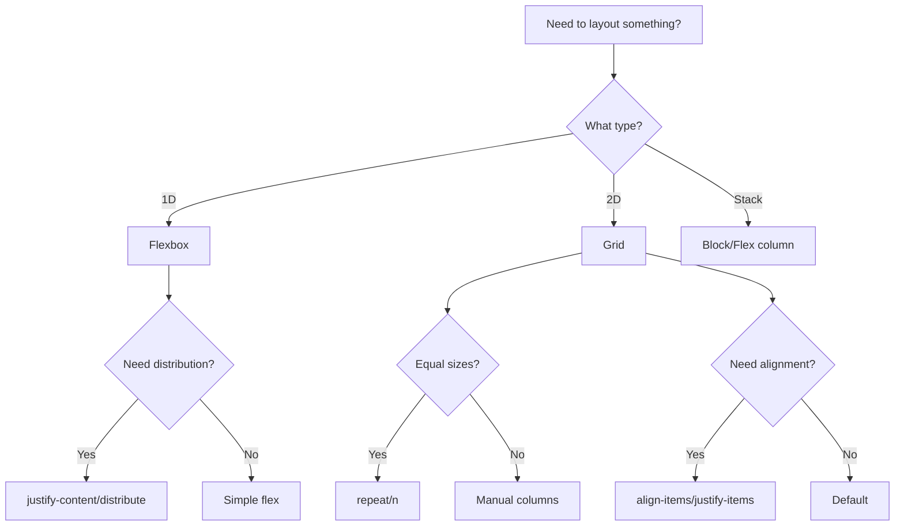

# Cascading Stylesheets Fundamentals

## Overview

CSS fundamentals covering the core concepts every developer needs to master for building modern web layouts.

---

## 1. CSS Architecture

### BEM Naming Convention

```css
/* Block */
.card { }

/* Element (part of block) */
.card__header { }
.card__title { }
.card__body { }
.card__footer { }

/* Modifier (variation) */
.card--primary { }
.card--large { }
.card__header--sticky { }

/* Usage */
/* <div class="card card--primary">
     <div class="card__header card__header--sticky">Title</div>
     <div class="card__body">Content</div>
   </div> */
```

### CSS Modules

```css
/* Button.module.css */
.button {
  padding: 0.5rem 1rem;
  border-radius: 0.25rem;
  background-color: blue;
  color: white;
}

.button:hover {
  background-color: darkblue;
}

/* Usage in component */
import styles from './Button.module.css'

function Button() {
  return <button className={styles.button}>Click me</button>
}
```

---

## 2. Custom Properties (CSS Variables)

```css
:root {
  /* Design tokens */
  --color-primary: #3b82f6;
  --color-primary-dark: #2563eb;
  --color-secondary: #64748b;
  --color-background: #ffffff;
  --color-foreground: #1e293b;
  --color-border: #e2e8f0;

  /* Spacing */
  --spacing-xs: 0.25rem;
  --spacing-sm: 0.5rem;
  --spacing-md: 1rem;
  --spacing-lg: 1.5rem;
  --spacing-xl: 2rem;

  /* Typography */
  --font-sans: 'Inter', system-ui, sans-serif;
  --font-mono: 'Fira Code', monospace;
  --font-size-sm: 0.875rem;
  --font-size-base: 1rem;
  --font-size-lg: 1.125rem;
  --font-size-xl: 1.25rem;

  /* Borders */
  --radius-sm: 0.25rem;
  --radius-md: 0.5rem;
  --radius-lg: 1rem;

  /* Shadows */
  --shadow-sm: 0 1px 2px rgba(0, 0, 0, 0.05);
  --shadow-md: 0 4px 6px rgba(0, 0, 0, 0.1);
  --shadow-lg: 0 10px 15px rgba(0, 0, 0, 0.1);
}

/* Usage */
.card {
  background: var(--color-background);
  border: 1px solid var(--color-border);
  border-radius: var(--radius-md);
  box-shadow: var(--shadow-md);
  padding: var(--spacing-lg);
  font-family: var(--font-sans);
}
```

---

## 3. Flexbox

```css
/* Flex container */
.flex-container {
  display: flex;
  flex-direction: row;           /* row | row-reverse | column | column-reverse */
  flex-wrap: wrap;               /* nowrap | wrap | wrap-reverse */
  justify-content: center;       /* flex-start | flex-end | center | space-between | space-around | space-evenly */
  align-items: center;           /* flex-start | flex-end | center | baseline | stretch */
  align-content: center;         /* For multi-line flex */
  gap: 1rem;                     /* Row and column gap */
}

/* Flex items */
.flex-item {
  flex-grow: 0;                  /* How much to grow */
  flex-shrink: 1;                /* How much to shrink */
  flex-basis: auto;              /* Initial size */
  flex: 1 0 auto;                /* Shorthand: grow shrink basis */
  align-self: flex-start;        /* Override align-items for this item */
}

/* Common patterns */
.center-content {
  display: flex;
  justify-content: center;
  align-items: center;
}

.space-between {
  display: flex;
  justify-content: space-between;
  align-items: center;
}

.grow-main {
  display: flex;
  gap: 1rem;
}
.grow-main > .sidebar { flex: 0 0 250px; }
.grow-main > .main { flex: 1 1 auto; }
```

---

## 4. CSS Grid

```css
/* Grid container */
.grid-container {
  display: grid;
  grid-template-columns: 1fr 2fr 1fr;
  grid-template-rows: auto 1fr auto;
  grid-template-areas:
    'header header header'
    'sidebar main aside'
    'footer footer footer';
  gap: 1rem;
}

/* Grid items */
.header { grid-area: header; }
.sidebar { grid-area: sidebar; }
.main { grid-area: main; }
.aside { grid-area: aside; }
.footer { grid-area: footer; }

/* Responsive grid */
.responsive-grid {
  display: grid;
  grid-template-columns: repeat(auto-fit, minmax(250px, 1fr));
  gap: 1.5rem;
}

/* Grid with explicit rows */
.dashboard {
  display: grid;
  grid-template-columns: repeat(4, 1fr);
  grid-template-rows: auto 1fr;
  gap: 1rem;
  height: 100vh;
}

.stat-card { grid-column: span 1; }
.chart { grid-column: span 2; grid-row: span 2; }
.recent-list { grid-column: span 2; }
```

---

## 5. Selectors & Specificity

```css
/* Specificity order (lowest to highest) */

/* 0,0,1 — Element */
div { }

/* 0,0,2 — Two elements */
div span { }

/* 0,1,0 — Class */
.card { }

/* 0,1,1 — Class + element */
.card span { }

/* 0,1,2 — Class + two elements */
.card span strong { }

/* 0,2,0 — Two classes */
.card.primary { }

/* 0,0,10 — Ten elements */
div div div div div div div div div div { }

/* 1,0,0 — ID */
#main { }

/* 1,1,0 — ID + class */
#main .card { }

/* 0,1,0 — Inline style (highest) */
/* style="..." */

/* Pseudo-classes and pseudo-elements */
a:hover { }        /* 0,1,0 — same as class */
a::before { }      /* 0,1,1 — class + pseudo-element */
a::first-line { }  /* 0,1,1 */

/* !important (overrides everything) */
.card { color: red !important; }
```

---

## 6. Common Layout Patterns

### Sticky Footer

```css
/* Method 1: Flexbox */
body {
  display: flex;
  flex-direction: column;
  min-height: 100vh;
}
main {
  flex: 1;
}

/* Method 2: Grid */
body {
  display: grid;
  grid-template-rows: auto 1fr auto;
  min-height: 100vh;
}
```

### Centering

```css
/* Horizontal centering */
.center-h {
  margin: 0 auto;
  width: 50%;
}

/* Perfect centering */
.center-perfect {
  position: absolute;
  top: 50%;
  left: 50%;
  transform: translate(-50%, -50%);
}

/* Flexbox centering */
.center-flex {
  display: flex;
  justify-content: center;
  align-items: center;
  min-height: 100vh;
}
```

### Container Queries

```css
.card {
  container-type: inline-size;
  container-name: card;
}

@container card (min-width: 400px) {
  .card__image {
    float: left;
    margin-right: 1rem;
  }
}
```

---

## 7. Transitions & Animations

```css
/* Transitions */
.button {
  transition: all 0.2s ease-in-out;
}
.button:hover {
  transform: translateY(-2px);
  box-shadow: 0 4px 12px rgba(0, 0, 0, 0.15);
}

/* Keyframe animations */
@keyframes fadeIn {
  from { opacity: 0; }
  to { opacity: 1; }
}

@keyframes slideUp {
  from {
    opacity: 0;
    transform: translateY(20px);
  }
  to {
    opacity: 1;
    transform: translateY(0);
  }
}

@keyframes spin {
  to { transform: rotate(360deg); }
}

/* Usage */
.fade-in { animation: fadeIn 0.3s ease-in-out; }
.slide-up { animation: slideUp 0.3s ease-out; }
.spinner { animation: spin 1s linear infinite; }

/* Animation properties */
.animated {
  animation-name: fadeIn;
  animation-duration: 0.3s;
  animation-timing-function: ease-in-out;
  animation-delay: 0s;
  animation-iteration-count: 1;
  animation-direction: normal;
  animation-fill-mode: forwards;
}

/* Shorthand */
.animated {
  animation: fadeIn 0.3s ease-in-out 0s 1 normal forwards;
}
```

---

## 8. Media Queries

```css
/* Mobile-first approach */
.container {
  padding: 1rem;
}

@media (min-width: 640px) {
  .container {
    padding: 1.5rem;
  }
}

@media (min-width: 768px) {
  .container {
    padding: 2rem;
  }
}

@media (min-width: 1024px) {
  .container {
    padding: 3rem;
  }
}

/* Feature queries */
@supports (display: grid) {
  .grid-container {
    display: grid;
  }
}

@supports not (display: grid) {
  .grid-container {
    display: flex;
  }
}
```

---

## 9. Modern CSS Features

```css
/* Container queries */
@container (min-width: 400px) {
  .card { flex-direction: row; }
}

/* Cascade layers */
@layer base, components, utilities;

@layer base {
  body { font-family: system-ui; }
}

@layer components {
  .btn { padding: 0.5rem 1rem; }
}

@layer utilities {
  .text-gradient {
    background: linear-gradient(to right, blue, purple);
    -webkit-background-clip: text;
    color: transparent;
  }
}

/* Subgrid */
.grid {
  display: grid;
  grid-template-columns: repeat(3, 1fr);
  gap: 1rem;
}

.grid-item {
  display: grid;
  grid-template-rows: subgrid;
  row-gap: 1rem;
}

/* :has() selector */
.card:has(img) {
  padding-top: 0;
}

.parent:has(> .active) {
  border-color: blue;
}
```

---

## Cross-References

- [Tailwind CSS](../TailwindsCSS/tailwind-css-patterns.md)
- [ShadCN UI](../ShadCN/shadcn-ui-patterns.md)
- [React Patterns](../React/react-patterns)
- [CSS Media Queries](css-media-queries.md) — Media types, features, container queries, device queries

## Sources

- [[Sources/mdn-css-2024|mdn-css-2024]]

---

## Decision Tree: CSS Layout Patterns



### When to Use Each Layout Method

| Method | When to Use | Example |
|--------|-------------|---------|
| **Flexbox** | 1D layouts (row or column) | Navigation bars, card rows |
| **Grid** | 2D layouts (rows and columns) | Page layouts, card grids |
| **Block** | Simple vertical stacking | Articles, forms |
| **Position** | Overlapping/absolute positioning | Modals, tooltips |

---

## Procedural Guidance: CSS Architecture Setup

### Step 1: Set Up CSS Architecture

```css
/* src/styles/base.css */
@layer base {
  /* Reset/Normalize */
  *, *::before, *::after {
    box-sizing: border-box;
    margin: 0;
    padding: 0;
  }

  /* Typography */
  body {
    font-family: 'Inter', system-ui, sans-serif;
    line-height: 1.5;
    color: var(--color-text);
    background-color: var(--color-bg);
  }
}

@layer components {
  /* Reusable components */
  .btn {
    @apply px-4 py-2 rounded-lg font-medium transition-colors;
  }

  .btn-primary {
    @apply bg-blue-500 text-white hover:bg-blue-600;
  }
}

@layer utilities {
  /* Utility classes */
  .text-gradient {
    background: linear-gradient(to right, blue, purple);
    -webkit-background-clip: text;
    color: transparent;
  }
}
```

### Step 2: Define Design Tokens

```css
/* src/styles/tokens.css */
:root {
  /* Colors */
  --color-primary: #0ea5e9;
  --color-primary-hover: #0284c7;
  --color-text: #1f2937;
  --color-bg: #ffffff;

  /* Spacing */
  --spacing-xs: 0.25rem;
  --spacing-sm: 0.5rem;
  --spacing-md: 1rem;
  --spacing-lg: 1.5rem;
  --spacing-xl: 2rem;

  /* Typography */
  --font-sans: 'Inter', system-ui, sans-serif;
  --font-mono: 'Fira Code', monospace;

  /* Borders */
  --radius-sm: 0.25rem;
  --radius-md: 0.375rem;
  --radius-lg: 0.5rem;

  /* Shadows */
  --shadow-sm: 0 1px 2px rgba(0, 0, 0, 0.05);
  --shadow-md: 0 4px 6px rgba(0, 0, 0, 0.1);
  --shadow-lg: 0 10px 15px rgba(0, 0, 0, 0.1);
}
```

### Step 3: Use BEM Naming

```css
/* Block */
.card {
  background: white;
  border-radius: var(--radius-lg);
  box-shadow: var(--shadow-md);
}

/* Element */
.card__header {
  padding: var(--spacing-lg);
  border-bottom: 1px solid var(--color-border);
}

.card__title {
  font-size: 1.25rem;
  font-weight: 600;
}

/* Modifier */
.card--primary {
  border-left: 4px solid var(--color-primary);
}

.card__header--sticky {
  position: sticky;
  top: 0;
  z-index: 10;
}
```

### Step 4: Implement Responsive Design

```css
/* Mobile first */
.container {
  width: 100%;
  padding: 0 var(--spacing-md);
}

@media (min-width: 640px) {
  .container {
    max-width: 640px;
    margin: 0 auto;
  }
}

@media (min-width: 768px) {
  .container {
    max-width: 768px;
  }
}

@media (min-width: 1024px) {
  .container {
    max-width: 1024px;
  }
}
```

### Step 5: Test Cross-Browser

```bash
# Install Autoprefixer
pnpm add -D autoprefixer

# Add to postcss.config.js
module.exports = {
  plugins: {
    tailwindcss: {},
    autoprefixer: {},
  },
}

# Test in multiple browsers
# Chrome, Firefox, Safari, Edge
```

---

## Copilot Instructions

### When to Read This Note
- Setting up CSS architecture for a new project
- Implementing responsive layouts
- Creating reusable component styles
- Debugging CSS specificity issues
- Building design systems with CSS

### What to Do With This Information
1. **Use @layer**: Organize CSS into base, components, and utilities
2. **Define design tokens**: Use CSS custom properties for colors, spacing, typography
3. **Follow BEM**: Use Block-Element-Modifier naming convention
4. **Mobile-first**: Start with mobile styles, add breakpoints for larger screens
5. **Flexbox/Grid**: Use Flexbox for 1D layouts, Grid for 2D layouts

### Tools to Use
- **VS Code Extension**: Tailwind CSS IntelliSense — for Tailwind autocomplete
- **VS Code Extension**: CSS Peek — for jumping to CSS definitions
- **Browser Extension**: Chrome DevTools — for CSS debugging
- **Browser Extension**: Firefox Inspector — for CSS debugging
- **Terminal Command**: `pnpm tailwindcss -o dist/tailwind.css` — build CSS
- **Terminal Command**: `pnpm postcss src/styles.css -o dist/styles.css` — process CSS

### Agents to Invoke
- **Code Review Agent**: Run when reviewing PRs with CSS changes
- **Performance Review Agent**: Run when optimizing CSS bundle size

### Integration with Other Notes
- Read [[tailwind-css-patterns]] for Tailwind CSS patterns
- read [[css-media-queries]] for media query patterns
- Read [[shadcn-ui-patterns]] for shadcn/ui component patterns
- Read [[design-tokens]] for design token patterns

### Common Pitfalls
- Don't use !important (use specificity instead)
- Don't hardcode values (use CSS custom properties)
- Don't forget responsive design (always test mobile first)
- Don't mix BEM with Tailwind (choose one approach)
- Don't ignore browser compatibility (test in multiple browsers)

### Quick Validation Checklist
- [ ] Are CSS custom properties used for design tokens?
- [ ] Are @layer rules organized correctly?
- [ ] Is BEM naming used consistently?
- [ ] Are responsive breakpoints mobile-first?
- [ ] Are Flexbox/Grid used appropriately?
- [ ] Is CSS tested in multiple browsers?

