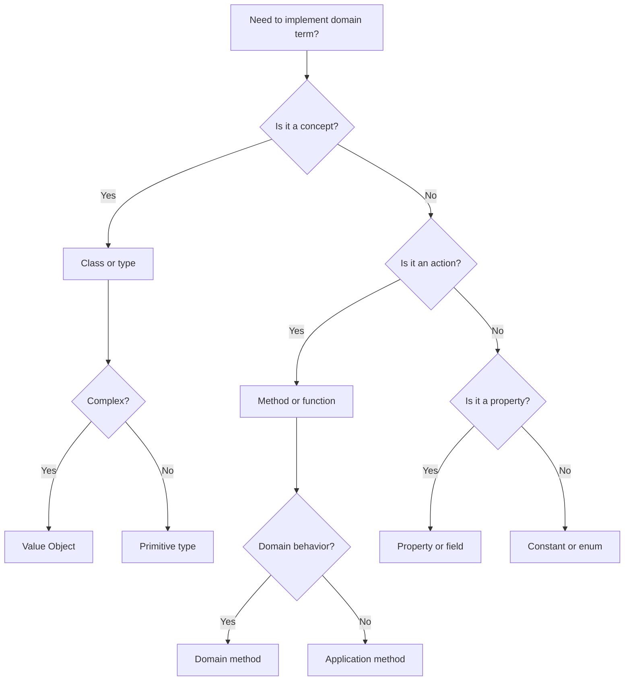

---
slug: c01-ubiquitous-language
sources:
  - https://www.domainlanguage.com/ddd/reference/
  - https://martinfowler.com/bliki/UbiquitousLanguage.html
date: 2026-11-02
tags:
  - ddd
  - ubiquitous-language
  - domain-modeling
  - communication
# Ubiquitous Language

## Definition

## concept_id
c01-ubiquitous-language

## title
Ubiquitous Language

## aliases
- C01-Ubiquitous-Language

## category
domain-modeling

## concept_type
tactical-pattern

## research_status
verified

## project_adoption
recommended
Ubiquitous Language is **a rigorously developed and shared language between developers and domain experts that forms the basis of all implementations in a DDD project**.

> "Ubiquitous Language is not just a rich model, it is a hard discipline. Everyone involved in the project must speak it." — Eric Evans

## Problem Addressed

## concept_id
c01-ubiquitous-language

## title
Ubiquitous Language

## aliases
- C01-Ubiquitous-Language

## category
domain-modeling

## concept_type
tactical-pattern

## research_status
verified

## project_adoption
recommended
Without ubiquitous language:
- **Miscommunication**: Developers and domain experts use different terms for the same concept
- **Model drift**: The code model diverges from the domain model
- **Ambiguity**: Terms have different meanings to different people
- **Onboarding**: New team members struggle to understand the domain

## Scope and Boundaries

## concept_id
c01-ubiquitous-language

## title
Ubiquitous Language

## aliases
- C01-Ubiquitous-Language

## category
domain-modeling

## concept_type
tactical-pattern

## research_status
verified

## project_adoption
recommended
- Ubiquitous Language ≠ Domain Language (ubiquitous language is shared and enforced, domain language is the raw input)
- Ubiquitous Language = Code (ubiquitous language should be reflected in code names)
- Ubiquitous Language is a **practice**, not a pattern

## When to Apply

## concept_id
c01-ubiquitous-language

## title
Ubiquitous Language

## aliases
- C01-Ubiquitous-Language

## category
domain-modeling

## concept_type
tactical-pattern

## research_status
verified

## project_adoption
recommended
- When working on complex domains
- when collaboration between developers and domain experts is essential
- when the domain model drives the architecture
- when onboarding new team members is important

## Tradeoffs and When to Avoid

## concept_id
c01-ubiquitous-language

## title
Ubiquitous Language

## aliases
- C01-Ubiquitous-Language

## category
domain-modeling

## concept_type
tactical-pattern

## research_status
verified

## project_adoption
recommended
| Cost | Description |
|------|-------------|
| **Effort** — Maintaining ubiquitous language requires constant communication |
| **Time** — Building shared understanding takes time |
| **Rigidity** — Changing the language requires changing the code |

## Common Misuses

## concept_id
c01-ubiquitous-language

## title
Ubiquitous Language

## aliases
- C01-Ubiquitous-Language

## category
domain-modeling

## concept_type
tactical-pattern

## research_status
verified

## project_adoption
recommended
- **Glossary only**: A glossary is not a ubiquitous language — it must be spoken daily
- **Ignoring evolution**: The language evolves as the domain understanding deepens
- **Confusing with technical jargon**: Technical terms should map to domain terms, not replace them

## Related Concepts

## concept_id
c01-ubiquitous-language

## title
Ubiquitous Language

## aliases
- C01-Ubiquitous-Language

## category
domain-modeling

## concept_type
tactical-pattern

## research_status
verified

## project_adoption
recommended
- [Bounded Context](DDD/bounded-context.md) — Each bounded context may have its own ubiquitous language
- [Entity](DDD/entity.md) — Entities are named using the ubiquitous language
- [Value Object](DDD/value-object.md) — Value objects are named using the ubiquitous language
- [Aggregate](DDD/aggregate.md) — Aggregates are defined using the ubiquitous language

## Project Observations

## concept_id
c01-ubiquitous-language

## title
Ubiquitous Language

## aliases
- C01-Ubiquitous-Language

## category
domain-modeling

## concept_type
tactical-pattern

## research_status
verified

## project_adoption
recommended
- The project uses ubiquitous language:
  - TypeScript naming conventions support domain-driven naming
  - The project's architecture patterns note covers DDD concepts
  - No evidence of ubiquitous language in existing code (src/ is empty)
- File naming conventions support ubiquitous language:
  - `*.use-case.ts` — Use case files
  - `*.entity.ts` — Entity files
  - `*.value-object.ts` — Value object files

## Sources

## concept_id
c01-ubiquitous-language

## title
Ubiquitous Language

## aliases
- C01-Ubiquitous-Language

## category
domain-modeling

## concept_type
tactical-pattern

## research_status
verified

## project_adoption
recommended
- [[Sources/evans-ddd-2003|evans-ddd-2003]]
- [[Sources/martin-fowler-patterns|martin-fowler-patterns]]

---

## Decision Tree: Ubiquitous Language Implementation

## concept_id
c01-ubiquitous-language

## title
Ubiquitous Language

## aliases
- C01-Ubiquitous-Language

## category
domain-modeling

## concept_type
tactical-pattern

## research_status
verified

## project_adoption
recommended


### Language Mapping Examples

| Domain Term | Code Implementation | Type |
|-------------|---------------------|------|
| **Customer** | `class Customer` | Entity |
| **Order** | `class Order` | Entity |
| **Email** | `class Email` | Value Object |
| **PlaceOrder** | `order.place()` | Domain Method |
| **IsActive** | `customer.isActive()` | Domain Method |
| **$100** | `Money.create(100, 'USD')` | Value Object |

---

## Procedural Guidance: Ubiquitous Language Implementation

## concept_id
c01-ubiquitous-language

## title
Ubiquitous Language

## aliases
- C01-Ubiquitous-Language

## category
domain-modeling

## concept_type
tactical-pattern

## research_status
verified

## project_adoption
recommended
### Step 1: Create Glossary with Domain Experts

```typescript
// docs/glossary.ts
// Domain Glossary — Created with domain experts

export const glossary = {
  // Core domain terms
  customer: {
    term: 'Customer',
    definition: 'A person or organization that places orders',
    examples: ['John Doe', 'Acme Corp'],
    relatedTerms: ['Order', 'Payment'],
  },
  order: {
    term: 'Order',
    definition: 'A request from a customer to purchase products',
    examples: ['Order #12345'],
    relatedTerms: ['Customer', 'OrderItem', 'Payment'],
  },
  orderItem: {
    term: 'Order Item',
    definition: 'A single product in an order with quantity and price',
    examples: ['2x Widget A'],
    relatedTerms: ['Order', 'Product', 'Money'],
  },
  money: {
    term: 'Money',
    definition: 'An amount with currency (e.g., $100 USD)',
    examples: ['$100 USD', '€50 EUR'],
    relatedTerms: ['OrderItem', 'Payment'],
  },
} as const

export type GlossaryKey = keyof typeof glossary
```

### Step 2: Name Classes After Domain Terms

```typescript
// domain/customer/customer.ts — Named after domain term
export class Customer {
  private constructor(
    readonly id: string,
    private name: CustomerName,
    private email: Email,
    private address: Address,
  ) {}

  static create(name: string, email: string, address: string): Customer {
    return new Customer(
      crypto.randomUUID(),
      CustomerName.create(name),
      Email.create(email),
      Address.create(address),
    )
  }
}

// domain/customer/customer-name.ts — Value object named after domain term
export class CustomerName {
  private constructor(private value: string) {}

  static create(name: string): CustomerName {
    if (!name || name.length < 2) {
      throw new Error('Customer name must be at least 2 characters')
    }
    return new CustomerName(name)
  }

  get value(): string {
    return this.value
  }
}

// domain/order/order.ts — Named after domain term
export class Order {
  private constructor(
    readonly id: string,
    private customer: Customer,
    private items: OrderItem[],
    private status: OrderStatus,
  ) {}

  static create(customer: Customer, items: OrderItem[]): Order {
    return new Order(
      crypto.randomUUID(),
      customer,
      items,
      OrderStatus.PENDING,
    )
  }

  // Domain method — named after domain action
  place(): void {
    if (this.status !== OrderStatus.PENDING) {
      throw new Error('Only pending orders can be placed')
    }
    this.status = OrderStatus.PLACED
  }

  cancel(reason: string): void {
    if (this.status !== OrderStatus.PLACED) {
      throw new Error('Only placed orders can be cancelled')
    }
    this.status = OrderStatus.CANCELLED
  }
}

// domain/order/order-item.ts — Named after domain term
export class OrderItem {
  constructor(
    readonly productId: string,
    private quantity: number,
    private price: Money,
  ) {}

  get total(): Money {
    return this.price.multiply(this.quantity)
  }
}

// domain/money/money.ts — Named after domain term
export class Money {
  private constructor(
    readonly value: number,
    readonly currency: string,
  ) {}

  static create(value: number, currency: string): Money {
    if (value < 0) {
      throw new Error('Money cannot be negative')
    }
    return new Money(value, currency)
  }

  add(other: Money): Money {
    if (this.currency !== other.currency) {
      throw new Error('Cannot add different currencies')
    }
    return Money.create(this.value + other.value, this.currency)
  }

  multiply(multiplier: number): Money {
    return Money.create(this.value * multiplier, this.currency)
  }
}

enum OrderStatus {
  PENDING = 'PENDING',
  PLACED = 'PLACED',
  CANCELLED = 'CANCELLED',
}
```

### Step 3: Use Domain Terms in Method Names

```typescript
// application/order/place-order.service.ts
import { Order } from '../../domain/order/order'
import { OrderRepository } from '../../domain/order/order.repository'

export class PlaceOrderService {
  constructor(private orderRepository: OrderRepository) {}

  // Method named after domain action
  async placeOrder(
    customerId: string,
    items: OrderItemDto[],
  ): Promise<Order> {
    // 1. Get customer
    const customer = await this.customerRepository.findById(customerId)
    if (!customer) {
      throw new Error('Customer not found')
    }

    // 2. Create order items
    const orderItems = items.map(
      (item) => new OrderItem(item.productId, item.quantity, item.price),
    )

    // 3. Create order
    const order = Order.create(customer, orderItems)

    // 4. Place order (domain method)
    order.place()

    // 5. Save order
    await this.orderRepository.save(order)

    return order
  }
}

interface OrderItemDto {
  productId: string
  quantity: number
  price: Money
}
```

### Step 4: Document Domain Terms in Code

```typescript
// domain/order/order.ts

/**
 * Order — A request from a customer to purchase products.
 *
 * Lifecycle:
 * 1. PENDING — Order is created but not yet placed
 * 2. PLACED — Order is confirmed and ready for processing
 * 3. CANCELLED — Order is cancelled by customer or system
 *
 * Invariants:
 * - An order must have at least one item
 * - An order cannot be placed without items
 * - An order can only be cancelled when PLACED
 */
export class Order {
  // ... implementation
}
```

### Step 5: Enforce Language Consistency

```typescript
// .eslintrc.js
module.exports = {
  rules: {
    // Enforce domain term naming
    '@typescript-eslint/naming-convention': [
      'error',
      {
        selector: 'class',
        format: ['PascalCase'],
        custom: {
          regex: '^(Customer|Order|OrderItem|Money|Payment|Product)$',
          match: true,
        },
      },
    ],

    // Enforce domain method naming
    'domain-method-naming': [
      'error',
      {
        patterns: ['^place$', '^cancel$', '^isActive$', '^create$'],
      },
    ],
  },
}
```

---

## Copilot Instructions

## concept_id
c01-ubiquitous-language

## title
Ubiquitous Language

## aliases
- C01-Ubiquitous-Language

## category
domain-modeling

## concept_type
tactical-pattern

## research_status
verified

## project_adoption
recommended
### When to Read This Note
- Implementing domain-driven design
- Naming classes and methods after domain terms
- Creating glossary with domain experts
- Ensuring code reflects domain language
- Onboarding new team members

### What to Do With This Information
1. **Create glossary**: Document domain terms with experts
2. **Name classes after terms**: Customer, Order, Money, etc.
3. **Name methods after actions**: placeOrder, cancel, isActive
4. **Document invariants**: Document domain rules in code
5. **Enforce consistency**: Use linters to enforce naming

### Tools to Use
- **VS Code Extension**: Error Lens — for inline error display
- **npm Package**: `eslint` — for code quality
- **npm Package**: `@typescript-eslint` — for TypeScript linting
- **Terminal Command**: `pnpm lint` — check code quality
- **Terminal Command**: `pnpm test` — run tests

### Agents to Invoke
- **DDD Review Agent**: Run when reviewing domain model naming
- **Code Review Agent**: Run when reviewing PRs for language consistency

### Integration with Other Notes
- read [[bounded-context]] for context-specific language
- read [[entity]] for entity naming
- read [[value-object]] for value object naming
- read [[domain-invariant]] for invariant documentation

### Common Pitfalls
- Don't use technical terms in domain layer (use domain terms)
- Don't ignore domain expert input (collaborate with them)
- Don't let code drift from language (review regularly)
- Don't skip documentation (document domain terms)
- Don't use multiple terms for same concept (be consistent)

### Quick Validation Checklist
- [ ] Are class names domain terms?
- [ ] Are method names domain actions?
- [ ] Is glossary maintained?
- [ ] Are domain experts consulted?
- [ ] Is code reviewed for language drift?
- [ ] Are invariants documented?


