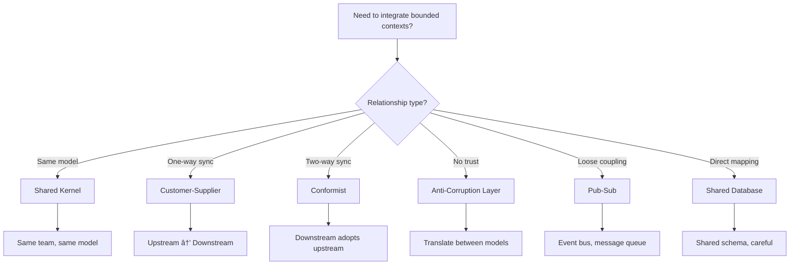

---
slug: c03-context-map
sources:
  - https://www.domainlanguage.com/ddd/reference/
  - https://martinfowler.com/bliki/ContextMap.html
date: 2026-11-02
tags:
  - maturity/deprecated
  - ddd
  - context-map
  - domain-modeling
  - integration
# Context Map

## Definition

## concept_id
c03-context-map

## title
Context Map

## aliases
- C03-Context-Map

## category
domain-modeling

## concept_type
tactical-pattern

## research_status
verified

## project_adoption
recommended
Context Map is **a document that describes the relationships between bounded contexts and the integration patterns used between them**.

> "The context map is a diagram that shows the relationships between bounded contexts." — Eric Evans

## Problem Addressed

## concept_id
c03-context-map

## title
Context Map

## aliases
- C03-Context-Map

## category
domain-modeling

## concept_type
tactical-pattern

## research_status
verified

## project_adoption
recommended
Without context map:
- **Integration chaos**: No clear understanding of how bounded contexts interact
- **Coupling**: Bounded contexts become tightly coupled
- **Dependency confusion**: Unknown dependencies between contexts
- **Scaling issues**: Can't scale teams without clear boundaries

## Scope and Boundaries

## concept_id
c03-context-map

## title
Context Map

## aliases
- C03-Context-Map

## category
domain-modeling

## concept_type
tactical-pattern

## research_status
verified

## project_adoption
recommended
- Context Map ≠ Bounded Context (context map describes relationships, bounded context is a single model)
- Context Map = Integration (context map defines integration patterns)
- Context Map is a **documentation artifact**, not a pattern

## When to Apply

## concept_id
c03-context-map

## title
Context Map

## aliases
- C03-Context-Map

## category
domain-modeling

## concept_type
tactical-pattern

## research_status
verified

## project_adoption
recommended
- When building systems with multiple bounded contexts
- when integration between contexts is complex
- when scaling development teams
- when onboarding new team members

## Tradeoffs and When to Avoid

## concept_id
c03-context-map

## title
Context Map

## aliases
- C03-Context-Map

## category
domain-modeling

## concept_type
tactical-pattern

## research_status
verified

## project_adoption
recommended
| Cost | Description |
|------|-------------|
| **Effort** — Maintaining context map requires effort |
| **Time** — Creating context map takes time |
| **Over-documentation** — Don't create context maps for simple systems |

## Common Misuses

## concept_id
c03-context-map

## title
Context Map

## aliases
- C03-Context-Map

## category
domain-modeling

## concept_type
tactical-pattern

## research_status
verified

## project_adoption
recommended
- **One context map for everything**: Context maps should be living documents, updated as the system evolves
- **Ignoring integration patterns**: Each relationship needs an explicit integration pattern
- **Confusing with architecture diagram**: Context map focuses on relationships, not technical architecture

## Related Concepts

## concept_id
c03-context-map

## title
Context Map

## aliases
- C03-Context-Map

## category
domain-modeling

## concept_type
tactical-pattern

## research_status
verified

## project_adoption
recommended
- [Bounded Context](DDD/bounded-context.md) — Context map describes relationships between bounded contexts
- [Anti-Corruption Layer](DDD/anti-corruption-layer.md) — Anti-corruption layer is an integration pattern
- [Shared Kernel](DDD/context-map.md) — Shared kernel is an integration pattern

## Project Observations

## concept_id
c03-context-map

## title
Context Map

## aliases
- C03-Context-Map

## category
domain-modeling

## concept_type
tactical-pattern

## research_status
verified

## project_adoption
recommended
- The project uses context maps:
  - The project's architecture patterns note covers DDD concepts
  - TypeScript modules can serve as bounded context boundaries
  - No evidence of context maps in existing code (src/ is empty)
- File naming conventions support context maps:
  - `*.integration.ts` — Integration files
  - `*.bounded-context.ts` — Bounded context files

## Sources

## concept_id
c03-context-map

## title
Context Map

## aliases
- C03-Context-Map

## category
domain-modeling

## concept_type
tactical-pattern

## research_status
verified

## project_adoption
recommended
- [[Sources/evans-ddd-2003|evans-ddd-2003]]
- [[Sources/martin-fowler-patterns|martin-fowler-patterns]]

---

## Decision Tree: Integration Patterns

## concept_id
c03-context-map

## title
Context Map

## aliases
- C03-Context-Map

## category
domain-modeling

## concept_type
tactical-pattern

## research_status
verified

## project_adoption
recommended


### Integration Pattern Selection

| Pattern | When to Use | Complexity | Trust Level |
|---------|-------------|------------|-------------|
| **Shared Kernel** | Same team, shared domain | Low | High |
| **Customer-Supplier** | Upstream controls, downstream consumes | Medium | Medium |
| **Conformist** | Must adopt upstream model | Low | Low |
| **Anti-Corruption Layer** | Untrusted external system | High | None |
| **Pub-Sub** | Event-driven, loose coupling | Medium | Variable |
| **Shared Database** | Legacy migration, performance | High | High |

---

## Procedural Guidance: Context Map Implementation

## concept_id
c03-context-map

## title
Context Map

## aliases
- C03-Context-Map

## category
domain-modeling

## concept_type
tactical-pattern

## research_status
verified

## project_adoption
recommended
### Step 1: Identify Bounded Contexts

```typescript
// contexts/index.ts — Bounded context registry
import { UserContext } from './user-context'
import { OrderContext } from './order-context'
import { PaymentContext } from './payment-context'

export const boundedContexts = {
  user: UserContext,
  order: OrderContext,
  payment: PaymentContext,
} as const

export type BoundedContextKey = keyof typeof boundedContexts
```

### Step 2: Define Integration Patterns

```typescript
// contexts/integration/customer-supplier.ts
// Customer-Supplier: Upstream provides API, downstream consumes

import { HttpClient } from '@/lib/http-client'

export class CustomerSupplierIntegration {
  private upstream: HttpClient

  constructor() {
    this.upstream = new HttpClient({
      baseUrl: process.env.UPSTREAM_API_URL,
      timeout: 5000,
    })
  }

  // Downstream consumes upstream data
  async getCustomerData(customerId: string) {
    const response = await this.upstream.get(`/customers/${customerId}`)
    return response.data
  }

  // Downstream sends events to upstream
  async sendOrderEvent(event: OrderEvent) {
    await this.upstream.post('/events', {
      type: event.type,
      payload: event.payload,
    })
  }
}

interface OrderEvent {
  type: string
  payload: Record<string, unknown>
}
```

### Step 3: Implement Anti-Corruption Layer

```typescript
// contexts/integration/anti-corruption-layer.ts
// Anti-Corruption Layer: Translate external model to internal model

import { HttpClient } from '@/lib/http-client'
import { User, UserId } from '@/domain/user'

export class AntiCorruptionLayer {
  private external: HttpClient

  constructor() {
    this.external = new HttpClient({
      baseUrl: process.env.EXTERNAL_API_URL,
    })
  }

  // Translate external user model to internal user model
  async mapExternalUserToInternal(externalId: string): Promise<User> {
    const externalUser = await this.external.get(`/users/${externalId}`)

    // Transform external model to internal model
    return User.create({
      id: UserId.generate(),
      name: externalUser.data.name,
      email: externalUser.data.email_address, // Different field name
      phone: externalUser.data.phone_number, // Different field name
    })
  }

  // Translate internal user model to external user model
  async mapInternalUserToExternal(user: User): Promise<Record<string, unknown>> {
    return {
      name: user.name.value,
      email_address: user.email.value, // Different field name
      phone_number: user.phone?.value, // Different field name
    }
  }
}
```

### Step 4: Implement Pub-Sub Integration

```typescript
// contexts/integration/pub-sub.ts
// Pub-Sub: Event bus for loose coupling

import { EventEmitter } from 'events'

export class EventBus extends EventEmitter {
  static instance: EventBus

  static getInstance(): EventBus {
    if (!EventBus.instance) {
      EventBus.instance = new EventBus()
    }
    return EventBus.instance
  }

  // Publish domain event
  async publish(event: DomainEvent): Promise<void> {
    this.emit(event.type, event)
  }

  // Subscribe to domain event
  subscribe(eventType: string, handler: (event: DomainEvent) => void): void {
    this.on(eventType, handler)
  }
}

interface DomainEvent {
  type: string
  payload: Record<string, unknown>
  timestamp: Date
  eventId: string
}
```

### Step 5: Create Context Map Document

```typescript
// docs/context-map.md
// Context Map Document

/**
 * Bounded Contexts:
 * 1. User Context — Manages user accounts
 * 2. Order Context — Manages orders
 * 3. Payment Context — Manages payments
 *
 * Integration Patterns:
 * 1. User Context → Order Context: Pub-Sub (user created events)
 * 2. Order Context → Payment Context: Customer-Supplier (order events)
 * 3. Payment Context → Order Context: Anti-Corruption Layer (payment status)
 */

export const contextMap = {
  contexts: ['user', 'order', 'payment'] as const,
  integrations: [
    {
      from: 'user',
      to: 'order',
      pattern: 'pub-sub',
      events: ['UserCreated', 'UserUpdated'],
    },
    {
      from: 'order',
      to: 'payment',
      pattern: 'customer-supplier',
      events: ['OrderCreated'],
    },
    {
      from: 'payment',
      to: 'order',
      pattern: 'anti-corruption-layer',
      events: ['PaymentCompleted', 'PaymentFailed'],
    },
  ],
}
```

---

## Copilot Instructions

## concept_id
c03-context-map

## title
Context Map

## aliases
- C03-Context-Map

## category
domain-modeling

## concept_type
tactical-pattern

## research_status
verified

## project_adoption
recommended
### When to Read This Note
- Designing system architecture with multiple bounded contexts
- Integrating microservices or modules
- Choosing integration patterns
- Implementing anti-corruption layers
- Setting up event-driven communication

### What to Do With This Information
1. **Identify bounded contexts**: Define clear context boundaries
2. **Choose integration patterns**: Select appropriate patterns for each relationship
3. **Implement anti-corruption layers**: Translate between different models
4. **Use event bus**: For loose coupling between contexts
5. **Document context map**: Keep context map updated

### Tools to Use
- **VS Code Extension**: Error Lens — for inline error display
- **npm Package**: `@prisma/client` — for database access
- **npm Package**: `amqplib` — for RabbitMQ pub-sub
- **npm Package**: `bullmq` — for job queues
- **Terminal Command**: `pnpm test` — run tests
- **Terminal Command**: `pnpm lint` — check code quality

### Agents to Invoke
- **Architecture Review Agent**: Run when designing new bounded contexts
- **Security Review Agent**: Run when implementing integration patterns

### Integration with Other Notes
- read [[bounded-context]] for bounded context design
- read [[aggregate-root]] for aggregate root design
- read [[domain-event]] for domain event patterns
- read [[application-service]] for application services
- read [event-driven-architecture](D/event-driven-architecture.md) for event-driven patterns

### Common Pitfalls
- Don't create too many bounded contexts (start with 3-5)
- Don't use shared databases (prefer API or event-based integration)
- Don't ignore model translation (use anti-corruption layers)
- Don't couple contexts tightly (use events for loose coupling)
- Don't forget to document (keep context map updated)

### Quick Validation Checklist
- [ ] Are bounded contexts clearly defined?
- [ ] Are integration patterns documented?
- [ ] Are anti-corruption layers implemented?
- [ ] Is event bus used for loose coupling?
- [ ] Is context map kept up to date?
- [ ] Are contexts independently deployable?


