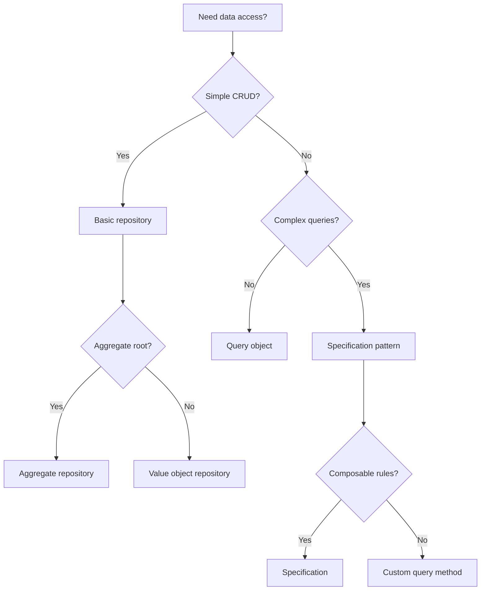

# Repository (DDD)

## Definition

Repository (DDD) is **a mechanism for encapsulating storage, retrieval, and search behavior which emulates a collection of objects**.

> "A repository performs the tasks of an intermediary between the domain model and data mapping, acting similarly to a collection." — Martin Fowler

## Problem Addressed

Without repositories:
- **Data access leakage**: Domain code directly accesses data access mechanisms
- **Testing difficulty**: Hard to test domain logic without real database
- **Persistence ignorance**: Domain model depends on persistence details
- **Duplication**: Query logic duplicated across the codebase

## Scope and Boundaries

- Repository ≠ Data Mapper (repository provides collection-like interface, data mapper handles object-relational mapping)
- Repository = Collection (repository emulates a collection in memory)
- Repository is a **domain model building block**, not a pattern

## When to Apply

- When building domain models with complex queries
- when persistence ignorance is important
- when testing domain logic without a database is needed
- when query logic needs to be centralized

## Tradeoffs and When to Avoid

| Cost | Description |
|------|-------------|
| **Complexity** — Repositories add an abstraction layer |
| **Time** — Implementing repositories takes time |
| **Over-repository** — Simple CRUD may not need a repository |

## Common Misuses

- **Query objects as repositories**: Repositories should not become query objects
- **Domain logic in repositories**: Repositories should not contain domain logic
- **Confusing with data mapper**: Repository provides collection interface, data mapper handles mapping

## Related Concepts

- [Data Mapper](Architecture/data-mapper-pattern.md) — Data mapper handles object-relational mapping
- [Unit of Work](Architecture/unit-of-work-pattern.md) — Unit of work coordinates repositories
- [Aggregate Root](DDD/aggregate-root.md) — Repositories typically manage aggregate roots

## Project Observations

- The project uses repositories:
  - TypeScript interfaces can serve as repository abstractions
  - The project's architecture patterns note covers DDD concepts
  - No evidence of repositories in existing code (src/ is empty)
- File naming conventions support repositories:
  - `*.repository.ts` — Repository files
  - `*.port.ts` — Port files

## Sources

- [[Sources/evans-ddd-2003|evans-ddd-2003]]
- [[Sources/martin-fowler-patterns|martin-fowler-patterns]]

---

## Decision Tree: Repository Design



### Repository Type Selection

| Repository Type | When to Use | Example |
|-----------------|-------------|---------|
| **Basic repository** | Simple CRUD operations | `UserRepository.findById()` |
| **Aggregate repository** | Aggregate root persistence | `OrderRepository.save()` |
| **Specification repository** | Composable query rules | `UserRepository.find(spec)` |
| **Query repository** | Complex read queries | `UserRepository.search()` |
| **Write repository** | Command-only (CQRS) | `UserRepository.create()` |

---

## Procedural Guidance: Repository Implementation

### Step 1: Define Repository Interface

```typescript
// domain/user/user.repository.ts
import { User } from './user'

export interface UserRepository {
  findById(id: string): Promise<User | null>
  findByEmail(email: string): Promise<User | null>
  findAll(): Promise<User[]>
  save(user: User): Promise<void>
  delete(id: string): Promise<void>
}
```

### Step 2: Implement Repository with Prisma

```typescript
// infrastructure/user/prisma-user.repository.ts
import { PrismaClient } from '@prisma/client'
import { User } from '../../domain/user/user'
import { UserRepository } from '../../domain/user/user.repository'

export class PrismaUserRepository implements UserRepository {
  private prisma: PrismaClient

  constructor() {
    this.prisma = new PrismaClient()
  }

  async findById(id: string): Promise<User | null> {
    const userData = await this.prisma.user.findUnique({
      where: { id },
    })

    if (!userData) return null

    return User.create(userData.email, userData.name)
  }

  async findByEmail(email: string): Promise<User | null> {
    const userData = await this.prisma.user.findUnique({
      where: { email },
    })

    if (!userData) return null

    return User.create(userData.email, userData.name)
  }

  async findAll(): Promise<User[]> {
    const usersData = await this.prisma.user.findMany()
    return usersData.map((data) => User.create(data.email, data.name))
  }

  async save(user: User): Promise<void> {
    await this.prisma.user.upsert({
      where: { id: user.id },
      update: {
        email: user.email.value,
        name: user.name.value,
      },
      create: {
        id: user.id,
        email: user.email.value,
        name: user.name.value,
      },
    })
  }

  async delete(id: string): Promise<void> {
    await this.prisma.user.delete({
      where: { id },
    })
  }
}
```

### Step 3: Implement Repository with TypeORM

```typescript
// infrastructure/user/typeorm-user.repository.ts
import { Repository, DataSource } from 'typeorm'
import { User } from '../../domain/user/user'
import { UserRepository } from '../../domain/user/user.repository'
import { UserEntity } from './user-entity'

export class TypeOrmUserRepository implements UserRepository {
  private repository: Repository<UserEntity>

  constructor(dataSource: DataSource) {
    this.repository = dataSource.getRepository(UserEntity)
  }

  async findById(id: string): Promise<User | null> {
    const entity = await this.repository.findOne({
      where: { id },
    })

    if (!entity) return null

    return User.create(entity.email, entity.name)
  }

  async findByEmail(email: string): Promise<User | null> {
    const entity = await this.repository.findOne({
      where: { email },
    })

    if (!entity) return null

    return User.create(entity.email, entity.name)
  }

  async findAll(): Promise<User[]> {
    const entities = await this.repository.find()
    return entities.map((entity) => User.create(entity.email, entity.name))
  }

  async save(user: User): Promise<void> {
    const entity = new UserEntity()
    entity.id = user.id
    entity.email = user.email.value
    entity.name = user.name.value

    await this.repository.save(entity)
  }

  async delete(id: string): Promise<void> {
    await this.repository.delete(id)
  }
}
```

### Step 4: Implement Specification Pattern

```typescript
// domain/user/user-specifications.ts
import { User } from './user'

export interface Specification<T> {
  isSatisfiedBy(candidate: T): boolean
  and(other: Specification<T>): Specification<T>
  or(other: Specification<T>): Specification<T>
}

export class ActiveUserSpecification implements Specification<User> {
  isSatisfiedBy(candidate: User): boolean {
    return candidate.isActive()
  }

  and(other: Specification<User>): Specification<User> {
    return new AndSpecification(this, other)
  }

  or(other: Specification<User>): Specification<User> {
    return new OrSpecification(this, other)
  }
}

export class EmailSpecification implements Specification<User> {
  constructor(private readonly email: string) {}

  isSatisfiedBy(candidate: User): boolean {
    return candidate.email.value === this.email
  }

  and(other: Specification<User>): Specification<User> {
    return new AndSpecification(this, other)
  }

  or(other: Specification<User>): Specification<User> {
    return new OrSpecification(this, other)
  }
}

export class AndSpecification<T> implements Specification<T> {
  constructor(
    private readonly left: Specification<T>,
    private readonly right: Specification<T>,
  ) {}

  isSatisfiedBy(candidate: T): boolean {
    return this.left.isSatisfiedBy(candidate) && this.right.isSatisfiedBy(candidate)
  }

  and(other: Specification<T>): Specification<T> {
    return new AndSpecification(this, other)
  }

  or(other: Specification<T>): Specification<T> {
    return new OrSpecification(this, other)
  }
}

export class OrSpecification<T> implements Specification<T> {
  constructor(
    private readonly left: Specification<T>,
    private readonly right: Specification<T>,
  ) {}

  isSatisfiedBy(candidate: T): boolean {
    return this.left.isSatisfiedBy(candidate) || this.right.isSatisfiedBy(candidate)
  }

  and(other: Specification<T>): Specification<T> {
    return new AndSpecification(this, other)
  }

  or(other: Specification<T>): Specification<T> {
    return new OrSpecification(this, other)
  }
}
```

### Step 5: Use Repository in Application Service

```typescript
// application/user/create-user.service.ts
import { UserRepository } from '../../domain/user/user.repository'
import { User } from '../../domain/user/user'

export class CreateUserService {
  constructor(private userRepository: UserRepository) {}

  async execute(email: string, name: string): Promise<User> {
    // Check if user already exists
    const existing = await this.userRepository.findByEmail(email)
    if (existing) {
      throw new Error('User with this email already exists')
    }

    // Create user
    const user = User.create(email, name)

    // Save user
    await this.userRepository.save(user)

    return user
  }
}
```

---

## Copilot Instructions

### When to Read This Note
- Implementing repository pattern
- Designing data access layer
- Creating repository interfaces
- Using specification pattern
- Implementing CQRS repositories

### What to Do With This Information
1. **Define repository interfaces**: In domain layer
2. **Implement with ORM**: In infrastructure layer
3. **Use specification pattern**: For composable queries
4. **Keep domain clean**: Domain doesn't depend on ORM
5. **Use dependency injection**: Inject repositories

### Tools to Use
- **VS Code Extension**: Error Lens — for inline error display
- **npm Package**: `@prisma/client` — for Prisma ORM
- **npm Package**: `typeorm` — for TypeORM
- **npm Package**: `pg` — for PostgreSQL client
- **Terminal Command**: `pnpm test` — run tests
- **Terminal Command**: `pnpm lint` — check code quality

### Agents to Invoke
- **DDD Review Agent**: Run when designing repositories
- **Architecture Review Agent**: Run when implementing data access

### Integration with Other Notes
- read [[aggregate-root]] for aggregate repositories
- read [[specification-ddd-pattern]] for specification pattern
- read [[application-service]] for repository usage
- read [[event-sourcing]] for event sourcing repositories

### Common Pitfalls
- Don't put domain logic in repositories (use domain services)
- Don't leak ORM entities to domain (use domain entities)
- Don't create god repositories (one per aggregate root)
- Don't forget to test (mock repositories in tests)
- Don't couple domain to infrastructure (use interfaces)

### Quick Validation Checklist
- [ ] Are repository interfaces in domain layer?
- [ ] Are implementations in infrastructure layer?
- [ ] Is domain independent of ORM?
- [ ] Are repositories testable with mocks?
- [ ] Is one repository per aggregate root?
- [ ] Are specifications composable?


