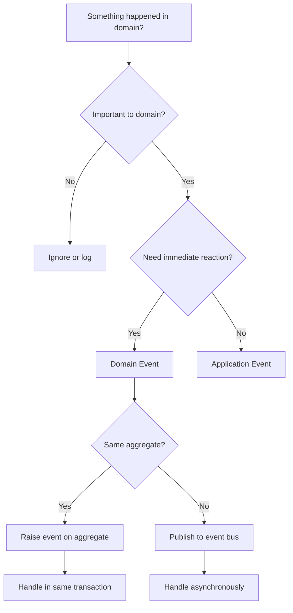

# Domain Event

## Definition

Domain Event is **a significant occurrence or change in the domain that is important to other parts of the system**.

> "A domain event is something that happened in the domain that the rest of the domain model needs to know about." — Eric Evans

## Problem Addressed

Without domain events:
- **Tight coupling**: Components are tightly coupled through direct calls
- **Missing side effects**: Important side effects are not triggered
- **No audit trail**: Cannot track domain changes
- **No eventual consistency**: Cannot coordinate across bounded contexts

## Scope and Boundaries

- Domain Event ≠ Application Event (domain event represents domain knowledge, application event represents application state changes)
- Domain Event = Notification (domain events notify other parts of the system)
- Domain Event is a **domain model building block**, not a pattern

## When to Apply

- When building domain models with complex interactions
- when other parts of the system need to react to domain changes
- when an audit trail is needed
- when eventual consistency is required

## Tradeoffs and When to Avoid

| Cost | Description |
|------|-------------|
| **Complexity** — Domain events add architectural complexity |
| **Time** — Designing domain events takes time |
| **Over-event** — Not every change needs to be an event |

## Common Misuses

- **Everything an event**: Not every change needs to be an event
- **Domain logic in event handlers**: Event handlers should not contain domain logic
- **Confusing with application event**: Domain events represent domain knowledge, application events represent application state changes

## Related Concepts

- [Event-Driven Architecture](Architecture/event-driven-architecture.md) — Domain events are a form of event-driven architecture
- [Domain Invariant](DDD/domain-invariant.md) — Domain events can trigger invariant checks
- [Transactional Outbox](Architecture/transactional-outbox.md) — Transactional outbox ensures domain events are persisted

## Project Observations

- The project uses domain events:
  - TypeScript events can serve as domain events
  - The project's architecture patterns note covers DDD concepts
  - No evidence of domain events in existing code (src/ is empty)
- File naming conventions support domain events:
  - `*.event.ts` — Event files
  - `*.domain-event.ts` — Domain event files

## Sources

- [[Sources/evans-ddd-2003|evans-ddd-2003]]
- [[Sources/martin-fowler-patterns|martin-fowler-patterns]]

---

## Decision Tree: Domain Event Design



### Event Type Selection

| Event Type | When to Use | Timing | Example |
|------------|-------------|--------|---------|
| **Domain Event** | Domain knowledge, important state change | Synchronous or async | OrderCreated, PaymentCompleted |
| **Application Event** | Application state change | Async | UserRegistered, TaskCompleted |
| **Infrastructure Event** | External system notification | Async | WebhookReceived, EmailSent |

---

## Procedural Guidance: Domain Event Implementation

### Step 1: Define Domain Event Interface

```typescript
// domain/events/domain-event.ts
export interface DomainEvent {
  type: string
  payload: Record<string, unknown>
  timestamp: Date
  eventId: string
  aggregateId?: string
}

// domain/events/order-events.ts
export class OrderCreated {
  readonly type = 'OrderCreated'
  readonly timestamp: Date
  readonly eventId: string

  constructor(
    readonly orderId: string,
    readonly customerId: string,
    readonly items: OrderItem[],
    readonly total: Money,
  ) {
    this.timestamp = new Date()
    this.eventId = crypto.randomUUID()
  }

  static fromPayload(payload: {
    orderId: string
    customerId: string
    items: OrderItem[]
    total: Money
  }): OrderCreated {
    return new OrderCreated(
      payload.orderId,
      payload.customerId,
      payload.items,
      payload.total,
    )
  }
}

export class OrderCancelled {
  readonly type = 'OrderCancelled'
  readonly timestamp: Date
  readonly eventId: string

  constructor(
    readonly orderId: string,
    readonly reason: string,
  ) {
    this.timestamp = new Date()
    this.eventId = crypto.randomUUID()
  }
}

interface OrderItem {
  productId: string
  quantity: number
  price: Money
}
```

### Step 2: Raise Events from Aggregate Root

```typescript
// domain/order/order.ts
import { DomainEvent } from '../events/domain-event'
import { OrderCreated, OrderCancelled } from '../events/order-events'

export class Order {
  private constructor(
    readonly id: string,
    private customerId: string,
    private items: OrderItem[],
    private status: OrderStatus,
    private raisedEvents: DomainEvent[],
  ) {
    this.raisedEvents = []
  }

  // Factory method — raises OrderCreated
  static create(
    customerId: string,
    items: OrderItem[],
  ): Order {
    const order = new Order(
      crypto.randomUUID(),
      customerId,
      items,
      OrderStatus.PENDING,
      [],
    )
    order.raisedEvents.push(
      new OrderCreated(order.id, customerId, items, order.calculateTotal()),
    )
    return order
  }

  // Domain method — raises OrderCancelled
  cancel(reason: string): void {
    if (this.status !== OrderStatus.PENDING) {
      throw new Error('Only pending orders can be cancelled')
    }
    this.status = OrderStatus.CANCELLED
    this.raisedEvents.push(new OrderCancelled(this.id, reason))
  }

  // Get raised events (for persistence)
  getEvents(): DomainEvent[] {
    return [...this.raisedEvents]
  }

  // Clear events after persistence
  clearEvents(): void {
    this.raisedEvents = []
  }

  private calculateTotal(): Money {
    return this.items.reduce(
      (total, item) => total.add(item.price.multiply(item.quantity)),
      Money.zero(),
    )
  }
}

enum OrderStatus {
  PENDING = 'PENDING',
  CANCELLED = 'CANCELLED',
  CONFIRMED = 'CONFIRMED',
}

interface Money {
  value: number
  currency: string
  add(other: Money): Money
  multiply(multiplier: number): Money
  static zero(): Money
}
```

### Step 3: Implement Event Handler

```typescript
// domain/events/event-handler.ts
import { DomainEvent } from './domain-event'
import { OrderCreated } from './order-events'

export interface DomainEventHandler<T extends DomainEvent = DomainEvent> {
  handle(event: T): Promise<void>
  supports(eventType: string): boolean
}

// handlers/inventory-reservation-handler.ts
export class InventoryReservationHandler implements DomainEventHandler<OrderCreated> {
  supports(eventType: string): boolean {
    return eventType === 'OrderCreated'
  }

  async handle(event: OrderCreated): Promise<void> {
    // Reserve inventory for order items
    for (const item of event.items) {
      await this.reserveInventory(item.productId, item.quantity)
    }
  }

  private async reserveInventory(productId: string, quantity: number): Promise<void> {
    // Reserve inventory logic
    console.log(`Reserving ${quantity} units of ${productId}`)
  }
}

// handlers/notification-handler.ts
export class NotificationHandler implements DomainEventHandler<OrderCreated> {
  supports(eventType: string): boolean {
    return eventType === 'OrderCreated'
  }

  async handle(event: OrderCreated): Promise<void> {
    // Send order confirmation notification
    console.log(`Sending order confirmation to customer ${event.customerId}`)
  }
}
```

### Step 4: Implement Event Bus

```typescript
// domain/events/event-bus.ts
import { DomainEvent, DomainEventHandler } from './domain-event'

export class InMemoryEventBus {
  private handlers: Map<string, DomainEventHandler[]> = new Map()

  // Register handler
  register<T extends DomainEvent>(handler: DomainEventHandler<T>): void {
    const eventType = (handler as any).supports.toString().match(/'([^']+)'/)?.[1]
    if (!eventType) return

    const existing = this.handlers.get(eventType) || []
    this.handlers.set(eventType, [...existing, handler])
  }

  // Publish event
  async publish(event: DomainEvent): Promise<void> {
    const handlers = this.handlers.get(event.type) || []

    for (const handler of handlers) {
      if (handler.supports(event.type)) {
        await handler.handle(event)
      }
    }
  }

  // Publish multiple events
  async publishAll(events: DomainEvent[]): Promise<void> {
    for (const event of events) {
      await this.publish(event)
    }
  }
}
```

### Step 5: Use Event Bus in Repository

```typescript
// domain/order/order.repository.ts
import { Order } from './order'
import { InMemoryEventBus } from '../events/event-bus'

export class OrderRepository {
  private orders: Map<string, Order> = new Map()
  private eventBus: InMemoryEventBus

  constructor(eventBus: InMemoryEventBus) {
    this.eventBus = eventBus
  }

  async save(order: Order): Promise<void> {
    this.orders.set(order.id, order)

    // Publish raised events
    const events = order.getEvents()
    if (events.length > 0) {
      await this.eventBus.publishAll(events)
      order.clearEvents()
    }
  }

  async findById(id: string): Promise<Order | null> {
    return this.orders.get(id) || null
  }
}
```

---

## Copilot Instructions

### When to Read This Note
- Designing domain events
- Implementing event-driven architecture
- Creating aggregate root event handling
- Building event handlers
- Setting up event bus

### What to Do With This Information
1. **Define event interfaces**: Create typed domain events
2. **Raise events from aggregates**: Use factory methods and domain methods
3. **Implement handlers**: Create handlers for each event type
4. **Use event bus**: Publish events through event bus
5. **Handle asynchronously**: For cross-aggregate events

### Tools to Use
- **VS Code Extension**: Error Lens — for inline error display
- **npm Package**: `@prisma/client` — for database access
- **npm Package**: `bullmq` — for job queues
- **npm Package**: `amqplib` — for RabbitMQ
- **Terminal Command**: `pnpm test` — run tests
- **Terminal Command**: `pnpm lint` — check code quality

### Agents to Invoke
- **DDD Review Agent**: Run when designing domain events
- **Architecture Review Agent**: Run when implementing event bus

### Integration with Other Notes
- read [[aggregate-root]] for aggregate root event handling
- read [[bounded-context]] for cross-context events
- read [[application-service]] for application event handling
- read [event-driven-architecture](D/event-driven-architecture.md) for event-driven patterns
- read [[context-map]] for integration patterns

### Common Pitfalls
- Don't raise events in getters (only in domain methods)
- Don't put domain logic in event handlers (use domain services)
- Don't forget to clear events after persistence
- Don't use events for everything (only significant domain events)
- Don't couple handlers tightly (use event bus for loose coupling)

### Quick Validation Checklist
- [ ] Are events typed and immutable?
- [ ] Are events raised from aggregate roots?
- [ ] Are handlers registered with event bus?
- [ ] Are events cleared after persistence?
- [ ] Are handlers idempotent?
- [ ] Are cross-aggregate events handled asynchronously?


