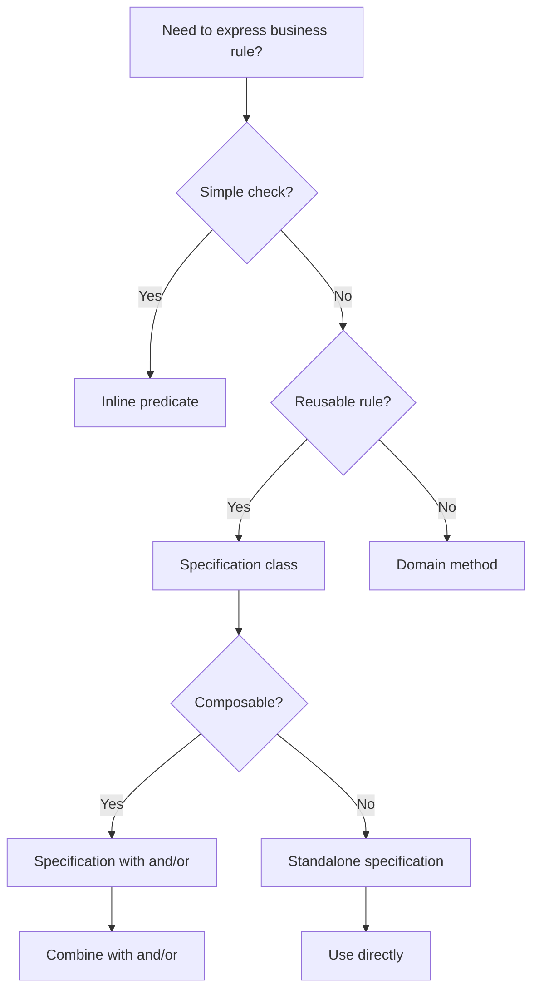

---
slug: specification-ddd-pattern
sources:
  - https://www.domainlanguage.com/ddd/reference/
  - https://martinfowler.com/bliki/SpecificationPattern.html
date: 2026-11-02
tags:
  - ddd
  - specification
  - domain-modeling
  - business-rules
# Specification (DDD)

## Definition

## concept_id
c15-specification-ddd-pattern

## title
Specification (DDD)

## aliases
- C15-Specification-DDD-Pattern

## category
domain-modeling

## concept_type
tactical-pattern

## research_status
verified

## project_adoption
recommended
Specification (DDD) is **a pattern that encapsulates a business rule as a composable predicate**.

> "A specification is a pattern that encapsulates a business rule as a predicate that can be composed with other specifications." — Eric Evans

## Problem Addressed

## concept_id
c15-specification-ddd-pattern

## title
Specification (DDD)

## aliases
- C15-Specification-DDD-Pattern

## category
domain-modeling

## concept_type
tactical-pattern

## research_status
verified

## project_adoption
recommended
Without specifications:
- **Complex queries**: Business rules are expressed as complex queries
- **Duplication**: Same rules expressed in multiple places
- **Testing difficulty**: Hard to test business rules
- **Maintenance**: Rules are scattered across the codebase

## Scope and Boundaries

## concept_id
c15-specification-ddd-pattern

## title
Specification (DDD)

## aliases
- C15-Specification-DDD-Pattern

## category
domain-modeling

## concept_type
tactical-pattern

## research_status
verified

## project_adoption
recommended
- Specification ≠ Query (specification expresses business rules, query expresses data access)
- Specification = Predicate (specification is a predicate that can be composed)
- Specification is a **domain model building block**, not a pattern

## When to Apply

## concept_id
c15-specification-ddd-pattern

## title
Specification (DDD)

## aliases
- C15-Specification-DDD-Pattern

## category
domain-modeling

## concept_type
tactical-pattern

## research_status
verified

## project_adoption
recommended
- When building domain models with complex business rules
- when business rules need to be composed
- when testing business rules is important
- when rules are expressed in multiple places

## Tradeoffs and When to Avoid

## concept_id
c15-specification-ddd-pattern

## title
Specification (DDD)

## aliases
- C15-Specification-DDD-Pattern

## category
domain-modeling

## concept_type
tactical-pattern

## research_status
verified

## project_adoption
recommended
| Cost | Description |
|------|-------------|
| **Complexity** — Specifications add an abstraction layer |
| **Time** — Implementing specifications takes time |
| **Over-specification** — Simple rules may not need a specification |

## Common Misuses

## concept_id
c15-specification-ddd-pattern

## title
Specification (DDD)

## aliases
- C15-Specification-DDD-Pattern

## category
domain-modeling

## concept_type
tactical-pattern

## research_status
verified

## project_adoption
recommended
- **Everything a specification**: Not every rule needs a specification
- **Specification as god object**: Specifications should be small and composable
- **Confusing with validation**: Specifications express business rules, validation checks input

## Related Concepts

## concept_id
c15-specification-ddd-pattern

## title
Specification (DDD)

## aliases
- C15-Specification-DDD-Pattern

## category
domain-modeling

## concept_type
tactical-pattern

## research_status
verified

## project_adoption
recommended
- [Domain Invariant](DDD/domain-invariant.md) — Specifications can express domain invariants
- [Entity](DDD/entity.md) — Specifications often evaluate entities
- [Repository](DDD/repository-ddd-pattern.md) — Repositories often use specifications for queries

## Project Observations

## concept_id
c15-specification-ddd-pattern

## title
Specification (DDD)

## aliases
- C15-Specification-DDD-Pattern

## category
domain-modeling

## concept_type
tactical-pattern

## research_status
verified

## project_adoption
recommended
- The project uses specifications:
  - TypeScript functions can serve as specifications
  - The project's architecture patterns note covers DDD concepts
  - No evidence of specifications in existing code (src/ is empty)
- File naming conventions support specifications:
  - `*.spec.ts` — Spec files
  - `*.policy.ts` — Policy files

## Sources

## concept_id
c15-specification-ddd-pattern

## title
Specification (DDD)

## aliases
- C15-Specification-DDD-Pattern

## category
domain-modeling

## concept_type
tactical-pattern

## research_status
verified

## project_adoption
recommended
- [[Sources/evans-ddd-2003|evans-ddd-2003]]
- [[Sources/martin-fowler-patterns|martin-fowler-patterns]]

---

## Decision Tree: Specification Design

## concept_id
c15-specification-ddd-pattern

## title
Specification (DDD)

## aliases
- C15-Specification-DDD-Pattern

## category
domain-modeling

## concept_type
tactical-pattern

## research_status
verified

## project_adoption
recommended


### Specification Type Selection

| Specification Type | When to Use | Example |
|--------------------|-------------|---------|
| **Inline predicate** | Simple, one-off check | `users.filter(u => u.isActive())` |
| **Standalone specification** | Reusable rule | `ActiveUserSpecification` |
| **Composable specification** | Rules need combining | `ActiveUserSpecification.and(EmailSpecification)` |
| **Repository specification** | Query filtering | `userRepository.find(spec)` |

---

## Procedural Guidance: Specification Implementation

## concept_id
c15-specification-ddd-pattern

## title
Specification (DDD)

## aliases
- C15-Specification-DDD-Pattern

## category
domain-modeling

## concept_type
tactical-pattern

## research_status
verified

## project_adoption
recommended
### Step 1: Define Specification Interface

```typescript
// domain/specification.ts
export interface Specification<T> {
  isSatisfiedBy(candidate: T): boolean
  and(other: Specification<T>): Specification<T>
  or(other: Specification<T>): Specification<T>
  negate(): Specification<T>
}
```

### Step 2: Implement Basic Specifications

```typescript
// domain/user/user-specifications.ts
import { User } from './user'
import { Specification } from '../specification'

export class ActiveUserSpecification implements Specification<User> {
  isSatisfiedBy(candidate: User): boolean {
    return candidate.isActive()
  }

  and(other: Specification<User>): Specification<User> {
    return new AndSpecification(this, other)
  }

  or(other: Specification<User>): Specification<User> {
    return new OrSpecification(this, other)
  }

  negate(): Specification<User> {
    return new NotSpecification(this)
  }
}

export class EmailDomainSpecification implements Specification<User> {
  constructor(private readonly domain: string) {}

  isSatisfiedBy(candidate: User): boolean {
    return candidate.email.value.endsWith(this.domain)
  }

  and(other: Specification<User>): Specification<User> {
    return new AndSpecification(this, other)
  }

  or(other: Specification<User>): Specification<User> {
    return new OrSpecification(this, other)
  }

  negate(): Specification<User> {
    return new NotSpecification(this)
  }
}
```

### Step 3: Implement Composable Specifications

```typescript
// domain/specifications/composable.ts
import { Specification } from '../specification'

export class AndSpecification<T> implements Specification<T> {
  constructor(
    private readonly left: Specification<T>,
    private readonly right: Specification<T>,
  ) {}

  isSatisfiedBy(candidate: T): boolean {
    return this.left.isSatisfiedBy(candidate) && this.right.isSatisfiedBy(candidate)
  }

  and(other: Specification<T>): Specification<T> {
    return new AndSpecification(this, other)
  }

  or(other: Specification<T>): Specification<T> {
    return new OrSpecification(this, other)
  }

  negate(): Specification<T> {
    return new NotSpecification(this)
  }
}

export class OrSpecification<T> implements Specification<T> {
  constructor(
    private readonly left: Specification<T>,
    private readonly right: Specification<T>,
  ) {}

  isSatisfiedBy(candidate: T): boolean {
    return this.left.isSatisfiedBy(candidate) || this.right.isSatisfiedBy(candidate)
  }

  and(other: Specification<T>): Specification<T> {
    return new AndSpecification(this, other)
  }

  or(other: Specification<T>): Specification<T> {
    return new OrSpecification(this, other)
  }

  negate(): Specification<T> {
    return new NotSpecification(this)
  }
}

export class NotSpecification<T> implements Specification<T> {
  constructor(private readonly specification: Specification<T>) {}

  isSatisfiedBy(candidate: T): boolean {
    return !this.specification.isSatisfiedBy(candidate)
  }

  and(other: Specification<T>): Specification<T> {
    return new AndSpecification(this, other)
  }

  or(other: Specification<T>): Specification<T> {
    return new OrSpecification(this, other)
  }

  negate(): Specification<T> {
    return this.specification
  }
}
```

### Step 4: Use Specifications in Repository

```typescript
// infrastructure/user/prisma-user.repository.ts
import { PrismaClient } from '@prisma/client'
import { User } from '../../domain/user/user'
import { UserRepository } from '../../domain/user/user.repository'
import { Specification } from '../../domain/specification'

export class PrismaUserRepository implements UserRepository {
  private prisma: PrismaClient

  constructor() {
    this.prisma = new PrismaClient()
  }

  async find(specification: Specification<User>): Promise<User[]> {
    const allUsers = await this.prisma.user.findMany()
    const users = allUsers.map((data) => User.create(data.email, data.name))
    return users.filter((user) => specification.isSatisfiedBy(user))
  }

  async findOne(specification: Specification<User>): Promise<User | null> {
    const allUsers = await this.prisma.user.findMany()
    const users = allUsers.map((data) => User.create(data.email, data.name))
    return users.find((user) => specification.isSatisfiedBy(user)) || null
  }
}
```

### Step 5: Use Specifications in Application Service

```typescript
// application/user/find-active-users.service.ts
import { UserRepository } from '../../domain/user/user.repository'
import { ActiveUserSpecification } from '../../domain/user/user-specifications'
import { AndSpecification } from '../../domain/specifications/composable'
import { EmailDomainSpecification } from '../../domain/user/user-specifications'

export class FindActiveUsersService {
  constructor(private userRepository: UserRepository) {}

  async execute(): Promise<User[]> {
    // Find active users with @company.com email
    const spec = new ActiveUserSpecification()
      .and(new EmailDomainSpecification('@company.com'))

    return this.userRepository.find(spec)
  }
}
```

---

## Copilot Instructions

## concept_id
c15-specification-ddd-pattern

## title
Specification (DDD)

## aliases
- C15-Specification-DDD-Pattern

## category
domain-modeling

## concept_type
tactical-pattern

## research_status
verified

## project_adoption
recommended
### When to Read This Note
- Expressing business rules as specifications
- Creating composable query predicates
- Implementing specification pattern
- Building reusable business rule classes
- Filtering entities with complex rules

### What to Do With This Information
1. **Define specification interface**: With isSatisfiedBy, and, or, negate
2. **Create basic specifications**: For simple business rules
3. **Make them composable**: Use and/or/not combinations
4. **Use in repositories**: For query filtering
5. **Use in services**: For business rule validation

### Tools to Use
- **VS Code Extension**: Error Lens — for inline error display
- **npm Package**: `@prisma/client` — for Prisma ORM
- **npm Package**: `typeorm` — for TypeORM
- **Terminal Command**: `pnpm test` — run tests
- **Terminal Command**: `pnpm lint` — check code quality

### Agents to Invoke
- **DDD Review Agent**: Run when designing specifications
- **Code Review Agent**: Run when reviewing specification compositions

### Integration with Other Notes
- read [[repository-ddd-pattern]] for repository integration
- read [[domain-invariant]] for invariant specifications
- read [[value-object]] for value object specifications
- read [[specification-ddd-pattern]] for specification patterns

### Common Pitfalls
- Don't create specifications for simple checks (use inline predicates)
- Don't put domain logic in specifications (keep them pure)
- Don't over-compose (keep combinations readable)
- Don't forget negation (include negate method)
- Don't couple specifications to ORM (keep them domain-pure)

### Quick Validation Checklist
- [ ] Are specifications composable (and/or/not)?
- [ ] Are specifications pure (no side effects)?
- [ ] Are specifications reusable?
- [ ] Are specifications testable?
- [ ] Are specifications used in repositories?
- [ ] Are specifications documented?


