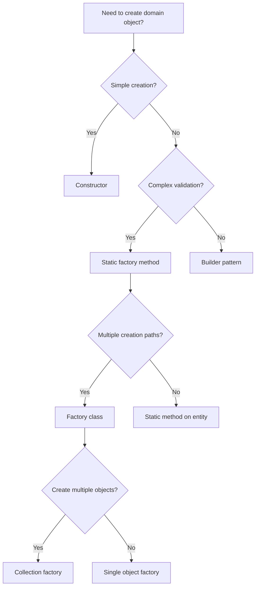

# Factory (DDD)

## Definition

Factory (DDD) is **an object or method responsible for creating domain objects, encapsulating creation logic and ensuring objects are created in valid states**.

> "A factory is an operation that creates a new domain object, ensuring it is created in a valid state." — Eric Evans

## Problem Addressed

Without factories:
- **Invalid state**: Objects can be created in invalid states
- **Creation logic leakage**: Creation logic is scattered across the codebase
- **Duplication**: Creation logic is duplicated
- **Testing difficulty**: Hard to test object creation

## Scope and Boundaries

- Factory ≠ Constructor (factory is a separate method/class, constructor is built-in)
- Factory = Creation (factory encapsulates object creation logic)
- Factory is a **domain model building block**, not a pattern

## When to Apply

- When building domain models with complex creation logic
- when objects must be created in valid states
- when creation logic is complex
- when testing object creation is important

## Tradeoffs and When to Avoid

| Cost | Description |
|------|-------------|
| **Complexity** — Factories add an abstraction layer |
| **Time** — Implementing factories takes time |
| **Over-factory** — Simple objects may not need a factory |

## Common Misuses

- **Everything needs a factory**: Not every object needs a factory
- **Factory as god object**: Factories should not become god objects
- **Confusing with constructor**: Constructors are for simple creation, factories are for complex creation

## Related Concepts

- [Aggregate Root](DDD/aggregate-root.md) — Aggregate roots often contain factory methods
- [Value Object](DDD/value-object.md) — Value objects may need factories for creation
- [Domain Invariant](DDD/domain-invariant.md) — Factories ensure objects are created in valid states

## Project Observations

- The project uses factories:
  - TypeScript static methods can serve as factories
  - The project's architecture patterns note covers DDD concepts
  - No evidence of factories in existing code (src/ is empty)
- File naming conventions support factories:
  - `*.factory.ts` — Factory files
  - `*.entity.ts` — Entity files

## Sources

- [[Sources/evans-ddd-2003|evans-ddd-2003]]
- [[Sources/fowler-ddd-2003|fowler-ddd-2003]]

---

## Decision Tree: Factory Design



### Factory Type Selection

| Factory Type | When to Use | Example |
|--------------|-------------|---------|
| **Constructor** | Simple creation, no validation | `new Point(x, y)` |
| **Static factory method** | Complex validation, single object | `User.create(email, name)` |
| **Factory class** | Multiple creation paths | `OrderFactory.fromCart()` |
| **Builder pattern** | Many optional parameters | `new OrderBuilder().withItems().build()` |
| **Collection factory** | Create multiple related objects | `UserFactory.createMany()` |

---

## Procedural Guidance: Factory Implementation

### Step 1: Static Factory Method on Entity

```typescript
// domain/user/user.ts
import { Email } from '../value-objects/email'
import { UserName } from '../value-objects/user-name'

export class User {
  private constructor(
    readonly id: string,
    readonly email: Email,
    readonly name: UserName,
    private createdAt: Date,
  ) {
    this.createdAt = new Date()
  }

  // ✅ Factory method — validates and creates
  static create(email: string, name: string): User {
    // Validate email
    const emailVO = Email.create(email)

    // Validate name
    const nameVO = UserName.create(name)

    // Create user
    return new User(crypto.randomUUID(), emailVO, nameVO, new Date())
  }

  // ✅ Alternative factory method
  static createWithId(id: string, email: string, name: string): User {
    const emailVO = Email.create(email)
    const nameVO = UserName.create(name)
    return new User(id, emailVO, nameVO, new Date())
  }
}
```

### Step 2: Factory Class for Complex Creation

```typescript
// domain/order/order-factory.ts
import { Order } from './order'
import { OrderItem } from './order-item'
import { Money } from '../value-objects/money'

export class OrderFactory {
  // Create order from cart items
  static fromCart(
    customerId: string,
    items: CartItem[],
  ): Order {
    const orderItems: OrderItem[] = items.map((item) => ({
      productId: item.productId,
      quantity: item.quantity,
      price: item.price,
    }))

    const total = this.calculateTotal(orderItems)

    return Order.create(customerId, orderItems, total)
  }

  // Create order from scratch
  static createEmpty(customerId: string): Order {
    return Order.create(customerId, [], Money.zero())
  }

  // Create order with discount
  static withDiscount(
    customerId: string,
    items: OrderItem[],
    discountPercent: number,
  ): Order {
    const order = Order.create(customerId, items, this.calculateTotal(items))
    order.applyDiscount(discountPercent)
    return order
  }

  private static calculateTotal(items: OrderItem[]): Money {
    return items.reduce(
      (total, item) => total.add(item.price.multiply(item.quantity)),
      Money.zero(),
    )
  }
}

interface CartItem {
  productId: string
  quantity: number
  price: Money
}
```

### Step 3: Builder Pattern for Many Options

```typescript
// domain/user/user-builder.ts
import { User } from './user'
import { Email } from '../value-objects/email'
import { UserName } from '../value-objects/user-name'

export class UserBuilder {
  private email?: string
  private name?: string
  private phone?: string
  private address?: string

  setEmail(email: string): UserBuilder {
    this.email = email
    return this
  }

  setName(name: string): UserBuilder {
    this.name = name
    return this
  }

  setPhone(phone: string): UserBuilder {
    this.phone = phone
    return this
  }

  setAddress(address: string): UserBuilder {
    this.address = address
    return this
  }

  build(): User {
    if (!this.email || !this.name) {
      throw new Error('Email and name are required')
    }

    return User.create(this.email, this.name)
  }
}

// Usage:
// const user = new UserBuilder()
//   .setEmail('john@example.com')
//   .setName('John Doe')
//   .setPhone('555-1234')
//   .build()
```

### Step 4: Factory with Validation

```typescript
// domain/order/order-validation.ts
import { Money } from '../value-objects/money'

export class OrderValidation {
  static validateItems(items: OrderItem[]): void {
    if (items.length === 0) {
      throw new Error('Order must have at least one item')
    }

    for (const item of items) {
      if (item.quantity <= 0) {
        throw new Error(`Item ${item.productId} must have quantity > 0`)
      }

      if (item.price.value < 0) {
        throw new Error(`Item ${item.productId} cannot have negative price`)
      }
    }
  }

  static validateTotal(total: Money, items: OrderItem[]): void {
    const expectedTotal = this.calculateExpectedTotal(items)
    if (total.value !== expectedTotal.value) {
      throw new Error(`Total mismatch: expected ${expectedTotal.value}, got ${total.value}`)
    }
  }

  private static calculateExpectedTotal(items: OrderItem[]): Money {
    return items.reduce(
      (total, item) => total.add(item.price.multiply(item.quantity)),
      Money.zero(),
    )
  }
}

interface OrderItem {
  productId: string
  quantity: number
  price: Money
}
```

---

## Copilot Instructions

### When to Read This Note
- Creating domain objects with complex validation
- Implementing factory patterns
- Building builders for optional parameters
- Validating objects before creation
- Encapsulating creation logic

### What to Do With This Information
1. **Use static factory methods**: For complex validation
2. **Use factory classes**: For multiple creation paths
3. **Use builders**: For many optional parameters
4. **Validate in factories**: Ensure objects are created in valid states
5. **Encapsulate creation**: Hide creation complexity

### Tools to Use
- **VS Code Extension**: Error Lens — for inline error display
- **npm Package**: `zod` — for validation schemas
- **npm Package**: `class-validator` — for decorator-based validation
- **Terminal Command**: `pnpm test` — run tests
- **Terminal Command**: `pnpm lint` — check code quality

### Agents to Invoke
- **DDD Review Agent**: Run when designing factories
- **Code Review Agent**: Run when reviewing factory implementations

### Integration with Other Notes
- read [[aggregate-root]] for aggregate factory methods
- read [[value-object]] for value object factories
- read [[entity]] for entity creation patterns
- read [[domain-invariant]] for invariant validation

### Common Pitfalls
- Don't use constructors for complex creation (use static factory methods)
- Don't put domain logic in factories (use domain services)
- Don't create god factories (keep factories focused)
- Don't skip validation (validate in factories)
- Don't expose internal state (use immutability)

### Quick Validation Checklist
- [ ] Are factories encapsulating creation logic?
- [ ] Are objects created in valid states?
- [ ] Is validation performed in factories?
- [ ] Are factory methods static?
- [ ] Are builders used for complex creation?
- [ ] Are factories testable?


