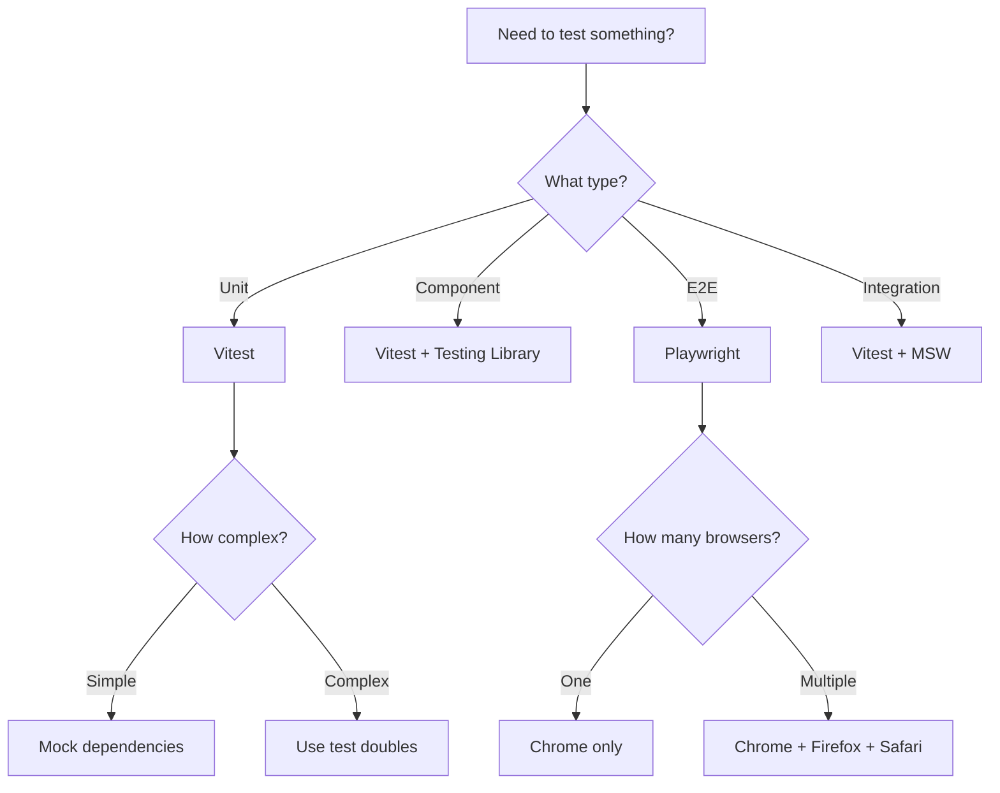

---
slug: vitest-testing
sources:
  - https://vitest.dev/guide/
  - https://vitest.dev/config/
  - https://vitest.dev/guide/improving-performance
  - https://vitest.dev/guide/profiling-test-performance
  - https://vitest.dev/guide/mocking
  - https://vitest.dev/guide/features
date: 2025-01-15
tags:
  - priority/high
  - maturity/deprecated
  - domain/backend
  - type/reference
  - domain/security
  - domain/frontend
  - domain/architecture
  - type/concept
  - domain/optimization
  - domain/accessibility
  - status/complete
  - type/guide
  - domain/testing
  - vitest
  - testing
  - unit-testing
  - performance
  - mocking
  - best-practices
---

# Vitest: Best Practices, Performance & Security

## Overview

Vitest is a next-generation testing framework powered by Vite. It provides fast unit testing, browser testing, component testing, and visual regression testing.

**Requirements:** Vite >= 6.4.0, Node >= 22.12.0

## Installation

```bash
pnpm add -D vitest
```

```json
// package.json
{
  "scripts": {
    "test": "vitest",
    "test:run": "vitest run",
    "test:coverage": "vitest run --coverage",
    "test:ui": "vitest --ui"
  }
}
```

## Configuration

### vitest.config.ts

```ts
/// <reference types="vitest/config" />
import { defineConfig } from 'vite'

export default defineConfig({
  test: {
    // Test file patterns
    include: ['**/*.test.{ts,tsx,js,jsx}'],
    exclude: ['**/node_modules/**', '**/dist/**', '**/.git/**'],
    
    // Root directory
    root: './src',
    
    // Test environment
    environment: 'jsdom', // 'node', 'jsdom', 'happy-dom'
    
    // Global APIs (auto-import)
    globals: true,
    
    // Setup files
    setupFiles: ['./test/setup.ts'],
    
    // Coverage
    coverage: {
      provider: 'v8', // 'v8', 'istanbul', 'custom'
      reporter: ['text', 'html', 'lcov'],
      exclude: [
        'node_modules/',
        'src/test/',
        '**/*.test.ts',
        '**/*.d.ts',
        'src/main.ts',
      ],
      thresholds: {
        branches: 80,
        functions: 80,
        lines: 80,
        statements: 80,
      },
    },
    
    // Performance
    pool: 'threads', // 'threads', 'forks', 'vmThreads'
    maxWorkers: 4,
    minWorkers: 1,
    fileParallelism: true,
    maxConcurrency: 4,
    
    // Timeouts
    testTimeout: 10000,
    hookTimeout: 10000,
    teardownTimeout: 10000,
    
    // UI
    ui: true,
    open: true,
    
    // Watch mode
    watch: true,
    watchExclude: ['**/node_modules/**', '**/dist/**'],
    
    // Isolation
    isolate: true,
    clearMocks: true,
    mockReset: true,
    restoreMocks: true,
    
    // Snapshot
    snapshotFormat: {
      escapeString: false,
      printInlineImport: false,
    },
    
    // Sequence
    sequence: {
      concurrent: false,
      seed: 'random',
    },
    
    // Reporting
    reporters: ['default', 'html'],
    outputFile: {
      html: './reports/test-report.html',
      json: './reports/results.json',
    },
    
    // CSS
    css: {
      modules: {
        classNameStrategy: 'non-scoped',
      },
    },
    
    // Cache
    cache: {
      dir: '.vitest/cache',
    },
  },
})
```

### test/setup.ts

```ts
import { afterEach, beforeEach } from 'vitest'
import { cleanup } from '@testing-library/react'

// Auto-cleanup after each test
afterEach(() => {
  cleanup()
})

// Reset mocks
beforeEach(() => {
  vi.restoreAllMocks()
})
```

## Writing Tests

### Basic Test

```ts
// sum.test.ts
import { expect, test } from 'vitest'
import { sum } from './sum'

test('adds 1 + 2 to equal 3', () => {
  expect(sum(1, 2)).toBe(3)
})
```

### Test Groups

```ts
import { expect, test, describe } from 'vitest'
import { User } from './user'

describe('User', () => {
  describe('constructor', () => {
    test('creates user with name and email', () => {
      const user = new User('John', 'john@example.com')
      expect(user.name).toBe('John')
      expect(user.email).toBe('john@example.com')
    })

    test('throws on invalid email', () => {
      expect(() => new User('John', 'invalid')).toThrow('Invalid email')
    })
  })

  describe('methods', () => {
    test('getDisplayName returns full name', () => {
      const user = new User('John', 'john@example.com')
      expect(user.getDisplayName()).toBe('John')
    })
  })
})
```

### Async Tests

```ts
import { expect, test } from 'vitest'
import { fetchData } from './api'

test('fetches data asynchronously', async () => {
  const data = await fetchData('/api/users')
  expect(data).toBeDefined()
  expect(data.users).toHaveLength(3)
})

test('handles errors', async () => {
  await expect(fetchData('/api/invalid')).rejects.toThrow('Not found')
})

test('with timeout', async () => {
  const data = await fetchData('/api/users', { timeout: 5000 })
  expect(data).toBeDefined()
})
```

### Parameterized Tests

```ts
import { expect, test, describe } from 'vitest'

describe.each([
  [1, 1, 2],
  [0, 0, 0],
  [-1, 1, 0],
  [-1, -1, -2],
])('add(%i, %i)', (a, b, expected) => {
  test(`returns ${expected}`, () => {
    expect(a + b).toBe(expected)
  })
})
```

## Mocking

### vi.fn() — Mock Functions

```ts
import { expect, test, vi } from 'vitest'

test('mock function', () => {
  const mockFn = vi.fn()
  mockFn('hello')
  mockFn('world')

  expect(mockFn).toHaveBeenCalledTimes(2)
  expect(mockFn).toHaveBeenCalledWith('hello')
  expect(mockFn).toHaveBeenLastCalledWith('world')
  expect(mockFn).toHaveBeenNthCalledWith(1, 'hello')
})
```

### vi.mock() — Module Mocking

```ts
import { expect, test, vi } from 'vitest'

// Mock entire module
vi.mock('../api', () => ({
  fetchData: vi.fn().mockResolvedValue({ users: [] }),
}))

import { fetchData } from '../api'

test('uses mocked API', async () => {
  const data = await fetchData('/users')
  expect(data).toEqual({ users: [] })
})
```

### vi.spyOn() — Object Method Spying

```ts
import { expect, test, vi } from 'vitest'

test('spy on method', () => {
  const obj = {
    getValue: () => 42,
  }

  const spy = vi.spyOn(obj, 'getValue')
  obj.getValue()

  expect(spy).toHaveBeenCalledTimes(1)
  expect(spy).toHaveReturnedWith(42)
})
```

### vi.mocked() — TypeScript Support

```ts
import { expect, test, vi } from 'vitest'
import { mocked } from 'vitest/utils'

test('typed mock', () => {
  const mockFn = vi.fn<(x: number) => number>()
  mocked(mockFn).mockImplementation(x => x * 2)
  
  expect(mockFn(5)).toBe(10)
})
```

### vi.hoisted() — Hoist Mocks

```ts
import { expect, test, vi } from 'vitest'

// Hoisted to top of file (before imports)
const { createCache } = vi.hoisted(() => {
  return { createCache: vi.fn() }
})

test('uses hoisted mock', () => {
  expect(createCache).toBeDefined()
})
```

### vi.unstubAllEnvs() / vi.unstubAllGlobals()

```ts
import { expect, test, vi } from 'vitest'

test('stub environment', () => {
  vi.stubEnv('NODE_ENV', 'test')
  expect(import.meta.env.NODE_ENV).toBe('test')
  vi.unstubAllEnvs()
})

test('stub global', () => {
  vi.stubGlobal('fetch', vi.fn())
  vi.unstubAllGlobals()
})
```

### Conditional Mocking

```ts
import { expect, test, vi } from 'vitest'

test('conditional mock', async () => {
  const mockFn = vi.fn()
  
  vi.when(mockFn, { calls: [1] })
    .mockReturnValue('first call')
  
  vi.when(mockFn, { calls: [2] })
    .mockReturnValue('second call')
  
  mockFn() // 'first call'
  mockFn() // 'second call'
})
```

## React Testing

### Testing Library Integration

```bash
pnpm add -D @testing-library/react @testing-library/jest-dom
```

```ts
// test/setup.ts
import '@testing-library/jest-dom/vitest'
```

```tsx
// Button.test.tsx
import { render, screen, fireEvent } from '@testing-library/react'
import { expect, test, vi } from 'vitest'
import Button from '../Button'

test('renders button with text', () => {
  render(<Button>Click me</Button>)
  expect(screen.getByRole('button', { name: /click me/i })).toBeInTheDocument()
})

test('calls onClick when clicked', () => {
  const handleClick = vi.fn()
  render(<Button onClick={handleClick}>Click me</Button>)
  
  fireEvent.click(screen.getByRole('button'))
  expect(handleClick).toHaveBeenCalledTimes(1)
})

test('renders in loading state', () => {
  render(<Button loading>Processing</Button>)
  expect(screen.getByRole('button')).toBeDisabled()
  expect(screen.getByText('Processing')).toBeInTheDocument()
})
```

### Mocking React Hooks

```ts
import { expect, test, vi } from 'vitest'
import { renderHook, act } from '@testing-library/react'
import { useCounter } from '../useCounter'

test('useCounter hook', () => {
  const { result } = renderHook(() => useCounter())

  expect(result.current.count).toBe(0)
  expect(result.current.increment).toBeDefined()

  act(() => {
    result.current.increment()
  })

  expect(result.current.count).toBe(1)
})
```

## Test Filtering & Annotations

### Test Filters

```ts
import { expect, test } from 'vitest'

// Run only this test
test.only('only test', () => {
  expect(1 + 1).toBe(2)
})

// Skip this test
test.skip('skipped test', () => {
  // Won't run
})

// Run when condition is met
test('conditional test', () => {
  // ...
}, { skip: process.env.CI })

// Mark as slow (3x timeout)
test('slow test', () => {
  // ...
}, { timeout: 30000 })
```

### Test Annotations

```ts
import { expect, test } from 'vitest'

test('requires CI', { requires: ['CI'] }, () => {
  // Only runs in CI
})

test('requires Node 22+', { requires: { node: '>=22.0.0' } }, () => {
  // Only runs on Node 22+
})
```

### Test Tags

```ts
import { expect, test } from 'vitest'

test('smoke test', { tags: ['smoke'] }, () => {
  // ...
})

test('integration test', { tags: ['integration'] }, () => {
  // ...
})
```

## Performance Optimization

### Parallel Test Execution

```ts
export default defineConfig({
  test: {
    // Run test files in parallel (default: true)
    fileParallelism: true,
    
    // Max concurrent test files
    maxWorkers: 4,
    
    // Max concurrent tests per file
    maxConcurrency: 4,
    
    // Use threads (faster but more memory)
    pool: 'threads',
    
    // Use forks (slower but more isolated)
    // pool: 'forks',
    
    // Use VM threads (fastest, Node-only)
    // pool: 'vmThreads',
  },
})
```

### Isolated Test Files

```ts
export default defineConfig({
  test: {
    // Each file runs in isolation (default: true)
    isolate: true,
    
    // Clear mocks between tests
    clearMocks: true,
    
    // Reset mocks between tests
    mockReset: true,
    
    // Restore original implementations
    restoreMocks: true,
  },
})
```

### Profiling Test Performance

```bash
# Profile test execution
vitest run --coverage --reporter=json

# Use the profiling API
import { profile } from 'vitest/profiling'

test('profile this test', async () => {
  const profiler = profile()
  // ... test code ...
  profiler.stop()
  console.log(profiler.report())
})
```

### Improving Test Performance

1. **Use `fileParallelism: true`** — run test files in parallel
2. **Use `pool: 'vmThreads'`** — fastest pool (Node-only)
3. **Limit `maxWorkers`** — don't exceed CPU cores
4. **Use `clearMocks`** — faster than full reset
5. **Mock external dependencies** — avoid real API calls
6. **Use `vi.mock()`** — module-level mocking
7. **Avoid `vi.useFakeTimers()`** when possible
8. **Use `--run`** for CI (no watch mode overhead)
9. **Use changed files** — `vitest run --changed`
10. **Cache dependencies** — `cache: { dir: '.vitest/cache' }`

## Security Best Practices

### Isolated Test Environment

```ts
export default defineConfig({
  test: {
    // Isolate each test file
    isolate: true,
    
    // Clear mocks between tests
    clearMocks: true,
    mockReset: true,
    restoreMocks: true,
    
    // Don't allow only tests in CI
    allowOnly: !process.env.CI,
  },
})
```

### Environment Variable Security

```ts
import { expect, test, vi } from 'vitest'

test('does not leak secrets', () => {
  // Stub environment variables
  vi.stubEnv('NODE_ENV', 'test')
  vi.stubEnv('DB_PASSWORD', 'test-password')
  
  // Test code that reads env vars
  expect(process.env.NODE_ENV).toBe('test')
  
  // Clean up
  vi.unstubAllEnvs()
})
```

### Preventing Test Pollution

```ts
import { expect, test, vi, beforeEach, afterEach } from 'vitest'

beforeEach(() => {
  vi.clearAllMocks()
  vi.restoreAllMocks()
})

afterEach(() => {
  vi.resetModules()
})

test('test 1', () => {
  // Isolated from other tests
})

test('test 2', () => {
  // Also isolated
})
```

## Best Practices Checklist

- [x] **Use `vitest run`** for CI (no watch mode)
- [x] **Enable `fileParallelism`** for speed
- [x] **Use `clearMocks`** for isolation
- [x] **Use `setupFiles`** for common test setup
- [x] **Mock external dependencies** with `vi.mock()`
- [x] **Use `vi.fn()`** for mock functions
- [x] **Use `vi.spyOn()`** for object methods
- [x] **Use `vi.hoisted()`** for top-level mocks
- [x] **Use `vi.unstubAllEnvs()`** for cleanup
- [x] **Set appropriate timeouts** (`testTimeout`, `hookTimeout`)
- [x] **Use coverage thresholds** (80%+ recommended)
- [x] **Use `@testing-library/react`** for React tests
- [x] **Name tests descriptively**
- [x] **Use `test.only`/`test.skip`** for debugging
- [x] **Add `.vitest/` to `.gitignore`**
- [x] **Never commit test secrets**
- [x] **Use `allowOnly: !process.env.CI`** in CI

## CLI Reference

| Command | Description |
|---------|-------------|
| `vitest` | Run tests in watch mode |
| `vitest run` | Run tests once |
| `vitest watch` | Run tests in watch mode |
| `vitest --ui` | Open UI mode |
| `vitest --coverage` | Run with coverage |
| `vitest --reporter=html` | Generate HTML report |
| `vitest --changed` | Run only changed tests |
| `vitest --grep=<pattern>` | Filter by test name |
| `vitest --fileParallelism=false` | Disable parallelism |
| `vitest --pool=threads` | Use thread pool |
| `vitest --maxWorkers=4` | Set max workers |

## Cross-References

- See [react-performance-security](D/react-performance-security.md) for React testing patterns
- See [vite-optimization-security](D/vite-optimization-security.md) for Vite configuration
- See [pnpm-best-practices](D/pnpm-best-practices.md) for package management
- See [playwright-patterns](D/playwright-patterns.md) for E2E testing with Playwright

---

## Decision Tree: Testing Strategy



### When to Use Each Testing Type

| Type | When to Use | Tool |
|------|-------------|------|
| **Unit Tests** | Testing individual functions/classes | Vitest |
| **Component Tests** | Testing React components | Vitest + Testing Library |
| **E2E Tests** | Testing user flows | Playwright |
| **Integration Tests** | Testing API endpoints | Vitest + MSW |

---

## Procedural Guidance: Writing a Vitest Test

### Step 1: Create Test File

```bash
# Create test file next to source file
src/components/User.tsx → src/components/User.test.tsx
```

### Step 2: Write Unit Test

```typescript
// src/components/User.test.tsx
import { describe, it, expect, vi } from 'vitest'
import { render, screen } from '@testing-library/react'
import { User } from './User'

describe('User component', () => {
  it('renders user name', () => {
    render(<User name="John" email="john@example.com" />)
    expect(screen.getByText('John')).toBeInTheDocument()
  })

  it('renders email', () => {
    render(<User name="John" email="john@example.com" />)
    expect(screen.getByText('john@example.com')).toBeInTheDocument()
  })

  it('calls onClick when clicked', () => {
    const handleClick = vi.fn()
    render(<User name="John" email="john@example.com" onClick={handleClick} />)
    screen.getByText('John').click()
    expect(handleClick).toHaveBeenCalledTimes(1)
  })
})
```

### Step 3: Mock Dependencies

```typescript
// Mock a module
vi.mock('../api/user-api', () => ({
  fetchUser: vi.fn().mockResolvedValue({ name: 'John', email: 'john@example.com' }),
}))

// Mock a hook
vi.mock('../hooks/use-user', () => ({
  useUser: vi.fn().mockReturnValue({ user: { name: 'John' }, loading: false }),
}))
```

### Step 4: Run Tests

```bash
# Run all tests
pnpm test

# Run with coverage
pnpm test -- --coverage

# Run only changed tests
pnpm test -- --changed

# Run with UI
pnpm test -- --ui
```

---

## Copilot Instructions

### When to Read This Note
- Writing unit tests for TypeScript/React code
- Setting up Vitest configuration
- Mocking dependencies in tests
- Improving test performance

### What to Do With This Information
1. **Write unit tests**: Test individual functions/classes in isolation
2. **Mock dependencies**: Use `vi.mock()` for external dependencies
3. **Run with coverage**: Aim for 80%+ coverage on critical paths
4. **Use test parallelism**: Enable `--pool=threads` for faster runs
5. **Profile slow tests**: Use `--profiling` to identify bottlenecks

### Tools to Use
- **VS Code Extension**: Error Lens — for inline test error display
- **VS Code Extension**: Test Explorer UI — for test navigation
- **npm Package**: `@testing-library/react` — for React component testing
- **npm Package**: `msw` — for API mocking
- **Terminal Command**: `pnpm test -- --coverage` — run with coverage
- **Terminal Command**: `pnpm test -- --changed` — run only changed tests

### Agents to Invoke
- **Testing Agent**: Run when writing new tests to ensure coverage
- **Code Review Agent**: Run when reviewing PRs with test changes

### Integration with Other Notes
- Read [playwright-patterns](D/playwright-patterns.md) for E2E testing
- Read [[testing-patterns]] for testing strategies
- Read [react-performance-security](D/react-performance-security.md) for React testing patterns
- Read [pnpm-best-practices](D/pnpm-best-practices.md) for package management
- Read [vite-optimization-security](D/vite-optimization-security.md) for Vite configuration

### Common Pitfalls
- Don't test implementation details (test behavior, not implementation)
- Don't mock everything (mock external dependencies, not internal logic)
- Don't write fragile tests (avoid testing exact strings, test behavior)
- Don't skip test cleanup (use `afterEach` to reset mocks)
- Don't run tests sequentially (use `--pool=threads` for parallelism)

### Quick Validation Checklist
- [ ] Are tests isolated (no test depends on another)?
- [ ] Are mocks used for external dependencies?
- [ ] Is test coverage > 80% on critical paths?
- [ ] Are tests running in parallel?
- [ ] Are test names descriptive (test what, not how)?
- [ ] Are tests deterministic (no random/flaky behavior)?


## See Also
- [[T01-playwright-e2e]]
- [[T02-testing-patterns]]


