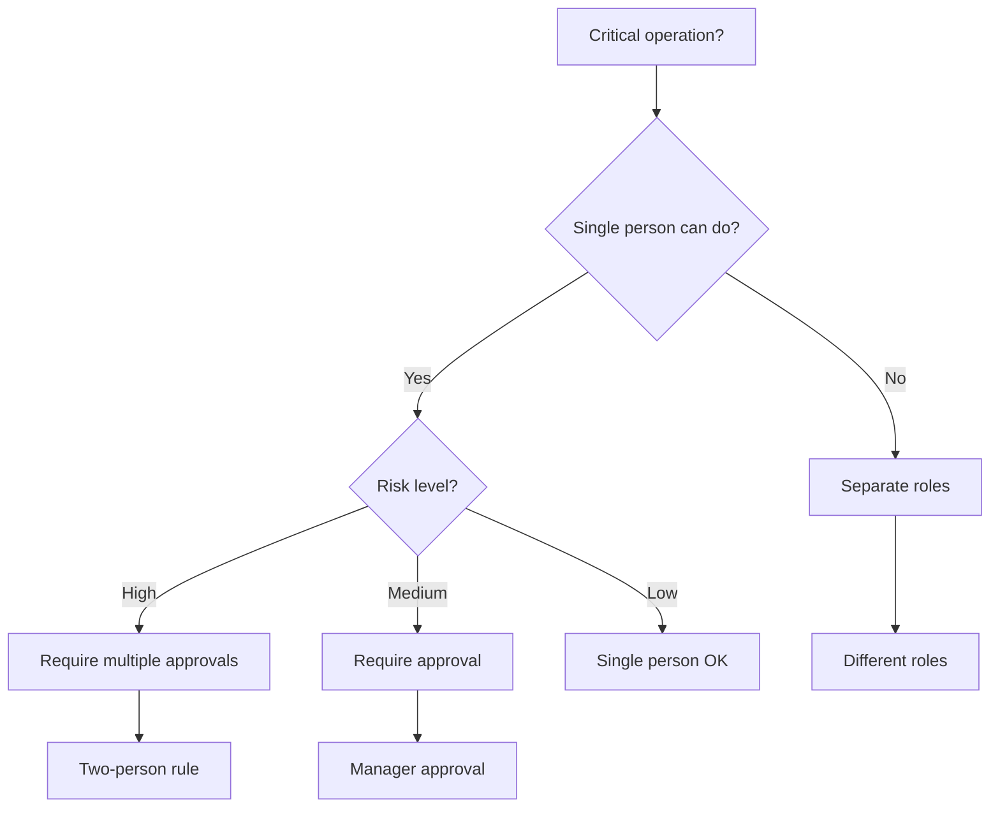

---
slug: separation-of-duties
sources:
  - https://owasp.org/
  - https://cwe.mitre.org/
date: 2026-11-02
tags:
  - separation-of-duties
  - security
  - access-control
  - compliance
# Separation of Duties

## Definition

## concept_id
m06-separation-of-duties

## title
Separation of Duties

## aliases
- M06-Separation-of-Duties

## category
security

## concept_type
security-pattern

## research_status
verified

## project_adoption
required
Separation of Duties is **a security principle that critical tasks require multiple people to complete, preventing any single person from having too much power**.

> "Separation of duties is a key internal control concept that aims to reduce the risk of error and inappropriate behavior." — OWASP

## Problem Addressed

## concept_id
m06-separation-of-duties

## title
Separation of Duties

## aliases
- M06-Separation-of-Duties

## category
security

## concept_type
security-pattern

## research_status
verified

## project_adoption
required
Without separation of duties:
- **Too much power**: Any single person can perform critical tasks
- **Fraud**: Fraud can be committed by a single person
- **Errors**: Errors go undetected
- **Compliance**: Regulations require separation of duties

## Scope and Boundaries

## concept_id
m06-separation-of-duties

## title
Separation of Duties

## aliases
- M06-Separation-of-Duties

## category
security

## concept_type
security-pattern

## research_status
verified

## project_adoption
required
- Separation of Duties ≠ RBAC (separation of duties is a principle, RBAC is an implementation)
- Separation of Duties = Prevention (separation of duties prevents abuse)
- Separation of Duties is a **security principle**, not a pattern

## When to Apply

## concept_id
m06-separation-of-duties

## title
Separation of Duties

## aliases
- M06-Separation-of-Duties

## category
security

## concept_type
security-pattern

## research_status
verified

## project_adoption
required
- When building systems with critical tasks
- when fraud prevention is important
- when compliance requires separation of duties
- when multiple roles exist

## Tradeoffs and When to Avoid

## concept_id
m06-separation-of-duties

## title
Separation of Duties

## aliases
- M06-Separation-of-Duties

## category
security

## concept_type
security-pattern

## research_status
verified

## project_adoption
required
| Cost | Description |
|------|-------------|
| **Complexity** — Separation of duties adds complexity |
| **Time** — Implementing separation of duties takes time |
| **Overhead**: More people needed for critical tasks |

## Common Misuses

## concept_id
m06-separation-of-duties

## title
Separation of Duties

## aliases
- M06-Separation-of-Duties

## category
security

## concept_type
security-pattern

## research_status
verified

## project_adoption
required
- **Everything separated**: Not every task needs separation
- **Ignoring small teams**: Small teams may not be able to separate duties
- **Confusing with RBAC**: Separation of duties is a principle, RBAC is an implementation

## Related Concepts

## concept_id
m06-separation-of-duties

## title
Separation of Duties

## aliases
- M06-Separation-of-Duties

## category
security

## concept_type
security-pattern

## research_status
verified

## project_adoption
required
- [RBAC](Security/rbac.md) — RBAC implements separation of duties
- [Authorization](Security/authorization.md) — Authorization enforces separation of duties
- [Security Principles](Security/security-principles.md) — Security principles include separation of duties

## Project Observations

## concept_id
m06-separation-of-duties

## title
Separation of Duties

## aliases
- M06-Separation-of-Duties

## category
security

## concept_type
security-pattern

## research_status
verified

## project_adoption
required
- The project uses separation of duties:
  - TypeScript can enforce separation of duties through type system
  - The project's architecture patterns note covers security concepts
  - No evidence of separation of duties in existing code (src/ is empty)
- File naming conventions support separation of duties:
  - `*.guard.ts` — Guard files
  - `*.middleware.ts` — Middleware files

## Sources

## concept_id
m06-separation-of-duties

## title
Separation of Duties

## aliases
- M06-Separation-of-Duties

## category
security

## concept_type
security-pattern

## research_status
verified

## project_adoption
required
- [[Sources/martin-fowler-patterns|martin-fowler-patterns]]
- [[Sources/react-docs-2026|react-docs-2026]]

---

## Decision Tree: Separation of Duties

## concept_id
m06-separation-of-duties

## title
Separation of Duties

## aliases
- M06-Separation-of-Duties

## category
security

## concept_type
security-pattern

## research_status
verified

## project_adoption
required


### Separation Level Selection

| Level | When to Use | Example |
|-------|-------------|---------|
| **Two-person rule** | Highest risk (production deploy) | Two admins must approve |
| **Manager approval** | High risk (large transactions) | Manager approves >$10k |
| **Role separation** | Medium risk (code review) | Developer ≠ Deployer |
| **Audit trail** | All operations | Log all actions |

---

## Procedural Guidance: Separation of Duties Implementation

## concept_id
m06-separation-of-duties

## title
Separation of Duties

## aliases
- M06-Separation-of-Duties

## category
security

## concept_type
security-pattern

## research_status
verified

## project_adoption
required
### Step 1: Define Separation Rules

```typescript
// security/separation-of-duties.ts
export enum Role {
  DEVELOPER = 'developer',
  REVIEWER = 'reviewer',
  DEPLOYER = 'deployer',
  ADMIN = 'admin',
  AUDITOR = 'auditor',
}

export interface SeparationRule {
  action: string
  requiredRoles: Role[]
  maxSameRole: number
  description: string
}

export const separationRules: SeparationRule[] = [
  {
    action: 'deploy-production',
    requiredRoles: [Role.REVIEWER, Role.DEPLOYER],
    maxSameRole: 1,
    description: 'Production deployment requires separate reviewer and deployer',
  },
  {
    action: 'approve-payment',
    requiredRoles: [Role.DEVELOPER, Role.ADMIN],
    maxSameRole: 1,
    description: 'Payment approval requires developer and admin',
  },
  {
    action: 'modify-security-config',
    requiredRoles: [Role.ADMIN, Role.AUDITOR],
    maxSameRole: 1,
    description: 'Security config changes require admin and auditor',
  },
]
```

### Step 2: Implement Approval Workflow

```typescript
// security/approval-workflow.ts
import { Role, separationRules, SeparationRule } from './separation-of-duties'

export class ApprovalWorkflow {
  private approvals: Map<string, Set<Role>> = new Map()

  // Check if action can be performed
  canPerformAction(
    userId: string,
    userRole: Role,
    action: string,
  ): boolean {
    const rule = separationRules.find((r) => r.action === action)
    if (!rule) return true // No rule defined

    const currentApprovals = this.approvals.get(action) || new Set()

    // Check if user already approved
    if (currentApprovals.has(userRole)) {
      return false // User already approved, can't approve again
    }

    // Check if required roles are satisfied
    const requiredRoles = rule.requiredRoles
    const currentRoles = new Set(currentApprovals)
    currentRoles.add(userRole)

    const allRequired = requiredRoles.every((role) => currentRoles.has(role))
    const noDuplicate = rule.maxSameRole === 1
      ? currentRoles.size === requiredRoles.length
      : true

    return allRequired && noDuplicate
  }

  // Record approval
  recordApproval(
    action: string,
    role: Role,
    userId: string,
  ): boolean {
    const rule = separationRules.find((r) => r.action === action)
    if (!rule) return false

    if (!this.approvals.has(action)) {
      this.approvals.set(action, new Set())
    }

    const currentApprovals = this.approvals.get(action)!

    // Check if role already approved
    if (currentApprovals.has(role)) {
      return false
    }

    currentApprovals.add(role)
    return true
  }

  // Reset approvals
  resetApprovals(action: string): void {
    this.approvals.delete(action)
  }
}
```

### Step 3: Implement Middleware

```typescript
// security/approval-middleware.ts
import { Request, Response, NextFunction } from 'express'
import { ApprovalWorkflow } from './approval-workflow'

interface AuthRequest extends Request {
  user?: {
    id: string
    role: Role
  }
}

export const approvalWorkflow = new ApprovalWorkflow()

export function requireApproval(action: string) {
  return (req: AuthRequest, res: Response, next: NextFunction): void => {
    if (!req.user) {
      res.status(401).json({ error: 'Unauthorized' })
      return
    }

    const { id, role } = req.user

    // Check if action can be performed
    if (!approvalWorkflow.canPerformAction(id, role, action)) {
      res.status(403).json({ error: 'Approval required' })
      return
    }

    // Record approval
    const approved = approvalWorkflow.recordApproval(action, role, id)
    if (!approved) {
      res.status(403).json({ error: 'Duplicate approval' })
      return
    }

    next()
  }
}

// Usage:
// app.post('/deploy', requireApproval('deploy-production'), deployHandler)
// app.post('/payment', requireApproval('approve-payment'), paymentHandler)
```

### Step 4: Implement Audit Logging

```typescript
// security/audit-logger.ts
export interface AuditLog {
  timestamp: Date
  userId: string
  role: Role
  action: string
  details: string
  ipAddress?: string
}

export class AuditLogger {
  private logs: AuditLog[] = []

  log(logEntry: Omit<AuditLog, 'timestamp'>): void {
    const entry: AuditLog = {
      ...logEntry,
      timestamp: new Date(),
    }
    this.logs.push(entry)

    // Log to file or external system
    console.log(`[AUDIT] ${entry.timestamp.toISOString()} - ${entry.role}:${entry.userId} - ${entry.action} - ${entry.details}`)
  }

  getLogs(userId?: string): AuditLog[] {
    if (userId) {
      return this.logs.filter((log) => log.userId === userId)
    }
    return [...this.logs]
  }

  getLogsByAction(action: string): AuditLog[] {
    return this.logs.filter((log) => log.action === action)
  }
}

export const auditLogger = new AuditLogger()
```

### Step 5: Use in Application Service

```typescript
// application/deploy/deploy-service.ts
import { ApprovalWorkflow, auditLogger } from '../../security'
import { Role } from '../../security/separation-of-duties'

export class DeployService {
  async deploy(
    userId: string,
    userRole: Role,
    version: string,
    ipAddress?: string,
  ): Promise<void> {
    // Log deployment attempt
    auditLogger.log({
      userId,
      role: userRole,
      action: 'deploy-production',
      details: `Deploying version ${version}`,
      ipAddress,
    })

    // Check approval
    if (!approvalWorkflow.canPerformAction(userId, userRole, 'deploy-production')) {
      throw new Error('Deployment requires separate reviewer and deployer approval')
    }

    // Perform deployment
    console.log(`Deploying version ${version}`)

    // Log successful deployment
    auditLogger.log({
      userId,
      role: userRole,
      action: 'deploy-production-complete',
      details: `Successfully deployed version ${version}`,
      ipAddress,
    })
  }
}
```

---

## Copilot Instructions

## concept_id
m06-separation-of-duties

## title
Separation of Duties

## aliases
- M06-Separation-of-Duties

## category
security

## concept_type
security-pattern

## research_status
verified

## project_adoption
required
### When to Read This Note
- Implementing separation of duties
- Designing approval workflows
- Creating audit trails
- Preventing fraud
- Compliance requirements

### What to Do With This Information
1. **Define rules**: Document separation rules
2. **Implement workflow**: Create approval workflow
3. **Add middleware**: Protect critical operations
4. **Log actions**: Create audit trail
5. **Review regularly**: Audit separation rules

### Tools to Use
- **VS Code Extension**: Error Lens — for inline error display
- **npm Package**: `winston` — for audit logging
- **npm Package**: `express` — for middleware
- **npm Package**: `pg` — for audit database
- **Terminal Command**: `pnpm test` — run tests
- **Terminal Command**: `pnpm lint` — check code quality

### Agents to Invoke
- **Security Review Agent**: Run when implementing separation
- **Compliance Agent**: Run when auditing separation rules

### Integration with Other Notes
- read [[rbac]] for role-based access control
- read [authorization](D/authorization.md) for authorization patterns
- read [[secure-by-design]] for security principles
- read [security-principles](D/security-principles.md) for security principles

### Common Pitfalls
- Don't allow self-approval (require different roles)
- Don't skip audit logging (log all actions)
- Don't hardcode rules (use configuration)
- Don't ignore small teams (document exceptions)
- Don't forget to review (audit regularly)

### Quick Validation Checklist
- [ ] Are separation rules defined?
- [ ] Is approval workflow implemented?
- [ ] Are critical operations protected?
- [ ] Is audit logging enabled?
- [ ] Are rules reviewed regularly?
- [ ] Are exceptions documented?


