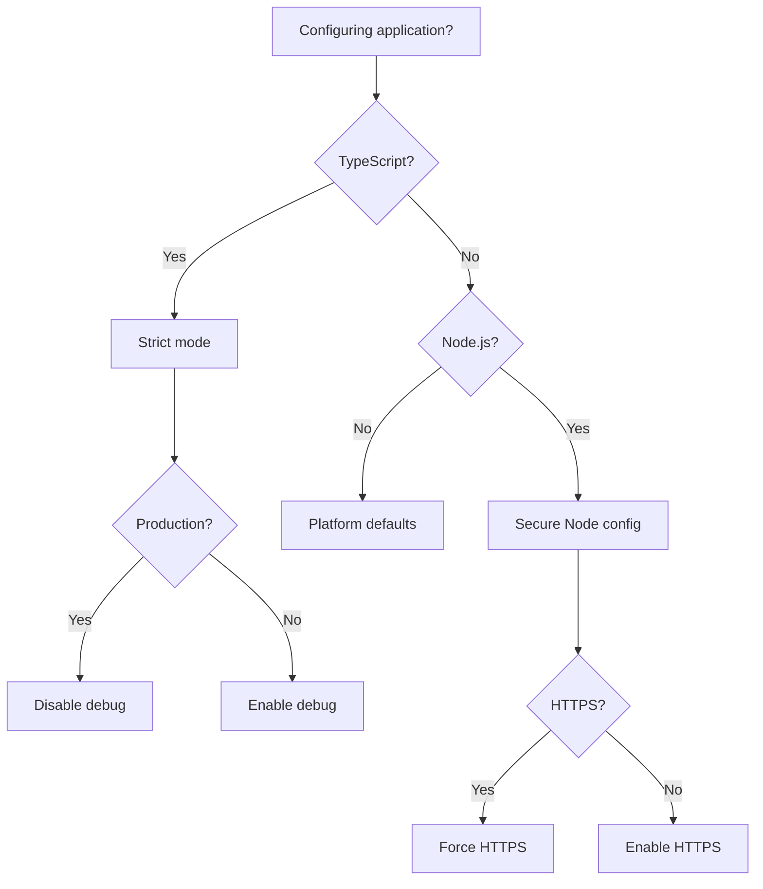

# Secure Defaults

## Definition

Secure Defaults is **a security principle that systems should ship with the most secure configuration by default, requiring explicit action to reduce security**.

> "Secure defaults means that systems should ship with the most secure configuration by default." — OWASP

## Problem Addressed

Without secure defaults:
- **Insecure configurations**: Systems ship with insecure configurations
- **User error**: Users don't change insecure defaults
- **Security holes**: Security holes are introduced by default configurations
- **Compliance**: Regulations require secure defaults

## Scope and Boundaries

- Secure Defaults ≠ Security Testing (secure defaults prevent security issues through configuration, security testing finds them)
- Secure Defaults = Configuration (secure defaults are about configuration)
- Secure Defaults is a **security principle**, not a pattern

## When to Apply

- When building systems that ship with configurations
- when security is critical
- when users may not change configurations
- when compliance requires secure defaults

## Tradeoffs and When to Avoid

| Cost | Description |
|------|-------------|
| **Usability** — Secure defaults may reduce usability |
| **Complexity** — Secure defaults add configuration complexity |
| **Time** — Designing secure defaults takes time |

## Common Misuses

- **Everything secure by default**: Not every configuration needs secure defaults
- **Ignoring usability**: Secure defaults should not severely impact usability
- **Confusing with secure by design**: Secure defaults is about configuration, secure by design is about design

## Related Concepts

- [Security Principles](Security/security-principles.md) — Security principles include secure defaults
- [Secure by Design](Security/secure-by-design.md) — Secure by design includes secure defaults
- [Deny by Default](Security/deny-by-default.md) — Deny by default is related to secure defaults

## Project Observations

- The project uses secure defaults:
  - TypeScript supports secure defaults through strict mode
  - Vite supports secure defaults through secure configuration
  - The project's architecture patterns note covers security concepts
  - No evidence of secure defaults in existing code (src/ is empty)
- File naming conventions support secure defaults:
  - `*.config.ts` — Config files
  - `*.env.ts` — Environment files

## Sources

- [[Sources/martin-fowler-patterns|martin-fowler-patterns]]
- [[Sources/react-docs-2026|react-docs-2026]]

---

## Decision Tree: Secure Defaults Configuration



### Default Configuration Selection

| Default | When to Use | Security Level | Example |
|---------|-------------|----------------|---------|
| **TypeScript strict** | All TypeScript projects | High | strict: true |
| **HTTPS** | All production apps | High | https: true |
| **CORS restricted** | API endpoints | High | origin: ['https://example.com'] |
| **Rate limiting** | All public APIs | Medium | 100 req/15min |
| **Cookie secure** | All cookies | High | secure: true |

---

## Procedural Guidance: Secure Defaults Implementation

### Step 1: TypeScript Strict Mode

```json
// tsconfig.json
{
  "compilerOptions": {
    "strict": true,
    "noImplicitAny": true,
    "strictNullChecks": true,
    "strictFunctionTypes": true,
    "noUnusedLocals": true,
    "noUnusedParameters": true,
    "noImplicitReturns": true,
    "esModuleInterop": true,
    "forceConsistentCasingInFileNames": true,
    "skipLibCheck": true
  }
}
```

### Step 2: Node.js Secure Defaults

```typescript
// config/secure-defaults.ts
import { Request, Response, NextFunction } from 'express'

export const secureDefaults = {
  // Disable X-Powered-By header
  hidePoweredBy: true,

  // Enable HTTPS in production
  https: {
    enabled: process.env.NODE_ENV === 'production',
    redirectToHttps: true,
  },

  // Cookie security
  cookies: {
    secure: process.env.NODE_ENV === 'production',
    httpOnly: true,
    sameSite: 'strict' as const,
    maxAge: 24 * 60 * 60 * 1000, // 24 hours
  },

  // Session security
  session: {
    secure: true,
    resave: false,
    saveUninitialized: false,
    cookie: {
      secure: process.env.NODE_ENV === 'production',
      httpOnly: true,
      sameSite: 'strict',
    },
  },
}

// Apply secure defaults to Express app
export function applySecureDefaults(app: any): void {
  // Hide X-Powered-By
  app.disable('x-powered-by')

  // Secure cookies
  app.set('trust proxy', 1)

  // Secure session
  app.use(session({
    secret: process.env.SESSION_SECRET,
    resave: secureDefaults.session.resave,
    saveUninitialized: secureDefaults.session.saveUninitialized,
    cookie: secureDefaults.session.cookie,
    name: '__session', // Don't use 'connect.sid'
  }))
}
```

### Step 3: CORS Secure Defaults

```typescript
// config/cors.ts
import { CorsOptions } from 'cors'

export const corsOptions: CorsOptions = {
  // Default: Deny all
  origin: false,

  // Allowed origins (configure per environment)
  allowedOrigins: [
    'https://example.com',
    'https://app.example.com',
  ],

  // Secure methods
  methods: ['GET', 'POST', 'PUT', 'DELETE'],

  // Secure headers
  allowedHeaders: ['Content-Type', 'Authorization'],

  // Credentials
  credentials: true,

  // Max age
  maxAge: 600,
}

// Apply CORS
export function applyCors(app: any): void {
  app.use((req, res, next) => {
    const origin = req.headers.origin

    if (corsOptions.allowedOrigins.includes(origin || '')) {
      res.setHeader('Access-Control-Allow-Origin', origin)
      res.setHeader('Access-Control-Allow-Methods', corsOptions.methods.join(', '))
      res.setHeader('Access-Control-Allow-Headers', corsOptions.allowedHeaders.join(', '))
      res.setHeader('Access-Control-Allow-Credentials', 'true')
    }

    if (req.method === 'OPTIONS') {
      res.sendStatus(204)
      return
    }

    next()
  })
}
```

### Step 4: Environment-Secure Defaults

```typescript
// config/environment.ts
export const environment = {
  // Production defaults
  production: {
    debug: false,
    logLevel: 'error',
    showStackTraces: false,
    allowErrorDetails: false,
  },

  // Development defaults
  development: {
    debug: true,
    logLevel: 'debug',
    showStackTraces: true,
    allowErrorDetails: true,
  },

  // Test defaults
  test: {
    debug: true,
    logLevel: 'error',
    showStackTraces: true,
    allowErrorDetails: true,
  },
}

export function getEnvironmentConfig(): typeof environment.production {
  const nodeEnv = process.env.NODE_ENV || 'development'

  switch (nodeEnv) {
    case 'production':
      return environment.production
    case 'test':
      return environment.test
    default:
      return environment.development
  }
}
```

### Step 5: Database Secure Defaults

```typescript
// config/database.ts
export const databaseConfig = {
  // Default: Deny all
  host: 'localhost',
  port: 5432,
  database: 'myapp',
  username: 'myapp',
  password: process.env.DATABASE_PASSWORD,

  // Secure defaults
  ssl: process.env.NODE_ENV === 'production' ? { rejectUnauthorized: true } : false,
  pool: {
    min: 2,
    max: 10,
    idleTimeoutMillis: 30000,
  },

  // Query limits
  query: {
    timeout: 5000,
    maxRows: 1000,
  },
}
```

---

## Copilot Instructions

### When to Read This Note
- Configuring application security defaults
- Setting up TypeScript strict mode
- Configuring HTTPS and cookies
- Setting CORS policies
- Configuring database security

### What to Do With This Information
1. **Enable TypeScript strict**: All projects should use strict mode
2. **Set secure cookies**: httpOnly, secure, sameSite
3. **Configure CORS**: Deny by default, allow specific origins
4. **Use HTTPS**: Force HTTPS in production
5. **Limit database**: Set query timeouts and row limits

### Tools to Use
- **VS Code Extension**: Error Lens — for inline error display
- **npm Package**: `helmet` — for security headers
- **npm Package**: `cors` — for CORS configuration
- **npm Package**: `express-session` — for secure sessions
- **Terminal Command**: `pnpm test` — run tests
- **Terminal Command**: `pnpm lint` — check code quality

### Agents to Invoke
- **Security Review Agent**: Run when configuring defaults
- **DevOps Agent**: Run when deploying to production

### Integration with Other Notes
- read [[secure-by-design]] for security principles
- read [content-security-policy](D/content-security-policy.md) for CSP headers
- read [[secrets-management]] for secret configuration
- read [security-principles](D/security-principles.md) for security principles

### Common Pitfalls
- Don't use insecure defaults (always start secure)
- Don't disable security features (keep strict mode)
- Don't allow all CORS origins (be specific)
- Don't skip HTTPS (use in production)
- Don't hardcode secrets (use environment variables)

### Quick Validation Checklist
- [ ] Is TypeScript strict mode enabled?
- [ ] Are cookies secure (httpOnly, secure, sameSite)?
- [ ] Is CORS configured (deny by default)?
- [ ] Is HTTPS enforced in production?
- [ ] Are database queries limited?
- [ ] Are error messages sanitized?


