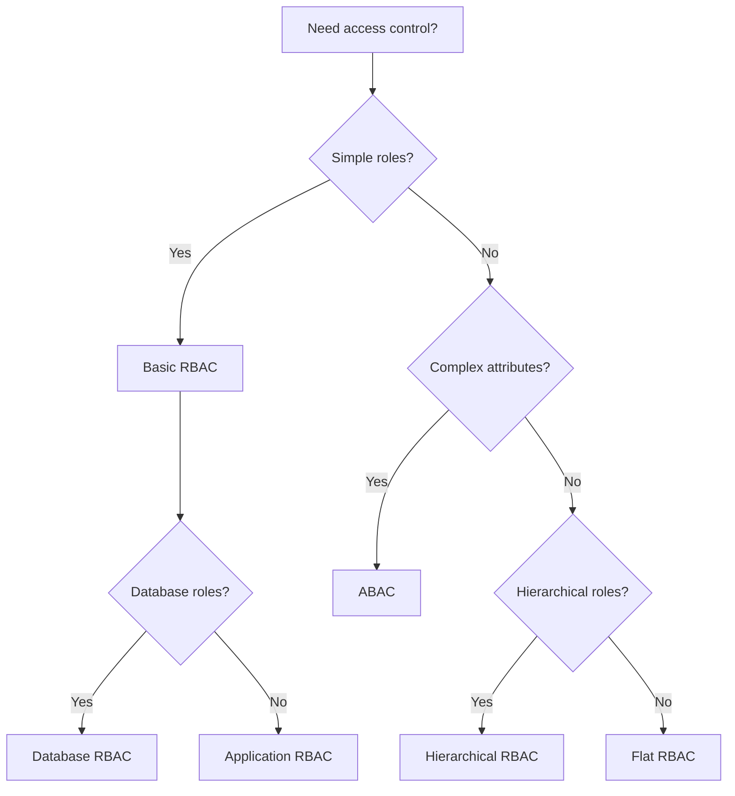

---
slug: rbac
sources:
  - https://owasp.org/
  - https://cwe.mitre.org/
date: 2026-11-02
tags:
  - rbac
  - security
  - access-control
  - authorization
# Role-Based Access Control (RBAC)

## Definition

## concept_id
m13-rbac

## title
Role-Based Access Control (RBAC)

## aliases
- M13-RBAC

## category
security

## concept_type
security-pattern

## research_status
verified

## project_adoption
required
Role-Based Access Control (RBAC) is **an access control model where permissions are assigned to roles, and users are assigned to roles**.

> "RBAC is an access control model where permissions are assigned to roles, and users are assigned to roles." — NIST

## Problem Addressed

## concept_id
m13-rbac

## title
Role-Based Access Control (RBAC)

## aliases
- M13-RBAC

## category
security

## concept_type
security-pattern

## research_status
verified

## project_adoption
required
Without RBAC:
- **Complex permissions**: Permissions are complex to manage
- **User management**: User permissions are hard to manage
- **Compliance**: Compliance requires role-based access
- **Security**: Security is hard to enforce

## Scope and Boundaries

## concept_id
m13-rbac

## title
Role-Based Access Control (RBAC)

## aliases
- M13-RBAC

## category
security

## concept_type
security-pattern

## research_status
verified

## project_adoption
required
- RBAC ≠ ABAC (RBAC uses roles, ABAC uses attributes)
- RBAC = Roles (RBAC uses roles for access control)
- RBAC is an **access control model**, not a pattern

## When to Apply

## concept_id
m13-rbac

## title
Role-Based Access Control (RBAC)

## aliases
- M13-RBAC

## category
security

## concept_type
security-pattern

## research_status
verified

## project_adoption
required
- When building systems with access control
- when roles exist in the system
- when compliance requires role-based access
- when user management is important

## Tradeoffs and When to Avoid

## concept_id
m13-rbac

## title
Role-Based Access Control (RBAC)

## aliases
- M13-RBAC

## category
security

## concept_type
security-pattern

## research_status
verified

## project_adoption
required
| Cost | Description |
|------|-------------|
| **Complexity** — RBAC adds access control complexity |
| **Time** — Implementing RBAC takes time |
| **Rigidity**: RBAC may not support all access patterns |

## Common Misuses

## concept_id
m13-rbac

## title
Role-Based Access Control (RBAC)

## aliases
- M13-RBAC

## category
security

## concept_type
security-pattern

## research_status
verified

## project_adoption
required
- **Everything a role**: Not every permission needs a role
- **Role explosion**: Too many roles create complexity
- **Confusing with ABAC**: RBAC uses roles, ABAC uses attributes

## Related Concepts

## concept_id
m13-rbac

## title
Role-Based Access Control (RBAC)

## aliases
- M13-RBAC

## category
security

## concept_type
security-pattern

## research_status
verified

## project_adoption
required
- [Authorization](Security/authorization.md) — Authorization uses RBAC
- [Separation of Duties](Security/separation-of-duties.md) — Separation of duties is implemented through RBAC
- [ABAC](Security/abac.md) — ABAC is an alternative to RBAC

## Project Observations

## concept_id
m13-rbac

## title
Role-Based Access Control (RBAC)

## aliases
- M13-RBAC

## category
security

## concept_type
security-pattern

## research_status
verified

## project_adoption
required
- The project uses RBAC:
  - TypeScript can enforce RBAC through type system
  - The project's architecture patterns note covers security concepts
  - No evidence of RBAC in existing code (src/ is empty)
- File naming conventions support RBAC:
  - `*.guard.ts` — Guard files
  - `*.middleware.ts` — Middleware files

## Sources

## concept_id
m13-rbac

## title
Role-Based Access Control (RBAC)

## aliases
- M13-RBAC

## category
security

## concept_type
security-pattern

## research_status
verified

## project_adoption
required
- [[Sources/martin-fowler-patterns|martin-fowler-patterns]]
- [[Sources/react-docs-2026|react-docs-2026]]

---

## Decision Tree: RBAC Implementation

## concept_id
m13-rbac

## title
Role-Based Access Control (RBAC)

## aliases
- M13-RBAC

## category
security

## concept_type
security-pattern

## research_status
verified

## project_adoption
required


### RBAC Model Selection

| Model | When to Use | Complexity | Example |
|-------|-------------|------------|---------|
| **Flat RBAC** | Simple role hierarchy | Low | admin, user, guest |
| **Hierarchical RBAC** | Role inheritance | Medium | admin > manager > employee |
| **Constraint RBAC** | Separation of duties | High | Cannot be both creator and approver |
| **Temporal RBAC** | Time-based roles | Medium | Role active only during work hours |

---

## Procedural Guidance: RBAC Implementation

## concept_id
m13-rbac

## title
Role-Based Access Control (RBAC)

## aliases
- M13-RBAC

## category
security

## concept_type
security-pattern

## research_status
verified

## project_adoption
required
### Step 1: Define Roles and Permissions

```typescript
// auth/roles.ts
export enum Role {
  ADMIN = 'admin',
  MANAGER = 'manager',
  USER = 'user',
  GUEST = 'guest',
}

export const roleHierarchy: Record<Role, Role[]> = {
  [Role.ADMIN]: [Role.MANAGER, Role.USER, Role.GUEST],
  [Role.MANAGER]: [Role.USER, Role.GUEST],
  [Role.USER]: [Role.GUEST],
  [Role.GUEST]: [],
}

export const permissions: Record<Role, Permission[]> = {
  [Role.ADMIN]: [
    Permission.USER_CREATE,
    Permission.USER_READ,
    Permission.USER_UPDATE,
    Permission.USER_DELETE,
    Permission.ORDER_READ,
    Permission.ORDER_WRITE,
    Permission.SETTINGS_READ,
    Permission.SETTINGS_WRITE,
  ],
  [Role.MANAGER]: [
    Permission.USER_READ,
    Permission.USER_UPDATE,
    Permission.ORDER_READ,
    Permission.ORDER_WRITE,
    Permission.SETTINGS_READ,
  ],
  [Role.USER]: [
    Permission.USER_READ,
    Permission.ORDER_READ,
    Permission.ORDER_WRITE,
  ],
  [Role.GUEST]: [
    Permission.ORDER_READ,
  ],
}

export enum Permission {
  USER_CREATE = 'user:create',
  USER_READ = 'user:read',
  USER_UPDATE = 'user:update',
  USER_DELETE = 'user:delete',
  ORDER_READ = 'order:read',
  ORDER_WRITE = 'order:write',
  SETTINGS_READ = 'settings:read',
  SETTINGS_WRITE = 'settings:write',
}
```

### Step 2: Implement Permission Checker

```typescript
// auth/permission-checker.ts
import { Role, permissions, roleHierarchy } from './roles'
import { Permission } from './roles'

export class PermissionChecker {
  // Check if role has permission
  static hasPermission(role: Role, permission: Permission): boolean {
    // Check direct permissions
    const rolePermissions = permissions[role]
    if (rolePermissions.includes(permission)) {
      return true
    }

    // Check inherited roles
    const inheritedRoles = roleHierarchy[role] || []
    for (const inheritedRole of inheritedRoles) {
      const inheritedPermissions = permissions[inheritedRole]
      if (inheritedPermissions.includes(permission)) {
        return true
      }
    }

    return false
  }

  // Check if user has permission
  static userHasPermission(userRole: Role, permission: Permission): boolean {
    return this.hasPermission(userRole, permission)
  }

  // Get all permissions for role
  static getRolePermissions(role: Role): Permission[] {
    const rolePermissions = [...(permissions[role] || [])]

    // Add inherited role permissions
    const inheritedRoles = roleHierarchy[role] || []
    for (const inheritedRole of inheritedRoles) {
      rolePermissions.push(...(permissions[inheritedRole] || []))
    }

    return [...new Set(rolePermissions)]
  }
}
```

### Step 3: Implement Express Middleware

```typescript
// auth/rbac-middleware.ts
import { Request, Response, NextFunction } from 'express'
import { PermissionChecker } from './permission-checker'
import { Permission } from './roles'

interface AuthRequest extends Request {
  user?: {
    id: string
    role: string
  }
}

export function requirePermission(permission: Permission) {
  return (req: AuthRequest, res: Response, next: NextFunction): void => {
    if (!req.user) {
      res.status(401).json({ error: 'Unauthorized' })
      return
    }

    const userRole = req.user.role as Role
    if (!PermissionChecker.userHasPermission(userRole, permission)) {
      res.status(403).json({ error: 'Forbidden' })
      return
    }

    next()
  }
}

// Usage:
// app.get('/users', requirePermission(Permission.USER_READ), getUserHandler)
// app.post('/users', requirePermission(Permission.USER_CREATE), createUserHandler)
// app.delete('/users/:id', requirePermission(Permission.USER_DELETE), deleteUserHandler)
```

### Step 4: Implement Role-Based Guards

```typescript
// auth/role-guards.ts
import { Role } from './roles'

export class RoleGuard {
  private allowedRoles: Role[]

  constructor(...roles: Role[]) {
    this.allowedRoles = roles
  }

  canActivate(userRole: Role): boolean {
    return this.allowedRoles.includes(userRole)
  }
}

// Usage in NestJS or similar:
// @UseGuards(new RoleGuard(Role.ADMIN, Role.MANAGER))
// @Post('/users')
// createUser() { ... }

// Usage in React:
// const AdminRoute = ({ children }: { children: React.ReactNode }) => {
//   const { user } = useAuth()
//   const guard = new RoleGuard(Role.ADMIN)
//   if (!guard.canActivate(user?.role)) {
//     return <Navigate to="/forbidden" />
//   }
//   return <>{children}</>
// }
```

### Step 5: Implement Role Assignment

```typescript
// auth/role-assignment.ts
import { Role } from './roles'

export class RoleAssignmentService {
  private userRoles: Map<string, Role[]> = new Map()

  // Assign role to user
  assignRole(userId: string, role: Role): void {
    const currentRoles = this.userRoles.get(userId) || []
    if (!currentRoles.includes(role)) {
      currentRoles.push(role)
      this.userRoles.set(userId, currentRoles)
    }
  }

  // Remove role from user
  removeRole(userId: string, role: Role): void {
    const currentRoles = this.userRoles.get(userId) || []
    const filtered = currentRoles.filter((r) => r !== role)
    this.userRoles.set(userId, filtered)
  }

  // Get user roles
  getUserRoles(userId: string): Role[] {
    return this.userRoles.get(userId) || []
  }

  // Check if user has any of the required roles
  hasAnyRole(userId: string, requiredRoles: Role[]): boolean {
    const userRoles = this.getUserRoles(userId)
    return requiredRoles.some((role) => userRoles.includes(role))
  }

  // Check if user has all required roles
  hasAllRoles(userId: string, requiredRoles: Role[]): boolean {
    const userRoles = this.getUserRoles(userId)
    return requiredRoles.every((role) => userRoles.includes(role))
  }
}
```

---

## Copilot Instructions

## concept_id
m13-rbac

## title
Role-Based Access Control (RBAC)

## aliases
- M13-RBAC

## category
security

## concept_type
security-pattern

## research_status
verified

## project_adoption
required
### When to Read This Note
- Implementing role-based access control
- Designing permission systems
- Creating authorization middleware
- Building role hierarchies
- Implementing access guards

### What to Do With This Information
1. **Define roles**: Create role enum with clear hierarchy
2. **Define permissions**: Map permissions to roles
3. **Implement checker**: Create permission checking utility
4. **Add middleware**: Protect routes with role checks
5. **Add guards**: Protect components with role guards

### Tools to Use
- **VS Code Extension**: Error Lens — for inline error display
- **npm Package**: `express` — for middleware
- **npm Package**: `@nestjs/passport` — for authentication
- **npm Package**: `casl` — for authorization
- **Terminal Command**: `pnpm test` — run tests
- **Terminal Command**: `pnpm lint` — check code quality

### Agents to Invoke
- **Security Review Agent**: Run when implementing RBAC
- **Code Review Agent**: Run when reviewing access control

### Integration with Other Notes
- read [[abac]] for attribute-based access control
- read [[separation-of-duties]] for role separation
- read [authorization](D/authorization.md) for authorization patterns
- read [authentication](D/authentication.md) for authentication integration

### Common Pitfalls
- Don't hardcode roles (use configuration)
- Don't forget role hierarchy (implement inheritance)
- Don't skip permission checks (check at every level)
- Don't over-complicate (start with flat roles)
- Don't ignore auditing (log role changes)

### Quick Validation Checklist
- [ ] Are roles clearly defined?
- [ ] Are permissions mapped to roles?
- [ ] Is role hierarchy implemented?
- [ ] Are middleware checks in place?
- [ ] Are component guards implemented?
- [ ] Is role assignment audited?


