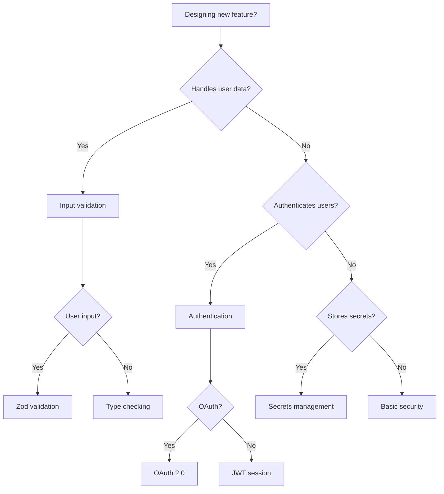

---
slug: secure-by-design
sources:
  - https://owasp.org/
  - https://cwe.mitre.org/
date: 2026-11-02
tags:
  - secure-by-design
  - security
  - design
  - principles
---

# Secure by Design

## Definition

Secure by Design is **a security principle that security is built into the system from the beginning, not added as an afterthought**.

> "Secure by design means that security is built into the system from the beginning, not added as an afterthought." — OWASP

## Problem Addressed

Without secure by design:
- **Security holes**: Security holes are introduced during development
- **Rework**: Security requires significant rework
- **Cost**: Security fixes are expensive
- **Risk**: System is insecure until security is added

## Scope and Boundaries

- Secure by Design ≠ Security Testing (secure by design prevents security issues, security testing finds them)
- Secure by Design = Prevention (secure by design prevents security issues)
- Secure by Design is a **security principle**, not a pattern

## When to Apply

- When building secure systems
- when security is critical
- when security issues are expensive to fix
- when compliance requires secure by design

## Tradeoffs and When to Avoid

| Cost | Description |
|------|-------------|
| **Time** — Secure by design takes more time upfront |
| **Complexity** — Secure by design adds complexity |
| **Expertise**: Requires security expertise |

## Common Misuses

- **Ignoring testing**: Secure by design doesn't eliminate the need for security testing
- **One-time effort**: Secure by design is continuous, not one-time
- **Confusing with security testing**: Secure by design prevents security issues, security testing finds them

## Related Concepts

- [Security Principles](Security/security-principles.md) — Security principles include secure by design
- [Threat Modeling](Security/threat-modeling.md) — Threat modeling supports secure by design
- [Input Validation](Security/input-validation.md) — Input validation is part of secure by design

## Project Observations

- The project uses secure by design:
  - TypeScript supports secure by design through type system
  - Zod supports secure by design through validation
  - The project's architecture patterns note covers security concepts
  - No evidence of secure by design in existing code (src/ is empty)
- File naming conventions support secure by design:
  - `*.schema.ts` — Schema files
  - `*.guard.ts` — Guard files

## Sources

- [[Sources/fowler-patterns-2002|fowler-patterns-2002]]
- [[Sources/react-docs-2026|react-docs-2026]]

---

## Decision Tree: Secure by Design Implementation



### Security Control Selection

| Control | When to Use | Implementation |
|---------|-------------|----------------|
| **Input validation** | All user input | Zod, class-validator |
| **Authentication** | User accounts | JWT, OAuth 2.0 |
| **Authorization** | Protected resources | RBAC, ABAC |
| **Encryption** | Sensitive data | AES-256, TLS |
| **Logging** | Audit trail | Winston, pino |

---

## Procedural Guidance: Secure by Design Implementation

### Step 1: Define Security Requirements

```typescript
// security/security-requirements.ts
export interface SecurityRequirements {
  // Authentication
  authentication: {
    method: 'jwt' | 'oauth' | 'session'
    tokenExpiry: string
    refreshEnabled: boolean
  }

  // Authorization
  authorization: {
    model: 'rbac' | 'abac'
    defaultRole: string
  }

  // Data protection
  dataProtection: {
    encryptSensitiveFields: boolean
    anonymizeLogs: boolean
    dataRetentionDays: number
  }

  // Input validation
  inputValidation: {
    enabled: boolean
    maxStringLength: number
    allowHtml: boolean
  }
}

export const defaultSecurityRequirements: SecurityRequirements = {
  authentication: {
    method: 'jwt',
    tokenExpiry: '24h',
    refreshEnabled: true,
  },
  authorization: {
    model: 'rbac',
    defaultRole: 'user',
  },
  dataProtection: {
    encryptSensitiveFields: true,
    anonymizeLogs: true,
    dataRetentionDays: 90,
  },
  inputValidation: {
    enabled: true,
    maxStringLength: 1000,
    allowHtml: false,
  },
}
```

### Step 2: Implement Input Validation

```typescript
// security/input-validation.ts
import { z } from 'zod'

// User registration schema
export const userRegistrationSchema = z.object({
  email: z.string().email().max(255),
  password: z.string().min(8).max(128),
  name: z.string().min(2).max(100),
})

// User login schema
export const userLoginSchema = z.object({
  email: z.string().email().max(255),
  password: z.string().min(1),
})

// Order creation schema
export const orderCreationSchema = z.object({
  customerId: z.string().uuid(),
  items: z.array(
    z.object({
      productId: z.string().uuid(),
      quantity: z.number().int().positive().max(100),
      price: z.number().positive().max(1000000),
    }),
  ).min(1),
})

// Validate input
export function validateInput<T>(schema: z.ZodSchema<T>, input: unknown): T {
  try {
    return schema.parse(input)
  } catch (error) {
    if (error instanceof z.ZodError) {
      throw new Error(`Validation failed: ${error.errors.map((e) => e.message).join(', ')}`)
    }
    throw error
  }
}
```

### Step 3: Implement Security Middleware

```typescript
// security/security-middleware.ts
import { Request, Response, NextFunction } from 'express'
import helmet from 'helmet'
import rateLimit from 'express-rate-limit'

// Helmet — Set secure headers
export const securityHeaders = helmet()

// Rate limiting
export const rateLimiter = rateLimit({
  windowMs: 15 * 60 * 1000, // 15 minutes
  max: 100, // Limit each IP to 100 requests per window
  message: { error: 'Too many requests, please try again later' },
  standardHeaders: true,
  legacyHeaders: false,
})

// Content security policy
export const contentSecurityPolicy = helmet.contentSecurityPolicy({
  useDefaults: true,
  directives: {
    defaultSrc: ["'self'"],
    scriptSrc: ["'self'"],
    styleSrc: ["'self'", "'unsafe-inline'"],
    imgSrc: ["'self'", 'data:'],
  },
})

// Apply security middleware
export function applySecurityMiddleware(app: any): void {
  app.use(securityHeaders)
  app.use(rateLimiter)
  app.use(contentSecurityPolicy)
}
```

### Step 4: Implement Error Handling

```typescript
// security/error-handler.ts
import { Request, Response, NextFunction } from 'express'

export class AppError extends Error {
  constructor(
    public statusCode: number,
    public message: string,
    public isOperational: boolean = true,
  ) {
    super(message)
  }
}

export function errorHandler(
  err: Error,
  req: Request,
  res: Response,
  next: NextFunction,
): void {
  // Log error (never log sensitive data)
  console.error('Error:', err.message)

  // Operational error (known issue)
  if (err instanceof AppError) {
    res.status(err.statusCode).json({
      status: 'error',
      message: err.message,
    })
    return
  }

  // Programming error (unknown issue)
  res.status(500).json({
    status: 'error',
    message: 'Internal server error',
  })
}

// Usage:
// throw new AppError(404, 'User not found')
// throw new AppError(400, 'Invalid input')
```

### Step 5: Implement Security Testing

```typescript
// tests/security.test.ts
import { describe, it, expect } from 'vitest'
import { validateInput, userRegistrationSchema } from '../security/input-validation'

describe('Security', () => {
  it('should reject invalid email', () => {
    expect(() => validateInput(userRegistrationSchema, {
      email: 'invalid-email',
      password: 'password123',
      name: 'John Doe',
    })).toThrow('Validation failed')
  })

  it('should reject short password', () => {
    expect(() => validateInput(userRegistrationSchema, {
      email: 'john@example.com',
      password: 'short',
      name: 'John Doe',
    })).toThrow('Validation failed')
  })

  it('should accept valid input', () => {
    const result = validateInput(userRegistrationSchema, {
      email: 'john@example.com',
      password: 'password123',
      name: 'John Doe',
    })

    expect(result.email).toBe('john@example.com')
    expect(result.password).toBe('password123')
    expect(result.name).toBe('John Doe')
  })
})
```

---

## Copilot Instructions

### When to Read This Note
- Designing secure applications
- Implementing security controls
- Setting up input validation
- Configuring security middleware
- Writing security tests

### What to Do With This Information
1. **Define requirements**: Document security requirements
2. **Validate input**: Use Zod schemas for all input
3. **Add middleware**: Helmet, rate limiting, CSP
4. **Handle errors**: Use AppError for operational errors
5. **Test security**: Write security tests

### Tools to Use
- **VS Code Extension**: Error Lens — for inline error display
- **npm Package**: `zod` — for validation
- **npm Package**: `helmet` — for security headers
- **npm Package**: `express-rate-limit` — for rate limiting
- **Terminal Command**: `pnpm test` — run tests
- **Terminal Command**: `pnpm audit` — check vulnerabilities

### Agents to Invoke
- **Security Review Agent**: Run when implementing security controls
- **Code Review Agent**: Run when reviewing security changes

### Integration with Other Notes
- read [[secure-defaults]] for secure configuration
- read [input-validation](D/input-validation.md) for input validation
- read [[threat-modeling]] for threat modeling
- read [security-principles](D/security-principles.md) for security principles

### Common Pitfalls
- Don't skip input validation (validate everything)
- Don't hardcode security settings (use configuration)
- Don't ignore rate limiting (protect against brute force)
- Don't log sensitive data (sanitize logs)
- Don't skip security testing (test regularly)

### Quick Validation Checklist
- [ ] Are security requirements defined?
- [ ] Is input validation implemented?
- [ ] Are security headers set?
- [ ] Is rate limiting enabled?
- [ ] Are errors handled securely?
- [ ] Are security tests written?


