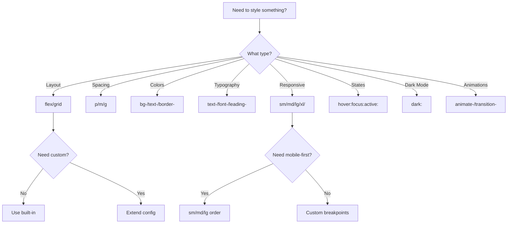

# Tailwind CSS Patterns

## Overview

Tailwind CSS is a utility-first CSS framework for rapidly building custom designs.

---

## 1. Configuration

```javascript
// tailwind.config.js
/** @type {import('tailwindcss').Config} */
export default {
  content: [
    './index.html',
    './src/**/*.{js,ts,jsx,tsx}',
  ],
  theme: {
    extend: {
      colors: {
        primary: {
          50: '#f0f9ff',
          100: '#e0f2fe',
          200: '#bae6fd',
          300: '#7dd3fc',
          400: '#38bdf8',
          500: '#0ea5e9',
          600: '#0284c7',
          700: '#0369a1',
          800: '#075985',
          900: '#0c4a6e',
        },
        secondary: {
          DEFAULT: '#64748b',
          foreground: '#ffffff',
        },
      },
      fontFamily: {
        sans: ['Inter', 'system-ui', 'sans-serif'],
        mono: ['Fira Code', 'monospace'],
      },
      spacing: {
        '72': '18rem',
        '84': '21rem',
        '96': '24rem',
      },
      borderRadius: {
        'xl': '1rem',
        '2xl': '1.5rem',
        '3xl': '2rem',
      },
      boxShadow: {
        'soft': '0 2px 15px -3px rgba(0, 0, 0, 0.07), 0 10px 20px -2px rgba(0, 0, 0, 0.04)',
        'card': '0 4px 6px -1px rgba(0, 0, 0, 0.1), 0 2px 4px -1px rgba(0, 0, 0, 0.06)',
      },
      animation: {
        'fade-in': 'fadeIn 0.3s ease-in-out',
        'slide-up': 'slideUp 0.3s ease-out',
      },
      keyframes: {
        fadeIn: {
          '0%': { opacity: '0' },
          '100%': { opacity: '1' },
        },
        slideUp: {
          '0%': { transform: 'translateY(10px)', opacity: '0' },
          '100%': { transform: 'translateY(0)', opacity: '1' },
        },
      },
    },
  },
  plugins: [
    require('@tailwindcss/forms'),
    require('@tailwindcss/typography'),
  ],
}
```

---

## 2. Component Patterns

### Button Variants

```tsx
interface ButtonProps {
  variant?: 'primary' | 'secondary' | 'ghost' | 'outline'
  size?: 'sm' | 'md' | 'lg'
  children: React.ReactNode
  className?: string
  disabled?: boolean
  onClick?: () => void
}

export function Button({
  variant = 'primary',
  size = 'md',
  children,
  className = '',
  disabled,
  onClick,
}: ButtonProps) {
  const baseClasses = 'inline-flex items-center justify-center font-medium rounded-lg transition-colors focus:outline-none focus:ring-2 focus:ring-offset-2'
  const variantClasses = {
    primary: 'bg-blue-600 text-white hover:bg-blue-700 focus:ring-blue-500 disabled:bg-blue-300',
    secondary: 'bg-gray-200 text-gray-800 hover:bg-gray-300 focus:ring-gray-500 disabled:bg-gray-100',
    ghost: 'text-gray-600 hover:bg-gray-100 focus:ring-gray-500',
    outline: 'border border-gray-300 text-gray-700 hover:bg-gray-50 focus:ring-gray-500',
  }
  const sizeClasses = {
    sm: 'px-3 py-1.5 text-sm',
    md: 'px-4 py-2 text-base',
    lg: 'px-6 py-3 text-lg',
  }

  return (
    <button
      className={`${baseClasses} ${variantClasses[variant]} ${sizeClasses[size]} ${className}`}
      disabled={disabled}
      onClick={onClick}
    >
      {children}
    </button>
  )
}
```

### Card Component

```tsx
interface CardProps {
  title?: string
  description?: string
  image?: string
  children: React.ReactNode
  className?: string
}

export function Card({ title, description, image, children, className = '' }: CardProps) {
  return (
    <div className={`bg-white rounded-xl shadow-card overflow-hidden ${className}`}>
      {image && (
        
      )}
      <div className="p-6">
        {title && <h3 className="text-xl font-semibold mb-2">{title}</h3>}
        {description && <p className="text-gray-600 mb-4">{description}</p>}
        {children}
      </div>
    </div>
  )
}
```

### Form Components

```tsx
interface InputProps {
  label?: string
  type?: string
  value: string
  placeholder?: string
  error?: string
  disabled?: boolean
  onChange: (value: string) => void
}

export function Input({
  label,
  type = 'text',
  value,
  placeholder,
  error,
  disabled,
  onChange,
}: InputProps) {
  return (
    <div className="space-y-1">
      {label && (
        <label className="block text-sm font-medium text-gray-700">
          {label}
        </label>
      )}
      <input
        type={type}
        value={value}
        placeholder={placeholder}
        disabled={disabled}
        onChange={(e) => onChange(e.target.value)}
        className={`w-full rounded-lg border px-3 py-2 transition-colors
          ${error
            ? 'border-red-500 focus:border-red-500 focus:ring-red-500'
            : 'border-gray-300 focus:border-blue-500 focus:ring-blue-500'
          }
          focus:outline-none focus:ring-2 disabled:bg-gray-100 disabled:cursor-not-allowed`}
      />
      {error && <p className="text-sm text-red-500">{error}</p>}
    </div>
  )
}
```

---

## 3. Responsive Design

```tsx
// Mobile-first responsive classes
export function ResponsiveGrid() {
  return (
    <div className="grid grid-cols-1 sm:grid-cols-2 md:grid-cols-3 lg:grid-cols-4 gap-4">
      {/* 1 column on mobile, 2 on small, 3 on medium, 4 on large */}
      {[1, 2, 3, 4].map(i => (
        <div key={i} className="p-4 bg-white rounded-lg shadow">
          Item {i}
        </div>
      ))}
    </div>
  )
}

// Responsive spacing
export function ResponsiveSpacing() {
  return (
    <div className="p-4 sm:p-6 md:p-8 lg:p-12">
      <h1 className="text-xl sm:text-2xl md:text-3xl lg:text-4xl">
        Responsive Heading
      </h1>
    </div>
  )
}
```

---

## 4. Dark Mode

```javascript
// tailwind.config.js
export default {
  darkMode: 'class',  // or 'media'
  // ...
}
```

```tsx
export function ThemeToggle() {
  const [isDark, setIsDark] = useState(false)

  useEffect(() => {
    document.documentElement.classList.toggle('dark', isDark)
  }, [isDark])

  return (
    <button
      onClick={() => setIsDark(!isDark)}
      className="p-2 rounded-lg bg-gray-200 dark:bg-gray-700"
    >
      {isDark ? '☀️' : '🌙'}
    </button>
  )
}

// Dark mode colors
export function ThemedCard() {
  return (
    <div className="bg-white dark:bg-gray-800 text-gray-900 dark:text-white rounded-lg p-4">
      <h3 className="font-semibold">Themed Card</h3>
      <p className="text-gray-600 dark:text-gray-300">
        Adapts to dark mode
      </p>
    </div>
  )
}
```

---

## 5. Animations

```tsx
export function AnimatedCard() {
  return (
    <div className="animate-slide-up bg-white rounded-lg p-4 shadow-card">
      <h3>Animated Card</h3>
    </div>
  )
}

// Hover effects
export function HoverCard() {
  return (
    <div className="group relative bg-white rounded-lg shadow-card overflow-hidden">
      
      <div className="p-4 opacity-0 group-hover:opacity-100 transition-opacity">
        <h3>Hover to reveal</h3>
      </div>
    </div>
  )
}

// Transition utilities
export function TransitionButton() {
  return (
    <button className="bg-blue-600 text-white px-4 py-2 rounded-lg
      transition-all duration-200 ease-in-out
      hover:bg-blue-700 hover:shadow-lg
      active:scale-95
      focus:outline-none focus:ring-2 focus:ring-blue-500">
      Click me
    </button>
  )
}
```

---

## 6. Best Practices

### Extract Reusable Components

```tsx
// ❌ Inline everything
<div className="bg-white rounded-lg shadow-card p-6">
  <h3 className="text-xl font-semibold mb-2">Title</h3>
  <p className="text-gray-600">Content</p>
</div>

// ✅ Extract to component
<Card title="Title" description="Content" />
```

### Use Arbitrary Values Sparingly

```tsx
// ❌ Overuse arbitrary values
<div className="w-[327px] h-[184px] p-[13px]">

// ✅ Use scale or define in config
<div className="w-80 h-44 p-3">
```

### Group Related Utilities

```tsx
// Group by concern
<div className="
  /* Layout */
  flex items-center justify-between
  /* Spacing */
  gap-4 p-6
  /* Typography */
  text-lg font-medium
  /* Colors */
  bg-white text-gray-900
  /* Borders */
  border border-gray-200 rounded-lg
  /* Shadows */
  shadow-card
  /* Responsive */
  sm:p-8 md:text-xl
  /* States */
  hover:shadow-lg focus:outline-none focus:ring-2 focus:ring-blue-500
  /* Transitions */
  transition-all duration-200
">
  Content
</div>
```

---

## Cross-References

- [React Patterns](../React/react-patterns)
- [TypeScript Strict Mode](../TypeScript/typescript-strict-mode.md)
- [Cascading Stylesheets](../Cascading Stylesheets/css-fundamentals.md)
- [CSS Media Queries](../Cascading Stylesheets/css-media-queries.md) — Media types, features, container queries

## Sources

- [[Sources/tailwind-docs-2024|tailwind-docs-2024]]

---

## Decision Tree: Tailwind CSS Patterns



### When to Use Each Tailwind Pattern

| Pattern | When to Use | Example |
|---------|-------------|---------|
| **Utility Classes** | Most styling needs | `flex items-center justify-between` |
| **Arbitrary Values** | One-off values | `w-[327px]` |
| **Extended Config** | Repeated custom values | `colors.primary.500` |
| **Component Classes** | Reusable component styles | `@apply` in CSS |
| **Variant Prefixes** | State-specific styles | `hover:bg-blue-500` |

---

## Procedural Guidance: Tailwind CSS Setup

### Step 1: Install and Configure

```bash
# Install Tailwind CSS
pnpm add -D tailwindcss postcss autoprefixer
pnpm tailwindcss init
```

```javascript
// tailwind.config.js
/** @type {import('tailwindcss').Config} */
export default {
  content: [
    './index.html',
    './src/**/*.{js,ts,jsx,tsx}',
  ],
  theme: {
    extend: {
      colors: {
        primary: {
          50: '#f0f9ff',
          100: '#e0f2fe',
          500: '#0ea5e9',
          900: '#0c4a6e',
        },
      },
      fontFamily: {
        sans: ['Inter', 'system-ui', 'sans-serif'],
      },
    },
  },
  plugins: [
    require('@tailwindcss/forms'),
    require('@tailwindcss/typography'),
  ],
}
```

### Step 2: Add to CSS

```css
/* src/index.css */
@tailwind base;
@tailwind components;
@tailwind utilities;

@layer components {
  .btn-primary {
    @apply bg-blue-500 text-white px-4 py-2 rounded-lg hover:bg-blue-600 transition-colors;
  }
}
```

### Step 3: Use in Components

```tsx
// src/components/Button.tsx
export function Button({ children, variant = 'primary' }) {
  const classes = variant === 'primary'
    ? 'bg-blue-500 text-white px-4 py-2 rounded-lg hover:bg-blue-600'
    : 'bg-gray-200 text-gray-800 px-4 py-2 rounded-lg hover:bg-gray-300'

  return <button className={classes}>{children}</button>
}
```

### Step 4: Responsive Design

```tsx
// Mobile-first responsive
<div className="
  grid grid-cols-1
  sm:grid-cols-2
  md:grid-cols-3
  lg:grid-cols-4
  gap-4
">
  {/* Cards */}
</div>
```

### Step 5: Dark Mode

```tsx
// Dark mode with class strategy
<div className="bg-white dark:bg-gray-900 text-gray-900 dark:text-white">
  {/* Content */}
</div>
```

---

## Copilot Instructions

### When to Read This Note
- Styling React components with Tailwind
- Setting up Tailwind configuration
- Creating responsive layouts
- Implementing dark mode
- Building design systems with Tailwind

### What to Do With This Information
1. **Use utility classes**: Prefer Tailwind utilities over custom CSS
2. **Extend config**: Define custom colors/fonts in tailwind.config.js
3. **Mobile-first**: Start with mobile styles, add breakpoints for larger screens
4. **Group utilities**: Organize by concern (layout, spacing, typography, colors)
5. **Use variants**: Leverage hover:, focus:, dark: prefixes for states

### Tools to Use
- **VS Code Extension**: Tailwind CSS IntelliSense — for autocomplete and preview
- **VS Code Extension**: Error Lens — for inline Tailwind error display
- **npm Package**: `@tailwindcss/forms` — for form element styling
- **npm Package**: `@tailwindcss/typography` — for prose typography
- **Terminal Command**: `pnpm tailwindcss -o dist/tailwind.css --watch` — watch for changes
- **Terminal Command**: `pnpm tailwindcss -i src/index.css -o dist/output.css` — build CSS

### Agents to Invoke
- **Code Review Agent**: Run when reviewing PRs with Tailwind changes
- **Performance Review Agent**: Run when optimizing CSS bundle size

### Integration with Other Notes
- Read [[Cascading Stylesheets/css-fundamentals]] for CSS fundamentals
- Read [css-media-queries](D/css-media-queries.md) for media query patterns
- read [[tw-optimization-performance]] for Tailwind optimization
- Read [[ShadCN/shadcn-ui-patterns]] for shadcn/ui component patterns

### Common Pitfalls
- Don't use arbitrary values for repeated patterns (extend config instead)
- Don't mix Tailwind with custom CSS unnecessarily
- Don't forget responsive prefixes (always test mobile first)
- Don't overuse !important (use specificity instead)
- Don't ignore dark mode (add dark: variants from the start)

### Quick Validation Checklist
- [ ] Are utilities organized by concern?
- [ ] Are responsive breakpoints mobile-first?
- [ ] Are custom colors/fonts in tailwind.config.js?
- [ ] Are dark mode variants added where needed?
- [ ] Are hover/focus states implemented?
- [ ] Is the CSS bundle optimized (purge unused)?
- [[Sources/mdn-css-2024|mdn-css-2024]]


## See Also
- [[TC02-tw-optimization-performance]]


