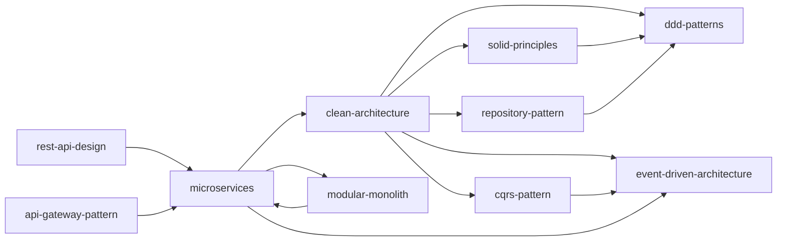
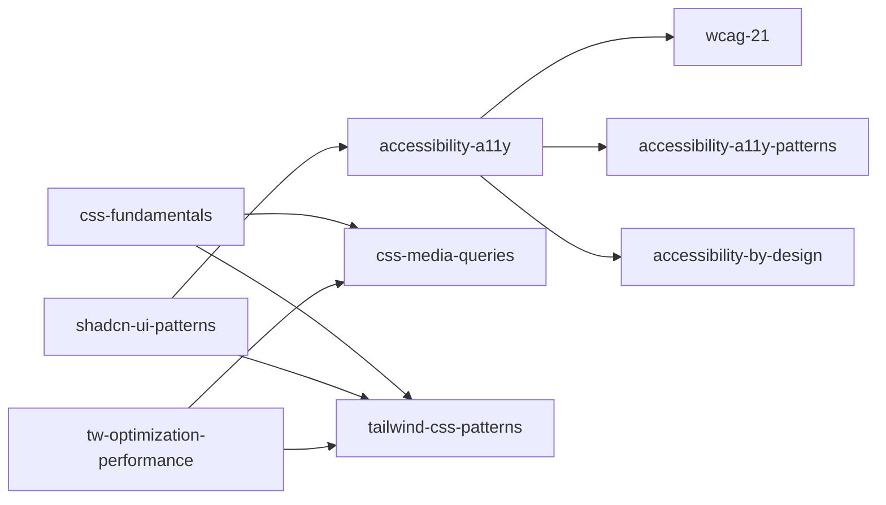
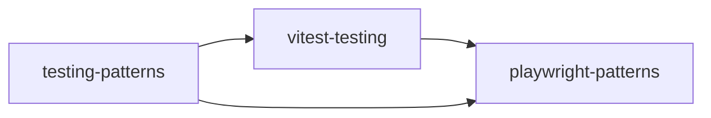
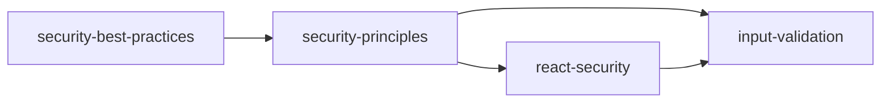
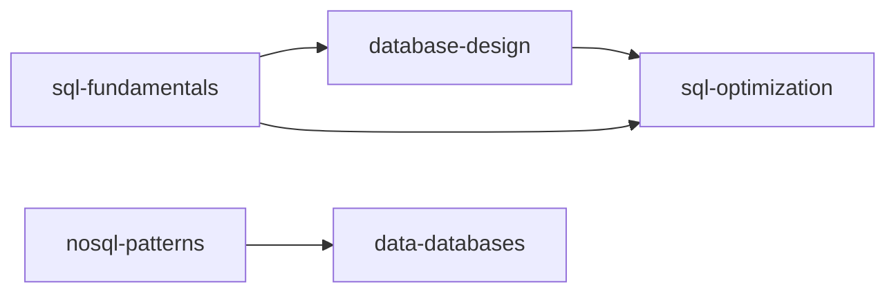
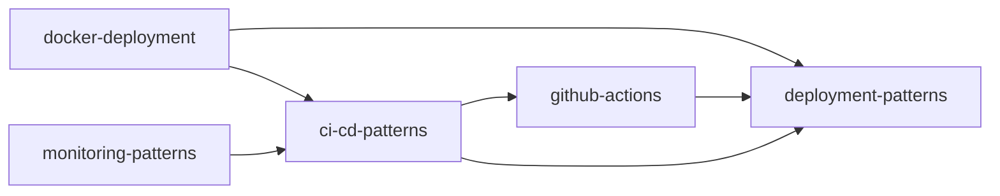
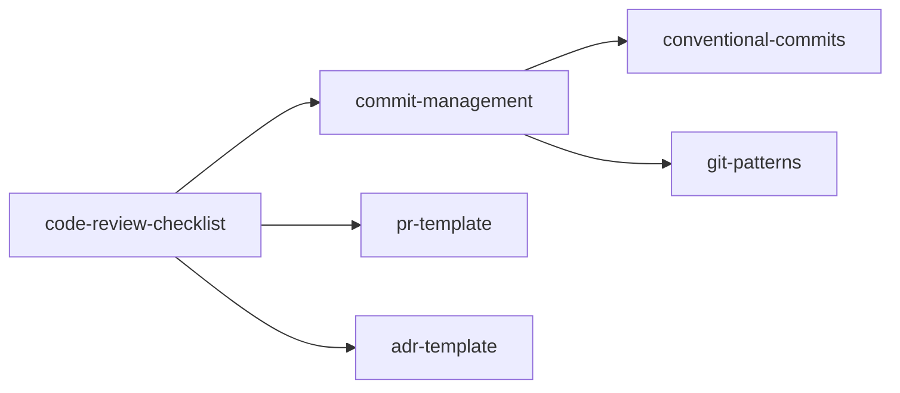
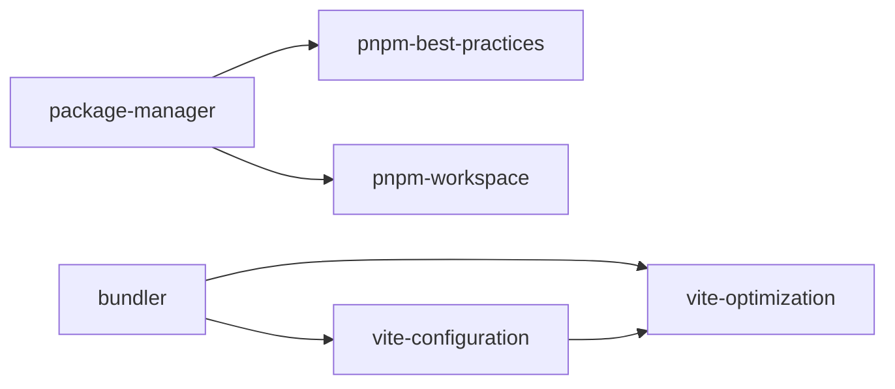
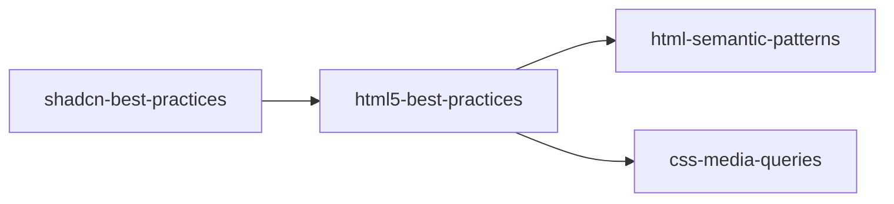
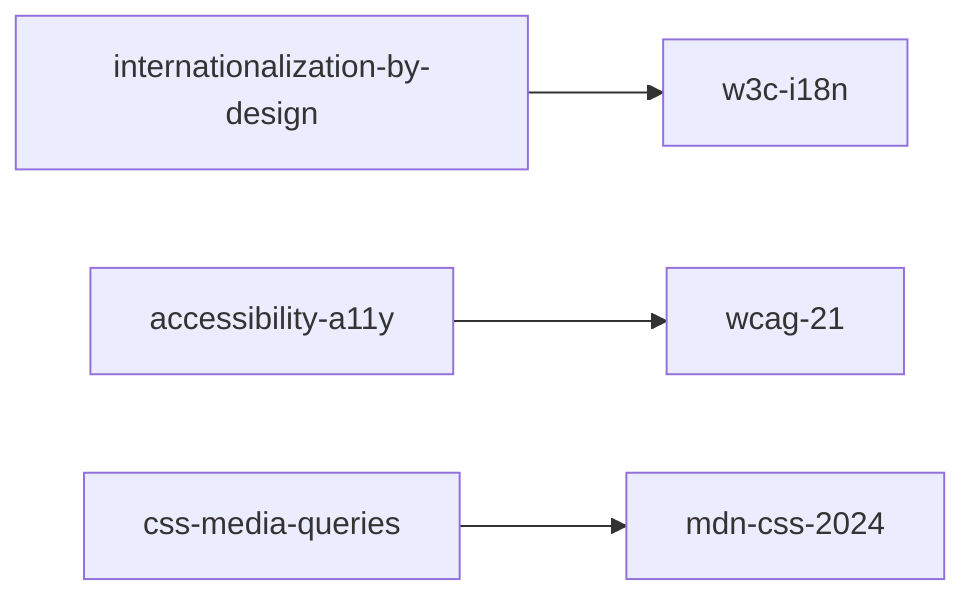

# Vault Integration Map

## Purpose

This document maps how all notes in the vault connect to each other, showing dependencies, relationships, and navigation paths. Use this to understand the knowledge graph and navigate efficiently.

---

## Core Architecture Layer



### Architecture Notes (12 notes)

| Note | Connects To | Referenced By |
|------|-------------|---------------|
| `clean-architecture` | solid-principles, ddd-patterns, cqrs-pattern, event-driven-architecture | modular-monolith, microservices, project-structure-mapping |
| `solid-principles` | clean-architecture, ddd-patterns | clean-architecture, ddd-patterns, code-review-checklist |
| `ddd-patterns` | clean-architecture, solid-principles, cqrs-pattern | clean-architecture, microservices, project-structure-mapping |
| `cqrs-pattern` | ddd-patterns, event-driven-architecture | clean-architecture, project-structure-mapping |
| `event-driven-architecture` | cqrs-pattern, microservices | microservices, cqrs-pattern |
| `microservices` | clean-architecture, modular-monolith, event-driven-architecture | modular-monolith, rest-api-design |
| `modular-monolith` | microservices, clean-architecture | microservices |
| `rest-api-design` | microservices, api-gateway-pattern | project-structure-mapping |
| `repository-pattern` | ddd-patterns, clean-architecture | ddd-patterns, project-structure-mapping |
| `api-gateway-pattern` | rest-api-design, microservices | microservices |
| `react-security` | security-principles, input-validation | code-review-checklist |
| `react-performance-security` | performance-optimization, vite-optimization | code-review-checklist |

---

## Frontend/UI Layer



### Frontend Notes (8 notes)

| Note | Connects To | Referenced By |
|------|-------------|---------------|
| `accessibility-a11y` | wcag-21, accessibility-a11y-patterns, accessibility-by-design | polling-platform-requirements |
| `accessibility-a11y-patterns` | wcag-21, accessibility-a11y | shadcn-ui-patterns, accessibility-by-design |
| `accessibility-by-design` | wcag-21, accessibility-a11y-patterns | polling-platform-requirements |
| `css-fundamentals` | mdn-css-2024, css-media-queries | tailwind-css-patterns, tw-optimization-performance |
| `css-media-queries` | mdn-css-2024 | css-fundamentals, tailwind-css-patterns, tw-optimization-performance, html5-best-practices |
| `tailwind-css-patterns` | tailwind-docs-2024, mdn-css-2024, css-media-queries | tw-optimization-performance, shadcn-ui-patterns |
| `tw-optimization-performance` | tailwind-docs-2024, mdn-css-2024, css-media-queries | tailwind-css-patterns |
| `shadcn-ui-patterns` | radix-ui-docs-2024, wcag-21, tailwind-css-patterns, accessibility-a11y-patterns | code-review-checklist |

---

## Testing Layer



### Testing Notes (3 notes)

| Note | Connects To | Referenced By |
|------|-------------|---------------|
| `vitest-testing` | playwright-patterns | testing-patterns, react-performance-security |
| `playwright-patterns` | vitest-testing | react-performance-security, vitest-testing |
| `testing-patterns` | vitest-testing, playwright-patterns | — |

---

## Security Layer



### Security Notes (4 notes)

| Note | Connects To | Referenced By |
|------|-------------|---------------|
| `security-principles` | react-security, input-validation | react-security, code-review-checklist |
| `react-security` | security-principles, input-validation | code-review-checklist |
| `input-validation` | security-principles, react-security | react-security, code-review-checklist |
| `security-best-practices` | security-principles | code-review-checklist |

---

## Data Layer



### Data Notes (5 notes)

| Note | Connects To | Referenced By |
|------|-------------|---------------|
| `sql-fundamentals` | database-design, sql-optimization | code-review-checklist |
| `database-design` | sql-fundamentals, sql-optimization | sql-fundamentals |
| `sql-optimization` | sql-fundamentals, database-design | sql-fundamentals |
| `nosql-patterns` | data-databases | code-review-checklist |
| `data-databases` | nosql-patterns | nosql-patterns |

---

## DevOps/Infrastructure Layer



### DevOps Notes (8 notes)

| Note | Connects To | Referenced By |
|------|-------------|---------------|
| `ci-cd-patterns` | github-actions, deployment-patterns, docker-deployment | code-review-checklist |
| `github-actions` | ci-cd-patterns, deployment-patterns | ci-cd-patterns |
| `deployment-patterns` | ci-cd-patterns, docker-deployment | ci-cd-patterns |
| `docker-deployment` | ci-cd-patterns, deployment-patterns | ci-cd-patterns |
| `monitoring-patterns` | ci-cd-patterns | code-review-checklist |
| `logging-patterns` | monitoring-patterns | code-review-checklist |
| `nginx-patterns` | deployment-patterns | code-review-checklist |
| `vite-configuration` | vite-optimization | code-review-checklist |

---

## Quality/Process Layer



### Quality Notes (6 notes)

| Note | Connects To | Referenced By |
|------|-------------|---------------|
| `commit-management` | conventional-commits, git-patterns | code-review-checklist |
| `conventional-commits` | commit-management, git-patterns | commit-management |
| `git-patterns` | commit-management, conventional-commits | commit-management |
| `code-review-checklist` | commit-management, pr-template, adr-template | — (template) |
| `pr-template` | code-review-checklist | — (template) |
| `adr-template` | code-review-checklist | — (template) |

---

## Package/Build Layer



### Package/Build Notes (5 notes)

| Note | Connects To | Referenced By |
|------|-------------|---------------|
| `package-manager` | pnpm-best-practices, pnpm-workspace | code-review-checklist |
| `pnpm-best-practices` | package-manager, pnpm-workspace | package-manager |
| `pnpm-workspace` | package-manager, pnpm-best-practices | package-manager |
| `bundler` | vite-configuration, vite-optimization | code-review-checklist |
| `vite-configuration` | bundler, vite-optimization | vite-optimization, code-review-checklist |

---

## HTML/Content Layer



### HTML Notes (4 notes)

| Note | Connects To | Referenced By |
|------|-------------|---------------|
| `html5-best-practices` | mdn-html-2024, html-semantic-patterns, css-media-queries | shadcn-best-practices, code-review-checklist |
| `html-semantic-patterns` | html5-best-practices | html5-best-practices |
| `shadcn-best-practices` | html5-best-practices, shadcn-ui-patterns | code-review-checklist |
| `seo-best-practices` | html5-best-practices | code-review-checklist |

---

## Internationalization/Accessibility Layer



### i18n/a11y Notes (3 notes)

| Note | Connects To | Referenced By |
|------|-------------|---------------|
| `internationalization-by-design` | w3c-i18n | polling-platform-requirements |
| `accessibility-a11y` | wcag-21, accessibility-a11y-patterns, accessibility-by-design | polling-platform-requirements |
| `css-media-queries` | mdn-css-2024 | css-fundamentals, tailwind-css-patterns, tw-optimization-performance, html5-best-practices |

---

## Sources Layer (42 source notes)

### Primary Sources (referenced by 3+ notes)

| Source | Referenced By | Count |
|--------|---------------|-------|
| `wcag-21` | accessibility-a11y, accessibility-a11y-patterns, accessibility-by-design, shadcn-ui-patterns | 4 |
| `w3c-i18n` | internationalization-by-design, polling-platform-requirements | 2 |
| `css-media-queries` | css-fundamentals, tailwind-css-patterns, tw-optimization-performance, html5-best-practices | 4 |
| `mdn-css-2024` | css-fundamentals, tailwind-css-patterns, tw-optimization-performance | 3 |
| `tailwind-docs-2024` | tailwind-css-patterns, tw-optimization-performance | 2 |
| `mdn-html-2024` | html5-best-practices | 1 |
| `radix-ui-docs-2024` | shadcn-ui-patterns | 1 |

### Secondary Sources (referenced by 1-2 notes)

| Source | Referenced By | Count |
|--------|---------------|-------|
| `fowler-patterns-2002` | modular-monolith | 1 |
| `martinfowler-microservices` | microservices | 1 |
| `cleancoder-clean-architecture` | clean-architecture | 1 |
| `martin-srp-2014` | solid-principles | 1 |
| `booch-ddd` | ddd-patterns | 1 |
| `microsoft-azure` | microservices | 1 |

### Unused Sources (20 files — not referenced by any note)

These source files exist but are not cited by any note. They may be:
- Reference material for future notes
- Ingestion artifacts not yet processed
- Candidates for deletion if no longer needed

---

## Cross-Layer Dependencies

### Inward-Only Rule (Clean Architecture)

```
┌─────────────────────────────────────────────────────┐
│  Sources Layer (42 notes) — Outermost               │
│  └─ Referenced by all other layers                  │
├─────────────────────────────────────────────────────┤
│  Templates Layer (5 notes) — Outermost              │
│  └─ Used by code-review-checklist                   │
├─────────────────────────────────────────────────────┤
│  DevOps / Package / Quality Layers                  │
│  └─ Support the build process                       │
├─────────────────────────────────────────────────────┤
│  Data / Testing Layers                              │
│  └─ Support application functionality               │
├─────────────────────────────────────────────────────┤
│  Security / i18n / a11y Layers                      │
│  └─ Cross-cutting concerns                          │
├─────────────────────────────────────────────────────┤
│  Frontend / HTML Layers                             │
│  └─ User-facing implementation                      │
├─────────────────────────────────────────────────────┤
│  Architecture Layer (12 notes) — Innermost          │
│  └─ Core business rules & patterns                  │
└─────────────────────────────────────────────────────┘
```

---

## Navigation Guide

### "I want to learn about X" → Read Y

| Goal | Start With | Then Read |
|------|------------|-----------|
| Architecture patterns | `clean-architecture` | `solid-principles`, `ddd-patterns` |
| Microservices | `microservices` | `modular-monolith`, `event-driven-architecture` |
| Testing | `vitest-testing` | `playwright-patterns` |
| Security | `security-principles` | `react-security`, `input-validation` |
| CSS/Tailwind | `css-fundamentals` | `tailwind-css-patterns`, `css-media-queries` |
| Accessibility | `accessibility-a11y` | `accessibility-a11y-patterns`, `wcag-21` |
| i18n | `internationalization-by-design` | `w3c-i18n` |
| DevOps | `ci-cd-patterns` | `github-actions`, `docker-deployment` |
| Git/Commits | `commit-management` | `conventional-commits`, `git-patterns` |
| Build/Package | `bundler` | `vite-configuration`, `pnpm-best-practices` |
| Data/DB | `sql-fundamentals` | `database-design`, `sql-optimization` |
| Templates | `templates/README` | `adr-template`, `code-review-checklist` |

---

## Copilot Instructions

### When to Read This Note
- Navigating the vault for the first time
- Looking for related notes on a topic
- Understanding how concepts connect
- Deciding which notes to read first

### What to Do With This Information
1. **Start with the Architecture Layer** for core patterns
2. **Follow the "I want to learn about X" table** for topic-specific navigation
3. **Check cross-references** in each note for deeper connections
4. **Use the Mermaid diagrams** to visualize dependencies

### Integration with Other Notes
- Read `00-architecture-index` for a categorized list of all notes
- Read `Research-Status` for research progress tracking
- Read individual note Copilot Instructions for topic-specific guidance
